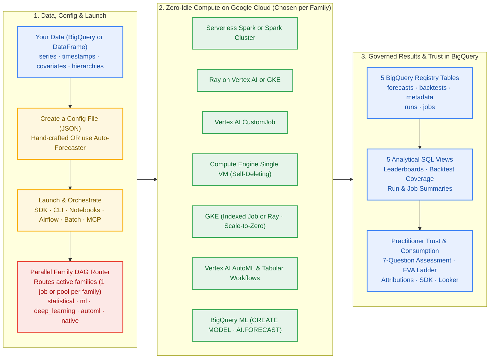

# scale-forecasting

**Enterprise time-series forecasting on Google Cloud — from 10 series on a laptop to 100,000+ in BigQuery, with one JSON configuration and no idle compute.**

[](https://pypi.org/project/scale-forecasting/)
[](https://console.cloud.google.com/vertex-ai/colab/import/https%3A%2F%2Fraw.githubusercontent.com%2Fstatmike%2Fscale-forecasting%2Fmain%2Fnotebooks%2F00_model_playground.ipynb)
[](https://ssh.cloud.google.com/cloudshell/editor?cloudshell_git_repo=https://github.com/statmike/scale-forecasting&cloudshell_tutorial=cloudshell_tutorial.md)
[](https://statmike.github.io/scale-forecasting/)
[](https://github.com/statmike/scale-forecasting/blob/main/docs/getting_started.md)
[](https://github.com/statmike/scale-forecasting/blob/main/docs/agent_and_mcp_guide.md)
[](https://github.com/statmike/scale-forecasting/blob/main/docs/workshop.md)
[](https://github.com/statmike/scale-forecasting/blob/main/terraform/README.md)
[](https://github.com/statmike/scale-forecasting/blob/main/LICENSE)

`37 models` · `5 families` · `21 evaluation metrics` · `7 Google Cloud runtimes` · `5 Analytical SQL Views` · `validated at 100k series`



---

## What you just found

You describe *what* to forecast in one JSON file — the BigQuery table, the horizon, the models, the covariates, and the evaluation metrics. `scale-forecasting` decides *how*: it splits active models into up to five family jobs, dispatches each family in parallel to the Google Cloud runtime you chose for it, scores every model with rolling-origin backtesting and conformal prediction intervals, blends the winners into ensembles, reconciles hierarchical trees, and streams forecasts, leaderboards, and feature attributions back to BigQuery. When the run ends, the compute is gone.

- **Use `scale-forecasting` when** you want to evaluate or operate multiple model families (statistical, gradient-boosted trees, PyTorch deep learning & open-weight foundation models, Vertex AI AutoML, and BigQuery ML) under one schema, one backtest contract, and one BigQuery leaderboard — from a handful of series to 100,000+.
- **Use a simpler path when** a single SQL query (`AI.FORECAST` or `ARIMA_PLUS` directly in BigQuery) already answers the question; you can still adopt `scale-forecasting` later to benchmark that SQL baseline against 35 Python and AutoML models on the same holdout folds.

---

## Three ways to start

### Journey 1 — Try it locally in 5 minutes (no cloud, no credentials)

Install the pure offline package (or clone the repo and run `uv sync`) to fit models, run backtests, and inspect metrics in memory on your machine:

```bash
pip install scale-forecasting
python -m scale_forecasting.playground --list
python -m scale_forecasting.playground --model theta --backtest --horizon 14
```

```python
import scale_forecasting as sf
from scale_forecasting import playground

result = playground.run_one(model="theta", horizon=14, backtest=True)
auto_run = sf.Forecaster.auto(playground.sample_data(n_series=3), tier="first_light", autofocus=True)
plan = sf.Forecaster.from_file("configs/ensemble_demo.json").dry_run()
print(result.metrics["wape"], auto_run.leaderboard_df().iloc[0]["model_type"], plan.run_id)
```

Continue in [`notebooks/00_model_playground.ipynb`](https://github.com/statmike/scale-forecasting/blob/main/notebooks/00_model_playground.ipynb), [`notebooks/11_auto_forecaster_and_autofocus.ipynb`](https://github.com/statmike/scale-forecasting/blob/main/notebooks/11_auto_forecaster_and_autofocus.ipynb), [Auto-forecaster & `autofocus` (`docs/auto_forecaster.md`)](https://github.com/statmike/scale-forecasting/blob/main/docs/auto_forecaster.md), or [Getting started (`docs/getting_started.md`)](https://github.com/statmike/scale-forecasting/blob/main/docs/getting_started.md).

### Journey 2 — Deploy to your Google Cloud project in 15 minutes

Provision the BigQuery dataset, Cloud Storage buckets, least-privilege service accounts, VPC networking, container image, Colab Enterprise runtime template, and 100,000-series seed dataset with two Terraform stages:

```bash
cd terraform/bootstrap && terraform init
terraform apply -var="project_id=YOUR_PROJECT_ID" -var="billing_account=YOUR_BILLING_ID"

cd ../main && terraform init
terraform apply -var="project_id=YOUR_PROJECT_ID"
```

> **Estimated cost & ongoing services:** One-time provisioning (Cloud Build image build + Dataproc Serverless 100k seed batch) costs an estimated **~\$0.15–\$0.50**. At rest, datasets, buckets, VPC networking, and service accounts have no running compute cost (only standard Cloud Storage and BigQuery storage rates for stored bytes). Forecast runs bill only while batches, VMs, pods, or queries execute. **Always-on disclosure:** Cloud Composer 3 (`create_composer = false` by default) and standing GKE clusters incur continuous hourly charges while provisioned. See [`docs/deploying_on_gcp.md`](https://github.com/statmike/scale-forecasting/blob/main/docs/deploying_on_gcp.md) and [`terraform/README.md`](https://github.com/statmike/scale-forecasting/blob/main/terraform/README.md).

### Journey 3 — Run 100,000+ series on Google Cloud

Launch any declarative configuration from the CLI, Python SDK, or a generated Cloud Composer 3 DAG:

```bash
# Run directly from the CLI or stage native gcloud / kubectl / bq / ray commands
python -m scale_forecasting.main --config configs/ensemble_demo.json
python -m scale_forecasting.main --config configs/spark_serverless_100k.json --emit-airflow dags/sf_100k.py
```

Full operator loop: [Running and reviewing (`docs/running_and_reviewing.md`)](https://github.com/statmike/scale-forecasting/blob/main/docs/running_and_reviewing.md) and [Platform overview (`docs/overview.md`)](https://github.com/statmike/scale-forecasting/blob/main/docs/overview.md).

---

## AI agents, portable skills & built-in MCP server

`scale-forecasting` is ready out of the box for **Google Antigravity (`agy` CLI & IDE)**, **Claude Code**, **Cursor**, **VS Code Copilot**, and **Windsurf** — shipping a **portable [`SKILL.md`](https://github.com/statmike/scale-forecasting/blob/main/skills/scale-forecasting/SKILL.md)** (auto-discovered via [`.agents/skills.json`](https://github.com/statmike/scale-forecasting/blob/main/.agents/skills.json)), an **Antigravity [`plugin.json`](https://github.com/statmike/scale-forecasting/blob/main/plugin.json) + [`mcp_config.json`](https://github.com/statmike/scale-forecasting/blob/main/mcp_config.json)**, a **built-in MCP server (`python -m scale_forecasting.mcp`)**, a **Draft 2020-12 [`RunConfig` JSON Schema](https://github.com/statmike/scale-forecasting/blob/main/docs/schemas/run_config.schema.json)**, and **[`llms.txt`](https://github.com/statmike/scale-forecasting/blob/main/docs/llms.txt) / [`llms-full.txt`](https://github.com/statmike/scale-forecasting/blob/main/docs/llms-full.txt)** compiled directly from code (`make agent-surfaces`):

```bash
# Probe installed extras, available models, and SF_* readiness:
python -m scale_forecasting.agent_surfaces --probe-env

# Launch Google Antigravity CLI (auto-discovers .agents/skills/ & AGENTS.md) or register MCP:
agy
claude mcp add scale-forecasting -- python3 -m scale_forecasting.mcp
```

Full setup and architectural guide: **[AI Agents, Portable Skills & Built-in MCP Server (`docs/agent_and_mcp_guide.md`)](https://github.com/statmike/scale-forecasting/blob/main/docs/agent_and_mcp_guide.md)**.

---

## One configuration, every engine

Every run is a validated [`RunConfig`](https://github.com/statmike/scale-forecasting/blob/main/docs/configuration_reference.md) (such as [`configs/ensemble_demo.json`](https://github.com/statmike/scale-forecasting/blob/main/configs/ensemble_demo.json)). To move a model family between Dataproc Serverless, Ray, Vertex AI CustomJob, Compute Engine, or GKE, change `compute.families.<family>.runtime` — nothing else:

```json
{
  "run_name": "hybrid_stacked_ensemble",
  "data": {"source_table": "source_series_iceberg", "series_limit": 100, "horizon": 14},
  "models": ["theta", "holtwinters", "xgboost", "arima_plus"],
  "compute": {
    "families": {
      "statistical": {"runtime": "spark"},
      "ml": {"runtime": "spark"}
    }
  },
  "backtest": {"enabled": true, "scheme": "expanding", "n_folds": 3, "decision_metric": "wape"},
  "ensemble": {"enabled": true, "strategies": ["mean", "inverse_error", "nnls", "xgb"]}
}
```

---

## Write a `RunConfig` by hand — or let the Glass-Box Auto-Forecaster compile & refine it

You can always author a [`RunConfig`](https://github.com/statmike/scale-forecasting/blob/main/docs/configuration_reference.md) JSON file directly and run it with any method in this repository. Or, when starting on a new dataset, let **`Forecaster.build_config()`** and **`Forecaster.auto()`** profile your data (`Forecaster.profile_data()`), compile a standard `RunConfig` across **4 exposure tiers** (`first_light`, `wide_field`, `deep_sky`, `deep_field`), optionally refine it with multi-branch **`autofocus`**, and answer the 7 core questions every forecaster asks (`f.practitioner_assessment_df()`, `f.compare_models()`):

| What Forecasters Care About | Manual Trial-and-Error | Typical Black-Box AutoML | `scale-forecasting` Glass-Box Auto-Forecaster & `autofocus` |
| :--- | :--- | :--- | :--- |
| **Transparency & ownership** | Full control, but days of hand-tuning JSON/code across model families. | Swallows your data and hides *why* models or features were picked. | **100% glass-box:** Prints a plain-English rationale table (`bp.explain()`) and saves a standard, editable `RunConfig` JSON you own (`--init-config`). |
| **User constraints (`[PINNED]`)** | You wire every constraint and fallback by hand. | Take-it-or-leave-it automation; hard to lock specific families or metrics. | **Pin any dial:** Lock `allowed_families`, `models`, `decision_metric`, `n_folds`, `hpo`, `ensemble`, or `max_minutes`; `autofocus` optimizes strictly around your pins. |
| **Compute & scale awareness (`n_series`)** | You manually size VMs, GPUs, and worker pools for 10 vs. 100k series. | Assumes a single Python machine or a single fixed cluster. | **Co-designs models + 7 cloud runtimes:** Adapts portfolios from `micro` (`<15` series) to `hyperscale` (`25,000+` series) across `local`, `bigquery`, `spark`, `ray`, `vertex`, `gce`, and `gke`. |
| **Iterative learning & compute reuse** | Re-running a tweak refits every model from scratch. | Runs a single fixed pipeline or brute-forces everything upfront. | **Multi-branch `autofocus` DAG + cell borrowing:** Tests isolated upgrades (`2A` scale/outliers, `2B` feature pruning/horizon, `2C` intermittent/hierarchy/stockouts), **borrows Pass 1's finished models**, and guarantees non-degradation via the **Champion Ratchet**. |
| **"Earn your complexity" proof** | Easy to overfit noisy features without noticing a simple model was better. | Often crowns a heavy model without proving lift over simple baselines. | **4-anchor Baseline Ladder & 7-Question Assessment:** Benchmarks against seasonal naive, plain univariate (`theta`), and dual-mode foundation baselines (`@univariate` vs. `@global_cov_all`). If a simple univariate model wins, it becomes champion and lists the complex models it beat (`f.baseline_value_df()`, `f.practitioner_assessment_df()`). |
| **How the policy was built** | Individual intuition and ad-hoc rules of thumb. | Fixed vendor heuristics or slow, costly runtime LLM calls. | **Evolved with AlphaEvolve on Gemini Enterprise (`26.08 -> 74.82` fitness across 20 synthetic DGPs + 9 public benchmarks)** and compiled into deterministic pure Python (**zero LLM calls at runtime**), plus opt-in runtime `# EVOLVE-BLOCK` evolution via `Forecaster.evolve()` (`backend="alphaevolve"` on Gemini Enterprise or `backend="vertex_gemini"` backup) under a 3-Gate Anti-Overfitting Ratchet. |

Full guide and interactive notebook: **[Glass-Box Auto-Forecaster & `autofocus` (`docs/auto_forecaster.md`)](https://github.com/statmike/scale-forecasting/blob/main/docs/auto_forecaster.md)**, **[AlphaEvolve Runtime Harness (`docs/alphaevolve_runner.md`)](https://github.com/statmike/scale-forecasting/blob/main/docs/alphaevolve_runner.md)**, and **[`notebooks/11_auto_forecaster_and_autofocus.ipynb`](https://github.com/statmike/scale-forecasting/blob/main/notebooks/11_auto_forecaster_and_autofocus.ipynb)**.

---

## Why Google Cloud for forecasting at any scale

| Pillar | What it means for you | Proof in this repository |
| :--- | :--- | :--- |
| **Data stays in BigQuery** | Workers read source tables via the BigQuery Storage Read API with contiguous per-worker `[start_id, end_id]` pushdown and stream results back through the Storage Write API. | [`docs/reading_source_data.md`](https://github.com/statmike/scale-forecasting/blob/main/docs/reading_source_data.md) · [`docs/writing_results.md`](https://github.com/statmike/scale-forecasting/blob/main/docs/writing_results.md) |
| **Compute only while it runs** | Active model families launch in parallel (`dag.py`); fast CPU families tear down immediately while GPU families finish; single-VM GCE enforces triple-redundant self-deletion. | [`docs/runtimes_reference.md`](https://github.com/statmike/scale-forecasting/blob/main/docs/runtimes_reference.md) · [`docs/architecture.md`](https://github.com/statmike/scale-forecasting/blob/main/docs/architecture.md) |
| **Seven runtimes, one contract** | Run `spark`, `ray`, `vertex`, `gce`, `gke`, `vertex_automl`, and `bigquery` concurrently under one `run_id` across CPU and NVIDIA `T4`, `L4`, `A100`, `A100_80GB` GPUs. | [`docs/runtimes_reference.md`](https://github.com/statmike/scale-forecasting/blob/main/docs/runtimes_reference.md) · [`docs/validation.md`](https://github.com/statmike/scale-forecasting/blob/main/docs/validation.md) |
| **Managed and open models on one leaderboard** | Benchmark BigQuery ML (`ARIMA_PLUS`, `AI.FORECAST` / `timesfm` / `bq_timesfm`) and Vertex AI AutoML alongside 31 open-source statistical, tree, deep learning, and foundation models (`chronos_bolt`, `chronos2`, `timesfm_torch`) on identical folds. | [`docs/models_reference.md`](https://github.com/statmike/scale-forecasting/blob/main/docs/models_reference.md) · [`docs/output_schemas.md`](https://github.com/statmike/scale-forecasting/blob/main/docs/output_schemas.md) |
| **Governed by construction** | Content-addressed `run_id`, snapshot-pinned reads, 5 registry tables, 5 analytical SQL views, surgical cell repair (`retry_run`), and 42 live-validated smoke configurations. | [`docs/output_schemas.md`](https://github.com/statmike/scale-forecasting/blob/main/docs/output_schemas.md) · [`docs/operations.md`](https://github.com/statmike/scale-forecasting/blob/main/docs/operations.md) · [`docs/validation.md`](https://github.com/statmike/scale-forecasting/blob/main/docs/validation.md) |
| **Modular install & 1-file extensibility** | `pip install scale-forecasting` has zero Google Cloud dependencies; `[gcp]`, `[spark]`, `[ray]`, `[models]`, and `[all]` are opt-in extras; new models ship in 1 file with no image rebuild. | [`docs/runtime_dependencies.md`](https://github.com/statmike/scale-forecasting/blob/main/docs/runtime_dependencies.md) · [`docs/adding_a_model.md`](https://github.com/statmike/scale-forecasting/blob/main/docs/adding_a_model.md) |

---

## What's inside

| Family | Models (`37` total) | Runtimes | Highlights |
| :--- | :--- | :--- | :--- |
| **`statistical`** (`18`) | `theta`, `auto_theta`, `holtwinters`, `autoets`, `auto_arima`, `sarimax`, `tbats`, `auto_ces`, `stl_bagging`, `ucm`, `kalman`, `prophet`, `croston`, `fft`, `naive_mean`, `naive_seasonal`, `naive_drift`, `naive_moving_average` | `spark`, `ray`, `vertex`, `gce`, `gke` | Fast local baselines, state-space, intermittent demand, and harmonic decomposition. |
| **`ml`** (`5`) | `lightgbm`, `xgboost`, `catboost`, `random_forest`, `regression_lags` | `spark`, `ray`, `vertex`, `gce`, `gke` | Lag/calendar/exogenous features plus Tier 1 & Tier 2 TreeSHAP / linear / deviation attributions. |
| **`deep_learning`** (`8`) | `tide`, `tft`, `tsmixer`, `patchtst`, `neuralprophet`, `chronos_bolt`, `chronos2`, `timesfm_torch` | `spark`, `ray`, `vertex`, `gce`, `gke` | Trained PyTorch (`[models-dl]`) and open-weight zero-shot foundation (`[models-foundation]`) models across `local`, `global`, and `hybrid` regimes on CPU or GPU. |
| **`automl`** (`4`) | `vertex_l2l`, `vertex_tide`, `vertex_tft`, `vertex_seq2seq` | `vertex_automl` | Managed Vertex AI Tabular Workflows & AutoML training jobs with Stage-1 HPO reuse and baseline attributions. |
| **`native`** (`2`) | `arima_plus` (`ARIMA_PLUS` / `ARIMA_PLUS_XREG`), `timesfm` / `bq_timesfm` (`AI.FORECAST`) | `bigquery` | Pure BigQuery SQL execution with future covariates (`ARIMA_PLUS_XREG`), `ML.EXPLAIN_FORECAST` attributions, and zero cluster provisioning. |

- **Evaluation, quantiles & calibration:** **21 evaluation metrics** (16 point + 5 interval: `wape`, `smape`, `mape`, `maape`, `ope`, `mae`, `rmse`, `mse`, `rmsle`, `bias`, `mase`, `mase_seasonal`, `rmsse`, `msse`, `r2`, `cv`, `coverage`, `pinball`, `interval_score`, `interval_width`, `msis`), empirical conformal prediction intervals, monotone multi-percentile fans (`output.quantiles` with Chernozhukov rearrangement), and Newsvendor asymmetric cost targets (`underage_cost` / `overage_cost`) ([`docs/metrics_reference.md`](https://github.com/statmike/scale-forecasting/blob/main/docs/metrics_reference.md)).
- **Hierarchy, smart ensembles & explainability:** All 8 Hyndman FPP3 reconciliation methods (including active-set non-negative `"mint_nonneg"` alongside `mint_shrink`, `wls_var`, `wls_struct`, `ols`, `bottom_up`, `top_down`, `middle_out`), 8 ensemble strategies (`mean`, `median`, `inverse_error`, `champion`, `horizon_specialist`, `nnls`, `ridge`, `xgb`) with `top_k` & `parsimony_margin` pruning and calibrated ensemble intervals, physical bounds (`floor`, `cap`, `cumulative_round`), and two-tier feature attributions (`attributions_df` / `plot_attributions`).
- **Glass-box auto-forecaster, multi-branch `autofocus` & opt-in `Forecaster.evolve`:** Compile an explained `RunConfig` from any DataFrame or BigQuery table (`Forecaster.build_config()` / `--init-config`) across 4 exposure tiers (`first_light`, `wide_field`, `deep_sky`, `deep_field`) with optional user scope pins and approximate 7-runtime duration/cost estimates (`predict_run_duration`), run a multi-branch `autofocus=True` tournament (`Forecaster.auto()`) whose pure-Python decision rules were evolved with **AlphaEvolve on Gemini Enterprise** across 20 synthetic ground-truth test panels and 9 public open-data benchmarks ([`docs/auto_forecaster.md`](https://github.com/statmike/scale-forecasting/blob/main/docs/auto_forecaster.md)), or opt into runtime `# EVOLVE-BLOCK` and post-run/multi-run super-ensemble evolution (`Forecaster.evolve()`, `f.evolve()`, `from_run_ids=[...]`, or `python -m scale_forecasting.evolve`) across `"features"`, `"ensemble"`, `"model"`, and `"policy"` targets under an AST security sandbox, `+1e6` lookahead probe, and 3-Gate Anti-Overfitting Ratchet ([`docs/alphaevolve_runner.md`](https://github.com/statmike/scale-forecasting/blob/main/docs/alphaevolve_runner.md)).
- **Forecaster workbench, econometrics, inventory policy & executive reports:** Pre-fit data hygiene & SBC demand regime routing (`smooth`, `erratic`, `intermittent`, `lumpy`), Forecast Value Added (`compute_fva`) with Harvey–Leybourne–Newbold (1997) modified Diebold–Mariano $p$-values, lead-time horizon decay, Trigg tracking-signal bias audits, AR(1)-aware time rollups (`rollup_time`) and replenishment policy translators (`compute_inventory_policy` / `inventory_policy_df` for $(s, S)$, $(R, S)$, Fill Rate, and Newsvendor safety stock, reorder point, and EOQ), counterfactual promo/price scenario simulation (`simulate_scenarios`), live drift & whipsaw stability scoring, Top-$N$ exception triage (`exceptions_df`), and self-contained interactive HTML/JSON reports (`python -m scale_forecasting.report`) ([`docs/forecaster_workbench.md`](https://github.com/statmike/scale-forecasting/blob/main/docs/forecaster_workbench.md)).

---

## Learn by doing (12 notebooks across 4 tracks)

All notebooks in [`notebooks/`](https://github.com/statmike/scale-forecasting/blob/main/notebooks/README.md) include committed outputs and one-click **Colab Enterprise** launch links:

- **Track 1 — Local sandbox, auto-forecaster & plugins (no GCP setup):** [`00_model_playground.ipynb`](https://github.com/statmike/scale-forecasting/blob/main/notebooks/00_model_playground.ipynb) · [`11_auto_forecaster_and_autofocus.ipynb`](https://github.com/statmike/scale-forecasting/blob/main/notebooks/11_auto_forecaster_and_autofocus.ipynb) · [`09_custom_models_and_metrics.ipynb`](https://github.com/statmike/scale-forecasting/blob/main/notebooks/09_custom_models_and_metrics.ipynb)
- **Track 2 — Cloud runtimes:** [`01_bigquery_native_sql.ipynb`](https://github.com/statmike/scale-forecasting/blob/main/notebooks/01_bigquery_native_sql.ipynb) · [`02_vertex_and_gce_vms.ipynb`](https://github.com/statmike/scale-forecasting/blob/main/notebooks/02_vertex_and_gce_vms.ipynb) · [`03_spark_serverless_and_connect.ipynb`](https://github.com/statmike/scale-forecasting/blob/main/notebooks/03_spark_serverless_and_connect.ipynb) · [`04_ray_on_vertex_gpu.ipynb`](https://github.com/statmike/scale-forecasting/blob/main/notebooks/04_ray_on_vertex_gpu.ipynb)
- **Track 3 — Covariates, hierarchy, HPO & ensembles:** [`05_covariates_and_global_models.ipynb`](https://github.com/statmike/scale-forecasting/blob/main/notebooks/05_covariates_and_global_models.ipynb) · [`06_hierarchical_reconciliation.ipynb`](https://github.com/statmike/scale-forecasting/blob/main/notebooks/06_hierarchical_reconciliation.ipynb) · [`07_hpo_backtesting_and_ensembles.ipynb`](https://github.com/statmike/scale-forecasting/blob/main/notebooks/07_hpo_backtesting_and_ensembles.ipynb)
- **Track 4 — Master multi-engine DAG & operations:** [`08_multi_engine_master_workflow.ipynb`](https://github.com/statmike/scale-forecasting/blob/main/notebooks/08_multi_engine_master_workflow.ipynb) · [`10_registry_operations_and_scale.ipynb`](https://github.com/statmike/scale-forecasting/blob/main/notebooks/10_registry_operations_and_scale.ipynb)
- **Team lab:** [Hands-on workshop guide (`docs/workshop.md`)](https://github.com/statmike/scale-forecasting/blob/main/docs/workshop.md)

---

## Where next

- **Start here:** [Getting started](https://github.com/statmike/scale-forecasting/blob/main/docs/getting_started.md) · [Platform overview](https://github.com/statmike/scale-forecasting/blob/main/docs/overview.md) · [Auto-forecaster & `autofocus`](https://github.com/statmike/scale-forecasting/blob/main/docs/auto_forecaster.md) · [AlphaEvolve runtime harness](https://github.com/statmike/scale-forecasting/blob/main/docs/alphaevolve_runner.md) · [Forecaster workbench](https://github.com/statmike/scale-forecasting/blob/main/docs/forecaster_workbench.md) · [AI agents, skills & MCP](https://github.com/statmike/scale-forecasting/blob/main/docs/agent_and_mcp_guide.md) · [Choosing a runtime](https://github.com/statmike/scale-forecasting/blob/main/docs/choosing_a_runtime.md) · [Cost estimates & controls](https://github.com/statmike/scale-forecasting/blob/main/docs/cost_estimates.md) · [Why Google Cloud](https://github.com/statmike/scale-forecasting/blob/main/docs/why_google_cloud.md) · [FAQ](https://github.com/statmike/scale-forecasting/blob/main/docs/faq.md) · [Glossary](https://github.com/statmike/scale-forecasting/blob/main/docs/glossary.md) · [Documentation map](https://github.com/statmike/scale-forecasting/blob/main/docs/README.md)
- **Reference:** [Compute runtimes](https://github.com/statmike/scale-forecasting/blob/main/docs/runtimes_reference.md) · [Configuration](https://github.com/statmike/scale-forecasting/blob/main/docs/configuration_reference.md) · [Models & ensembles](https://github.com/statmike/scale-forecasting/blob/main/docs/models_reference.md) · [Evaluation metrics](https://github.com/statmike/scale-forecasting/blob/main/docs/metrics_reference.md) · [Output schemas & views](https://github.com/statmike/scale-forecasting/blob/main/docs/output_schemas.md)
- **Operate & extend:** [Python SDK (`Forecaster`)](https://github.com/statmike/scale-forecasting/blob/main/docs/using_the_sdk.md) · [Running & reviewing](https://github.com/statmike/scale-forecasting/blob/main/docs/running_and_reviewing.md) · [Operations & repair](https://github.com/statmike/scale-forecasting/blob/main/docs/operations.md) · [Quota & 100k scale](https://github.com/statmike/scale-forecasting/blob/main/docs/quota_and_scale.md) · [System validation ledger](https://github.com/statmike/scale-forecasting/blob/main/docs/validation.md) · [API reference](https://statmike.github.io/scale-forecasting/api/)

---

## License

Apache-2.0 — see [`LICENSE`](https://github.com/statmike/scale-forecasting/blob/main/LICENSE).

This is not an officially supported Google product. It is built on Google products and is neither
endorsed nor supported by Google.
