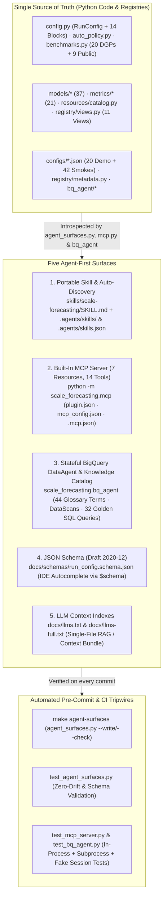

# AI Agents, BigQuery Registry `DataAgent`, Portable Skills & Built-in MCP Server

`scale-forecasting` is engineered as an **agent-first repository**. Whether you use **BigQuery Studio**, **Google Antigravity (`agy` CLI & IDE)**, **Claude Code**, **Cursor**, **VS Code GitHub Copilot (Agent Mode)**, **Windsurf**, **OpenAI Codex CLI**, or an LLM ingestion pipeline, the platform exposes its entire configuration contract (`RunConfig`), all **37 models**, **21 metrics**, **7 compute runtimes**, **5 execution paths**, and **live BigQuery registry conversational analytics** as structured, environment-aware tools and drift-locked reference surfaces.



---

## 1. Quickstart by AI Agent Client

Every agent surface works out of the box on a base `pip install scale-forecasting` (or `pip install -e .`) installation — **zero extra MCP or web-server dependencies are required**.

| AI Agent Environment | Automatic Workspace Discovery (In-Repo) | Global / Plugin Registration |
| :--- | :--- | :--- |
| **Google Antigravity (`agy` CLI & IDE)** | **Automatic:** Reads `AGENTS.md`, [`.agents/skills.json`](https://github.com/statmike/scale-forecasting/blob/main/.agents/skills.json), and `.agents/skills/scale-forecasting/SKILL.md` on workspace open. | Symlink repo as a plugin (`~/.gemini/config/plugins/scale-forecasting`) using [`plugin.json`](https://github.com/statmike/scale-forecasting/blob/main/plugin.json) + [`mcp_config.json`](https://github.com/statmike/scale-forecasting/blob/main/mcp_config.json), or merge `mcp_config.json` into `~/.gemini/config/mcp_config.json`. |
| **Claude Code** | **Automatic:** Reads [`.mcp.json`](https://github.com/statmike/scale-forecasting/blob/main/.mcp.json) and `AGENTS.md` at repository root. | `claude mcp add scale-forecasting -- python3 -m scale_forecasting.mcp` and link `skills/scale-forecasting` into `.claude/skills/scale-forecasting`. |
| **Cursor** | **Automatic:** Reads `AGENTS.md` and `.agents/skills/scale-forecasting/SKILL.md`. | Copy [`mcp_config.json`](https://github.com/statmike/scale-forecasting/blob/main/mcp_config.json) to `.cursor/mcp.json` or `~/.cursor/mcp.json`. |
| **VS Code (GitHub Copilot Agent Mode)** | **Automatic:** Reads `.agents/skills/scale-forecasting/SKILL.md` and root [`.mcp.json`](https://github.com/statmike/scale-forecasting/blob/main/.mcp.json). | Add `"scale-forecasting"` under `"servers"` in `.vscode/mcp.json`. |
| **Windsurf / OpenAI Codex CLI** | **Automatic:** Reads `AGENTS.md` and `.agents/skills/scale-forecasting/SKILL.md`. | Merge [`mcp_config.json`](https://github.com/statmike/scale-forecasting/blob/main/mcp_config.json) into `~/.codeium/windsurf/mcp_config.json`. |

### Google Antigravity (`agy` CLI & IDE)

Google Antigravity (`agy` in the terminal and Antigravity IDE) is the unified agentic environment that succeeded the legacy Gemini CLI. This repository ships native Antigravity workspace discovery and plugin manifests:

1. **Zero-Setup Workspace Discovery:** Cloning `scale-forecasting` and running `agy` (or opening the folder in Antigravity IDE) automatically discovers `AGENTS.md` and `.agents/skills/scale-forecasting/SKILL.md` via [`.agents/skills.json`](https://github.com/statmike/scale-forecasting/blob/main/.agents/skills.json).
2. **Antigravity Plugin Bundle (`plugin.json` + `mcp_config.json`):** The repository root includes [`plugin.json`](https://github.com/statmike/scale-forecasting/blob/main/plugin.json) and [`mcp_config.json`](https://github.com/statmike/scale-forecasting/blob/main/mcp_config.json), allowing you to register the entire repository (skill + rules + MCP server) as a single toggleable Antigravity plugin, or add the MCP server directly to `~/.gemini/config/mcp_config.json`:

```bash
# Option A: Link as a toggleable Antigravity plugin (bundles SKILL.md + mcp_config.json):
mkdir -p ~/.gemini/config/plugins
ln -s "$(pwd)" ~/.gemini/config/plugins/scale-forecasting

# Option B: Launch `agy` directly inside the repository:
agy
```

To configure the MCP server standalone in `~/.gemini/config/mcp_config.json` (pass `"--allow-launch"` only when you want the agent to submit live cloud jobs or run mutating registry repairs):

```json
{
  "mcpServers": {
    "scale-forecasting": {
      "command": "python3",
      "args": ["-m", "scale_forecasting.mcp"]
    }
  }
}
```

### Claude Code

The repository root includes [`.mcp.json`](https://github.com/statmike/scale-forecasting/blob/main/.mcp.json), which Claude Code detects automatically when launched inside the repository. You can also register the MCP server and portable skill from any directory:

```bash
claude mcp add scale-forecasting -- python3 -m scale_forecasting.mcp
```

### Cursor, VS Code GitHub Copilot & Windsurf

- **Skills & Rules:** Cursor, VS Code GitHub Copilot (Agent Mode), Windsurf, and OpenAI Codex CLI automatically discover `AGENTS.md` and `.agents/skills/scale-forecasting/SKILL.md`.
- **MCP Server:** Copy [`mcp_config.json`](https://github.com/statmike/scale-forecasting/blob/main/mcp_config.json) to `.cursor/mcp.json` (Cursor) or `~/.codeium/windsurf/mcp_config.json` (Windsurf). VS Code GitHub Copilot reads root [`.mcp.json`](https://github.com/statmike/scale-forecasting/blob/main/.mcp.json) directly or `.vscode/mcp.json`:

```json
{
  "servers": {
    "scale-forecasting": {
      "type": "stdio",
      "command": "python3",
      "args": ["-m", "scale_forecasting.mcp"]
    }
  }
}
```

### Example Prompts to Try With Your Agent

- *"Run the Glass-Box Auto-Forecaster with `autofocus=True` on `dgp_04_true_vs_decoy_covs`, show me the Step 0 Data Profile, the 4-anchor Baseline Value Ladder, and the 7-Question Practitioner Assessment (`practitioner_assessment`)."*
- *"Run `run_playground` on `cold_start_short_history` or `regime_shift_volatility_drift` with `include_aci=True`, `include_tail_risk=True`, `optimize_inventory_params={'max_budget': 25000.0}`, and `optimize_scenario_params={'objective': 'gross_profit'}`."*
- *"Build a validated `RunConfig` for daily retail sales in `my_project.retail.sales` with `promo_flag` as a future covariate, comparing `auto_arima`, `lightgbm@monotone`, and `tft` with an `nnls` stacked ensemble, routing `deep_learning` to an `L4` GPU on Vertex AI CustomJob."*
- *"Dry-run `configs/ensemble_demo.json`, show me the per-family DAG and deterministic `run_id`, and emit a Cloud Composer 3 Airflow DAG with surgical retry enabled."*
- *"Inspect the live BigQuery registry with `doctor`, review the latest completed run's leaderboard, online ACI coverage (`include_aci=True`), copula VaR/CVaR tail risk (`include_tail_risk=True`), portfolio inventory replenishment (`optimize_inventory_params`), and preview a surgical `--retry` plan for any failed cells."*

---

## 2. Environment-Aware Design (`probe_environment`)

A common failure mode of AI coding assistants is guessing what packages, credentials, or environment variables exist on the user's machine. Both the portable skill ([`SKILL.md`](https://github.com/statmike/scale-forecasting/blob/main/skills/scale-forecasting/SKILL.md)) and the MCP server begin with **Step 0: Environment Probing**:

```bash
python -m scale_forecasting.agent_surfaces --probe-env
```

Or in Python:

```python
from scale_forecasting.agent_surfaces import probe_environment

report = probe_environment()
```

`probe_environment()` performs pure local inspection (zero network calls, zero heavy imports) and reports:

| Inspection Dimension | What It Checks | How Agents Use It |
| :--- | :--- | :--- |
| **`extras` (13 extras)** | Calls `is_importable()` on the probe modules for `gcp`, `notebook`, `spark`, `ray`, `submit`, `models-stats`, `models-trees`, `models-prophet`, `models-dl`, `models-foundation`, `models-automl`, `models`, and `all`. | Recommends the exact `pip install "scale-forecasting[<extra>]"` command or filters to installed models (`--ignore-unavailable-models`). |
| **`models` (37 models)** | Calls `cls.is_available()` on all 37 registered models and groups them into `available` (14 core models on a bare install) vs. `missing` (with `extra` and `install_command`). | Ensures `run_playground` only executes locally installed models while allowing `validate_and_dry_run` to plan cloud runs for all 37 models. |
| **`settings_env` (`SF_*`)** | Checks `SF_PROJECT_ID`, `SF_CONNECTION`, `SF_WAREHOUSE_URI`, `SF_DATASET_ID`, `SF_REGISTRY_DATASET_ID`, `SF_REGION`, `SF_SERVICE_ACCOUNT`, `SF_CONTAINER_IMAGE`, `SF_GKE_CLUSTER`, `SF_SUBNET`, `SF_LOG_LEVEL`, plus `.env.infra` presence on disk. | Tells the agent whether to run `set -a && source .env.infra && set +a` before invoking live BigQuery/cloud tools. |
| **`adc_configured`** | Checks `GOOGLE_APPLICATION_CREDENTIALS`, `~/.config/gcloud/application_default_credentials.json`, and GCE/Cloud Run metadata environment variables. | Detects missing local authentication before attempting cloud API calls. |
| **`execution_paths_ready`** | Booleans for all 5 execution paths (`path_1_offline_playground_and_dry_run` and `path_5_airflow_dag_emission` are always `True`; paths 2–4 require `[gcp]` + `SF_*`). | Routes the agent to offline dry-run/playground vs. live cloud preflight/execution. |

---

## 3. Portable Agent Skill (`skills/scale-forecasting/`)

The [`skills/scale-forecasting/`](https://github.com/statmike/scale-forecasting/tree/main/skills/scale-forecasting) directory follows the open [Agent Skills (`SKILL.md`) specification](https://agentskills.io) with **Progressive Disclosure** so agents keep a small baseline context and load deep reference tables only when needed:

| File | Role | Source of Truth |
| :--- | :--- | :--- |
| [`skills/scale-forecasting/SKILL.md`](https://github.com/statmike/scale-forecasting/blob/main/skills/scale-forecasting/SKILL.md) | YAML frontmatter (`name`, `description`) + 4-step operational workflow (Probe → Author & Validate `RunConfig` → Pre-Flight & Execute across 5 paths → Review & Surgically Repair). | Hand-authored workflow guide |
| [`skills/scale-forecasting/references/config_reference.md`](https://github.com/statmike/scale-forecasting/blob/main/skills/scale-forecasting/references/config_reference.md) | Every field, type, default, and constraint across `RunConfig` and all 14 nested Pydantic config classes, 7 cross-field normalization rules, GPU-to-VM shape matrix, and `run_id` digest exclusions. | Auto-generated from [`config.py`](./api/config.md) |
| [`skills/scale-forecasting/references/catalog_reference.md`](https://github.com/statmike/scale-forecasting/blob/main/skills/scale-forecasting/references/catalog_reference.md) | Complete tables for all **37 models**, **21 metrics**, **7 runtimes**, **13 extras**, **4 source / 5 registry / 11 view schemas**, and **62 shipped configs** (`20` root demos + `42` smoke configs). | Auto-generated from [`models/`](./api/models.md), [`metrics/`](./api/metrics.md), [`registry/`](./api/registry_views.md), and [`configs/`](https://github.com/statmike/scale-forecasting/blob/main/configs/README.md) |
| [`skills/scale-forecasting/references/execution_paths_and_ops.md`](https://github.com/statmike/scale-forecasting/blob/main/skills/scale-forecasting/references/execution_paths_and_ops.md) | Exact CLI commands and Python SDK snippets for `SF_*` environment variables, all 5 execution paths, monitoring/calibration/review, surgical cell repair (`retry_run`), and registry operations (`registry.ops`). | Auto-generated from [`agent_surfaces.py`](./api/agent_surfaces.md) |

---

## 4. Built-In MCP Server (`scale_forecasting.mcp`)

[`scale_forecasting.mcp`](./api/mcp.md) implements a self-contained JSON-RPC 2.0 Model Context Protocol server over `stdio` supporting both newline-delimited JSON and `Content-Length` framed streams. Package logs are routed strictly to `stderr` so `stdout` carries only clean JSON-RPC frames.

### 7 Read-Only MCP Resources (`resources/list` & `resources/read`)

| Resource URI | MIME Type | Contents |
| :--- | :--- | :--- |
| `forecast://environment` | `application/json` | Live `probe_environment()` report (extras, models, `SF_*` env vars, ADC, path readiness). |
| `forecast://schema/run-config` | `application/schema+json` | Full Draft 2020-12 JSON Schema for `RunConfig` and all nested blocks. |
| `forecast://catalog/models` | `application/json` | All 37 models with family, runtime, package, extra, covariate flags, explainability, and local availability. |
| `forecast://catalog/metrics` | `application/json` | All 21 evaluation metrics (16 point + 5 interval) with direction and requirements. |
| `forecast://catalog/runtimes` | `application/json` | All 7 compute runtimes and 4 GPU types (`T4`, `L4`, `A100`, `A100_80GB`). |
| `forecast://catalog/configs` | `application/json` | All 62 shipped configs (20 root demo configs + 42 smoke configs) with `run_id`, runtime, and models. |
| `forecast://catalog/views` | `application/json` | The 4 source tables, 5 registry tables, and 11 analytical SQL views. |

### 14 MCP Tools (`tools/list` & `tools/call`)

| Tool Name | Requires `[gcp]`? | Requires `--allow-launch`? | Purpose |
| :--- | :---: | :---: | :--- |
| `probe_environment` | No | No | Inspect installed extras, available models, `SF_*` variables, `.env.infra`, ADC, 5-path readiness, and Auto-Forecaster tiers/benchmarks (`20` synthetic DGPs + `9` public benchmarks). |
| `list_catalog` | No | No | Query models (with optional `family` and `available_only` filters), metrics, runtimes, GPUs, extras, views, shipped configs, `benchmarks` (`20` DGPs including `cold_start_short_history` and `regime_shift_volatility_drift`), or `auto_tiers` (exposure tiers & scale regimes). |
| `inspect_config_schema` | No | No | Inspect the top-level `RunConfig` overview or drill into a specific section/class (`compute`, `backtest`, `FamilyCompute`, etc.). |
| `validate_and_dry_run` | No | No | Validate a `RunConfig` (dict, JSON string, or file path), compute deterministic `run_id`, estimate workload, resolve per-family DAG nodes, and check local model extras. |
| `run_playground` | No | No | Run a real Python model on deterministic synthetic panel data via `worker.run_cell` with optional 3-fold backtesting, workbench diagnostics (`include_fva`, `include_horizon_decay`, `include_bias_report`, `include_exceptions`, `include_inventory_policy`, `include_promo_elasticity`, `temporal_reconciliation_method`, `allocate_target`, `scenarios`), Track L/Q risk & prescriptive optimization (`include_tail_risk`, `copula_type` in `("auto", "gaussian", "student_t", "iman_conover", "empirical")`, `include_aci`, `optimize_inventory_params`, `optimize_scenario_params`, `include_clearance`, `optimize_clearance_params`, `include_contract_volume`, `optimize_contract_volume_params`), and Track P similarity diagnostics (`include_similarity`, `similarity_method`, `include_substitutes`, `include_emerging_trends`). |
| `plan_execution` | Mode-dependent | Only `stage_only` | Plan or emit execution artifacts: `dry_run`, `emit_airflow` (with `--with-retry`), `feasibility` (live BQ), `quota` (live GCP quotas), or `stage_only` (uploads to GCS). |
| `inspect_registry` | Yes | No | Read-only live BigQuery registry inspection: `doctor`, `recent_runs` (`v_run_summary`), `probe_run` (live runtime reconciliation), or `retry_preview` (surgical cell repair table). |
| `review_run` | Yes | No | Full data-science, risk, and supply-chain evaluation of a `run_id` (`review_run` + `calibration_report` + optional workbench diagnostics including `include_inventory_policy`, `include_promo_elasticity`, `temporal_reconciliation_method`, `allocate_target`, `include_tail_risk`, `copula_type` in `("auto", "gaussian", "student_t", "iman_conover", "empirical")`, `include_aci`, `optimize_inventory_params`, `optimize_scenario_params`, `include_clearance`, `optimize_clearance_params`, `include_contract_volume`, `optimize_contract_volume_params`, `include_similarity`, `similarity_method`, `include_substitutes`, `include_emerging_trends`): champion models, ensemble lift, leaderboard, online ACI coverage, copula VaR/CVaR tail risk, portfolio inventory replenishment, lifecycle markdown & clearance schedules, vendor contract volume schedules, prescriptive price/promo calendars, and digital-twin similarity diagnostics. |
| `launch_or_repair_run` | Yes | **Yes** | Safety-gated execution and repair: `run` (launch multi-family DAG), `retry` (submit surgical repair), `settle` (repair stale job rows), `cancel` (stop cloud jobs), or `close_runs`. |
| `build_auto_config` | Only for BQ table | No | Synthesize a glass-box `RunConfig` and `ConfigBlueprint` (`Forecaster.build_config`) across the 4 exposure tiers (`first_light`, `wide_field`, `deep_sky`, `deep_field`) and 5 `n_series` scale regimes; returns Step 0 `profile_table`, `rationale`, `baseline_models`, `duration_estimate`, and optional emitted Airflow DAG. |
| `run_auto_forecast` | Only for cloud run | Only for cloud run | Execute `Forecaster.auto()` with optional multi-branch `autofocus=True` tournament (including Branch 2c `cold_start_analog_transfer`) across any of the 20 synthetic DGP benchmarks, local CSV/Parquet files, or BigQuery tables; returns Step 0 `profile_table`, `autofocus_ledger`, `baseline_value` ladder, `hierarchy_value`, `model_comparison`, and the **7-Question `practitioner_assessment`**. |
| `compute_time_series_similarity` | Only for BQ table | No | Compute 7-lens time-series similarity (`hybrid`, `physics_attractor`, `spectral_phase`, `elastic_dtw`, `minirocket`, `structural_signature`, `foundation_latent`), silhouette-optimal behavioral clusters (`cluster_by_similarity_df`), 2D phase-space & econometric embeddings (`embed_series_df`), SKU substitutes (`recommend_substitutes_df`), emerging trend breakouts (`detect_emerging_trends_df`), and top-$k$ digital-twin analog lookup (`query_ts_id`, `mode` in `("full_history", "launch_prefix", "recent_window", "substitutes", "emerging_trends")`) across any of the 20 synthetic DGP benchmarks, local CSV/Parquet files, or BigQuery tables. |
| `optimize_inventory_clearance` | No | No | Solve lifecycle markdown & perishable expiry clearance MILP (`mode="clearance"`, monotone discount ladder, FWL covariate partialling, digital-twin elasticity borrowing, shelf/warehouse `target_space_freed` constraint, bottom-up `hierarchy_rollup`) or vendor contract volume & tiered rebate / Take-or-Pay optimization (`mode="contract_volume"`, `contract_tiers`, `min_contract_volume`, `risk_aversion_lambda`, `cvar_alpha`). |
| `ask_forecast_registry` | Only for `bigquery_agent` / `probe` | Only for `ensure_agent=True` | Probe Conversational Analytics & **Knowledge Catalog** readiness (`mode="probe"`), ask a stateful multi-turn natural-language forecasting question (`mode="auto"` or `mode="bigquery_agent"`, defaulting to the latest `COMPLETED` run and returning generated SQL, DataFrame rows, Vega-Lite `chart_spec`, and reusable `conversation_id`), or query an offline synthetic benchmark (`mode="offline"`). |

### Safety-By-Default (`--allow-launch`)

By default, starting `python -m scale_forecasting.mcp` runs in **safe read/plan/playground mode**:
- All offline validation, DAG planning, Airflow emission, model playground runs, and read-only BigQuery registry queries (`inspect_registry`, `review_run`, `plan_execution` with `dry_run`/`emit_airflow`/`feasibility`/`quota`) are enabled.
- Any call to `launch_or_repair_run` or `plan_execution(mode="stage_only")` returns `"allowed": false` with the exact CLI command or `--allow-launch` instruction, preventing an agent from spending cloud quota or mutating the registry without explicit opt-in.

---

## 5. Stateful BigQuery Conversational Analytics `DataAgent` & Knowledge Catalog (`scale_forecasting.bq_agent`)

In addition to local coding agents and MCP clients, [`scale_forecasting.bq_agent`](./api/bq_agent.md) registers a **stateful Google Cloud BigQuery Conversational Analytics `DataAgent`** (`geminidataanalytics.googleapis.com/v1`) enriched by **Knowledge Catalog** (`dataplex.googleapis.com/v1`) over any `scale-forecasting` registry dataset:

1. **Strict Allowlisted Object Scope:** `discover_registry_scope` attaches **only** the 5 canonical `REGISTRY_TABLE_NAMES`, the 11 canonical `VIEW_NAMES`, and verified `source_table`s discovered from `run_registry.raw_config` (`$.data.source_table`) — never calling dataset-wide `list_tables`, so ephemeral `_sf_automl_*` staging tables and unrelated user tables in the same dataset are strictly excluded.
2. **Self-Documenting Registry & Upgrade Backfill:** All source tables, registry tables, and 11 analytical views carry table- and column-level `OPTIONS(description='...')` at creation (`ddl.py`, `views.py`), and `Registry().init()` / `ensure_registry_agent()` automatically backfills missing descriptions onto pre-existing registries created by earlier releases (`sync_existing_descriptions`).
3. **Knowledge Catalog Business Glossary, DataProfile Scans & 32 Golden SQL Queries:** Syncs 44 forecasting domain terms (`WAPE`, `MASE`, `MSIS`, `FVA`, `Trigg's Tracking Signal`, `SBC`, `THieF`, `snapshot_millis`, etc.) via Knowledge Catalog `EntryLink`s (`<= 8` links per object), optionally triggers Knowledge Catalog `DataScan` profile jobs (`catalogPublishingEnabled=True`), and embeds 32 verified Golden SQL queries plus explicit `SchemaRelationship` join edges in `publishedContext`.
4. **Non-Raising Check-and-Run Readiness Probe (`probe_bq_agent_access`):**
   - `reg.probe_bq_agent()`, `forecaster.probe_bq_agent()`, CLI `python -m scale_forecasting.bq_agent --probe`, and MCP `ask_forecast_registry(mode="probe")` check whether `geminidataanalytics.googleapis.com` and `dataplex.googleapis.com` (**Knowledge Catalog**) are enabled and reachable **without raising**. When disabled or unconfigured, `status.ready` is `False` and `status.setup_hint` provides exact `gcloud services enable ...` instructions, allowing notebooks and CI pipelines to run pure-SQL scorecards (`reg.sop_summary_df()`) unconditionally and execute conversational cells only when ready.
5. **Default-to-Latest-`COMPLETED`-Run & Multi-Surface Access:**
   - **BigQuery Studio UI:** Open **BigQuery Studio → Agents** and chat directly with `scale-forecasting Registry Agent (<dataset>)`.
   - **Python SDK (`Registry` / `Forecaster` / `PlaygroundRun` / `BakeOff`):**
     ```python
     from scale_forecasting import Forecaster, Registry

     reg = Registry()
     sop_df = reg.sop_summary_df(limit=5)  # Pure BigQuery SQL — always available
     agent_status = reg.probe_bq_agent()   # Non-raising check-and-run guard
     if agent_status.ready:
         receipt = reg.ensure_bq_agent(sync_glossary=True, run_scans=False)
         r1 = reg.ask("Which model won on the latest completed run and what was its pooled WAPE?")
         r2 = reg.ask("Now show me the FVA waterfall stages for that same run.", conversation_id=r1.conversation_id)
         hist = Forecaster.from_run_id("track-p-p2-live-sim-hierarchy-3mode-01dd2c1edab7").ask(
             "Compare all models on this historical run by pooled_wape."
         )
     else:
         print(agent_status.setup_hint)
     ```
   - **CLI & Declarative `RunConfig`:** Run `python -m scale_forecasting.bq_agent --dataset scale_forecasting --probe`, `python -m scale_forecasting.bq_agent --dataset scale_forecasting --ensure-agent --ask "..."`, or set `"output": {"ensure_bq_agent": true}` in any `RunConfig` JSON (excluded from `run_id` hashing).
   - **Interactive Notebooks:** Walk through the full curriculum in [`notebooks/12_conversational_analytics_and_knowledge_catalog.ipynb`](./notebooks/12_conversational_analytics_and_knowledge_catalog.ipynb) (plus check-and-run Day-2 review in [`notebooks/10_registry_operations_and_scale.ipynb`](./notebooks/10_registry_operations_and_scale.ipynb) and offline parity in [`notebooks/00_model_playground.ipynb`](./notebooks/00_model_playground.ipynb)).

### 5.1 Live Verified Multi-Turn & Domain Q&A Gallery

The transcripts below were captured live against a Google Cloud BigQuery Registry (`sf-registry-scale-forecasting`, grounded in all 44 **Knowledge Catalog** Business Glossary terms and 11 analytical views) immediately after completing a forecast run configured with `output={"ensure_bq_agent": True}` (`run_id = track-d1-live-agent-auto-refresh-15c1fc6a7155`):

#### A. 4-Turn Stateful Conversation (`conversation_id = "sf-conv-653d12086416"`)

Passing `conversation_id=turn1.conversation_id` keeps the active `run_id` and champion model in server-side `Conversation` state across follow-up questions:

| Turn | User Prompt (`reg.ask(...)`) | Target View Chosen by `DataAgent` | Live Agent Answer Summary & Returned Rows |
| :--- | :--- | :--- | :--- |
| **Turn 1** (`run_id="latest"`) | *"Which model won on the latest completed run and what were its pooled WAPE and pooled MAE?"* | `v_run_summary` $\bowtie$ `v_model_leaderboard_comparable` | Identifies `track-d1-live-agent-auto-refresh-15c1fc6a7155` and crowns **`ensemble_mean`** with `pooled_wape = 0.08526` (`8.53%`) and `pooled_mae = 10.76149` across `6` series (`8` leaderboard rows + Vega-Lite chart spec). |
| **Turn 2** (`conversation_id` reused) | *"Show the Forecast Value Added (FVA) waterfall stages and relative lift % for that same run."* | `v_fva_waterfall` | Resolves *"that same run"* from conversation state and traces progression from `2_statistical` (`arima_plus` baseline `0.0950` $\rightarrow$ `arima_plus@xreg` `+2.77%`) $\rightarrow$ `3_univariate_ml_dl` (`timesfm@univariate` `+6.72%`) $\rightarrow$ `5_ensemble` (`ensemble_mean` **`+10.28%` relative lift**, `8` rows). |
| **Turn 3** (`conversation_id` reused) | *"How does forecast accuracy (pooled_wape) and empirical interval coverage change across horizon_step 1 to 14 for the winning model on that run?"* | `v_executive_sop_summary` $\bowtie$ `v_horizon_decay` | Resolves *"the winning model"* (`ensemble_mean`) and returns all `14` lead-time steps (`pooled_wape = 0.0623` at Step 1, peaking at `0.1494` on Step 3, settling to `0.0671` at Step 14). |
| **Turn 4** (`conversation_id` reused) | *"Are any series flagged with is_exception = TRUE or high Trigg's tracking_signal in v_bias_and_exceptions on that run?"* | `v_bias_and_exceptions` | Surfaces `5` planner exception series ordered by `ABS(tracking_signal) DESC`, distinguishing `CHRONIC_UNDER_FORECAST` (`s_000002`, `tracking_signal = -17.50`) from `CHRONIC_OVER_FORECAST` (`s_000004`, `tracking_signal = +8.77`). |

Representative SQL generated by the stateful `DataAgent` on **Turn 2** (`v_fva_waterfall`) and **Turn 4** (`v_bias_and_exceptions`):

```sql
-- Turn 2: FVA Waterfall across complexity stages
WITH latest_run AS (
  SELECT run_id FROM `your-gcp-project-id.scale_forecasting.v_run_summary`
  ORDER BY IF(status = 'COMPLETED', 0, 1), created_at DESC LIMIT 1
)
SELECT f.stage_order, f.stage_name, f.model_type, f.pooled_wape,
       f.baseline_model, f.baseline_wape, f.fva_wape_delta, f.fva_relative_lift_pct
FROM `your-gcp-project-id.scale_forecasting.v_fva_waterfall` AS f
JOIN latest_run USING (run_id)
ORDER BY f.stage_order ASC, f.pooled_wape ASC;

-- Turn 4: Planner Exception Triage via Trigg's Tracking Signal
WITH champion AS (
  SELECT run_id, champion_model
  FROM `your-gcp-project-id.scale_forecasting.v_executive_sop_summary`
  ORDER BY IF(status = 'COMPLETED', 0, 1), created_at DESC LIMIT 1
)
SELECT e.ts_id, e.model_type, e.sbc_class, e.exception_reason,
       e.tracking_signal, e.signed_bias, e.wape, e.mase
FROM `your-gcp-project-id.scale_forecasting.v_bias_and_exceptions` AS e
JOIN champion AS c ON e.run_id = c.run_id AND e.model_type = c.champion_model
WHERE e.is_exception = TRUE
ORDER BY ABS(e.tracking_signal) DESC NULLS LAST, e.wape DESC NULLS LAST
LIMIT 50;
```

#### B. Explainability, Anomalies, Historical `run_id` Pinning, Cross-Run S&OP & `snapshot_millis` Lineage

| Analytical Pattern | SDK / MCP Call | Live Verified Behavior & SQL Target |
| :--- | :--- | :--- |
| **Exogenous Feature Attributions** | `fc.ask("Which exogenous features or covariates have the largest mean_abs_attribution in v_feature_attributions for this run?")` | Aggregates `v_feature_attributions` by `(model_type, attribution_scope, feature_name)`, ranking `price_index` (`avg_abs_importance = 85.60`, `horizon_local`) ahead of `trend` (`84.70`), `seasonal` (`15.04`), `promo_flag` (`1.99`), and `holiday_effect` (`0.65`) (`13` rows). |
| **Historical Run Pinning** | `Forecaster.from_run_id("track-p-p2-live-sim-hierarchy-3mode-01dd2c1edab7").ask("Compare all models on this historical run in v_model_leaderboard_comparable by pooled_wape.")` | Pins `WHERE run_id = 'track-p-p2-live-sim-hierarchy-3mode-01dd2c1edab7'` and ranks all `21` candidate models (`lightgbm` & `lightgbm@similarity_global` tied at `9.33%` WAPE ahead of `lightgbm_cross_temporal_mint` at `9.68%`). |
| **Out-of-Fold Demand Anomalies** | `reg.ask("Show 5 notable historical out-of-fold demand anomalies from v_anomalies...", run_id="all")` | Queries `v_anomalies` ordered by `ABS(residual_zscore) DESC`, flagging `POSITIVE_SPIKE` events on `s_000005` (`2024-12-25`, $z = +2.58$) and `s_000004` (`2024-12-23`, $z = +2.57$). |
| **Cross-Run Executive S&OP Scorecard** | `reg.ask("Compare the 5 most recent completed runs in v_executive_sop_summary...", run_id="all")` | Queries `v_executive_sop_summary WHERE status = 'COMPLETED' ORDER BY created_at DESC LIMIT 5`, comparing `champion_model`, `champion_pooled_wape` (`8.53%`–`13.88%`), `fva_relative_lift_pct` (`+10.28%`–`+37.99%`), and `total_forecast_units` across runs. |
| **Source Table & `snapshot_millis` Lineage** | `reg.ask("For the latest completed run, what source_table and snapshot_millis were recorded in run_registry, and how many distinct ts_id series are in source_series_covariates_native?")` | Extracts `JSON_VALUE(raw_config, '$.data.source_table')` (`source_series_covariates_native`) and `snapshot_millis = 1793278799656` from `run_registry` (`QUALIFY ROW_NUMBER() ... = 1`) and cross-joins `COUNT(DISTINCT ts_id) = 100` from the scoped source table. |
| **Live MCP `ask_forecast_registry` Tool** | `McpServer().call_tool("ask_forecast_registry", {"mode": "bigquery_agent", "run_id": ..., "question": "Return the executive S&OP scorecard row..."})` | Returns structured JSON (`isError=False`, `mode="bigquery_agent"`, `row_count=1`) with `champion_model="ensemble_mean"` and `total_forecast_units=10683.15`. |

---

## 6. IDE JSON Schema Autocomplete (`$schema`) & `llms.txt`

### Authoring `RunConfig` JSON With Editor Autocomplete

[`docs/schemas/run_config.schema.json`](./schemas/run_config.schema.json) is published with the documentation site at:

```text
https://statmike.github.io/scale-forecasting/schemas/run_config.schema.json
```

Add `"$schema"` to any config JSON file to get instant field autocomplete, hover descriptions, and enum validation in VS Code, Cursor, PyCharm, and JetBrains IDEs:

```json
{
  "$schema": "https://statmike.github.io/scale-forecasting/schemas/run_config.schema.json",
  "run_name": "schema-validated-demo",
  "python_runtime": "vertex",
  "data": {
    "source_table": "source_series",
    "freq": "D",
    "horizon": 14
  },
  "models": ["holtwinters", "theta", "xgboost"],
  "backtest": {
    "enabled": true,
    "n_folds": 3,
    "horizon": 14,
    "decision_metric": "wape"
  },
  "ensemble": {
    "enabled": true,
    "strategies": ["inverse_error", "nnls"]
  },
  "compute": {
    "families": {
      "statistical": {"runtime": "gce", "machine_type": "n2-standard-8"}
    }
  }
}
```

> **`run_id` Invariance Guarantee:** [`RunConfig._strip_json_schema_key`](./api/config.md) validates that `"$schema"` (when present) is a non-empty string and strips it before Pydantic model construction. Adding `"$schema"` to a config file produces the **exact same `model_dump()` and `<slug>-<12hex>` `run_id`** as omitting it.

### `llms.txt` and `llms-full.txt`

For LLM web crawlers, documentation indexers, and notebook/chat context attachment, two standard files are generated in `docs/` and published at the root of the documentation site:
- **[`llms.txt`](./llms.txt):** Concise markdown index of the platform's architecture, agent surfaces, positioning guides, and reference pages.
- **[`llms-full.txt`](./llms-full.txt):** Single-file context bundle concatenating `llms.txt` with the complete `RunConfig` schema reference, all 37 models / 21 metrics / 7 runtimes / 13 extras / 62 configs, and all 5 execution paths.

---

## 7. How We Built a Drift-Free Agent-First Repository

Hand-written agent prompts and JSON schemas rot the moment a new model is registered, a `RunConfig` field is added, or a CLI flag changes. We engineered `scale-forecasting` so that **agent surfaces are compiled from code and enforced by pre-commit tripwires**:

1. **Introspection Over Duplication ([`scale_forecasting.agent_surfaces`](./api/agent_surfaces.md)):**
   - `build_run_config_json_schema()` calls `RunConfig.model_json_schema()` and injects the optional `"$schema"` property and `$id` URI.
   - `render_skill_config_reference()` walks `_CONFIG_MODELS` (`RunConfig` + all 14 nested Pydantic models) and formats every field's type annotation, default value, and numeric/length constraints directly from `model_cls.model_fields`.
   - `render_skill_catalog_reference()` iterates over `list_models()`, `METRIC_NAMES`, `RUNTIME_CATALOG`, `ALL_EXTRA_MODULES`, `SOURCE_TABLE_NAMES`, `REGISTRY_TABLE_NAMES`, `VIEW_NAMES`, and all 62 JSON files under `configs/` and `configs/smokes/`.
2. **One-Command Regeneration (`make agent-surfaces`):**
   ```bash
   make agent-surfaces
   # Runs: python -m scale_forecasting.agent_surfaces --write
   ```
3. **Automated Pre-Commit & CI Gate ([`tests/unit/test_agent_surfaces.py`](https://github.com/statmike/scale-forecasting/blob/main/tests/unit/test_agent_surfaces.py) & [`tests/unit/test_mcp_server.py`](https://github.com/statmike/scale-forecasting/blob/main/tests/unit/test_mcp_server.py)):**
   - `test_agent_surfaces_zero_drift` calls `check_agent_surfaces()` in `.githooks/pre-commit` and CI. If any of the 6 generated files on disk differs by a single byte from what current code produces, the commit is blocked with instructions to run `make agent-surfaces`.
   - `test_all_shipped_configs_validate_with_schema_key_and_preserve_run_id` validates all 62 shipped configs (plus `"$schema"` round-trip and `run_id` invariance) against `docs/schemas/run_config.schema.json`.
   - `test_mcp_server.py` exercises all 7 MCP resources and 14 MCP tools both in-process and over a real `python -m scale_forecasting.mcp` subprocess `stdio` pipe using both newline-delimited and `Content-Length` JSON-RPC framing.
