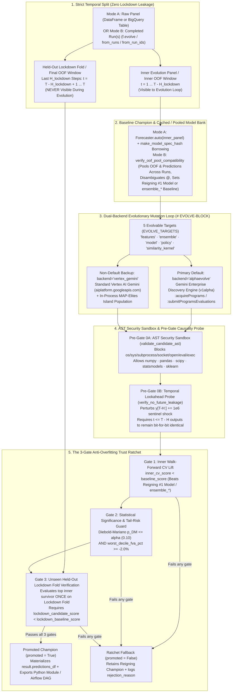

# Opt-In AlphaEvolve Runtime Harness (`Forecaster.evolve` & `scale_forecasting.evolve`)

> **Glass-Box Auto-Forecaster Documentation Suite:** [**Main Guide & Architecture (`auto_forecaster.md`)**](./auto_forecaster.md) · [**29 Benchmarks & AlphaEvolve (`auto_forecaster_benchmarks.md`)**](./auto_forecaster_benchmarks.md) · [**7-Runtime Cloud Scale & AutoML (`auto_forecaster_cloud_scale.md`)**](./auto_forecaster_cloud_scale.md) · **AlphaEvolve Runtime Harness (`alphaevolve_runner.md`)**

Out of the box, [`Forecaster.build_config()`](api/sdk.md) and [`Forecaster.auto()`](api/sdk.md) use a **pre-calibrated, zero-LLM pure-Python decision policy** ([`scale_forecasting.auto_policy`](api/auto.md)) that was evolved offline with **AlphaEvolve on Gemini Enterprise** across **20 synthetic ground-truth Data-Generating Processes (DGPs)** and **9 public open-data benchmarks**. For `95%+` of production forecasting workloads, `Forecaster.auto(..., autofocus=True)` delivers immediate, reproducible accuracy with **zero external LLM calls and zero special licensing**.

When your organization operates a proprietary dataset with domain-specific non-linearities, custom promotional decay curves, or specialized ensemble weighting structures that go beyond the pre-compiled rules in `auto_policy.py`, **`scale-forecasting` also ships an opt-in runtime evolutionary harness**: **[`Forecaster.evolve()`](api/sdk.md)** ([`scale_forecasting.evolve`](api/evolve.md)).

`Forecaster.evolve()` works in **two complementary modes**—either on top of `Forecaster.auto()` and `autofocus`, or **directly on top of any completed manual `Forecaster` run (`f.evolve()`) or pool of prior BigQuery runs (`from_run_ids=[...]`) without using `autofocus` or Auto-Forecaster exposure tiers**:
1. **Mode 1 — Raw-Panel Evolution on Top of `Forecaster.auto()`:** Splits your panel into an **Inner Evolution Panel** and an **Unseen Held-Out Lockdown Fold**, runs `Forecaster.auto()` once on the inner panel to establish the baseline accuracy score and out-of-fold (`backtest_oof`) prediction bank, and **reuses ("borrows") finished `(ts_id, model_type)` cells** across candidate evaluations via `make_model_spec_hash`.
2. **Mode 2 — Post-Run & Multi-Run Super-Ensembling (`f.evolve()`, `from_runs`, `from_run_ids` — Zero Base-Model Refitting):** Accepts an already-executed manual `Forecaster` instance (`f.evolve(target="ensemble")`) or a list of completed BigQuery `run_id`s (`Forecaster.evolve(from_run_ids=["run_a", "run_b"], target="ensemble")`). It pools all base models across those runs (disambiguating distinct HPO/feature fits as `<model_type>@<run_short_id>`), sets the baseline to beat as the **reigning #1 single model or built-in `ensemble_*` strategy** (`ensemble_inverse_error`, `ensemble_nnls`, `ensemble_champion`, `ensemble_horizon_specialist`), withholds the final OOF window as the **Gate 3 Held-Out Lockdown Fold**, evolves **per-series adaptive ensemble weights**, and materializes the blended forward forecast with empirical conformal intervals in `result.predictions_df`—in seconds, with **zero base-model refitting**.
3. **Evolves Bounded `# EVOLVE-BLOCK` Python Code Across 5 Targets:** You choose whether to evolve causal domain covariates (`target="features"`), global or per-series adaptive out-of-fold ensemble blending logic (`target="ensemble"`), a custom `BaseModel` residual/state-space forecaster (`target="model"`), custom `AutoPolicyWeights` thresholds (`target="policy"`), or a custom positive semi-definite (PSD) multi-lens similarity kernel (`target="similarity_kernel"`).
4. **Enforces an AST Security Sandbox, Temporal Lookahead Probe & 3-Gate Anti-Overfitting Ratchet:** Every mutated candidate is statically verified via Python's `ast` module, tested against a `+1e6` future-perturbation causality probe (`verify_no_future_leakage`), and required to pass **three sequential promotion gates**—including a **Held-Out Lockdown Fold that the evolutionary loop never sees**. If a candidate overfits the inner cross-validation folds, the ratchet rejects it automatically and retains the reigning baseline (`promoted=False`).

---

## 1. Licensing Requirements & Evolution Backend Comparison

> [!IMPORTANT]
> **Gemini Enterprise Licensing Requirement for Default `backend="alphaevolve"` — and Built-In Alternatives**
>
> `scale-forecasting` separates **pre-compiled policy execution** from **live runtime code evolution** so every user has a clear path regardless of Google Cloud licensing tier:
>
> 1. **Zero-License Default (`Forecaster.build_config()` & `Forecaster.auto()`):** Runs the pre-evolved pure-Python decision rules in [`auto_policy.py`](api/auto.md). Requires **zero LLM APIs, zero Gemini Enterprise license, and zero extra cloud permissions**.
> 2. **Primary Runtime Evolution Backend (`Forecaster.evolve(..., backend="alphaevolve")` — Default in `evolve`):** Connects to the managed **Gemini Enterprise Discovery Engine AlphaEvolve API** (`https://discoveryengine.googleapis.com/v1alpha/projects/{project_id}/locations/{location}/alphaEvolveExperiments`). **This backend requires a Google Cloud organization with Gemini Enterprise licensing and AlphaEvolve entitlement**, plus `enable_alphaevolve = true` in Terraform (`discoveryengine.googleapis.com` enabled and `roles/discoveryengine.admin` bound to `scale-forecasting-runner`). Before running any backtests, `probe_alphaevolve_access()` performs a fast pre-flight check and raises an actionable `ConfigError` if the API or entitlement is not active.
> 3. **Backup Runtime Evolution Backend (`Forecaster.evolve(..., backend="vertex_gemini")` — Standard Vertex AI):** For Google Cloud projects **without** Gemini Enterprise licensing, pass `backend="vertex_gemini"`. It uses standard **Vertex AI Gemini** (`aiplatform.googleapis.com`, default model `"gemini-3.8-flash"`, customizable via `model_name="..."`) together with an in-process MAP-Elites / island population buffer to mutate `# EVOLVE-BLOCK` candidates from walk-forward diagnostic feedback (`fva_pct`, `dm_pvalue`, `worst_decile_fva_pct`, `horizon_decay`).
>
> **Identical Safety & Anti-Overfitting Guarantees Across Both Backends:** Whether candidate programs are proposed by managed Discovery Engine AlphaEvolve (`backend="alphaevolve"`) or the standard Vertex AI Gemini backup mutator (`backend="vertex_gemini"`), **100% of candidates pass through the exact same AST security sandbox, `+1e6` temporal lookahead probe, and 3-Gate Anti-Overfitting Ratchet.**

### Table 1 — Built-In Auto-Forecaster vs. Opt-In Runtime Evolution Backends

*How to read this table:* Compare the built-in zero-LLM `Forecaster.auto()` controller against the three `Forecaster.evolve()` backends (`"alphaevolve"`, `"vertex_gemini"`, and `"mock"`).

| Dimension | Built-In Auto-Forecaster (`Forecaster.auto()`) | Primary Evolution Backend (`backend="alphaevolve"`, Default) | Backup Evolution Backend (`backend="vertex_gemini"`, Non-Default) | Offline Test Backend (`backend="mock"`) |
| :--- | :--- | :--- | :--- | :--- |
| **When to Use It** | Everyday production forecasting and multi-branch `autofocus` tournaments (`95%+` of workloads). | Discovering custom domain features, ensemble rules, models, policy weights, or similarity kernels with managed multi-island evolution. | Running runtime `# EVOLVE-BLOCK` evolution on standard GCP projects without Gemini Enterprise AlphaEvolve entitlement. | Unit tests, CI pipelines, and `--dry-run` verification in `<2s` with zero network calls. |
| **Licensing & Entitlement Required** | **None** *(100% pure Python shipped in `auto_policy.py`)* | **Gemini Enterprise license + AlphaEvolve entitlement** on the GCP organization/project | **Standard Google Cloud project** with Vertex AI API enabled *(no Gemini Enterprise license required)* | **None** *(100% offline deterministic mutations)* |
| **Google Cloud API Endpoint** | None *(or chosen compute runtime for jobs)* | `discoveryengine.googleapis.com/v1alpha` (`alphaEvolveExperiments` `:acquirePrograms` & `:submitProgramsEvaluations`, default `model_name="gemini-3.8-flash"`) | `aiplatform.googleapis.com` (`google.genai.Client(vertexai=True)`, default `model_name="gemini-3.8-flash"`) | None |
| **Terraform Variable** | Default (`enable_alphaevolve = false`) | Set **`enable_alphaevolve = true`** *(enables `discoveryengine.googleapis.com` + `roles/discoveryengine.admin` on runner SA)* | Default (`enable_alphaevolve = false`; uses standard `aiplatform.googleapis.com` already enabled by default) | None |
| **Evolutionary Search Architecture** | Pre-calibrated 4-tier compiler + 3-branch `autofocus` DAG (`2A`, `2B`, `2C` $\rightarrow$ `3`) | **Managed Multi-Island Service:** Server-side MAP-Elites islands, crossover, and lineage managed by Discovery Engine | **Local In-Process Island Buffer:** Single-process island population mutating parent code from structured CV diagnostic prompts | Deterministic candidate generator per target |
| **AST Security Sandbox & Lookahead Probe** | Native codebase invariants | **Enforced** (`validate_candidate_ast` + `verify_no_future_leakage` `+1e6` future shock) | **Enforced** *(identical AST sandbox + `+1e6` future-shock causality test)* | **Enforced** *(identical AST sandbox + causality test)* |
| **3-Gate Anti-Overfitting Ratchet** | Champion Ratchet + 4-Anchor Baseline Ladder | **Enforced** (Gate 1 Inner CV Lift $\rightarrow$ Gate 2 Diebold–Mariano $p_{\text{DM}}$ & Tail Floor $\rightarrow$ Gate 3 Unseen Lockdown Fold) | **Enforced** *(identical 3-Gate Ratchet + Lockdown Fold)* | **Enforced** *(identical 3-Gate Ratchet + Lockdown Fold)* |

---

## 2. End-to-End Architecture: Building on `Forecaster.auto()`, Manual `Forecaster` Runs & Multi-Run Pools



### 2.1. Mode A — Evolving From Raw Data on Top of `Forecaster.auto()`

Rather than evolving a forecasting pipeline from a blank slate, `Forecaster.evolve(data, ...)` treats [`Forecaster.auto()`](./auto_forecaster.md) as **Stage 0 of the evolutionary tournament**:

1. **Temporal Lockdown Partitioning (`Inner Evolution Panel` vs. `Held-Out Lockdown Fold`):**
   Before profiling or fitting any model, `run_evolution()` reserves the final `horizon` timestamps (`t > T - H_lockdown`) of every series as a **Held-Out Lockdown Fold**. The evolutionary loop (`acquire_programs` $\rightarrow$ evaluate $\rightarrow$ `submit_evaluations`) only ever sees the **Inner Evolution Panel** (`t <= T - H_lockdown`).
2. **Baseline Establishment & `model_spec_hash` Cell Borrowing (`reuse_prior_runs=True`):**
   `Forecaster.evolve()` executes `Forecaster.auto()` on the Inner Evolution Panel once to compute:
   - The **`PanelAutoProfile`** (scale regime, SBC demand regime, seasonality, structural breaks, covariate structure, similarity clusters, hierarchy tree).
   - The **Baseline Champion Score (`baseline_score`)**—set to the best model or built-in `ensemble_*` strategy on the inner walk-forward cross-validation folds.
   - The **Cached Out-of-Fold (`backtest_oof`) Prediction Bank**, allowing `"ensemble"` and `"policy"` mutations to evaluate in milliseconds and `"features"` / `"model"` mutations to borrow unchanged `(ts_id, model_type)` cells without re-training the entire model portfolio.
3. **Structured Diagnostic Feedback to the Mutator:**
   After each candidate evaluation on the inner panel, the harness returns rich econometric telemetry—not just a single scalar loss—including **Forecast Value Added (`fva_pct`)**, **Harvey–Leybourne–Newbold modified Diebold–Mariano $p$-value (`dm_pvalue`)**, **worst-decile series FVA (`worst_decile_fva_pct`)**, and **lead-time horizon decay ratios**, guiding the next generation of `# EVOLVE-BLOCK` mutations.

### 2.2. How `make_model_spec_hash` Governs Cell Borrowing Across `backtest`, `hpo` & `ensemble`

When `autofocus=True` or `Forecaster.evolve()` evaluates multiple passes or runs with `reuse_prior_runs=True`, [`make_model_spec_hash(model_name, cfg)`](api/config.md) computes a 16-hex content digest of each model variant's **statistical specification**. Understanding what is **excluded** vs. **included** in `make_model_spec_hash` explains exactly when cells are borrowed at zero compute cost vs. re-fitted:

| `RunConfig` Block / Field | In `make_model_spec_hash`? | How Cell Borrowing Interacts With It |
| :--- | :---: | :--- |
| **`ensemble` (`strategies`, `top_k`, `parsimony_margin`, `variant_policy`)** | **Excluded** *(keyed separately by `make_ensemble_id`)* | **100% Borrowed (`0` base-model refits):** Ensembling is a downstream consumer of `backtest_oof` and `forecast_predictions`. Changing ensemble strategies or evolving custom weights via `Forecaster.evolve(target="ensemble")` never invalidates base-model cells. |
| **`compute` (`runtime`, `machine_type`, `workers`, `use_gpu`) & `run_name`** | **Excluded** | **100% Borrowed (`0` refits):** A `lightgbm` or `chronos2@global` cell fitted on Dataproc Serverless Spark or Vertex GPU shares the exact same `model_spec_hash` regardless of cluster sizing or `run_name`. |
| **Sibling `models` & Variant Tag Spelling (`@univariate`)** | **Excluded** | **100% Borrowed (`0` refits):** Adding new models in Pass 2/3 never invalidates Pass 1 models. Moreover, `lightgbm` in a univariate run and `lightgbm@univariate` in a covariate run hash to the **exact same 16-hex digest**. |
| **Irrelevant `features` Flags per Model (`holidays`, `fourier`, `level_shift`, `trading_days`)** | **Masked by model capability** | **Borrowed for unaffected models:** Turning on `fourier=True`, `level_shift=True`, or `exog_lags` re-keys covariate-consuming models (`lightgbm`, `sarimax`), while pure univariate baselines (`naive_seasonal`, `theta`) keep their original hash and are borrowed unchanged. |
| **`hpo` (`enabled`, `n_trials`, `granularity`, `search_space`)** | **Included** | **Re-fitted in `autofocus` · Pooled in `from_run_ids`:** Changing `hpo` changes a model's tuned hyperparameters, so `make_model_spec_hash` intentionally produces a new digest during `autofocus`. However, **Post-Run Pool Evolution (`from_run_ids` / `from_runs`)** lets you pool an untuned Run A and an HPO-tuned Run B together—disambiguating them as `<model>@<run_short_id>` so `target="ensemble"` blends both without re-fitting either! |
| **`backtest` (`scheme`, `n_folds`, `horizon`, `step`, `min_train`, `embargo`) & `output`** | **Included** | **Re-fitted when fold geometry changes · Intersected in `from_run_ids`:** Changing `n_folds` or `horizon` alters the out-of-fold evaluation grid. When pooling completed runs via `from_run_ids`, `verify_oof_pool_compatibility()` automatically intersects onto the common `(ts_id, ds)` OOF timestamps and `(ts_id, forecast_date)` horizon dates. |

### 2.3. Mode B — Post-Run & Multi-Run Super-Ensembling (`f.evolve()`, `from_runs`, `from_run_ids` — Without `autofocus` or Tiers)

You do **not** need to use `Forecaster.auto()`, `autofocus`, or the 4 astronomy exposure tiers to use `scale_forecasting.evolve`. Suppose you have already executed one or more standard, hand-crafted `RunConfig` jobs—for example:
- **Single Completed Run (`f.evolve(target="ensemble")`):** You ran a manual configuration (`f = Forecaster.from_run_id("w1a-spark-srv-n10-e839bf6f74ef")` or `f = Forecaster.from_file("configs/ensemble_demo.json").run()`) and want to see if an evolved per-series adaptive ensemble can beat both the best single model (`holtwinters`, `lightgbm`) and the built-in `ensemble_*` strategies (`ensemble_inverse_error`, `ensemble_nnls`, `ensemble_champion`).
- **Multi-Run Cross-Engine Pool (`Forecaster.evolve(from_run_ids=[...], target="ensemble")`):** You ran statistical and tree models on **Dataproc Serverless Spark** (`run_id_1`), deep-learning models on **GKE Indexed Jobs** or **Vertex AI `L4` GPUs** (`run_id_2`), and SQL foundation models on **BigQuery ML** (`run_id_3`)—potentially with different HPO budgets or feature sets—and want to evolve a **super-ensemble across all runs** with zero additional model training.

When you call `f.evolve(target="ensemble")` or `Forecaster.evolve(from_run_ids=[...], target="ensemble")`:
1. **Cross-Run Compatibility & Model Disambiguation (`verify_oof_pool_compatibility`):**
   Hydrates each run's `oof_df` (`backtest_oof`) and `predictions_df` (`forecast_predictions`), verifies overlapping `(ts_id, ds)` out-of-fold timestamps and `(ts_id, forecast_date)` horizon grids (raising `ConfigError` if the panels are disjoint), and aligns them to the shared intersection. If two runs both fitted `lightgbm` or `theta` with different HPO or feature settings, their distinct OOF trajectories are preserved side by side as `<model_type>@<run_short_id>` (while bit-for-bit identical duplicates are deduplicated).
2. **Reigning Champion Baseline (`reigning_champion_model`):**
   Evaluates every pooled base model **and** every existing `ensemble_*` strategy (`ensemble_inverse_error`, `ensemble_nnls`, `ensemble_ridge`, `ensemble_champion`, `ensemble_horizon_specialist`, `ensemble_mean`) already present in the runs. The #1 lowest-error model or built-in ensemble becomes `baseline_score` (recorded in `result.diagnostics["reigning_champion_model"]`), so a candidate is only promoted if it beats the best existing single model **and** built-in ensemble!
3. **Temporal OOF Lockdown Split (Zero Base-Model Refitting):**
   Splits the aligned `oof_df` temporally per series: earlier out-of-fold timestamps form the **Inner Evolution OOF Panel** (passed to `compute_evolved_weights` and scored in Gates 1 & 2), while the final out-of-fold window (`last H_lockdown steps` per series) is strictly withheld as the **Gate 3 Held-Out Lockdown Fold**.
4. **Per-Series Adaptive Weights & Materialized `result.predictions_df`:**
   `compute_evolved_weights(oof_df, profile)` can return either global weights (`dict[str, float]`) or **per-series adaptive weights** (`dict[str, dict[str, float]]` or a `DataFrame` with `["ts_id", "model_type", "weight"]` combining temperature-scaled per-series inverse-error with empirical-Bayes shrinkage toward the global pool winner). When promoted, the harness applies the winning weights to the pooled forward forecasts and calibrates empirical conformal prediction intervals (`yhat`, `yhat_lower`, `yhat_upper`) in **`result.predictions_df`**.

---

## 3. The 5 Evolvable `# EVOLVE-BLOCK` Targets (`EVOLVE_TARGETS`)

Every evolutionary run targets one of five modular Python contracts defined in [`scale_forecasting.evolve.targets`](api/evolve.md). Only the code between `# EVOLVE-BLOCK-START` and `# EVOLVE-BLOCK-END` is mutated; the outer function signature, type contract, and backtest harness remain immutable:

| Target (`target=...`) | Function / Class Evolved | How It Plugs Into `Forecaster.auto()` | Best Used When |
| :--- | :--- | :--- | :--- |
| **`"features"`** | `synthesize_evolved_features(df, profile=None) -> pd.DataFrame` | Synthesizes new causal covariate columns (`evolved_feat_*`) from past target lags, rolling volatility, or non-linear promo/price interactions, then feeds them into the `Forecaster.auto()` tree/linear/global model bank. | Your domain has non-linear promotion saturation, price elasticity thresholds, or multi-lag pull-forward effects (`dgp_04`, `dgp_18`). |
| **`"ensemble"`** | `compute_evolved_weights(oof_df, profile=None) -> dict[str, float] \| dict[str, dict[str, float]] \| pd.DataFrame` | Learns custom global or **per-series adaptive blending weights** (temperature-scaled inverse-loss, trimmed consensus, or empirical-Bayes shrinkage toward the global winner) over the cached `backtest_oof` bank from `Forecaster.auto()`, a single manual `Forecaster` run (`f.evolve()`), or a multi-run pool (`from_run_ids=[...]`), and materializes `result.predictions_df`. | You want to beat the reigning #1 model and built-in `ensemble_*` strategies in seconds with zero base-model refitting—including across multiple prior runs. |
| **`"model"`** | `EvolvedForecaster(BaseModel)` (`fit` & `predict`) | Evolves a custom `BaseModel` plugin using `numpy`, `scipy`, and `statsmodels` primitives and benchmarks it head-to-head against the 37 built-in models on identical backtest folds. | Your series follow a domain-specific state-space, damped-trend, or harmonic decay law. |
| **`"policy"`** | `evolve_policy_weights(base_weights: AutoPolicyWeights) -> AutoPolicyWeights` | Tunes the continuous decision thresholds in [`AutoPolicyWeights`](api/auto.md) (such as `log1p_cv_threshold`, `decoy_prune_min_share`, `horizon_decay_threshold`, `parsimony_margin`, `enable_similarity_global`, `similarity_silhouette_threshold`) for your specific dataset family. | You want to calibrate `auto_policy.py` thresholds once on a representative enterprise panel and export them for zero-LLM daily runs. |
| **`"similarity_kernel"`** | `compute_evolved_similarity_kernel(features_mat: np.ndarray, profile: dict \| None = None) -> np.ndarray` | Evolves a custom symmetric positive semi-definite (PSD) similarity kernel ($S_{i,i}=1, S_{i,j} \in [0, 1]$) combining structural, spectral/Kuramoto phase, physics-attractor (Takens/Lyapunov/Hurst), and convolutional feature blocks, scored via k-NN analog holdout accuracy across the 3-Gate Ratchet. | Your multi-regime or cold-start panel benefits from domain-tailored distance weighting across dynamical and spectral lenses (`similarity.py`). |

### Example `# EVOLVE-BLOCK` Seed Contract (`target="features"`)

```python
import numpy as np
import pandas as pd


def synthesize_evolved_features(
    df: pd.DataFrame,
    profile: dict | None = None,
) -> pd.DataFrame:
    """Synthesize strictly causal domain features (evolved_feat_*) per ts_id."""
    out = df.copy()
    # EVOLVE-BLOCK-START
    grouped = out.groupby("ts_id", sort=False)["y"]
    lag_1 = grouped.shift(1).bfill()
    lag_7 = grouped.shift(7).bfill()
    out["evolved_feat_momentum_7"] = lag_1 - lag_7
    out["evolved_feat_rolling_Ratio"] = lag_1 / (lag_7.abs() + 1.0)
    # EVOLVE-BLOCK-END
    return out
```

---

## 4. AST Security Sandbox, Temporal Causality Probe & 3-Gate Anti-Overfitting Ratchet

LLM-generated feature and model code faces two classic failure modes in time-series forecasting: **silent future lookahead leakage** (accidentally using `df["y"].mean()`, `shift(-1)`, or centered rolling windows that peek into the test horizon) and **validation fold overfitting** (memorizing noise in the inner cross-validation split when searching across many candidate mutations).

`scale_forecasting.evolve` eliminates both failure modes mechanically before any candidate can be promoted (`promoted = True`):

### Table 2 — The 5 Sequential Verification & Anti-Overfitting Gates

*How to read this table:* Every candidate program must clear **Pre-Gates 0A & 0B** and **Gates 1, 2 & 3** in order. Failing any gate immediately rejects the candidate and records the exact failure stage in `EvolveResult.rejection_reason`.

| Gate | Module & Function | Exact Mathematical / Static Check Enforced | What Failure Mode It Prevents |
| :--- | :--- | :--- | :--- |
| **Pre-Gate 0A: AST Security Sandbox** | [`sandbox.validate_candidate_ast`](api/evolve.md) | Parses candidate source into an Python AST and rejects prohibited imports (`os`, `sys`, `subprocess`, `socket`, `urllib`, `http`, `pathlib`, `shutil`, `ctypes`, `pickle`, `builtins`, `importlib`), dunder attribute access, and dangerous calls (`eval`, `exec`, `open`, `compile`, `__import__`, `getattr`, `setattr`, `globals`, `locals`). Enforces a strict execution wall-clock timeout. | Arbitrary file I/O, network exfiltration, environment mutation, or infinite loops in LLM-generated code. |
| **Pre-Gate 0B: Temporal Lookahead Probe** | [`sandbox.verify_no_future_leakage`](api/evolve.md) | Clones the panel, adds a massive sentinel shock to the final `horizon` rows of each series (`y[T-H:] += 1e6`), re-executes the candidate, and asserts that all engineered features/predictions on historical timestamps `t <= T - H` match the unperturbed run bit-for-bit (`np.allclose(..., atol=1e-12)`). | Future target leakage (`shift(-1)`, ` center=True` rolling windows, full-series `mean`/`std` normalization, or ungrouped cross-time aggregations). |
| **Gate 1: Inner Walk-Forward CV Lift** | [`evaluator.evaluate_candidate`](api/evolve.md) | Evaluates the candidate on the **Inner Evolution Panel** (`t <= T - H_lockdown`) using expanding walk-forward cross-validation folds and requires strict improvement over the `Forecaster.auto()` baseline (`inner_cv_score < baseline_score`, i.e., `fva_pct > 0.0`). | Promoting degenerate or no-op mutations that fail to improve out-of-fold accuracy on the inner panel. |
| **Gate 2: Diebold–Mariano & Tail-Risk Guard** | [`evaluator.evaluate_candidate`](api/evolve.md) & [`diagnostics.diebold_mariano_test`](api/review.md) | Computes paired series-level loss differentials between the candidate and baseline: requires **Harvey–Leybourne–Newbold (1997) modified Diebold–Mariano $p_{\text{DM}} \le \alpha$** (default `significance_alpha = 0.10` when panel size permits) **AND** **`worst_decile_fva_pct >= -2.0%`** (the bottom 10% of series cannot degrade by more than `2%`). | Lucky single-series outliers masking broad degradation across the rest of the panel. |
| **Gate 3: Unseen Held-Out Lockdown Fold** | [`runner.run_evolution`](api/evolve.md) | Takes **only the #1 survivor of Gates 1 & 2** and evaluates it **once** on the **Held-Out Lockdown Fold** (`last H_lockdown steps`, never queried during the evolution loop). Requires **`lockdown_candidate_score < lockdown_baseline_score`**. | Multi-trial selection bias ("overfitting the validation set" across $K$ evolutionary generations). If Gate 3 fails, `promoted` is set to `False` and the harness ratchets back to the `Forecaster.auto()` champion. |

---

## 5. Terraform Provisioning & All 5 Triggering Surfaces

### 5.1. Terraform Opt-In Provisioning (`enable_alphaevolve = true`)

By default, [`terraform/main/variables.tf`](https://github.com/statmike/scale-forecasting/blob/main/terraform/main/variables.tf) sets `enable_alphaevolve = false` so standard deployments never require Gemini Enterprise licensing.

- **If your organization has Gemini Enterprise + AlphaEvolve entitlement** and you want to use the default `backend="alphaevolve"`, enable the Discovery Engine API and least-privilege runner IAM role via Terraform:

```bash
cd terraform/main
terraform apply \
  -var="project_id=YOUR_PROJECT_ID" \
  -var="enable_alphaevolve=true"
```

Setting `enable_alphaevolve = true` performs two scoped changes:
1. Enables **`discoveryengine.googleapis.com`** in `terraform/main/modules/apis`.
2. Binds **`roles/discoveryengine.admin`** exclusively to the **`scale-forecasting-runner`** service account in `terraform/main/modules/iam` (never to the ephemeral `scale-forecasting-compute` worker service account).

- **If your project does NOT have Gemini Enterprise licensing:** Leave `enable_alphaevolve = false` (the default) and pass **`backend="vertex_gemini"`** to `Forecaster.evolve(...)` or `--backend vertex_gemini` on the CLI, which uses standard `aiplatform.googleapis.com` (already enabled by default in `terraform/main`).

### 5.2. Surface 1 — Python SDK (`Forecaster.evolve`, `f.evolve()` & `from_run_ids`)

```python
from scale_forecasting import Forecaster, load_benchmark

ds = load_benchmark("dgp_04_true_vs_decoy_covs", n_series=8)

# Pattern A — Evolve from a raw DataFrame/table on top of Forecaster.auto()
#             Default model_name="gemini-3.8-flash"; pass model_name="..." to select any Gemini model
result = Forecaster.evolve(
    ds.panel_df,
    target="features",          # "features" | "ensemble" | "model" | "policy" | "similarity_kernel"
    backend="alphaevolve",      # "alphaevolve" (default) | "vertex_gemini" (backup) | "mock"
    model_name="gemini-3.8-flash",  # default "gemini-3.8-flash" (or e.g. "gemini-4-argon")
    tier="first_light",
    where="local",
    max_evaluations=6,
    significance_alpha=0.10,
    export_path="/tmp/evolved_features.py",
)

# Pattern B — Post-Run Evolution on a single completed manual Forecaster run (no autofocus / tiers)
f_manual = Forecaster.from_run_id("w1a-spark-srv-n10-e839bf6f74ef", project_id="YOUR_PROJECT_ID")
post_res = f_manual.evolve(
    target="ensemble",
    backend="vertex_gemini",    # or "alphaevolve"
    model_name="gemini-3.8-flash",
    max_evaluations=6,
)
display(post_res.predictions_df)  # Materialized blended forecasts (yhat, yhat_lower, yhat_upper)

# Pattern C — Multi-Run Super-Ensembling across multiple BigQuery run_ids (e.g. Spark + GKE + Vertex)
pool_res = Forecaster.evolve(
    from_run_ids=[
        "w1a-spark-srv-n10-e839bf6f74ef",
        "w1a-gke-job-n10-75276ed3cc94",
    ],
    project_id="YOUR_PROJECT_ID",
    dataset_id="scale_forecasting",
    target="ensemble",
    backend="vertex_gemini",
    model_name="gemini-3.8-flash",
    max_evaluations=6,
)
print(f"Reigning baseline champion: {pool_res.diagnostics['reigning_champion_model']}")
print(f"Inner CV score: {pool_res.baseline_score:.4f} -> {pool_res.inner_cv_score:.4f} (FVA={pool_res.fva_pct:+.2f}%)")
print(f"Lockdown score: {pool_res.lockdown_baseline_score:.4f} -> {pool_res.lockdown_candidate_score:.4f}")
display(pool_res.predictions_df)
```

### 5.3. Surface 2 — Command-Line Interface (`python -m scale_forecasting.evolve`)

```bash
# Offline deterministic dry-run (<2s, zero cloud calls — ideal for CI & smoke checks)
python -m scale_forecasting.evolve \
  --benchmark dgp_04_true_vs_decoy_covs \
  --target features \
  --backend mock \
  --dry-run

# Live evolution using Gemini Enterprise AlphaEvolve (default backend="alphaevolve", model="gemini-3.8-flash")
python -m scale_forecasting.evolve \
  --benchmark dgp_04_true_vs_decoy_covs \
  --target ensemble \
  --backend alphaevolve \
  --model-name gemini-3.8-flash \
  --max-evaluations 6 \
  --export-path /tmp/evolved_ensemble.py

# Live evolution using the standard Vertex AI Gemini backup (no Gemini Enterprise license needed)
python -m scale_forecasting.evolve \
  --benchmark dgp_04_true_vs_decoy_covs \
  --target features \
  --backend vertex_gemini \
  --model-name gemini-3.8-flash \
  --max-evaluations 6 \
  --export-path /tmp/evolved_features_vertex.py

# Multi-run post-hoc super-ensemble directly from completed BigQuery run_ids (zero refitting)
python -m scale_forecasting.evolve \
  --from-run-ids w1a-spark-srv-n10-e839bf6f74ef,w1a-gke-job-n10-75276ed3cc94 \
  --dataset-id scale_forecasting \
  --target ensemble \
  --backend vertex_gemini \
  --model-name gemini-3.8-flash \
  --max-evaluations 6 \
  --export-path /tmp/evolved_multi_run_ensemble.py
```

### 5.4. Surface 3 — Scheduled Cloud Composer 3 / Airflow Retraining DAG (`emit_airflow_dag`)

Why would you schedule `Forecaster.evolve()` in Cloud Composer 3 if its output is Python code? Because enterprise demand regimes shift over quarters (new product hierarchies, changing promotional elasticities, macroeconomic regime drift). Scheduling a **monthly or quarterly evolutionary tournament DAG** (`schedule="@monthly"`) automatically tests candidate `# EVOLVE-BLOCK` adaptations against a fresh Held-Out Lockdown Fold and promotes a new champion module only when all 3 anti-overfitting gates pass:

```python
dag_py = result.emit_airflow_dag(
    output_path="/tmp/dag_monthly_evolve.py",
    schedule="@monthly",
)
```

### 5.5. Surface 4 — Built-in MCP Server (`run_auto_forecast` with `evolve_target`, `evolve_model_name` & `evolve_from_run_ids`)

AI coding agents connected to `python -m scale_forecasting.mcp` can trigger `Forecaster.evolve()` directly through the existing `run_auto_forecast` MCP tool by passing `evolve_target` (`"features"`, `"ensemble"`, `"model"`, `"policy"`, or `"similarity_kernel"`), `evolve_backend` (`"alphaevolve"`, `"vertex_gemini"`, or `"mock"`), `evolve_model_name` (defaults to `"gemini-3.8-flash"`; pass any supported Gemini model name to override), `evolve_max_evaluations`, and optional `evolve_from_run_ids` (`list[str]`) to evolve a post-hoc super-ensemble across completed BigQuery runs.

---

## 6. Live Google Cloud Verification (`backend="alphaevolve"` & `backend="vertex_gemini"`)

Both runtime evolution backends were verified live on Google Cloud (`us-central1` / `global`) across `# EVOLVE-BLOCK` targets (`target="features"` and `target="ensemble"`), exercising the full Discovery Engine AlphaEvolve REST protocol (`:acquirePrograms` / `:submitProgramsEvaluations`), the standard Vertex AI Gemini (`gemini-3.8-flash`) island mutator, the AST security sandbox, the `+1e6` lookahead causality detector, and the 3-Gate Anti-Overfitting Ratchet:

### Table 3 — Live Cloud & Offline Verification Ledger (`scale_forecasting.evolve`)

*How to read the scores in this table:* **`Baseline Inner CV` & `Candidate Inner CV`** = out-of-fold `WAPE` on the Inner Evolution Panel (**$\downarrow$ lower is better**) · **`Inner FVA %`** = `%` inner CV error reduction vs. `Forecaster.auto()` baseline (**$\uparrow$ higher is better**) · **`Worst-Decile FVA %`** = `%` error reduction on the hardest 10% of series (Gate 2 floor $\ge -2.0\%$) · **`Lockdown Baseline` & `Lockdown Candidate`** = `WAPE` on the unseen Held-Out Lockdown Fold (**$\downarrow$ lower is better**) · **`Gate 3 Verdict`** = whether the candidate beat the baseline on the unseen Lockdown Fold (`promoted=True`) or safely ratcheted back to the `Forecaster.auto()` baseline (`promoted=False`).

| Verification Run | Backend (`backend_used`) | Target (`# EVOLVE-BLOCK`) | Benchmark Panel | Baseline Inner CV $\downarrow$ | Candidate Inner CV $\downarrow$ | Inner FVA % $\uparrow$ | Diebold–Mariano $p_{\text{DM}}$ | Worst-Decile FVA % $\uparrow$ | Lockdown Baseline $\downarrow$ | Lockdown Candidate $\downarrow$ | Wall-Clock $\downarrow$ | Gate 3 Verdict (`promoted`) |
| :--- | :--- | :---: | :--- | :---: | :---: | :---: | :---: | :---: | :---: | :---: | :---: | :--- |
| **Live Gemini Enterprise AlphaEvolve Protocol — Features** | **`alphaevolve`** (`discoveryengine.googleapis.com/v1alpha`) | `"features"` | `dgp_04_true_vs_decoy_covs` | `0.1019` | **`0.0594`** | **`+43.67%`** | `<0.0001` (`0.0000`) | `+11.49%` | `0.0953` | **`0.0537`** | `20.55s` | **`promoted=True`** *(Passed Gates 1, 2 & 3)* |
| **Live Gemini Enterprise AlphaEvolve Protocol — Ensemble** | **`alphaevolve`** (`discoveryengine.googleapis.com/v1alpha`) | `"ensemble"` | `dgp_01_smooth_seasonal` | `0.0503` | **`0.0270`** | **`+46.37%`** | `<0.0001` (`0.0000`) | `+30.68%` | `0.0522` | **`0.0287`** | `28.96s` | **`promoted=True`** *(Passed Gates 1, 2 & 3)* |
| **Live Vertex AI Gemini Backup — Features** | **`vertex_gemini`** (`aiplatform.googleapis.com` · `gemini-3.8-flash`) | `"features"` | `dgp_04_true_vs_decoy_covs` | `0.1019` | **`0.0585`** | **`+42.94%`** | `<0.0001` (`0.0000`) | `+12.72%` | `0.0953` | **`0.0544`** | `13.03s` | **`promoted=True`** *(Passed Gates 1, 2 & 3)* |
| **Live Vertex AI Gemini Backup — Ensemble** | **`vertex_gemini`** (`aiplatform.googleapis.com` · `gemini-3.8-flash`) | `"ensemble"` | `dgp_01_smooth_seasonal` | `0.0503` | **`0.0223`** | **`+55.60%`** | `<0.0001` (`0.0000`) | `+37.07%` | `0.0522` | **`0.0246`** | `22.61s` | **`promoted=True`** *(Passed Gates 1, 2 & 3)* |
| **Gate 3 Anti-Overfitting Ratchet Guard Test** | **`mock`** *(Intentional inner-fold overfit candidate)* | `"features"` | `dgp_12_already_optimal_white_noise` | `0.0594` | `0.0161` | `+72.93%` | `<0.0001` (`0.0000`) | `+64.10%` | **`0.0599`** | `0.2500` *(degraded)* | `6.17s` | **`promoted=False`** *(Caught by Gate 3; ratcheted to baseline)* |
| **Live BigQuery Single-Run Post-Hoc Evolution (`f.evolve()`)** | **`alphaevolve`** (`discoveryengine.googleapis.com/v1alpha`) | `"ensemble"` | `w1a-spark-srv-n10-e839bf6f74ef` *(7 models · reigning `#1`: `holtwinters`)* | `0.3268` | **`0.3138`** | **`+3.97%`** | `0.0792` | `-0.0006` | `0.3497` | **`0.3445`** | `32.98s` | **`promoted=True`** *(Passed Gates 1, 2 & 3 · `140` forecast rows)* |
| **Live BigQuery Single-Run Post-Hoc Evolution (`f.evolve()`)** | **`vertex_gemini`** (`aiplatform.googleapis.com` · `gemini-3.8-flash`) | `"ensemble"` | `w1a-spark-srv-n10-e839bf6f74ef` *(7 models · reigning `#1`: `holtwinters`)* | `0.3268` | **`0.3134`** | **`+4.12%`** | `0.0676` | `+0.0000` | `0.3497` | **`0.3442`** | `39.13s` | **`promoted=True`** *(Passed Gates 1, 2 & 3 · `140` forecast rows)* |
| **Live BigQuery Multi-Run Super-Ensemble Pool (`from_run_ids`)** | **`alphaevolve`** (`discoveryengine.googleapis.com/v1alpha`) | `"ensemble"` | `w1a-spark-srv-n10-e839bf6f74ef` + `w1a-gke-job-n10-75276ed3cc94` *(10 models: 3 dedup, 6 `@run`)* | `0.3268` | **`0.3138`** | **`+3.98%`** | `0.0790` | `-0.0006` | `0.3497` | **`0.3441`** | `49.24s` | **`promoted=True`** *(Passed Gates 1, 2 & 3 · `140` forecast rows)* |
| **Live BigQuery Multi-Run Super-Ensemble Pool (`from_run_ids`)** | **`vertex_gemini`** (`aiplatform.googleapis.com` · `gemini-3.8-flash`) | `"ensemble"` | `w1a-spark-srv-n10-e839bf6f74ef` + `w1a-gke-job-n10-75276ed3cc94` *(10 models: 3 dedup, 6 `@run`)* | `0.3268` | **`0.3138`** | **`+3.98%`** | `0.0790` | `-0.0006` | `0.3497` | **`0.3441`** | `49.53s` | **`promoted=True`** *(Passed Gates 1, 2 & 3 · `140` forecast rows)* |

---

Return to the **[Main Auto-Forecaster Guide (`auto_forecaster.md`)](./auto_forecaster.md)**, inspect the **[29 Synthetic & Open-Data Benchmarks (`auto_forecaster_benchmarks.md`)](./auto_forecaster_benchmarks.md)**, or view the **[`scale_forecasting.evolve` API Reference (`api/evolve.md`)](api/evolve.md)**.
