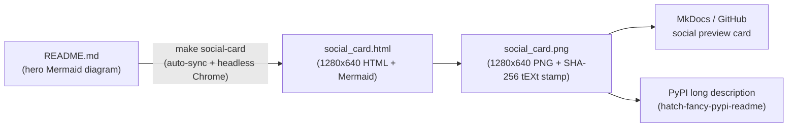

# `docs/assets/` — Static Documentation & Social Preview Assets

This directory holds static visual assets used by the MkDocs documentation site, the PyPI package description, and GitHub link previews.

## Directory Map

| File | Responsibility |
| :--- | :--- |
| [`README.md`](./README.md) | Directory map and regeneration instructions for static visual assets. |
| [`social_card.html`](./social_card.html) | Self-contained 1280×640 HTML + Mermaid source for the repository social preview card using the platform's four-class palette (`data`, `config`, `route`, `compute`). Automatically synced from `README.md`'s hero Mermaid diagram via `make social-card`. |
| [`social_card.png`](./social_card.png) | Rendered 1280×640 PNG used for PyPI long-description rendering (`hatch-fancy-pypi-readme`), GitHub repository social previews, and static OpenGraph metadata. Regenerate via `make social-card`; verified by `test_docs_integrity.py` via embedded `sf-source-sha256` PNG `tEXt` chunk. |
