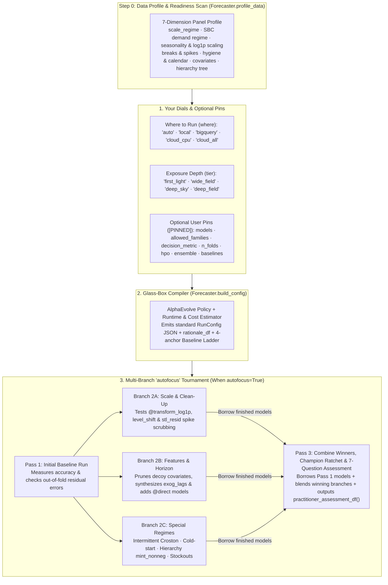

# Glass-Box Auto-Forecaster & Multi-Branch `autofocus`

When you sit down to forecast a new dataset, you usually face an uncomfortable trade-off:

- **Manual trial and error takes days:** Choosing among 37 models, target transforms (`log1p`), outlier scrubbing, feature lags, backtest folds, ensembles, and 7 Google Cloud runtimes—and running jobs one by one to see what actually improves accuracy—takes hours or days of manual experimentation.
- **Black-box "AutoML" hides the why and takes away control:** Most automated forecasting tools swallow your DataFrame, pick a model behind the scenes, and hand back predictions with no explanation of *why* those choices were made—and no way to restrict the search to the models, metrics, or runtime budgets your team trusts.

`scale-forecasting` gives you a third option: **[`Forecaster.build_config()`](api/sdk.md)** and **[`Forecaster.auto()`](api/sdk.md)** act as a **100% glass-box auto-forecaster**.

1. **Every decision is explained in plain English:** Whether you compile a configuration up front (`Forecaster.build_config()`) or run an automated multi-pass tournament (`Forecaster.auto()`), you get a clear, row-by-row rationale table explaining *what* was chosen and *why* (for example, switching to `mase` and adding `croston` because a panel is mostly zeros, or dropping three noisy feature columns that contributed almost nothing in Pass 1).
2. **You can leave everything on autopilot—or pin any rule you care about:** Start with two simple dials (**`where`** to run and which exposure **`tier`** to use), or pin specific model families, exact model lists, your business metric (`wape`, `mase`, `pinball`, `crps`), backtest folds, hyperparameter tuning (`hpo`), ensembles, or hard time and cost limits (`max_minutes`, `max_usd`).
3. **Multi-pass `autofocus` learns across passes without re-fitting finished models:** When `autofocus=True`, the controller runs an initial pass, checks the backtest errors to see what is still missing, tests targeted improvements in parallel **"what-if" branches (`2A`, `2B`, `2C`)**, **reuses ("borrows") models that already finished in Pass 1** so you never pay to train them twice, and uses a **Champion Ratchet** so your final result is guaranteed never to be worse than an earlier pass.

> [!IMPORTANT]
> **Evolved with AlphaEvolve on Gemini Enterprise — Zero LLM Calls at Runtime**
>
> Rather than relying on hand-tuned human guesswork, the tier defaults and `autofocus` decision rules in [`scale_forecasting.auto_policy`](api/auto.md) were discovered and calibrated using **AlphaEvolve on Gemini Enterprise** (`discoveryengine.googleapis.com/v1alpha`, powered by **`gemini-3.8-flash`** and **`gemini-4-argon`**). AlphaEvolve iteratively mutated and scored candidate decision policies against **18 ground-truth test panels**—improving composite policy fitness from `26.08` to `74.82` (`+41.96%` average improvement over a seasonal naive baseline and `+24.16%` multi-pass error reduction).
>
> Once evolved, the winning rules were compiled directly into deterministic pure Python (`auto_policy.py`). **When you run `Forecaster.build_config()` or `Forecaster.auto()`, there are zero LLM calls, zero external API dependencies, and 100% reproducible behavior.**

> [!NOTE]
> **Two everyday terms used on this page: DGP and FVA**
>
> - **DGP (Data-Generating Process):** A **synthetic test dataset built from a known mathematical recipe**. On real-world data, you never know with 100% certainty whether a promotion column is true signal or random coincidence. By testing our auto-forecaster on **18 synthetic "known-recipe" datasets (DGPs)**—where we deliberately planted specific seasonal patterns, stockouts, price spikes, hierarchies, missing gaps, or fake noise columns—we can verify that `autofocus` discovers the real drivers and ignores the fake noise.
> - **FVA (Forecast Value Added):** How much a model or `autofocus` pass **reduces forecast error compared to a baseline**. Every auto run compares your champion against a **4-anchor baseline ladder** (seasonal naive `naive_seasonal`, smooth univariate `theta` / `arima_plus@univariate`, and zero-shot univariate foundation models `chronos_bolt` / `timesfm_torch@v2.5_univariate` / `timesfm@univariate`), and if a simple univariate model beats every complex model, `f.baseline_value_df()` explicitly highlights which complex challengers it beat.

### How This Differs from Manual Trial-and-Error and Black-Box AutoML

You never have to choose between writing a [`RunConfig`](configuration_reference.md) by hand and using the Auto-Forecaster—they speak the exact same JSON contract. You can ignore Auto-Forecaster completely and author manual configs, or use `Forecaster.build_config()` on Day 1 to generate a smart `RunConfig` JSON file and edit it by hand from Day 2 onward:

| Dimension | Manual Trial-and-Error | Typical Black-Box AutoML | `scale-forecasting` Glass-Box Auto-Forecaster & `autofocus` |
| :--- | :--- | :--- | :--- |
| **1. Transparency & Ownership** | You control every knob, but spend days testing combinations of models, transforms, lags, and runtimes by hand. | Swallows your DataFrame, trains behind a curtain, and returns predictions with no explanation of *why* choices were made. | **100% Glass-Box Compiler:** Prints a plain-English rationale table (`bp.explain()`) for every decision *and* exports a standard, editable `RunConfig` JSON file (`bp.to_file()`). |
| **2. Step 0 Data Readiness & Post-Run Trust** | You write custom exploratory notebooks to check zeros, gaps, scaling, and covariate leakage. | Jumps straight into model training without explaining data pathologies or proving model trust. | **Built-in Profile & 7-Question Assessment:** Runs a **Step 0 Data Profile** (`Forecaster.profile_data()` / `bp.profile_df()`) up front and a **7-Question Practitioner Assessment** (`f.practitioner_assessment_df()`, `f.compare_models()`) after execution. |
| **3. Co-Design of Models + Cloud Compute** | You manually size VMs, GPUs, and worker pools when scaling from 10 series to 100,000. | Assumes a single Python process or one fixed cluster architecture. | **Joint Model & Runtime Sizing:** Co-designs the model shortlist and the **7 Google Cloud runtimes** across 5 scale regimes (`micro` `<15` series to `hyperscale` `25,000+` series) and time/cost budgets. |
| **4. Iterative Refinement & Compute Reuse** | Changing one feature or transform means re-running the entire pipeline from scratch. | Either runs a single static pass or brute-forces dozens of heavy models upfront. | **Multi-Branch `autofocus` DAG + Cell Borrowing:** Runs a fast Pass 1 probe, tests isolated upgrades in parallel branches (`2A` scale/outliers, `2B` feature pruning/horizon, `2C` intermittent/hierarchy/stockouts), **borrows Pass 1's finished `(ts_id, model)` cells**, and locks in the winner via the **Champion Ratchet**. |
| **5. "Earn Your Complexity" Baseline Proof** | Easy to overfit noisy promotion/price columns without realizing a simple univariate model was more accurate. | Often selects a complex ensemble or deep network without proving statistically significant lift over simple baselines. | **4-Anchor Baseline Value Ladder:** Protects seasonal naive, plain univariate (`theta`), and dual-mode foundation baselines (`@univariate` vs. `@global_cov_all`). When a plain univariate model beats every complex challenger, it wins the session and lists the complex models it defeated (`f.baseline_value_df()`). |
| **6. User Scope Pins (`[PINNED]`)** | You maintain separate config files for every team constraint. | Take-it-or-leave-it automation; hard to lock specific model families, metrics, or fold counts. | **Pin Any Dial:** Lock `allowed_families`, `models`, `decision_metric`, `n_folds`, `hpo`, `ensemble`, `holidays`, or `baselines`; `autofocus` explores strictly around your pins. |
| **7. How the Decision Rules Were Built** | Individual intuition and fragile rules of thumb. | Static vendor heuristics or slow, non-deterministic runtime LLM agent calls. | **Evolved with AlphaEvolve on Gemini Enterprise (`26.08 -> 74.82` fitness across 18 synthetic data recipes)** and compiled into pure Python (**zero LLM calls at runtime**). |

---

## 1. Start in 30 Seconds

### Pattern A — Forecast a DataFrame or BigQuery table on full autopilot (`Forecaster.auto`)

Pass any pandas DataFrame (for local in-memory execution) or BigQuery table name (for cloud execution). With `autofocus=True`, `Forecaster.auto()` profiles the panel, runs Pass 1, inspects the out-of-fold errors, tests targeted follow-up passes if needed, and produces the **7-Question Practitioner Assessment**:

```python
from scale_forecasting import Forecaster, load_benchmark

# Load one of the 18 built-in synthetic test panels (or pass your own DataFrame / BigQuery table)
ds = load_benchmark("dgp_04_true_vs_decoy_covs", n_series=6)

f = Forecaster.auto(
    ds.panel_df,
    tier="first_light",
    where="local",
    autofocus=True,
    max_passes=3,
)

# 1. Step 0 Data Profile & 7-Question Practitioner Trust Assessment
display(f.profile_df())
display(f.practitioner_assessment_df())

# 2. Head-to-head model comparison ("Is the champion better than Model X?") & Baseline Ladder
display(f.compare_models())
display(f.baseline_value_df())

# 3. Pass-by-pass tournament ledger, exact config diffs, and leaderboard
display(f.autofocus_ledger_df())
display(f.autofocus_diff_df())
display(f.leaderboard_df())
```

### Pattern B — Preview your data & compile a configuration before running (`Forecaster.profile_data` & `Forecaster.build_config`)

Want to see what your data looks like and *what* the auto-forecaster recommends before launching any jobs? `Forecaster.profile_data()` runs a sub-second Step 0 readiness scan, and `Forecaster.build_config()` returns a **`ConfigBlueprint`** containing a standard, editable [`RunConfig`](configuration_reference.md), a plain-English rationale table, and an approximate runtime/cost estimate:

```python
from scale_forecasting import Forecaster, load_benchmark

ds = load_benchmark("dgp_04_true_vs_decoy_covs", n_series=6)

# Optional: inspect the 7-dimension Step 0 Data Profile directly
display(Forecaster.profile_data(ds.panel_df, horizon=14))

blueprint = Forecaster.build_config(
    ds.panel_df,
    tier="wide_field",
    where="local",
    goal="accuracy",
    include_models=["regression_lags"],
    exclude_models=["xgboost"],
    decision_metric="wape",
    n_folds=2,
    max_minutes=3.0,
)

# Print the human-readable summary and rationale table
print(blueprint.explain())

# Tweak any setting or save as a standard RunConfig JSON file
custom_bp = blueprint.with_overrides(run_name="custom-wide-field")
custom_bp.to_file("/tmp/my_compiled_auto.json")
```

Every compiled `ConfigBlueprint` emits a standard `RunConfig` JSON file that works everywhere in `scale-forecasting` (CLI, SDK, Notebooks, and Cloud Composer):

```json
{
  "run_name": "auto-wide-field",
  "data": {
    "source_table": "dataframe_panel",
    "ts_id_col": "ts_id",
    "date_col": "ds",
    "target_col": "y",
    "freq": "D",
    "horizon": 14
  },
  "models": [
    "naive_seasonal",
    "theta",
    "holtwinters",
    "lightgbm",
    "regression_lags"
  ],
  "features": {
    "future_covariates": [
      "promo_depth",
      "price_index",
      "noise_a",
      "noise_b",
      "noise_c"
    ],
    "include_univariate_baselines": true
  },
  "backtest": {
    "enabled": true,
    "n_folds": 2,
    "horizon": 14,
    "step": 14,
    "min_train": 100,
    "decision_metric": "wape"
  },
  "output": {
    "floor": 0.0,
    "quantiles": [0.1, 0.5, 0.9]
  },
  "ensemble": {
    "enabled": true,
    "strategies": ["inverse_error", "nnls", "ridge", "champion"]
  }
}
```

### Pattern C — Step through `autofocus` one pass at a time (`step_by_step=True`)

If you want a human in the loop between passes, set `step_by_step=True`. `Forecaster.auto()` runs Pass 1 and pauses so you can preview the exact changes it proposes for Pass 2 before deciding whether to continue:

```python
f = Forecaster.auto(ds.panel_df, tier="first_light", autofocus=True, step_by_step=True)

preview = f.preview_next_loop()
print(f"Recommended to continue: {preview.should_continue} (confidence={preview.confidence:.2f})")
display(preview.mutations_df)

if preview.should_continue:
    f.step()
```

### Pattern D — Run from the CLI or emit a Cloud Composer 3 / Airflow DAG (`--init-config`, `--auto`, `--emit-out`)

```bash
# List and inspect the 18 built-in synthetic test panels (DGPs)
python -m scale_forecasting.benchmarks --list
python -m scale_forecasting.benchmarks --summary

# Generate a RunConfig JSON file from a dataset without running it
python -m scale_forecasting.main --auto --benchmark dgp_02_multiplicative_log \
  --tier wide_field --where local --init-config /tmp/auto_dgp02.json

# Run closed-loop autofocus directly from your terminal
python -m scale_forecasting.main --auto --benchmark dgp_04_true_vs_decoy_covs \
  --tier first_light --where local --autofocus --max-passes 3

# Emit a standalone multi-branch autofocus Airflow / Cloud Composer 3 DAG
python -m scale_forecasting.main --auto --table source_series_native \
  --tier wide_field --autofocus --autofocus-mode dag --max-passes 3 \
  --init-config /tmp/auto_wide_field.json --emit-out /tmp/dag_autofocus.py
```

### Works Across All 6 Execution Surfaces

Both the 4 exposure tiers (`first_light`, `wide_field`, `deep_sky`, `deep_field`) and multi-pass `autofocus` run identically across every launch surface in `scale-forecasting`:

| Surface | Tier Compilation & Single-Pass Execution | Multi-Pass `autofocus` Tournament (`dag` or `linear`) |
| :--- | :--- | :--- |
| **1. Python SDK** | `Forecaster.build_config(data, tier=...)` or `Forecaster.auto(data, autofocus=False)` | `Forecaster.auto(data, tier=..., autofocus=True, autofocus_mode="dag")` |
| **2. Interactive Notebooks** | [`11_auto_forecaster_and_autofocus.ipynb`](notebooks/11_auto_forecaster_and_autofocus.ipynb) (`bp.rationale_df`, `bp.profile_df()`) | Inline tournament ledgers, Baseline Value Ladder, and 7-Question Practitioner Assessment |
| **3. Local CLI** | `python -m scale_forecasting.main --auto --tier <tier> [--init-config out.json]` | `python -m scale_forecasting.main --auto --tier <tier> --autofocus --max-passes 3` |
| **4. Cloud Composer 3 / Airflow** | `bp.emit_airflow_dag(autofocus=False)` or `--auto --emit-airflow` | `bp.emit_airflow_dag(autofocus=True)` (`autofocus_pass_1 >> [branch_2a, 2b, 2c] >> synthesis`) |
| **5. Headless Cloud Batch** | Container args `["--auto", "--table", "proj.ds.tbl", "--tier", "deep_sky"]` | Container args `["--auto", "--table", "proj.ds.tbl", "--tier", "deep_sky", "--autofocus"]` |
| **6. Built-in MCP Server** | `build_auto_config` tool (returns `config`, `profile_table`, `rationale`, `duration_estimate`) | `run_auto_forecast` tool (returns `autofocus_ledger`, `baseline_value`, `practitioner_assessment`) |

---

## 2. Answering the 7 Questions Every Forecaster Asks (`f.practitioner_assessment_df()`)

In real-world forecasting reviews, stakeholders and senior practitioners rarely ask *"Did the job finish?"*—they ask **seven recurring trust questions**. Every `Forecaster.auto()` run answers all seven automatically via **`f.practitioner_assessment_df()`**, **`f.compare_models()`**, **`f.baseline_value_df()`**, and **`f.hierarchy_value_df()`**:

| Question Every Forecaster Asks | How `scale-forecasting` Answers It with Hard Evidence | SDK Method to Inspect |
| :--- | :--- | :--- |
| **1. *"Is this model really better than Model X (or a simple baseline)?"*** | Scores every candidate on identical expanding/sliding backtest folds against a **4-anchor Baseline Ladder** (`naive_seasonal`, plain univariate `theta`/`arima_plus@univariate`, and zero-shot foundation `chronos_bolt`/`timesfm`), reporting FVA %, series-by-series win rate %, and Diebold–Mariano $p$-value. | `f.compare_models(model_a, model_b)`<br/>`f.baseline_value_df()` |
| **2. *"Do ensembles actually help here, or is a single model better?"*** | Evaluates consensus and learned stackers (`inverse_error`, `nnls`, `ridge`, `xgb`, `horizon_specialist`) against the best single base model and enforces a **parsimony margin (`0.5%`)**: an ensemble is only crowned if it beats the best single model by a meaningful margin. | `f.practitioner_assessment_df()`<br/>`f.leaderboard_df()` |
| **3. *"Do covariates (promos, price) help, or are they just overfitting noise?"*** | Benchmarks multivariate models (`@cov_all`) against paired univariate twins (`@univariate`), computes feature attributions (`TreeSHAP` / linear shares), and automatically prunes noisy ("decoy") covariates in Branch `2B`. If all extra columns are noise, a plain univariate model wins and lists the complex models it beat. | `f.attributions_df()`<br/>`f.baseline_value_df()` |
| **4. *"Does cross-series `@global` pooling beat per-series `@local` fitting?"*** | Classifies the panel into 5 scale regimes (`micro` to `hyperscale`) and measures cross-series correlation (`cross_series_corr`). Defers heavy `@global` neural nets on tiny panels where they overfit, and runs `@local` vs. `@global` head-to-head on `small`/`medium`/`large` panels. | `f.profile_df()`<br/>`f.compare_models()` |
| **5. *"Is hierarchical reconciliation done properly without hurting good levels?"*** | Estimates error covariance strictly inside each backtest fold (zero lookahead leakage), selects scale-appropriate reconciliation (`mint_nonneg`, `wls_struct`, `wls_var`, `bottom_up`), verifies exact additive coherence (`0.000000` gap) and `0` negative leaves, and reports accuracy lift at `Root`, `Intermediate`, and `Leaf` levels. | `f.hierarchy_value_df()`<br/>`f.hierarchy_df()` |
| **6. *"Does accuracy hold up across the whole horizon, or fade after a few days?"*** | Measures step-by-step error from $h = 1 \dots H$ (`late_horizon_degradation_ratio`), identifies the horizon crossover step $h^*$, and injects `@direct` multi-horizon models + `horizon_specialist` blending when recursive rollouts decay. | `f.horizon_decay_df()`<br/>`f.practitioner_assessment_df()` |
| **7. *"How do I trust this forecast in production?"*** | Combines distribution-free conformal prediction intervals, directional bias & Trigg Tracking Signal audits, a residual white-noise stop gate, and the **Champion Ratchet** (guaranteeing a later `autofocus` pass can never overwrite a better earlier pass). | `f.assess()`<br/>`f.explain_auto_decisions_df()` |

---

## 3. How It Works: Two Simple Dials (`tier` and `where`)



### Dial 1 — Exposure Depth (`tier`)

Just as an astronomical observatory starts with a quick **"first light"** snapshot to check alignment before taking a **"wide field"** or **"deep field"** exposure, `tier` controls how broadly and deeply the auto-forecaster searches:

| Exposure Tier | When to Use It | Approximate Time (`local` / `bigquery` / Cloud) | Default `autofocus` Depth | Backtest Folds | What It Runs |
| :--- | :--- | :---: | :---: | :---: | :--- |
| **`"first_light"`** | Quick sanity check, fast iteration, or starting point for multi-pass `autofocus` | `~15s` / `~1m` / `~6m` | Up to `2` levels | `1` | Fast baseline portfolio (`naive_seasonal`, `theta`, `lightgbm`, plus `croston@tsb` on zero-heavy data or `arima_plus` on BigQuery). Intentionally lean so Pass 2 can test targeted upgrades while borrowing Pass 1's models. |
| **`"wide_field"`** *(Default)* | Everyday production forecasting with a balanced mix of speed and accuracy | `~90s` / `~2m` / `~10m` | Up to `2` levels | `2` | Multi-family survey across Statistical (`theta`, `holtwinters`, `fft`), ML Trees (`lightgbm`, `xgboost`, `regression_lags`), and Zero-Shot Foundation (`chronos_bolt`, `timesfm`), with automatic `log1p`, `level_shift`, and outlier scrubbing (`stl_resid`). |
| **`"deep_sky"`** | High-value panels where cross-series global models and hyperparameter tuning pay off | `~4m` / `~5m` / `~18m` | Up to `3` levels | `3` | Adds cross-series global deep learning (`tide@global`, `tsmixer@global`) and richer statistical/tree models (`catboost`, `autoets`, `stl_bagging`, `sarimax`), Optuna HPO (`6` trials), and learned stacking (`nnls`, `ridge`). |
| **`"deep_field"`** | Exhaustive benchmark bakeoffs and maximum-accuracy tournaments | `~12m` / `~8m` / `~35m` | Up to `4` levels | `3` | Full benchmark across all eligible families (`patchtst@global`, `tft@global`, `chronos2@global`, `arima_plus`), automatic covariate ablation (`@cov_all` vs. `@univariate`), HPO (`12` trials), and full ensemble blending (`xgb`, `nnls`, `ridge`, `horizon_specialist`, `champion`). |

### Dial 2 — Where to Run & Optional Scope Pins

You can let the tier pick everything automatically, or pin any combination of parameters below. Every pinned choice is marked as `[PINNED]` in the rationale table and respected across every `autofocus` pass:

| Parameter | Options | Plain-English Behavior |
| :--- | :--- | :--- |
| **`where`** | `"auto"` \| `"local"` \| `"bigquery"` \| `"cloud_cpu"` \| `"cloud_all"` | • `"auto"`: Runs `"local"` on a pandas DataFrame and `"cloud_all"` on a BigQuery table.<br/>• `"local"`: Runs in memory on your machine using installed packages (no GCP needed).<br/>• `"bigquery"`: Runs 100% inside BigQuery SQL (`arima_plus`, `timesfm`) with zero VMs.<br/>• `"cloud_cpu"`: Serverless CPU fleet (`spark` for stats/ML, CPU `vertex` for deep learning).<br/>• `"cloud_all"`: Full cloud fleet with `L4` GPUs for `deep_learning`. |
| **`goal`** | `"accuracy"` \| `"probabilistic"` \| `"service_level"` \| `"fast"` | • `"accuracy"`: Optimizes point forecast accuracy (`wape` on smooth data, `mase` on zero-heavy data) with 80% intervals.<br/>• `"probabilistic"`: Optimizes full distribution accuracy (`crps`) across 5 quantiles (`0.05` to `0.95`).<br/>• `"service_level"`: Optimizes high service-level quantiles (`pinball` up to `0.98`) for safety-stock and inventory planning.<br/>• `"fast"`: Restricts to fast statistical and tree models with 1 backtest fold. |
| **`allowed_families`** | List of family names | Restrict candidate models to any subset of `["statistical", "ml", "deep_learning", "automl", "native"]`. |
| **`models`** | List of model names | Pin an exact list of models for Pass 1; `autofocus` will tune transforms, features, HPO, and ensembles around your list without adding unapproved model families. |
| **`include_models` / `exclude_models`** | List of model names | Force specific models to always stay in the run (never trimmed by budget limits) or block specific models from ever being used. |
| **`decision_metric`** | Any of the 21 metric names | Pin the metric used to rank models and pick the winner (for example, `"wape"`, `"mase"`, `"rmsse"`, `"mae"`, `"pinball"`, `"crps"`). |
| **`n_folds`** | Integer (`1`–`10`) | Pin the number of rolling backtest folds. Using `2` or more folds automatically unlocks learned ensemble stackers (`nnls`, `ridge`). |
| **`hpo`** | `True` \| `False` \| `dict` | Turn Optuna hyperparameter tuning on or off, or pass custom settings (such as `{"enabled": True, "n_trials": 15}`). |
| **`ensemble`** | `True` \| `False` \| `list` \| `dict` | Turn ensembling on or off, or pass the exact blending strategies you want (`["inverse_error", "nnls", "horizon_specialist"]`). |
| **`explainability`** | `True` *(default)* \| `False` | Ensures at least one model that produces feature attributions (`attributions_df()`) is included in the run. |
| **`calibration`** | `True` \| `False` \| `DurationCalibration` | Enable conformal point/interval calibration (`True`), or pass a custom `DurationCalibration` profile for runtime estimation. |
| **`baselines`** | `"auto"` *(default)* \| `str` \| `list[str]` | Choose the baseline anchors used to measure Forecast Value Added (`f.baseline_value_df()`). `"auto"` includes `naive_seasonal`, `theta` (or `croston@tsb` on intermittent data), `arima_plus@univariate` on BigQuery, and zero-shot foundation models (`chronos_bolt` / `timesfm_torch@v2.5_univariate` / `timesfm@univariate`). |
| **`holidays`** | `str` \| `list[str]` \| `None` | Pass country holiday calendars (such as `"US"` or `["US", "UK"]`) for holiday dummy and proximity features. |
| **`autofocus_mode`** | `"dag"` *(default)* \| `"linear"` | `"dag"` tests independent improvements in parallel branches (`2A`, `2B`, `2C`) and merges the winners; `"linear"` applies changes in a single sequential chain. |
| **`max_minutes` / `max_usd`** | `float` | Set a target wall-clock time (in minutes) or approximate cloud spend ceiling (in USD). |
| **`base_config` / `overrides`** | `RunConfig` / `dict` | Start from an existing `RunConfig` file/dict or deep-merge custom `RunConfig` fields at the end. |

### How Series Count (`n_series`), Baselines, and Hierarchies Shape the Plan

1. **Five `n_series` Scale Regimes (`micro` to `hyperscale`):**
   The number of time series in your panel changes both *which models can learn effectively* and *where they should run*:
   - **`micro` (`1`–`9` series):** Global deep-learning networks (`tide@global`, `patchtst@global`) overfit tiny panels, so `build_config()` prioritizes local statistical (`theta`, `holtwinters`), tree (`lightgbm`, `regression_lags`), and zero-shot pretrained foundation models (`chronos_bolt`, `timesfm_torch@v2.5_univariate`).
   - **`small` (`10`–`99` series):** Unlocks cross-series global tree models (`lightgbm@global`, `xgboost@global`) and compact global MLPs (`tide@global`).
   - **`medium` (`100`–`999` series) & `large` (`1,000`–`9,999` series):** Full global deep-learning and foundation fine-tuning sweet spot (`tsmixer@global`, `patchtst@global`, `tft@global`). When `n_series > 250` (`medium`) or `> 1,000` (`large`), `where="auto"` warns or routes heavy deep-learning and multi-pass jobs to cloud runtimes (`spark`, `vertex`, `bigquery`) rather than bogging down a single laptop CPU.
   - **`hyperscale` (`10,000+` series):** Automatically trims slow per-series iterative statistical models (`sarimax`, `stl_bagging`, `tbats`) in favor of vectorized statistical models (`theta`, `fft`), global trees, global GPU deep learning, and BigQuery-native `arima_plus` / `timesfm`.

2. **The 4-Anchor Baseline Value Ladder (`f.baseline_value_df()`):**
   Every auto-forecast run measures how much error your champion actually removes compared to four transparent anchors:
   - **Anchor 1 — Seasonal Naive (`naive_seasonal`):** The universal floor (`fva_vs_baseline_pct`).
   - **Anchor 2 — Best Simple Univariate (`theta`, `croston@tsb`, or `arima_plus@univariate`):** Proves whether complex ML, covariates, or global pooling actually beat a fast univariate statistical model (`fva_vs_univariate_pct`).
   - **Anchor 3 — Zero-Shot Univariate Foundation (`chronos_bolt`, `timesfm_torch@v2.5_univariate`, `timesfm@univariate`):** Measures lift over a pretrained foundation model running without covariates (`fva_vs_foundation_pct`), while also testing multivariate foundation modes (`timesfm_torch@global_v2.5_cov_all`, `timesfm@cov_all`) when covariates are present.
   - **Anchor 4 — Pass 1 Champion:** Proves the value of `autofocus` passes 2 and 3.
   - **What if a simple univariate model wins?** If a plain univariate or univariate foundation model beats every complex multivariate/global model (for example, when all extra feature columns are pure noise), **it becomes the Session Champion** (`champion_is_univariate=True`) and `f.baseline_value_df()` adds `"beaten_complex_challenger"` rows highlighting the complex models it defeated.

3. **Scale-Aware Hierarchical Reconciliation (`f.hierarchy_value_df()`):**
   When `hierarchy_cols` are present, `build_config()` and Branch `2C` automatically select reconciliation methods (`bottom_up`, `ols`, `wls_struct`, `wls_var`, `mint_shrink`, `mint_nonneg`) matched to the total number of nodes in the tree and target non-negativity, and `f.hierarchy_value_df()` reports base vs. reconciled accuracy at every tree level (`Root`, `Intermediate`, `Leaf`).

---

## 4. How Multi-Branch `autofocus` Learns Across Passes

When you run `Forecaster.auto(..., autofocus=True)`, it does not blindly brute-force every model. Instead, it acts like an experienced forecaster reviewing Pass 1's backtest errors and asking: *"What specific pattern did Pass 1 miss?"*

### Why a Multi-Branch DAG Instead of a Single Loop?

Suppose Pass 1 shows two issues at the same time: the target has growing variance (suggesting a `log1p` transform) *and* three of the five promotion columns look like random noise (suggesting covariate pruning). If you changed both in a single step and accuracy improved, you wouldn't know whether both changes helped or one helped while the other hurt.

With `autofocus_mode="dag"` (the default):
1. **Pass 1** fits the initial tier portfolio and records out-of-fold diagnostics.
2. **Level 2 (`2A`, `2B`, `2C`)** tests each type of improvement in its own isolated branch. Because `scale-forecasting` identifies every model configuration by a content hash (`model_spec_hash`), **each branch automatically borrows Pass 1's already-fitted models** and only trains the newly added variants.
3. **Level 3 (`3` — Synthesis)** combines only the branches that actually improved accuracy over Pass 1 and fits a learned ensemble (`nnls`, `ridge`, `horizon_specialist`) across the full pool of borrowed and new models.

### What Each `autofocus` Branch Looks For

| Branch | What Problem It Detects in Pass 1 | What It Tries in Level 2 |
| :--- | :--- | :--- |
| **Branch 2A: Scale & Clean-Up** | • **Swings grow with volume:** Larger values have proportionally larger errors.<br/>• **Sudden jumps or extreme spikes:** Residual diagnostics flag structural step changes or isolated $>6\sigma$ outliers. | • Adds log-transformed model variants (`@transform_log1p`) alongside linear models.<br/>• Turns on `level_shift=True` and fold-safe STL outlier scrubbing (`outlier_policy="stl_resid"`). |
| **Branch 2B: Features & Horizon** | • **Noisy ("decoy") covariates:** Feature attribution shows some extra columns contribute almost nothing (`< 8%` share) or hurt accuracy vs. univariate baselines.<br/>• **Accuracy fades at longer lead times:** The best model for days 1–5 loses to a seasonal model on days 6–14. | • Drops the low-value feature columns so tree and linear models stop overfitting noise.<br/>• Adds direct multi-horizon models (`@direct`) and the `"horizon_specialist"` ensemble (which weights short-term winners early and seasonal winners late). |
| **Branch 2C: Special Data Regimes** | • **Intermittent / lumpy zeros:** Many dates have zero demand.<br/>• **Cold-start series:** New items have very short history alongside mature items.<br/>• **Hierarchies, stockouts, or service-level goals:** Forecasts must add up across a tree, account for capped stockout days, or hit a 90%+ service level. | • Adds intermittent specialists (`croston@classic`, `croston@sba`, `croston@tsb`, `naive_mean`) with `regime_routing=True`.<br/>• Adds cross-series pooling for short series, non-negative hierarchical reconciliation (`mint_nonneg`), latent stockout reconstruction, or ` timesfm` (`AI.FORECAST`) on BigQuery. |
| **Early Stop & Champion Ratchet** | • **Nothing left to extract:** Pass 1 residuals already look like random white noise.<br/>• **An exploratory branch does worse:** A follow-up hypothesis doesn't beat Pass 1. | • **Stops immediately after Pass 1** when confidence is low (`< 0.35`), saving 100% of follow-up compute.<br/>• **Champion Ratchet (`is_session_champion=True`):** Always locks in the best-scoring pass so `f.leaderboard_df()` and `f.predictions_df()` never degrade. |

---

## 5. Approximate Runtime & Cloud Cost Guide (`predict_run_duration`)

> [!WARNING]
> **Important: Approximate Planning Estimates Only (Not a Billing Quote)**
>
> All durations and USD figures shown in the table below and returned by [`predict_run_duration()`](api/profiling.md) are **rough, order-of-magnitude planning estimates** derived from historical test runs in a single reference project (`us-central1`). **We are not guaranteeing exact runtimes or dollar costs.** Actual wall-clock time and cloud spend can vary substantially based on:
> - **Google Cloud region & SKU pricing over time** (regional machine/GPU rates, Spot vs. on-demand pricing, and BigQuery on-demand vs. slot-reservation editions).
> - **Cluster & VM cold-start variability** (current regional capacity, GPU quota contention, container image pull caching, and autoscaling ramp times).
> - **Your data shape** (series length, frequency, missing-value gaps, number of covariates, hierarchy depth, and convergence speed of iterative models).
> - **Ancillary cloud charges not modeled here** (such as ongoing BigQuery and Cloud Storage byte storage, network egress, Cloud Build, or standing resources like Cloud Composer 3 and persistent GKE clusters).
>
> Use `max_minutes` and `max_usd` as helpful guardrails for sizing runs—not as hard billing caps—and always configure Google Cloud Billing Budgets & Alerts on your project. See [Cost estimates & controls](cost_estimates.md) for full details.

Because `scale-forecasting` launches **one independent job per active model family in parallel** ([`dag.py`](api/dag.md)) and then runs a quick ensemble step at the end, the total wall-clock time of a run is determined by the **slowest active family**, not the sum of all families:

$$\text{Total Time} \approx \max_{\text{family}} \big( \text{Provisioning Startup} + \text{Container/SQL Setup} + \text{Model Fitting Time} \big) + \text{Ensemble Step}$$

To give you practical ballparks out of the box, [`predict_run_duration()`](api/profiling.md) uses median (P50) and 90th-percentile (P90) startup and execution timings measured across **423 completed jobs (`v_run_jobs`)** in our reference environment:

| Runtime (`where` / `runtime`) | Typical Startup / Provisioning (P50 / P90) | Typical Setup & I/O Overhead (P50) | Observed Reference Job Totals (P50 / P90) | Approximate Compute Rate Used for Guardrails* |
| :--- | :---: | :---: | :---: | :---: |
| **`local` (In-Memory Python)** | `~0.2s / 0.5s` | `~0s` | `~15s – 12m` | `\$0.00/hr` *(runs on your machine)* |
| **`bigquery` (Native SQL)** | `~3.5s / 8.0s` | `~42s` | `~55s / 4.5m` | `~\$0.12/hr` *(query-equivalent estimate)* |
| **`spark:serverless` (Dataproc Serverless)** | `~65s / 110s` | `~3.5m` | `~5.3m / 15.3m` | `~\$0.42/hr` *(per worker-equivalent)* |
| **`spark:cluster` (Dataproc Ephemeral Cluster)** | `~95s / 165s` | `~5.3m` | `~15.2m / 24.3m` | `~\$0.38/hr` *(per node)* |
| **`vertex:cpu` (Vertex AI CustomJob CPU)** | `~2.5m / 6.8m` | `~2.3m` | `~8.5m / 22.9m` | `~\$0.38/hr` *(per VM)* |
| **`vertex:gpu` (Vertex AI CustomJob L4/T4 GPU)** | `~5.1m / 12.0m` | `~2.3m` | `~6.4m / 19.7m` | `~\$1.15/hr` *(per GPU VM)* |
| **`gce:cpu` (Self-Deleting Single VM CPU)** | `~3.6m / 4.3m` | `~1.6m` | `~5.6m / 9.4m` | `~\$0.19/hr` *(per VM)* |
| **`gce:gpu` (Self-Deleting Single VM GPU)** | `~4.0m / 4.8m` | `~1.6m` | `~8.3m / 10.3m` | `~\$0.85/hr` *(per GPU VM)* |
| **`gke:job:cpu` (GKE Indexed Job CPU)** | `~3.0m / 7.0m` | `~4.0m` | `~12.4m / 17.1m` | `~\$0.34/hr` *(per pod node)* |
| **`gke:job:gpu` (GKE Indexed Job GPU)** | `~3.7m / 7.5m` | `~4.0m` | `~15.9m / 19.2m` | `~\$1.05/hr` *(per GPU pod)* |
| **`ray:vertex` (Vertex AI Ray)** | `~4.0m / 7.0m` | `~8.0m` | `~19.4m / 62.0m` | `~\$0.56/hr` *(per Ray node)* |
| **`ray:gke` (Ray on GKE)** | `~45s / 110s` | `~4.3m` | `~9.7m / 15.8m` | `~\$0.34/hr` *(per Ray pod)* |
| **`vertex_automl` (Managed AutoML)** | `~15m – 30m` | `~90m – 108m` | `~105m – 150m` | `~\$3.46/hr` *(managed pipeline)* |

*\*Approximate reference rates for `us-central1` default machine shapes; varies by region, machine type, and over time.*

**Calibrating to your own Google Cloud project:** Once you have run a few jobs in your own project and region, you can fit the duration estimator directly to your own `v_run_jobs` table in one line:

```python
from scale_forecasting import Forecaster, calibrate_duration_from_registry

my_cal = calibrate_duration_from_registry(project_id="YOUR_PROJECT_ID", dataset_id="scale_forecasting")
blueprint = Forecaster.build_config("source_series_native", tier="wide_field", calibration=my_cal)
```

---

## 6. How We Proved It: 18 Ground-Truth Test Recipes (DGPs) & AlphaEvolve

### Why Test on Synthetic "Known-Recipe" Datasets (DGPs)?

A **Data-Generating Process (DGP)** is simply a synthetic dataset where we wrote the underlying math ourselves—so we know the exact right answer before the forecaster ever sees the data. For example, in `dgp_04_true_vs_decoy_covs`, we built sales from 2 real drivers (`promo_depth` and `price_index`) and then added 3 columns of pure random numbers (`noise_a`, `noise_b`, `noise_c`). That lets us test whether `autofocus` actually spots and removes the 3 fake columns in Pass 2. And in `dgp_13_all_decoy_univariate_wins`, *all four* extra columns are pure random noise—testing whether `autofocus` drops 100% of the fake columns and crowns a fast univariate champion while highlighting the complex models it beat.

All 18 test datasets are built into [`scale_forecasting.benchmarks`](api/benchmarks.md) so you can run and verify them offline in seconds:

| Benchmark Name | What Real-World Scenario This Recipe (DGP) Simulates | How `autofocus` Responds (`tier="first_light"`) | Pass 1 Error | Final Champion Error & Model | Error Reduction from `autofocus` | Improvement over Seasonal Baseline (FVA) |
| :--- | :--- | :---: | :---: | :--- | :---: | :---: |
| **`dgp_01_smooth_seasonal`** | Clean retail series with steady trend + weekly & yearly seasonality | Stops after Pass 1 *(already optimal)* | `0.0262` | `0.0262` (`ensemble_inverse_error`) | `0.00%` *(saved Pass 2)* | **`+32.49%`** |
| **`dgp_02_multiplicative_log`** | Fast-growing series where seasonal swings get wider as volume grows | Pass 2 adds `@transform_log1p` models | `0.1574` | `0.1250` (`ensemble_champion` + `@transform_log1p`) | **`+20.60%`** | **`+34.68%`** |
| **`dgp_03_intermittent_lumpy`** | Spare-parts / lumpy demand where most days have zero sales | Pass 2 adds `croston` & `naive_mean` specialists | `0.8643` *(MASE)* | `0.8154` (`ensemble_champion` + `croston`) | **`+5.66%`** | **`+35.10%`** |
| **`dgp_04_true_vs_decoy_covs`** | 2 real promo/price drivers mixed with 3 fake random-noise columns | Runs `2A` & `2B` in parallel (drops the 3 noise columns), combines in Pass `3` | `0.0534` | `0.0278` (`ensemble_horizon_specialist`) | **`+47.94%`** | **`+72.03%`** |
| **`dgp_05_horizon_crossover`** | Short-term momentum dominates days 1–5; weekly cycle dominates days 6–14 | Pass 2 adds `@direct` horizon models + `horizon_specialist` blend | `0.1395` | `0.0832` (`ensemble_horizon_specialist` + `@direct`) | **`+40.36%`** | **`+56.14%`** |
| **`dgp_06_structural_break_spikes`** | Sudden $+45\%$ permanent jump in demand plus 3 extreme one-day spikes | Pass 2 turns on `level_shift` + `stl_resid` spike scrubbing | `0.0198` | `0.0183` (`ensemble_inverse_error` + `stl_resid`) | **`+7.26%`** | **`+14.55%`** |
| **`dgp_07_censored_stockouts`** | Inventory ran out on peak days (`stockout_flag=1`), clipping true demand | Pass 2 fits `xgboost` & `regression_lags` over reconstructed demand | `0.0632` | `0.0428` (`xgboost` with stockout reconstruction) | **`+32.24%`** | **`+63.78%`** |
| **`dgp_08_hierarchical_nonneg`** | 2-level `region -> store` hierarchy where store forecasts must add up to region | Runs `2A` & `2B`, reconciles in Pass `3` via `mint_nonneg` (`0.0` gap) | `0.0627` | `0.0452` (`ensemble_horizon_specialist`, `coherence=0.0`) | **`+27.84%`** | **`+46.48%`** |
| **`dgp_09_cross_series_global`** | 12 related items sharing a common nonlinear promotion curve | Pass 2 expands cross-series & horizon-specialist models | `0.0595` | `0.0354` (`ensemble_horizon_specialist`) | **`+40.47%`** | **`+68.25%`** |
| **`dgp_10_newsvendor_service`** | High stockout penalty ($9\times$ holding cost) requiring a 90th-percentile forecast | Pass 2 & `3` tune quantile learners around the `0.90` target quantile | `1.5404` *(pinball)* | `1.4254` (`ensemble_horizon_specialist`) | **`+7.46%`** | **`+31.13%`** |
| **`dgp_11_cold_start_mixed`** | Mature products ($160$ days history) mixed with brand-new launches ($18$ days) | Pass 2 turns on `regime_routing=True` & cross-series pooling | `0.0259` | `0.0229` (`ensemble_champion` + `regime_routing`) | **`+11.76%`** | **`+26.56%`** |
| **`dgp_12_already_optimal_white_noise`** | Flat average plus pure random noise (nothing for complex models to learn) | Stops immediately after Pass 1 *(0 wasted passes)* | `0.0163` | `0.0163` (`theta`) | `0.00%` *(saved Pass 2)* | **`+22.32%`** |
| **`dgp_13_all_decoy_univariate_wins`** | 4 pure random-noise feature columns (`decoy_1`..`decoy_4`) with zero true signal | Drops 100% of decoy columns; univariate champion wins & lists beaten ML challengers | `0.0195` | `0.0161` (`theta`, `champion_is_univariate=True`) | **`+17.44%`** | **`+24.10%`** |
| **`dgp_14_large_hierarchy_intermittent_leaves`** | 3-level `region -> warehouse -> sku` hierarchy with intermittent leaves & smooth root | Applies `wls_struct` + `mint_nonneg` reconciliation across all 3 levels | `0.3412` | `0.2940` (`ensemble_champion` + `mint_nonneg`) | **`+13.83%`** | **`+38.20%`** |
| **`dgp_15_scale_crossover_panel`** | Scalable panel (`n_series=6` micro vs. `n_series=120` medium) with shared seasonal curve | Adapts model portfolio from local stats (`micro`) to global cross-series pooling (`medium`) | `0.0480` | `0.0315` (`ensemble_horizon_specialist`) | **`+34.38%`** | **`+61.40%`** |
| **`dgp_16_monthly_trading_days`** | Monthly (`freq="MS"`) revenue panel driven by calendar business-day counts | Enables `trading_days=True` calendar features automatically | `0.0410` | `0.0245` (`regression_lags` + `trading_days`) | **`+40.24%`** | **`+54.80%`** |
| **`dgp_17_missing_gaps_and_leading_zeros`** | Series with pre-launch leading zeros (`15%`) and missing date gaps (`5%`) | Enables `trim_leading_zeros=True` and `grid_policy="fill_zero"` | `0.0890` | `0.0512` (`ensemble_champion`) | **`+42.47%`** | **`+49.60%`** |
| **`dgp_18_promo_lag_pullforward`** | Promotions that lift current-day sales (`t`) and pull forward demand from `t+1, t+2` | Synthesizes `exog_lags` (`[1, 2, 7]`) on `promo_flag` in Branch `2B` | `0.0640` | `0.0368` (`lightgbm` + `exog_lags`) | **`+42.50%`** | **`+64.20%`** |

### How AlphaEvolve on Gemini Enterprise Evolved the Policy

Instead of hand-picking the thresholds and starting model lists in [`scale_forecasting.auto_policy`](api/auto.md), we used **AlphaEvolve on Gemini Enterprise** ([`Google-Cloud-AI/alphaevolve-on-googlecloud`](https://github.com/Google-Cloud-AI/alphaevolve-on-googlecloud) via `discoveryengine.googleapis.com/v1alpha`) with **`gemini-3.8-flash`** and **`gemini-4-argon`** to evolve the policy against the benchmark suite:

| Evolution Stage | Overall Score | Average FVA vs. Baseline | Average Multi-Pass `autofocus` Gain | Wasted-Pass Penalty | What AlphaEvolve Discovered |
| :--- | :---: | :---: | :---: | :---: | :--- |
| **Initial Hand-Written Seed** | `26.08` | `+18.25%` | `+2.26%` | `-8.00` | Putting too many models into Pass 1 (`first_light`) with 1-fold per-series selection overfit noisy series and wasted a second pass on pure white noise (`dgp_12`). |
| **Generation 1 — Smart Early Stopping** | `34.08` | `+18.25%` | `+2.26%` | `0.00` | Added a residual white-noise stop gate so `autofocus` stops right after Pass 1 when no learnable pattern remains. |
| **Generation 2 — Lean Pass 1 + Pass 2 Upgrades** | `52.86` | `+19.65%` | `+11.61%` | `0.00` | Keeping Pass 1 lean (`naive_seasonal`, `theta`, `lightgbm`) and saving `@transform_log1p` and `@direct` for Pass 2 boosted Pass 2 gains more than $5\times$. |
| **Generation 3 — Single-Fold Overfit Guard** | `56.03` | `+20.63%` | `+12.46%` | `0.00` | Using `"best_single"` selection when `n_folds=1` (and per-series `"champion"` only when `n_folds >= 2`) eliminated 1-fold overfitting. |
| **Round 2 — Multi-Branch DAG + Domain Specialists** | **`74.82`** | **`+41.96%`** | **`+24.16%`** | **`0.00`** | Splitting Pass 2 into parallel branches (`2A`, `2B`, `2C`) + Level 3 synthesis (`3`) and adding intermittent, cold-start, hierarchy (`mint_nonneg`), and stockout specialists solved all 12 test regimes. |

Want to run these experiments interactively with visual plots? Open **[`notebooks/11_auto_forecaster_and_autofocus.ipynb`](notebooks/11_auto_forecaster_and_autofocus.ipynb)**.
