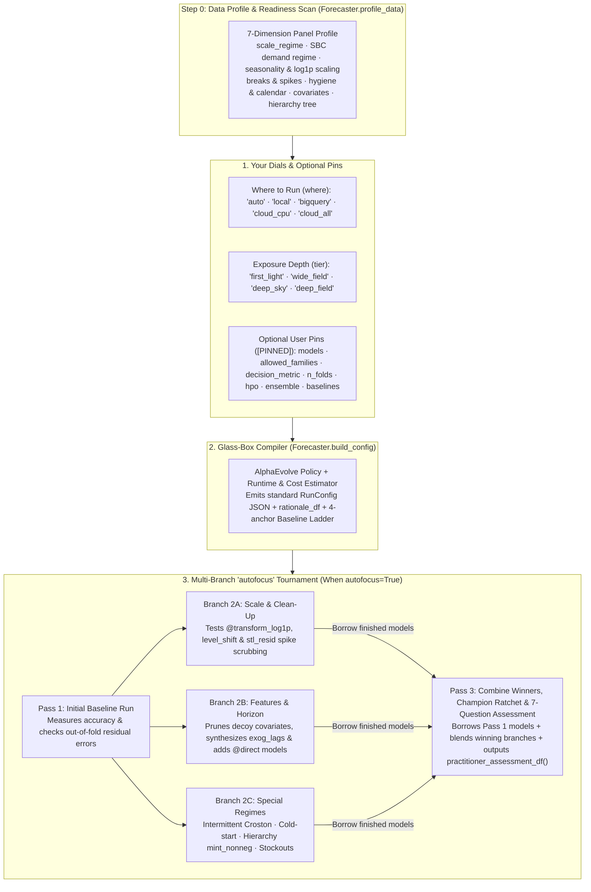

# Glass-Box Auto-Forecaster & Multi-Branch `autofocus`

> **Glass-Box Auto-Forecaster Documentation Suite:** **Main Guide & Architecture (`auto_forecaster.md`)** · [**29 Benchmarks & AlphaEvolve (`auto_forecaster_benchmarks.md`)**](./auto_forecaster_benchmarks.md) · [**7-Runtime Cloud Scale & AutoML (`auto_forecaster_cloud_scale.md`)**](./auto_forecaster_cloud_scale.md)

When you sit down to forecast a new dataset, you usually face an uncomfortable trade-off:

- **Manual trial and error takes days:** Choosing among 37 models, target transforms (`log1p`), outlier scrubbing, feature lags, backtest folds, ensembles, and 7 Google Cloud runtimes—and running jobs one by one to see what actually improves accuracy—takes hours or days of manual experimentation.
- **Black-box "AutoML" hides the why and takes away control:** Most automated forecasting tools swallow your DataFrame, pick a model behind the scenes, and hand back predictions with no explanation of *why* those choices were made—and no way to restrict the search to the models, metrics, or runtime budgets your team trusts.

`scale-forecasting` gives you a third option: **[`Forecaster.build_config()`](api/sdk.md)** and **[`Forecaster.auto()`](api/sdk.md)** act as a **100% glass-box auto-forecaster**.

1. **Every decision is explained in plain English:** Whether you compile a configuration up front (`Forecaster.build_config()`) or run an automated multi-pass tournament (`Forecaster.auto()`), you get a clear, row-by-row rationale table explaining *what* was chosen and *why* (for example, switching to `mase` and adding `croston` because a panel is mostly zeros, or dropping three noisy feature columns that contributed almost nothing in Pass 1).
2. **You can leave everything on autopilot—or pin any rule you care about:** Start with two simple dials (**`where`** to run and which exposure **`tier`** to use), or pin specific model families, exact model lists, your business metric (`wape`, `mase`, `pinball`, `crps`), backtest folds, hyperparameter tuning (`hpo`), ensembles, or hard time and cost limits (`max_minutes`, `max_usd`).
3. **Multi-pass `autofocus` learns across passes without re-fitting finished models:** When `autofocus=True`, the controller runs an initial pass, checks the backtest errors to see what is still missing, tests targeted improvements in parallel **"what-if" branches (`2A`, `2B`, `2C`)**, **reuses ("borrows") models that already finished in Pass 1** so you never pay to train them twice, and uses a **Champion Ratchet** so your final result is guaranteed never to be worse than an earlier pass.

> [!IMPORTANT]
> **Evolved with AlphaEvolve on Gemini Enterprise — Zero LLM Calls at Runtime**
>
> Rather than relying on hand-tuned human guesswork, the tier defaults and `autofocus` decision rules in [`scale_forecasting.auto_policy`](api/auto.md) were discovered and calibrated using **AlphaEvolve on Gemini Enterprise** (`discoveryengine.googleapis.com/v1alpha`, powered by **`gemini-3.8-flash`** and **`gemini-4-argon`**). AlphaEvolve iteratively mutated and scored candidate decision policies against **20 ground-truth test panels**—improving composite policy fitness from `26.08` to `74.82` (`+41.96%` average improvement over a seasonal naive baseline and `+24.16%` multi-pass error reduction).
>
> Once evolved, the winning rules were compiled directly into deterministic pure Python (`auto_policy.py`). **When you run `Forecaster.build_config()` or `Forecaster.auto()`, there are zero LLM calls, zero external API dependencies, and 100% reproducible behavior.**

> [!NOTE]
> **Two everyday terms used on this page: DGP and FVA**
>
> - **DGP (Data-Generating Process):** A **synthetic test dataset built from a known mathematical recipe**. On real-world data, you never know with 100% certainty whether a promotion column is true signal or random coincidence. By testing our auto-forecaster on **20 synthetic "known-recipe" datasets (DGPs)**—where we deliberately planted specific seasonal patterns, stockouts, price spikes, hierarchies, missing gaps, or fake noise columns—we can verify that `autofocus` discovers the real drivers and ignores the fake noise.
> - **FVA (Forecast Value Added):** How much a model or `autofocus` pass **reduces forecast error compared to a baseline**. Every auto run compares your champion against a **4-anchor baseline ladder** (seasonal naive `naive_seasonal`, smooth univariate `theta` / `arima_plus@univariate`, and zero-shot univariate foundation models `chronos_bolt` / `timesfm_torch@v2.5_univariate` / `timesfm@univariate`), and if a simple univariate model beats every complex model, `f.baseline_value_df()` explicitly highlights which complex challengers it beat.

### How This Differs from Manual Trial-and-Error and Black-Box AutoML

You never have to choose between writing a [`RunConfig`](configuration_reference.md) by hand and using the Auto-Forecaster—they speak the exact same JSON contract. You can ignore Auto-Forecaster completely and author manual configs, or use `Forecaster.build_config()` on Day 1 to generate a smart `RunConfig` JSON file and edit it by hand from Day 2 onward:

| Dimension | Manual Trial-and-Error | Typical Black-Box AutoML | `scale-forecasting` Glass-Box Auto-Forecaster & `autofocus` |
| :--- | :--- | :--- | :--- |
| **1. Transparency & Ownership** | You control every knob, but spend days testing combinations of models, transforms, lags, and runtimes by hand. | Swallows your DataFrame, trains behind a curtain, and returns predictions with no explanation of *why* choices were made. | **100% Glass-Box Compiler:** Prints a plain-English rationale table (`bp.explain()`) for every decision *and* exports a standard, editable `RunConfig` JSON file (`bp.to_file()`). |
| **2. Step 0 Data Readiness & Post-Run Trust** | You write custom exploratory notebooks to check zeros, gaps, scaling, and covariate leakage. | Jumps straight into model training without explaining data pathologies or proving model trust. | **Built-in Profile & 7-Question Assessment:** Runs a **Step 0 Data Profile** (`Forecaster.profile_data()` / `bp.profile_df()`) up front and a **7-Question Practitioner Assessment** (`f.practitioner_assessment_df()`, `f.compare_models()`) after execution. |
| **3. Co-Design of Models + Cloud Compute** | You manually size VMs, GPUs, and worker pools when scaling from 10 series to 100,000. | Assumes a single Python process or one fixed cluster architecture. | **Joint Model & Runtime Sizing:** Co-designs the model shortlist and the **7 Google Cloud runtimes** across 5 scale regimes (`micro` `<15` series to `hyperscale` `25,000+` series) and time/cost budgets. |
| **4. Iterative Refinement & Compute Reuse** | Changing one feature or transform means re-running the entire pipeline from scratch. | Either runs a single static pass or brute-forces dozens of heavy models upfront. | **Multi-Branch `autofocus` DAG + Cell Borrowing:** Runs a fast Pass 1 probe, tests isolated upgrades in parallel branches (`2A` scale/outliers, `2B` feature pruning/horizon, `2C` intermittent/hierarchy/stockouts), **borrows Pass 1's finished `(ts_id, model)` cells**, and locks in the winner via the **Champion Ratchet**. |
| **5. "Earn Your Complexity" Baseline Proof** | Easy to overfit noisy promotion/price columns without realizing a simple univariate model was more accurate. | Often selects a complex ensemble or deep network without proving statistically significant lift over simple baselines. | **4-Anchor Baseline Value Ladder:** Protects seasonal naive, plain univariate (`theta`), and dual-mode foundation baselines (`@univariate` vs. `@global_cov_all`). When a plain univariate model beats every complex challenger, it wins the session and lists the complex models it defeated (`f.baseline_value_df()`). |
| **6. User Scope Pins (`[PINNED]`)** | You maintain separate config files for every team constraint. | Take-it-or-leave-it automation; hard to lock specific model families, metrics, or fold counts. | **Pin Any Dial:** Lock `allowed_families`, `models`, `decision_metric`, `n_folds`, `hpo`, `ensemble`, `holidays`, or `baselines`; `autofocus` explores strictly around your pins. |
| **7. How the Decision Rules Were Built** | Individual intuition and fragile rules of thumb. | Static vendor heuristics or slow, non-deterministic runtime LLM agent calls. | **Evolved with AlphaEvolve on Gemini Enterprise (`26.08 -> 74.82` fitness across 20 synthetic data recipes)** and compiled into pure Python (**zero LLM calls at runtime**). |

---

## 1. Start in 30 Seconds

### Pattern A — Forecast a DataFrame or BigQuery table on full autopilot (`Forecaster.auto`)

Pass any pandas DataFrame (for local in-memory execution) or BigQuery table name (for cloud execution). With `autofocus=True`, `Forecaster.auto()` profiles the panel, runs Pass 1, inspects the out-of-fold errors, tests targeted follow-up passes if needed, and produces the **7-Question Practitioner Assessment**:

```python
from scale_forecasting import Forecaster, load_benchmark

# Load one of the 20 built-in synthetic test panels (or pass your own DataFrame / BigQuery table)
ds = load_benchmark("dgp_04_true_vs_decoy_covs", n_series=6)

f = Forecaster.auto(
    ds.panel_df,
    tier="first_light",
    where="local",
    autofocus=True,
    max_passes=3,
)

# 1. Step 0 Data Profile & 7-Question Practitioner Trust Assessment
display(f.profile_df())
display(f.practitioner_assessment_df())

# 2. Head-to-head model comparison ("Is the champion better than Model X?") & Baseline Ladder
display(f.compare_models())
display(f.baseline_value_df())

# 3. Pass-by-pass tournament ledger, exact config diffs, and leaderboard
display(f.autofocus_ledger_df())
display(f.autofocus_diff_df())
display(f.leaderboard_df())
```

### Pattern B — Preview your data & compile a configuration before running (`Forecaster.profile_data` & `Forecaster.build_config`)

Want to see what your data looks like and *what* the auto-forecaster recommends before launching any jobs? `Forecaster.profile_data()` runs a sub-second Step 0 readiness scan, and `Forecaster.build_config()` returns a **`ConfigBlueprint`** containing a standard, editable [`RunConfig`](configuration_reference.md), a plain-English rationale table, and an approximate runtime/cost estimate:

```python
from scale_forecasting import Forecaster, load_benchmark

ds = load_benchmark("dgp_04_true_vs_decoy_covs", n_series=6)

# Optional: inspect the 7-dimension Step 0 Data Profile directly
display(Forecaster.profile_data(ds.panel_df, horizon=14))

blueprint = Forecaster.build_config(
    ds.panel_df,
    tier="wide_field",
    where="local",
    goal="accuracy",
    include_models=["regression_lags"],
    exclude_models=["xgboost"],
    decision_metric="wape",
    n_folds=2,
    max_minutes=3.0,
)

# Print the human-readable summary and rationale table
print(blueprint.explain())

# Tweak any setting or save as a standard RunConfig JSON file
custom_bp = blueprint.with_overrides(run_name="custom-wide-field")
custom_bp.to_file("/tmp/my_compiled_auto.json")
```

Every compiled `ConfigBlueprint` emits a standard `RunConfig` JSON file that works everywhere in `scale-forecasting` (CLI, SDK, Notebooks, and Cloud Composer):

```json
{
  "run_name": "auto-wide-field",
  "data": {
    "source_table": "dataframe_panel",
    "ts_id_col": "ts_id",
    "date_col": "ds",
    "target_col": "y",
    "freq": "D",
    "horizon": 14
  },
  "models": [
    "naive_seasonal",
    "theta",
    "holtwinters",
    "lightgbm",
    "regression_lags"
  ],
  "features": {
    "future_covariates": [
      "promo_depth",
      "price_index",
      "noise_a",
      "noise_b",
      "noise_c"
    ],
    "include_univariate_baselines": true
  },
  "backtest": {
    "enabled": true,
    "n_folds": 2,
    "horizon": 14,
    "step": 14,
    "min_train": 100,
    "decision_metric": "wape"
  },
  "output": {
    "floor": 0.0,
    "quantiles": [0.1, 0.5, 0.9]
  },
  "ensemble": {
    "enabled": true,
    "strategies": ["inverse_error", "nnls", "ridge", "champion"]
  }
}
```

### Pattern C — Step through `autofocus` one pass at a time (`step_by_step=True`)

If you want a human in the loop between passes, set `step_by_step=True`. `Forecaster.auto()` runs Pass 1 and pauses so you can preview the exact changes it proposes for Pass 2 before deciding whether to continue:

```python
f = Forecaster.auto(ds.panel_df, tier="first_light", autofocus=True, step_by_step=True)

preview = f.preview_next_loop()
print(f"Recommended to continue: {preview.should_continue} (confidence={preview.confidence:.2f})")
display(preview.mutations_df)

if preview.should_continue:
    f.step()
```

### Pattern D — Run from the CLI or emit a Cloud Composer 3 / Airflow DAG (`--init-config`, `--auto`, `--emit-out`)

```bash
# List and inspect the 20 built-in synthetic test panels (DGPs)
python -m scale_forecasting.benchmarks --list
python -m scale_forecasting.benchmarks --summary

# Generate a RunConfig JSON file from a dataset without running it
python -m scale_forecasting.main --auto --benchmark dgp_02_multiplicative_log \
  --tier wide_field --where local --init-config /tmp/auto_dgp02.json

# Run closed-loop autofocus directly from your terminal
python -m scale_forecasting.main --auto --benchmark dgp_04_true_vs_decoy_covs \
  --tier first_light --where local --autofocus --max-passes 3

# Emit a standalone multi-branch autofocus Airflow / Cloud Composer 3 DAG
python -m scale_forecasting.main --auto --table source_series_native \
  --tier wide_field --autofocus --autofocus-mode dag --max-passes 3 \
  --init-config /tmp/auto_wide_field.json --emit-out /tmp/dag_autofocus.py
```

### Works Across All 6 Execution Surfaces

Both the 4 exposure tiers (`first_light`, `wide_field`, `deep_sky`, `deep_field`) and multi-pass `autofocus` run identically across every launch surface in `scale-forecasting`:

| Surface | Tier Compilation & Single-Pass Execution | Multi-Pass `autofocus` Tournament (`dag` or `linear`) |
| :--- | :--- | :--- |
| **1. Python SDK** | `Forecaster.build_config(data, tier=...)` or `Forecaster.auto(data, autofocus=False)` | `Forecaster.auto(data, tier=..., autofocus=True, autofocus_mode="dag")` |
| **2. Interactive Notebooks** | [`11_auto_forecaster_and_autofocus.ipynb`](notebooks/11_auto_forecaster_and_autofocus.ipynb) (`bp.rationale_df`, `bp.profile_df()`) | Inline tournament ledgers, Baseline Value Ladder, and 7-Question Practitioner Assessment |
| **3. Local CLI** | `python -m scale_forecasting.main --auto --tier <tier> [--init-config out.json]` | `python -m scale_forecasting.main --auto --tier <tier> --autofocus --max-passes 3` |
| **4. Cloud Composer 3 / Airflow** | `bp.emit_airflow_dag(autofocus=False)` or `--auto --emit-airflow` | `bp.emit_airflow_dag(autofocus=True)` (`autofocus_pass_1 >> [branch_2a, 2b, 2c] >> synthesis`) |
| **5. Headless Cloud Batch** | Container args `["--auto", "--table", "proj.ds.tbl", "--tier", "deep_sky"]` | Container args `["--auto", "--table", "proj.ds.tbl", "--tier", "deep_sky", "--autofocus"]` |
| **6. Built-in MCP Server** | `build_auto_config` tool (returns `config`, `profile_table`, `rationale`, `duration_estimate`) | `run_auto_forecast` tool (returns `autofocus_ledger`, `baseline_value`, `practitioner_assessment`) |

---

## 2. Answering the 7 Questions Every Forecaster Asks (`f.practitioner_assessment_df()`)

In real-world forecasting reviews, stakeholders and senior practitioners rarely ask *"Did the job finish?"*—they ask **seven recurring trust questions**. Every `Forecaster.auto()` run answers all seven automatically via **`f.practitioner_assessment_df()`**, **`f.compare_models()`**, **`f.baseline_value_df()`**, and **`f.hierarchy_value_df()`**:

| Question Every Forecaster Asks | How `scale-forecasting` Answers It with Hard Evidence | SDK Method to Inspect |
| :--- | :--- | :--- |
| **1. *"Is this model really better than Model X (or a simple baseline)?"*** | Scores every candidate on identical expanding/sliding backtest folds against a **4-anchor Baseline Ladder** (`naive_seasonal`, plain univariate `theta`/`arima_plus@univariate`, and zero-shot foundation `chronos_bolt`/`timesfm`), reporting FVA %, series-by-series win rate %, and Diebold–Mariano $p$-value. | `f.compare_models(model_a, model_b)`<br/>`f.baseline_value_df()` |
| **2. *"Do ensembles actually help here, or is a single model better?"*** | Evaluates consensus and learned stackers (`inverse_error`, `nnls`, `ridge`, `xgb`, `horizon_specialist`) against the best single base model and enforces a **parsimony margin (`0.5%`)**: an ensemble is only crowned if it beats the best single model by a meaningful margin. | `f.practitioner_assessment_df()`<br/>`f.leaderboard_df()` |
| **3. *"Do covariates (promos, price) help, or are they just overfitting noise?"*** | Benchmarks multivariate models (`@cov_all`) against paired univariate twins (`@univariate`), computes feature attributions (`TreeSHAP` / linear shares), and automatically prunes noisy ("decoy") covariates in Branch `2B`. If all extra columns are noise, a plain univariate model wins and lists the complex models it beat. | `f.attributions_df()`<br/>`f.baseline_value_df()` |
| **4. *"Does cross-series `@global` pooling beat per-series `@local` fitting?"*** | Classifies the panel into 5 scale regimes (`micro` to `hyperscale`) and measures cross-series correlation (`cross_series_corr`). Defers heavy `@global` neural nets on tiny panels where they overfit, and runs `@local` vs. `@global` head-to-head on `small`/`medium`/`large` panels. | `f.profile_df()`<br/>`f.compare_models()` |
| **5. *"Is hierarchical reconciliation done properly without hurting good levels?"*** | Estimates error covariance strictly inside each backtest fold (zero lookahead leakage), selects scale-appropriate reconciliation (`mint_nonneg`, `wls_struct`, `wls_var`, `bottom_up`), verifies exact additive coherence (`0.000000` gap) and `0` negative leaves, and reports accuracy lift at `Root`, `Intermediate`, and `Leaf` levels. | `f.hierarchy_value_df()`<br/>`f.hierarchy_df()` |
| **6. *"Does accuracy hold up across the whole horizon, or fade after a few days?"*** | Measures step-by-step error from $h = 1 \dots H$ (`late_horizon_degradation_ratio`), identifies the horizon crossover step $h^*$, and injects `@direct` multi-horizon models + `horizon_specialist` blending when recursive rollouts decay. | `f.horizon_decay_df()`<br/>`f.practitioner_assessment_df()` |
| **7. *"How do I trust this forecast in production?"*** | Combines distribution-free conformal prediction intervals, directional bias & Trigg Tracking Signal audits, a residual white-noise stop gate, and the **Champion Ratchet** (guaranteeing a later `autofocus` pass can never overwrite a better earlier pass). | `f.assess()`<br/>`f.explain_auto_decisions_df()` |

### Complete SDK Inspection & Downstream Action Cheat-Sheet (`bp` & `f`)

Every `ConfigBlueprint` (`bp = Forecaster.build_config(...)`) and `Forecaster` (`f = Forecaster.auto(...)`) exposes a complete suite of inspection, audit, and operational decision tables:

| Lifecycle Stage | Method / Property | What It Returns & Why You Use It |
| :--- | :--- | :--- |
| **1. Pre-Run Data & Blueprint Inspection (`bp`)** | `Forecaster.profile_data(data)` / `bp.profile_df()` | **7-Dimension Step 0 Data Profile:** Summarizes scale regime, SBC demand regime, seasonality/`log1p`, breaks/outliers, calendar/gaps, covariates, and hierarchy tree before fitting any models. |
| | `bp.explain()` / `bp.rationale_df` | **Plain-English Compiler Rationale:** Row-by-row table showing every synthesized `RunConfig` parameter, its chosen value, the empirical evidence from Step 0, and any `[PINNED]` user constraints. |
| | `bp.duration_estimate` / `bp.cost_estimate_usd` | **Parametric Runtime & Cloud Cost Estimate:** Predicted `P50` / `P90` wall-clock minutes (`bp.estimated_minutes_p50`) and approximate cloud spend ceiling (`USD`). |
| | `bp.with_overrides(...)` / `bp.to_file(path)` | **Zero-Cost Re-Compilation & JSON Export:** Modify any dial or `RunConfig` field without re-profiling the data, or export a standard `RunConfig` JSON file for CLI/Git/CI. |
| | `bp.emit_airflow_dag(autofocus=...)` | **Cloud Composer 3 / Airflow DAG Generator:** Emits a standalone Python DAG file (`autofocus=False` single-pass or `autofocus=True` multi-branch tournament DAG). |
| **2. Post-Run Trust & `autofocus` Audit (`f`)** | `f.assess()` / `f.practitioner_assessment_df()` | **7-Question Practitioner Assessment:** Formatted text report (`assess()`) or 7-row `DataFrame` answering the 7 core trust questions with metrics and verdicts. |
| | `f.compare_models(model_a, model_b)` | **Head-to-Head Model Comparison:** Score delta, FVA lift %, series win rate %, and Diebold–Mariano $p$-value between any two models (or the champion vs. all contenders). |
| | `f.baseline_value_df()` | **4-Anchor Baseline Value Ladder:** Compares the champion against `naive_seasonal`, plain univariate (`theta`), zero-shot foundation (`chronos_bolt`/`timesfm`), and Pass 1—plus `"beaten_complex_challenger"` rows when a simple univariate model wins. |
| | `f.hierarchy_value_df()` / `f.hierarchy_df()` | **Hierarchical Coherence & Lift:** Accuracy lift by tree level (`Root`, `Intermediate`, `Leaf`) and verification of `0.000000` additive coherence gap. |
| | `f.autofocus_ledger_df()` / `f.autofocus_diff_df()` | **Multi-Branch Tournament Ledger & Diffs:** Pass-by-pass audit table (`1`, `2A`, `2B`, `2C`, `3`), models executed vs. borrowed, and exact parameter/score diffs across passes. |
| | `f.explain_auto_decisions_df()` | **Unified End-to-End Audit Trail:** Combines Step 0 Pass 1 rationales with every Pass 2 / Pass 3 `autofocus` mutation and its realized accuracy change. |
| | `f.preview_next_loop()` / `f.step()` | **Human-in-the-Loop Stepping:** Preview proposed next-pass mutations, borrowed models, and `continue_confidence` before executing one pass at a time. |
| **3. Forecasts, Diagnostics & Operational Actions (`f`)** | `f.leaderboard_df(all_metrics=True)` | **Model Leaderboard:** Ranked out-of-fold accuracy across all evaluated base models and ensemble strategies (pass `all_metrics=True` for all 21 metrics). |
| | `f.predictions_df()` / `f.plot_forecasts()` | **Forecasts & Visual Trajectories:** Tidy `DataFrame` and matplotlib plot combining historical actuals, out-of-fold backtests, and future forecasts with prediction intervals. |
| | `f.attributions_df()` / `f.horizon_decay_df()` / `f.bias_report_df()` | **Deep Diagnostics:** Covariate/lag attribution shares (`TreeSHAP`/linear), step-by-step horizon accuracy decay ($h=1\dots H$), and directional bias / Trigg Tracking Signal flags. |
| | `f.inventory_policy_df()` / `f.simulate_scenarios()` | **Operational Replenishment & What-If Scenarios:** Reorder points (`ROP`), safety stock (`SS`), and counterfactual promo/price shock simulations. |
| | `f.detect_anomalies_df()` / `f.detect_change_points_df()` / `f.exceptions_df()` | **Anomaly, Regime Break & Exception Triage:** Historical/live anomaly detection, structural regime change points, and Top-$N$ operational exception queue. |
| | `f.export_report("report.html")` | **Self-Contained HTML Executive Report:** Exports leaderboards, `autofocus` ledger, FVA ladder, bias/exception queues, and forecast plots into a single shareable `.html` file. |

---

## 3. How It Works: Two Simple Dials (`tier` and `where`)



### Step 0 — What the 7-Dimension Data Profile Measures (`Forecaster.profile_data` / `f.profile_df()`)

Before choosing a single model, `Forecaster.profile_data(data)` (also available as `bp.profile_df()` and `f.profile_df()`) scans your panel in under a second and produces a **7-row readiness profile** that drives every downstream compiler rule:

| Step 0 Dimension | Key Metrics Measured (`PanelAutoProfile`) | How It Shapes the Compiled `RunConfig` & `autofocus` |
| :--- | :--- | :--- |
| **1. `scale_regime`** | `n_series`, `median_n_obs`, `total_observations`, `scale_regime` (`micro` \| `small` \| `medium` \| `large` \| `hyperscale`), `cross_series_corr` | Determines whether `@global` neural/tree pooling is safe (`small+`) or would overfit (`micro`), trims slow per-series iterative models at `hyperscale`, and sizes cloud worker pools. |
| **2. `demand_regime` (SBC)** | `zero_share`, `adi` (Average Demand Interval), `cv2` (Squared Coefficient of Variation), `dominant_regime` (`smooth` \| `erratic` \| `intermittent` \| `lumpy`), `has_cold_start` | Switches `decision_metric` from `wape` to scale-free `mase` when zeros exceed `20%`, injects `croston@tsb` / `croston@sba` / `naive_mean`, and enables `regime_routing=True` on mixed/cold-start panels. |
| **3. `seasonality_and_transform`** | `freq`, `seasonal_period`, `seasonality_strength`, `variance_mean_corr`, `recommends_log1p`, `strictly_non_negative` | Selects Fourier harmonics (including `365.25d` annual and `24h`/`12h`/`168h` sub-daily), sets `output.floor = 0.0` on non-negative demand, and triggers `@transform_log1p` in Pass 1 or Branch `2A`. |
| **4. `structural_breaks_and_outliers`** | `structural_break_share`, `outlier_spike_share`, `trend_strength`, `recommends_damped_trend` | Enables `features.level_shift = True` when structural step changes are detected and `data.outlier_policy = "stl_resid"` when isolated $>6\sigma$ spikes are present. |
| **5. `data_hygiene_and_calendar`** | `leading_zero_share`, `missing_gap_share`, `recommends_trading_days` | Enables `trim_leading_zeros = True` (pre-launch zeros), `grid_policy = "fill_zero"` (missing date gaps), and `trading_days = True` on monthly/quarterly business series. |
| **6. `covariates_and_lags`** | `known_future_covariates`, `past_covariates`, `static_covariates`, `has_stockout_flag` | Configures `@cov_all` vs. `@univariate` ablation pairs, enables `stockout_imputation = True` when `stockout_flag` is present, and prepares Branch `2B` decoy pruning and `exog_lags` synthesis. |
| **7. `hierarchy_structure`** | `hierarchy_cols`, `n_hierarchy_levels`, `n_bottom_series` | Selects scale-appropriate hierarchical reconciliation (`mint_nonneg`, `wls_struct`, `wls_var`, `bottom_up`) so forecasts sum coherently across every tree level. |

### Dial 1 — Exposure Depth (`tier`)

Just as an astronomical observatory starts with a quick **"first light"** snapshot to check alignment before taking a **"wide field"** or **"deep field"** exposure, `tier` controls how broadly and deeply the auto-forecaster searches:

| Exposure Tier | When to Use It | Approximate Time (`local` / `bigquery` / Cloud) | Default `autofocus` Depth | Backtest Folds | What It Runs |
| :--- | :--- | :---: | :---: | :---: | :--- |
| **`"first_light"`** | Quick sanity check, fast iteration, or starting point for multi-pass `autofocus` | `~15s` / `~1m` / `~6m` | Up to `2` levels | `1` | Fast baseline portfolio (`naive_seasonal`, `theta`, `lightgbm`, plus `croston@tsb` on zero-heavy data or `arima_plus` on BigQuery). Intentionally lean so Pass 2 can test targeted upgrades while borrowing Pass 1's models. |
| **`"wide_field"`** *(Default)* | Everyday production forecasting with a balanced mix of speed and accuracy | `~90s` / `~2m` / `~10m` | Up to `2` levels | `2` | Multi-family survey across Statistical (`theta`, `holtwinters`, `fft`), ML Trees (`lightgbm`, `xgboost`, `regression_lags`), and Zero-Shot Foundation (`chronos_bolt`, `timesfm`), with automatic `log1p`, `level_shift`, and outlier scrubbing (`stl_resid`). |
| **`"deep_sky"`** | High-value panels where cross-series global models and hyperparameter tuning pay off | `~4m` / `~5m` / `~18m` | Up to `3` levels | `3` | Adds cross-series global deep learning (`tide@global`, `tsmixer@global`) and richer statistical/tree models (`catboost`, `autoets`, `stl_bagging`, `sarimax`), Optuna HPO (`6` trials), and learned stacking (`nnls`, `ridge`). |
| **`"deep_field"`** | Exhaustive benchmark bakeoffs and maximum-accuracy tournaments | `~12m` / `~8m` / `~35m` | Up to `4` levels | `3` | Full benchmark across all eligible families (`patchtst@global`, `tft@global`, `chronos2@global`, `arima_plus`), automatic covariate ablation (`@cov_all` vs. `@univariate`), HPO (`12` trials), and full ensemble blending (`xgb`, `nnls`, `ridge`, `horizon_specialist`, `champion`). |

### Dial 2 — Where to Run & Optional Scope Pins

You can let the tier pick everything automatically, or pin any combination of parameters below. Every pinned choice is marked as `[PINNED]` in the rationale table and respected across every `autofocus` pass:

| Parameter | Options | Plain-English Behavior |
| :--- | :--- | :--- |
| **`where`** | `"auto"` \| `"local"` \| `"bigquery"` \| `"cloud_cpu"` \| `"cloud_all"` | • `"auto"`: Runs `"local"` on a pandas DataFrame and `"cloud_all"` on a BigQuery table.<br/>• `"local"`: Runs in memory on your machine using installed packages (no GCP needed).<br/>• `"bigquery"`: Runs 100% inside BigQuery SQL (`arima_plus`, `timesfm`) with zero VMs.<br/>• `"cloud_cpu"`: Serverless CPU fleet (`spark` for stats/ML, CPU `vertex` for deep learning).<br/>• `"cloud_all"`: Full cloud fleet with `L4` GPUs for `deep_learning`. |
| **`goal`** | `"accuracy"` \| `"probabilistic"` \| `"service_level"` \| `"fast"` | • `"accuracy"`: Optimizes point forecast accuracy (`wape` on smooth data, `mase` on zero-heavy data) with 80% intervals.<br/>• `"probabilistic"`: Optimizes full distribution accuracy (`crps`) across 5 quantiles (`0.05` to `0.95`).<br/>• `"service_level"`: Optimizes high service-level quantiles (`pinball` up to `0.98`) for safety-stock and inventory planning.<br/>• `"fast"`: Restricts to fast statistical and tree models with 1 backtest fold. |
| **`allowed_families`** | List of family names | Restrict candidate models to any subset of `["statistical", "ml", "deep_learning", "automl", "native"]`. |
| **`models`** | List of model names | Pin an exact list of models for Pass 1; `autofocus` will tune transforms, features, HPO, and ensembles around your list without adding unapproved model families. |
| **`include_models` / `exclude_models`** | List of model names | Force specific models to always stay in the run (never trimmed by budget limits) or block specific models from ever being used. |
| **`decision_metric`** | Any of the 21 metric names | Pin the metric used to rank models and pick the winner (for example, `"wape"`, `"mase"`, `"rmsse"`, `"mae"`, `"pinball"`, `"crps"`). |
| **`n_folds`** | Integer (`1`–`10`) | Pin the number of rolling backtest folds. Using `2` or more folds automatically unlocks learned ensemble stackers (`nnls`, `ridge`). |
| **`hpo`** | `True` \| `False` \| `dict` | Turn Optuna hyperparameter tuning on or off, or pass custom settings (such as `{"enabled": True, "n_trials": 15}`). |
| **`ensemble`** | `True` \| `False` \| `list` \| `dict` | Turn ensembling on or off, or pass the exact blending strategies you want (`["inverse_error", "nnls", "horizon_specialist"]`). |
| **`explainability`** | `True` *(default)* \| `False` | Ensures at least one model that produces feature attributions (`attributions_df()`) is included in the run. |
| **`calibration`** | `True` \| `False` \| `DurationCalibration` | Enable conformal point/interval calibration (`True`), or pass a custom `DurationCalibration` profile for runtime estimation. |
| **`baselines`** | `"auto"` *(default)* \| `str` \| `list[str]` | Choose the baseline anchors used to measure Forecast Value Added (`f.baseline_value_df()`). `"auto"` includes `naive_seasonal`, `theta` (or `croston@tsb` on intermittent data), `arima_plus@univariate` on BigQuery, and zero-shot foundation models (`chronos_bolt` / `timesfm_torch@v2.5_univariate` / `timesfm@univariate`). |
| **`holidays`** | `str` \| `list[str]` \| `None` | Pass country holiday calendars (such as `"US"` or `["US", "UK"]`) for holiday dummy and proximity features. |
| **`autofocus_mode`** | `"dag"` *(default)* \| `"linear"` | `"dag"` tests independent improvements in parallel branches (`2A`, `2B`, `2C`) and merges the winners; `"linear"` applies changes in a single sequential chain. |
| **`max_minutes` / `max_usd`** | `float` | Set a target wall-clock time (in minutes) or approximate cloud spend ceiling (in USD). |
| **`include_automl`** | `False` *(default)* \| `True` | Opt-in flag on `deep_field` (`where="cloud_all"`) to include managed Vertex AI AutoML global tabular workflows (`vertex_tide`, `vertex_l2l`, `automl`). |
| **`reuse_prior_runs`** | `True` *(default)* \| `False` | When `True`, cloud `autofocus` queries BigQuery for prior runs with matching `model_spec_hash` and borrows finished `(ts_id, model_type)` cells without re-training. |
| **`base_config` / `overrides`** | `RunConfig` / `dict` | Start from an existing `RunConfig` file/dict or deep-merge custom `RunConfig` fields at the end. |

### How Series Count (`n_series`), Baselines, and Hierarchies Shape the Plan

1. **Five `n_series` Scale Regimes (`micro` to `hyperscale`):**
   The number of time series in your panel changes both *which models can learn effectively* and *where they should run*:
   - **`micro` (`1`–`9` series):** Global deep-learning networks (`tide@global`, `patchtst@global`) overfit tiny panels, so `build_config()` prioritizes local statistical (`theta`, `holtwinters`), tree (`lightgbm`, `regression_lags`), and zero-shot pretrained foundation models (`chronos_bolt`, `timesfm_torch@v2.5_univariate`).
   - **`small` (`10`–`99` series):** Unlocks cross-series global tree models (`lightgbm@global`, `xgboost@global`) and compact global MLPs (`tide@global`).
   - **`medium` (`100`–`999` series) & `large` (`1,000`–`9,999` series):** Full global deep-learning and foundation fine-tuning sweet spot (`tsmixer@global`, `patchtst@global`, `tft@global`). When `n_series > 250` (`medium`) or `> 1,000` (`large`), `where="auto"` warns or routes heavy deep-learning and multi-pass jobs to cloud runtimes (`spark`, `vertex`, `bigquery`) rather than bogging down a single laptop CPU.
   - **`hyperscale` (`10,000+` series):** Automatically trims slow per-series iterative statistical models (`sarimax`, `stl_bagging`, `tbats`) in favor of vectorized statistical models (`theta`, `fft`), global trees, global GPU deep learning, and BigQuery-native `arima_plus` / `timesfm`.

2. **The 4-Anchor Baseline Value Ladder (`f.baseline_value_df()`):**
   Every auto-forecast run measures how much error your champion actually removes compared to four transparent anchors:
   - **Anchor 1 — Seasonal Naive (`naive_seasonal`):** The universal floor (`fva_vs_baseline_pct`).
   - **Anchor 2 — Best Simple Univariate (`theta`, `croston@tsb`, or `arima_plus@univariate`):** Proves whether complex ML, covariates, or global pooling actually beat a fast univariate statistical model (`fva_vs_univariate_pct`).
   - **Anchor 3 — Zero-Shot Univariate Foundation (`chronos_bolt`, `timesfm_torch@v2.5_univariate`, `timesfm@univariate`):** Measures lift over a pretrained foundation model running without covariates (`fva_vs_foundation_pct`), while also testing multivariate foundation modes (`timesfm_torch@global_v2.5_cov_all`, `timesfm@cov_all`) when covariates are present.
   - **Anchor 4 — Pass 1 Champion:** Proves the value of `autofocus` passes 2 and 3.
   - **What if a simple univariate model wins?** If a plain univariate or univariate foundation model beats every complex multivariate/global model (for example, when all extra feature columns are pure noise), **it becomes the Session Champion** (`champion_is_univariate=True`) and `f.baseline_value_df()` adds `"beaten_complex_challenger"` rows highlighting the complex models it defeated.

3. **Scale-Aware Hierarchical Reconciliation (`f.hierarchy_value_df()`):**
   When `hierarchy_cols` are present, `build_config()` and Branch `2C` automatically select reconciliation methods (`bottom_up`, `ols`, `wls_struct`, `wls_var`, `mint_shrink`, `mint_nonneg`) matched to the total number of nodes in the tree and target non-negativity, and `f.hierarchy_value_df()` reports base vs. reconciled accuracy at every tree level (`Root`, `Intermediate`, `Leaf`).


### How Foundation & `@global` Models Work (`chronos2` vs. `chronos_bolt` vs. `timesfm_torch` vs. `timesfm`)

When inspecting Auto-Forecaster leaderboards across tiers and runtimes, you will see foundation and neural models appear with suffixes such as **`@global`**, **`@local`**, **`@univariate`**, and **`@cov_all`** (for example, `chronos2@global_univariate`, `chronos2@local_cov_all`, `timesfm_torch@global_univariate`, `timesfm@cov_all`, or `chronos_bolt@global`).

These suffixes reflect **two independent architectural questions**:

1. **Axis 1 — How are multiple time series passed to the model, and do series learn from each other (`@local` vs. `@global`)?**
   - **`@local` (`1` time series at a time via `run_cell`):** Each `ts_id` is passed into the model in isolation. Series `A` never sees Series `B`.
   - **`@global` (All $N$ time series passed together as a panel via `run_panel_model`):** You hand the model all $N$ time series at the same time. Depending on the model family, passing the whole panel at once does one of three things:
     1. **Zero-Shot Cross-Series Group Attention (`chronos2@global`):** When **`chronos2`** (`amazon/chronos-2`) runs in `@global` mode on a multi-series panel (`len(items) > 1`), it automatically enables **`cross_learning=True`**. Inside the transformer, **Group Self-Attention** operates across *both* the covariates of each series *and* across the different time series (`ts_id_1`, `ts_id_2`, $\dots$, `ts_id_N`) in the batch simultaneously. That means short, noisy, or intermittent series actively share context representations across sibling series at zero-shot inference time—without any gradient fine-tuning.
     2. **Vectorized Panel Batching + Pooled Conformal Calibration (`timesfm_torch@global`, `chronos_bolt@global`, and BigQuery `timesfm`):** All $N$ series are passed together in a single vectorized GPU/CPU batch (`predict_batch`) or a single table-wide BigQuery SQL query (`AI.FORECAST(..., id_cols => ['ts_id'])`) and share pooled panel conformal calibration residuals—**but each `ts_id` is forecast independently in parallel inside the transformer backbone** (no cross-series attention between `ts_id_1` and `ts_id_2`).
     3. **Shared-Weight Panel Training (`@global` Neural, `@global` GBDTs, and `vertex_automl`):** Models such as `tft@global`, `tide@global`, `tsmixer@global`, `patchtst@global`, `lightgbm@global`, `xgboost@global`, and Vertex AI AutoML (`vertex_tide`, `vertex_l2l`, `automl`) train a single set of weights or trees across the stacked history of all $N$ series.
2. **Axis 2 — Are exogenous covariates (`future_covariates`, `past_covariates`, `static_covariates`) consumed (`@univariate` vs. `@cov_all`)?**
   - **`@univariate`:** Passes *only* the target history `(ts_id, ds, y)`, ignoring any promotion, price, or weather columns. This serves both as the **Anchor 3 Foundation Baseline** (to prove whether covariates actually help) and as a zero-overfitting specialist when extra columns are noisy.
   - **`@cov_all` (or default when covariates exist):** Passes historical, known-future, and static covariates into the model:
     - **`chronos2` (`@local_cov_all` / `@global_cov_all`):** Feeds `past_covariates`, `future_covariates`, and numeric-encoded `static_covariates` directly into Chronos-2's Group Self-Attention blocks.
     - **`timesfm_torch` (`TimesFM 3.0` default vs. `TimesFM 2.5`):** **TimesFM 3.0** (`google/timesfm-3.0-pytorch`) uses native **in-transformer Variate Attention** across each series' target, `past_only_covariates`, `past_future_covariates`, and static attributes; **TimesFM 2.5** (`google/timesfm-2.5-200m-pytorch`) fits an in-context standardized Ridge regression (`xreg_mode`) per series before batched transformer inference.
     - **Why BigQuery `timesfm` (`AI.FORECAST`) never has `@global` in its name:** In BigQuery SQL (`where="bigquery"`), `AI.FORECAST(TABLE ..., id_cols => ['ts_id'])` *always* processes the entire multi-series table in a single SQL query—there is no per-series Python loop vs. panel loop distinction. Instead, its two modes are **`timesfm@univariate`** (target `y` only) and **`timesfm` / `timesfm@cov_all`** (passes all covariate columns to **TimesFM 3.0** inside BigQuery).

| Model & Variant Names | How Series Are Passed | Cross-Series Sharing (`ts_id_1` $\leftrightarrow$ `ts_id_2`)? | Covariate Support (`@univariate` vs. `@cov_all`) | Where It Runs & Exposure Tier Unlocked |
| :--- | :--- | :--- | :--- | :--- |
| **`chronos2@global`**<br/>`chronos2@global_univariate`<br/>`chronos2@global_cov_all` | All $N$ series passed at once (`inputs=[...]`) | **Yes — Zero-Shot Group Self-Attention (`cross_learning=True`):** Sibling series in the panel attend to each other's context at inference time. | **Both:** `@global_univariate` (target `y` only) and `@global_cov_all` (past, future & static covariates via Group Self-Attention). | `local`, `vertex` (GPU/CPU), `gce`, `gke`, `spark`, `ray` · Unlocked at **`deep_field`** |
| **`chronos2` (`@local`)**<br/>`chronos2@local_univariate`<br/>`chronos2@local_cov_all` | `1` series at a time (`len(items) == 1`) | **No (`cross_learning=False`):** Attends only across that single series' target and covariates. | **Both:** `@local_univariate` and `@local_cov_all` (single-series multivariate attention). | All Python / GPU runtimes · Explicit or ablation variant |
| **`timesfm_torch@global`**<br/>`timesfm_torch@global_univariate`<br/>`timesfm_torch@global_cov_all` | All $N$ series passed at once (`predict_batch(contexts=...)`) | **Vectorized Batch Inference + Pooled Calibration:** Runs all $N$ series in one GPU/CPU batch; each `ts_id` is forecast independently (no cross-series attention). | **Both:** `@global_univariate` and `@global_cov_all` (**TimesFM 3.0** in-transformer Variate Attention; **TimesFM 2.5** in-context Ridge XReg). | `local`, `vertex` (GPU/CPU), `gce`, `gke`, `spark`, `ray` · Unlocked at **`deep_sky` / `deep_field`** |
| **`timesfm` (BigQuery SQL)**<br/>`timesfm@univariate`<br/>`timesfm@cov_all` | Entire table passed in one SQL `AI.FORECAST` query (`id_cols => ['ts_id']`) | **Table-Wide Serverless SQL Batch:** Always processes all `ts_id`s in one SQL query (no `@global` suffix needed); forecasts each `ts_id` independently. | **Both:** `timesfm@univariate` (target `y` only) and `timesfm` / `timesfm@cov_all` (passes all covariates to **TimesFM 3.0** in BigQuery). | `bigquery` (serverless SQL, zero VMs) · Unlocked at **`wide_field`+** (or Pass 2C on `first_light`) |
| **`chronos_bolt@global`**<br/>`chronos_bolt` (`@local`) | `@global`: All $N$ series batched as a 2D tensor<br/>`@local`: `1` series at a time | **Vectorized Batch Inference + Pooled Calibration:** Fast patch encoder-decoder; no cross-series attention between different `ts_id`s. | **Univariate Only:** `supports_future_covariates = False` (serves as the fast zero-shot univariate foundation anchor). | All Python / GPU runtimes · Unlocked at **`wide_field`+** (`@global` on `medium+` panels & `deep_sky`+) |
| **`@global` Neural & Trees**<br/>`tft@global`, `tide@global`, `tsmixer@global`, `patchtst@global`, `lightgbm@global`, `xgboost@global` | All $N$ series stacked into a shared panel dataset | **Yes — Shared Trained Weights / Trees:** Trains one global network or gradient-boosted forest across all $N$ series together. | **Both:** Consumes lags, calendars, Fourier harmonics, past, future, and static covariates (`patchtst` uses univariate patches). | All Python / GPU runtimes · Unlocked at **`small+` (`wide_field`)** & **`deep_sky` / `deep_field`** |
| **Vertex AI AutoML Global**<br/>`vertex_tide`, `vertex_l2l`, `automl`, `seq2seq` | Entire BigQuery table passed to Vertex AI Tabular Workflow | **Yes — Managed Global Panel Training:** Trains one global model + NAS/HPO across all series in the table. | **Both:** Consumes all past, future, and static covariates natively inside the managed Vertex AI pipeline. | `vertex_automl` · Unlocked at **`deep_field`** with `include_automl=True` |

---

## 4. How Multi-Branch `autofocus` Learns Across Passes

When you run `Forecaster.auto(..., autofocus=True)`, it does not blindly brute-force every model. Instead, it acts like an experienced forecaster reviewing Pass 1's backtest errors and asking: *"What specific pattern did Pass 1 miss?"*

### Why a Multi-Branch DAG Instead of a Single Loop?

Suppose Pass 1 shows two issues at the same time: the target has growing variance (suggesting a `log1p` transform) *and* three of the five promotion columns look like random noise (suggesting covariate pruning). If you changed both in a single step and accuracy improved, you wouldn't know whether both changes helped or one helped while the other hurt.

With `autofocus_mode="dag"` (the default):
1. **Pass 1** fits the initial tier portfolio and records out-of-fold diagnostics.
2. **Level 2 (`2A`, `2B`, `2C`)** tests each type of improvement in its own isolated branch. Because `scale-forecasting` identifies every model configuration by a content hash (`model_spec_hash`), **each branch automatically borrows Pass 1's already-fitted models** and only trains the newly added variants.
3. **Level 3 (`3` — Synthesis)** combines only the branches that actually improved accuracy over Pass 1 and fits a learned ensemble (`nnls`, `ridge`, `horizon_specialist`) across the full pool of borrowed and new models.

### What Each `autofocus` Branch Looks For

| Branch | What Problem It Detects in Pass 1 | What It Tries in Level 2 |
| :--- | :--- | :--- |
| **Branch 2A: Scale & Clean-Up** | • **Swings grow with volume:** Larger values have proportionally larger errors.<br/>• **Sudden jumps or extreme spikes:** Residual diagnostics flag structural step changes or isolated $>6\sigma$ outliers. | • Adds log-transformed model variants (`@transform_log1p`) alongside linear models.<br/>• Turns on `level_shift=True` and fold-safe STL outlier scrubbing (`outlier_policy="stl_resid"`). |
| **Branch 2B: Features & Horizon** | • **Noisy ("decoy") covariates:** Feature attribution shows some extra columns contribute almost nothing (`< 8%` share) or hurt accuracy vs. univariate baselines.<br/>• **Accuracy fades at longer lead times:** The best model for days 1–5 loses to a seasonal model on days 6–14. | • Drops the low-value feature columns so tree and linear models stop overfitting noise.<br/>• Adds direct multi-horizon models (`@direct`) and the `"horizon_specialist"` ensemble (which weights short-term winners early and seasonal winners late). |
| **Branch 2C: Special Data Regimes** | • **Intermittent / lumpy zeros:** Many dates have zero demand.<br/>• **Cold-start series:** New items have very short history alongside mature items.<br/>• **Hierarchies, stockouts, or service-level goals:** Forecasts must add up across a tree, account for capped stockout days, or hit a 90%+ service level. | • Adds intermittent specialists (`croston@classic`, `croston@sba`, `croston@tsb`, `naive_mean`) with `regime_routing=True`.<br/>• Adds cross-series pooling for short series, non-negative hierarchical reconciliation (`mint_nonneg`), latent stockout reconstruction, or ` timesfm` (`AI.FORECAST`) on BigQuery. |
| **Early Stop & Champion Ratchet** | • **Nothing left to extract:** Pass 1 residuals already look like random white noise.<br/>• **An exploratory branch does worse:** A follow-up hypothesis doesn't beat Pass 1. | • **Stops immediately after Pass 1** when confidence is low (`< 0.35`), saving 100% of follow-up compute.<br/>• **Champion Ratchet (`is_session_champion=True`):** Always locks in the best-scoring pass so `f.leaderboard_df()` and `f.predictions_df()` never degrade. |

---

## 5. Approximate Runtime & Cloud Cost Guide (`predict_run_duration`)

> [!WARNING]
> **Important: Approximate Planning Estimates Only (Not a Billing Quote)**
>
> All durations and USD figures shown in the table below and returned by [`predict_run_duration()`](api/profiling.md) are **rough, order-of-magnitude planning estimates** derived from historical test runs in a single reference project (`us-central1`). **We are not guaranteeing exact runtimes or dollar costs.** Actual wall-clock time and cloud spend can vary substantially based on:
> - **Google Cloud region & SKU pricing over time** (regional machine/GPU rates, Spot vs. on-demand pricing, and BigQuery on-demand vs. slot-reservation editions).
> - **Cluster & VM cold-start variability** (current regional capacity, GPU quota contention, container image pull caching, and autoscaling ramp times).
> - **Your data shape** (series length, frequency, missing-value gaps, number of covariates, hierarchy depth, and convergence speed of iterative models).
> - **Ancillary cloud charges not modeled here** (such as ongoing BigQuery and Cloud Storage byte storage, network egress, Cloud Build, or standing resources like Cloud Composer 3 and persistent GKE clusters).
>
> Use `max_minutes` and `max_usd` as helpful guardrails for sizing runs—not as hard billing caps—and always configure Google Cloud Billing Budgets & Alerts on your project. See [Cost estimates & controls](cost_estimates.md) for full details.

Because `scale-forecasting` launches **one independent job per active model family in parallel** ([`dag.py`](api/dag.md)) and then runs a quick ensemble step at the end, the total wall-clock time of a run is determined by the **slowest active family**, not the sum of all families:

$$\text{Total Time} \approx \max_{\text{family}} \big( \text{Provisioning Startup} + \text{Container/SQL Setup} + \text{Model Fitting Time} \big) + \text{Ensemble Step}$$

To give you practical ballparks out of the box, [`predict_run_duration()`](api/profiling.md) uses median (P50) and 90th-percentile (P90) startup and execution timings measured across **606 completed jobs (`5.59M` fitted cells in `v_run_jobs`)** in our reference environment:

*How to read the numbers in this table:* **`Startup / Provisioning (P50 / P90)`** & **`Setup & I/O Overhead (P50)`** = median and 90th-percentile elapsed time before model fitting starts (**$\downarrow$ lower is faster**) · **`Observed Reference Job Totals (P50 / P90)`** = end-to-end job wall-clock duration across 606 completed cloud jobs (**$\downarrow$ lower is faster**) · **`Approximate Compute Rate`** = reference hourly cloud unit rate used for `max_usd` planning guardrails (**$\downarrow$ lower is cheaper**).

| Runtime (`where` / `runtime`) | Typical Startup / Provisioning (P50 / P90) $\downarrow$ | Typical Setup & I/O Overhead (P50) $\downarrow$ | Observed Reference Job Totals (P50 / P90) $\downarrow$ | Approximate Compute Rate Used for Guardrails* $\downarrow$ |
| :--- | :---: | :---: | :---: | :---: |
| **`local` (In-Memory Python)** | `~0.2s / 0.5s` | `~0s` | `~15s – 12m` | `\$0.00/hr` *(runs on your machine)* |
| **`bigquery` (Native SQL)** | `~3.5s / 8.0s` | `~42s` | `~55s / 4.5m` | `~\$0.12/hr` *(query-equivalent estimate)* |
| **`spark:serverless` (Dataproc Serverless)** | `~65s / 110s` | `~3.5m` | `~5.3m / 15.3m` | `~\$0.42/hr` *(per worker-equivalent)* |
| **`spark:cluster` (Dataproc Ephemeral Cluster)** | `~95s / 165s` | `~5.3m` | `~15.2m / 24.3m` | `~\$0.38/hr` *(per node)* |
| **`vertex:cpu` (Vertex AI CustomJob CPU)** | `~2.5m / 6.8m` | `~2.3m` | `~8.5m / 22.9m` | `~\$0.38/hr` *(per VM)* |
| **`vertex:gpu` (Vertex AI CustomJob L4/T4 GPU)** | `~5.1m / 12.0m` | `~2.3m` | `~6.4m / 19.7m` | `~\$1.15/hr` *(per GPU VM)* |
| **`gce:cpu` (Self-Deleting Single VM CPU)** | `~3.6m / 4.3m` | `~1.6m` | `~5.6m / 9.4m` | `~\$0.19/hr` *(per VM)* |
| **`gce:gpu` (Self-Deleting Single VM GPU)** | `~4.0m / 4.8m` | `~1.6m` | `~8.3m / 10.3m` | `~\$0.85/hr` *(per GPU VM)* |
| **`gke:job:cpu` (GKE Indexed Job CPU)** | `~3.0m / 7.0m` | `~4.0m` | `~12.4m / 17.1m` | `~\$0.34/hr` *(per pod node)* |
| **`gke:job:gpu` (GKE Indexed Job GPU)** | `~3.7m / 7.5m` | `~4.0m` | `~15.9m / 19.2m` | `~\$1.05/hr` *(per GPU pod)* |
| **`ray:vertex` (Vertex AI Ray)** | `~4.0m / 7.0m` | `~8.0m` | `~19.4m / 62.0m` | `~\$0.56/hr` *(per Ray node)* |
| **`ray:gke` (Ray on GKE)** | `~45s / 110s` | `~4.3m` | `~9.7m / 15.8m` | `~\$0.34/hr` *(per Ray pod)* |
| **`vertex_automl` (Managed AutoML)** | `~15m – 30m` | `~90m – 108m` | `~105m – 150m` | `~\$3.46/hr` *(managed pipeline)* |

*\*Approximate reference rates for `us-central1` default machine shapes; varies by region, machine type, and over time.*

**Calibrating to your own Google Cloud project:** Once you have run a few jobs in your own project and region, you can fit the duration estimator directly to your own `v_run_jobs` table in one line:

```python
from scale_forecasting import Forecaster, calibrate_duration_from_registry

my_cal = calibrate_duration_from_registry(project_id="YOUR_PROJECT_ID", dataset_id="scale_forecasting")
blueprint = Forecaster.build_config("source_series_native", tier="wide_field", calibration=my_cal)
```

---

## 6. How We Proved It: 4-Tier Progression, Foundation Models, 29 Benchmarks & 7-Runtime Cloud Scale

To verify that the Glass-Box Auto-Forecaster makes sound modeling, feature, and compute decisions across every regime, we benchmarked `Forecaster.auto(...)` across three complementary dimensions. This section summarizes the key findings across all three dimensions; the complete, unabridged benchmark ledgers live in two dedicated companion pages:

- **[Auto-Forecaster Benchmarks: 4-Tier Progression, 20 Synthetic DGPs, AlphaEvolve & 9 Public Datasets (`auto_forecaster_benchmarks.md`)](./auto_forecaster_benchmarks.md)** — Full 4-tier $\times$ `autofocus` error, FVA %, held-out test lift %, runtime, cell-borrowing, and `#1 Single` vs. `#1 @global / Foundation` model tables across all 20 synthetic ground-truth recipes (`dgp_01`–`dgp_20`), 8 AlphaEvolve evolution stages, and 9 public open-data benchmarks (`36` cells).
- **[Auto-Forecaster Cloud Scale: 7-Runtime Matrix, `L4` GPU Foundation Models, Vertex AI AutoML & Cloud `autofocus` (`auto_forecaster_cloud_scale.md`)](./auto_forecaster_cloud_scale.md)** — Full BigQuery-verified `run_id` ledgers across 70+ live Google Cloud runs (`10` $\rightarrow$ `100,000` series) spanning `bigquery`, `spark`, `vertex` (`L4` GPU & sharded CPU), `gce`, `gke`, `ray`, and `vertex_automl` (`vertex_tide`, `vertex_l2l`), plus multi-pass cloud cell borrowing.

### 6.1. Executive Summary: The 4-Tier × `autofocus` Progression Curve

Running every benchmark across all four exposure tiers—both as a single pass (`autofocus=False`) and as an iterative multi-branch tournament (`autofocus=True`)—reveals a clear, predictable progression in both model coverage and accuracy:

#### Table 6.1A — What Each Exposure Tier Unlocks (CV Folds, Quantiles & Model Portfolio)

*How to read this table:* **`CV Folds`** = number of expanding out-of-fold validation windows (`n_folds`); **`Quantile Grid`** = prediction interval quantiles emitted; **`Max autofocus Depth`** = maximum tournament passes when `autofocus=True`.

| Exposure Tier | CV Folds | Quantile Grid | Max `autofocus` Depth | Candidate Families, `@global` Models & Foundation Backbones Added |
| :--- | :---: | :---: | :---: | :--- |
| **`first_light`** | `1` fold | `[0.1, 0.9]` | `2` passes | Fast local baselines (`naive_seasonal`, `theta`, `holtwinters`) + `lightgbm`; Pass 2/3 selectively adds `@transform_log1p`, `@direct`, `croston`, and `mint_nonneg` |
| **`wide_field`** *(default)* | `2` folds | `[0.1, 0.9]` | `2` passes | Adds `xgboost`, `autoarima`, `mstlm`, zero-shot `chronos_bolt` (`chronos_bolt@global` on `medium+` panels), and `timesfm` (on `bigquery`) |
| **`deep_sky`** | `3` folds | `[0.1, 0.9]` | `3` passes | Unlocks `@global` neural models (`tide@global`, `tsmixer@global`, `tft@global`), `chronos_bolt@global`, `timesfm_torch@global`, `catboost`, and Optuna HPO (`6` trials) |
| **`deep_field`** | `3` folds | `7` quantiles (`0.05..0.95`) | `4` passes | Unlocks `chronos2@global` (`amazon/chronos-2` with `cross_learning=True`), `patchtst@global`, `stl_bagging`, `tbats`, HPO (`12` trials), and optional `include_automl=True` (`vertex_tide`, `vertex_l2l`, `automl`) |

#### Table 6.1B — Measured Accuracy, Wall-Clock Time & Cell Borrowing by Tier (9 Public Benchmarks Mean)

*How to read the scores in this table:* **`OOF FVA %`** = Out-of-Fold Forecast Value Added (`%` error reduction vs. `naive_seasonal` across CV folds; **$\uparrow$ higher is better**) · **`autofocus OOF Lift`** = additional FVA `%` gained by multi-pass `autofocus=True` over Pass 1 (**$\uparrow$ higher is better**) · **`Held-Out Test Lift`** = `%` error reduction vs. `naive_seasonal` on the unseen post-cutoff test window (`oracle_future_df`; **$\uparrow$ higher is better**) · **`Wall-Clock (`s`)`** = mean elapsed runtime in seconds (**$\downarrow$ lower is faster**) · **`Mean Models (`Exec` / `Borrowed`)`** = newly fitted models (`Exec`) vs. finished models reused from earlier passes at zero compute cost (`Borrowed`; **$\uparrow$ higher `Borrowed` saves more compute**).

| Exposure Tier | Pass 1 OOF FVA (`autofocus=False`) $\uparrow$ | Multi-Pass OOF FVA (`autofocus=True`) $\uparrow$ | `autofocus` OOF Lift $\uparrow$ | Pass 1 Held-Out Test Lift $\uparrow$ | Best Held-Out Test Lift $\uparrow$ | Pass 1 Wall-Clock $\downarrow$ | `autofocus` Wall-Clock $\downarrow$ | Mean Models (`Exec` / `Borrowed`) |
| :--- | :---: | :---: | :---: | :---: | :---: | :---: | :---: | :---: |
| **`first_light`** | `+22.24%` | **`+27.67%`** | **`+5.43%`** | `+13.79%` | `+16.69%` | `24.1s` | `91.4s` | `10.4` / `7.0` |
| **`wide_field`** *(default)* | `+20.93%` | **`+21.94%`** *(2-fold CV)* | `+1.01%` | `+16.15%` | `+16.34%` | `85.9s` | `138.4s` | `11.1` / `11.6` |
| **`deep_sky`** | `+29.36%` | **`+30.43%`** | `+1.07%` | **`+18.51%`** | **`+18.51%`** | `181.5s` | `267.1s` | `13.4` / `7.0` |
| **`deep_field`** | **`+31.36%`** | **`+32.66%`** | `+1.30%` | `+12.79%` | `+13.06%` | `344.9s` | `396.4s` *(`227.2s` net)* | `9.7` / **`16.0`** |

> [!TIP]
> **When to Use Each Combination:**
> - **`tier="first_light", autofocus=True` (`~90s` local):** Best for rapid dataset triage and feature-engineering discovery. Multi-branch `autofocus` delivers its largest single-tier accuracy jump here (**`+5.43%`** additional OOF FVA on public benchmarks and up to **`+43.93%`** error reduction on synthetic DGPs) because Pass 1 starts with a lean 3-model core and Pass 2/3 selectively injects `@transform_log1p`, `@direct`, `exog_lags`, or `mint_nonneg` only when diagnostics warrant it.
> - **`tier="wide_field", autofocus=True` (Default, `~138s` local):** Best balanced production default. Moving from `1` fold to `2` expanding CV folds eliminates single-fold selection overfitting (lifting mean Pass 1 Held-Out Test Lift from `+13.79%` to **`+16.15%`**) while borrowing an average of `11.6` model evaluations across passes.
> - **`tier="deep_sky"` & `tier="deep_field"` (`3`-fold CV + `@global` Neural & Foundation Models):** Best when cross-series patterns, zero-shot pretrained foundation representations (`chronos_bolt@global`, `chronos2@global`, `timesfm_torch@global`), or full 7-quantile probabilistic fans are required. On the 9 public benchmarks, unlocking `@global` foundation and neural models at `deep_sky` and `deep_field` lifts mean OOF FVA to **`+30.43%`–`+32.66%`** and achieves the highest mean Held-Out Test Lift (**`+18.51%`** at `deep_sky`).

---

### 6.2. 20 Synthetic Ground-Truth Recipes (`dgp_01`–`dgp_20`)

A **Data-Generating Process (DGP)** is a synthetic dataset where we wrote the underlying mathematical equations ourselves—so we know the exact ground-truth structure before the forecaster ever sees the data (for example, `2` true promo/price drivers mixed with `3` random-noise decoy columns in `dgp_04_true_vs_decoy_covs`, or `100%` random-noise covariates in `dgp_13_all_decoy_univariate_wins`). All 20 synthetic datasets are built into [`scale_forecasting.benchmarks`](api/benchmarks.md) (`generate_benchmark_dataset("<name>")`).

**Key findings across all `20 DGPs × 4 Tiers × {autofocus=False, autofocus=True}` (`160` runs):**

- **`100%` Positive Forecast Value Added (`+28.94%` to `+77.57%` Peak FVA):** Every single DGP achieves strong positive error reduction over `naive_seasonal`.
- **Multi-Branch `autofocus` Delivers Up to `+43.93%` Error Reduction Over Pass 1:** On `first_light`, multi-branch `autofocus=True` improves over Pass 1 (`autofocus=False`) on **15 of 20 DGPs**—including **`+43.93%`** error reduction on `dgp_04_true_vs_decoy_covs` (`0.0954` $\rightarrow$ `0.0535`), **`+37.45%`** on `dgp_18_promo_lag_pullforward` (`0.0753` $\rightarrow$ `0.0471` via synthesized `exog_lags`), and **`+24.03%`** on `dgp_07_censored_stockout`—while stopping immediately after Pass 1 (`0` wasted passes) on pure white noise (`dgp_12`).
- **Where Zero-Shot Foundation Models (`chronos2@global`) Win Outright:** On sub-daily multi-seasonal electricity loads (`dgp_19_hourly_diurnal_weekly_load`), zero-shot **`chronos2@global`** wins outright across all 74 model variants and ensembles (`WAPE = 0.0147`, **`+73.72%` FVA**), and ranks as the **#1 single non-ensemble model** on `dgp_03_intermittent_lumpy` (`MASE = 0.7662`), `dgp_08_hierarchical_nonneg` (`WAPE = 0.0437`), and `dgp_10_newsvendor_service` (`0.0875`).

$\rightarrow$ **See the complete 20-DGP tables (`Tables 2A, 2B & 2C`) in [`auto_forecaster_benchmarks.md`](./auto_forecaster_benchmarks.md#2-20-synthetic-ground-truth-recipes-dgp_01dgp_20-across-all-4-exposure-tiers).**

---

### 6.3. How AlphaEvolve on Gemini Enterprise Evolved the Policy

Instead of hand-picking the thresholds and starting model lists in [`scale_forecasting.auto_policy`](api/auto.md), we used **AlphaEvolve on Gemini Enterprise** ([`Google-Cloud-AI/alphaevolve-on-googlecloud`](https://github.com/Google-Cloud-AI/alphaevolve-on-googlecloud) via `discoveryengine.googleapis.com/v1alpha`) with **`gemini-3.8-flash`** and **`gemini-4-argon`** across 5 evolutionary rounds:

- **Rounds 1–3 (`20` DGPs & Scale-Crossover Holdouts up to `25,000` Series):** Evolved residual white-noise early stopping (`0.00` wasted-pass penalty), lean Pass 1 + targeted Pass 2/3 specialist injection ($5\times$ higher multi-pass gain), single-fold overfit guards (`"best_single"` when `n_folds=1`), and `n_series` scale-regime cutoffs (`micro=9`, `small=99`, `medium=999`, `large=9,999`), lifting composite tournament fitness from `26.08` to **`74.82`** (`+45.40%` average FVA).
- **Rounds 4–5 (`9` Public Open-Data Benchmarks, Sub-Daily Harmonics & Conformal Intervals):** Evolved leave-one-fold-out cross-fitted `ensemble_champion`, smoothed step-window shrinkage for `ensemble_horizon_specialist`, physical `365.25d` / `24h` / `168h` Fourier harmonics, frequency-matched lag engineering (`_frequency_matched_lags`), and finite-sample conformal order statistics (`_empirical_quantile`), achieving **`9 / 9` non-negative held-out test lift** across all 9 public benchmarks.

$\rightarrow$ **See the complete 8-stage AlphaEvolve progression ledger (`Table 3`) in [`auto_forecaster_benchmarks.md`](./auto_forecaster_benchmarks.md#3-how-alphaevolve-on-gemini-enterprise-evolved-the-policy).**

---

### 6.4. 9 Real-World Public Open-Data Benchmarks (M5, Favorita, M4, Monash, ETT)

[`scale_forecasting.benchmarks`](api/benchmarks.md) includes on-demand fetchers ([`list_public_benchmarks()`](api/benchmarks.md), [`public_benchmark_catalog()`](api/benchmarks.md), and [`fetch_public_benchmark()`](api/benchmarks.md)) for **9 canonical academic and competition time-series datasets** (`m5_walmart`, `favorita_grocery`, `m4_daily`, `m4_weekly`, `m4_monthly`, `monash_tourism_monthly`, `monash_hospital`, `monash_car_parts`, and `etth1`) downloaded on demand from official public archives without rehosting data in Git:

```python
from scale_forecasting import Forecaster, fetch_public_benchmark, public_benchmark_catalog

ds = fetch_public_benchmark("m5_walmart", n_series=16)
f = Forecaster.auto(ds.panel_df, future_df=ds.future_df, tier="wide_field", autofocus=True)
print(f.assess())
```

**Key findings across all `9 Public Benchmarks × 4 Tiers` (`36` cells):**

1. **Zero-Shot Foundation Models Are the #1 Single Model on 7 of 9 Real-World Datasets:** Once `wide_field`, `deep_sky`, and `deep_field` introduce `chronos_bolt@global` and `chronos2@global`, a pretrained foundation model ranks as the **#1 single non-ensemble model** on **`favorita_grocery`** (`chronos2@global_mint_nonneg` `0.0718`), **`m4_daily`** (`chronos_bolt@global` `0.0436`), **`m4_weekly`** (`chronos2@global` `0.0695`), **`m4_monthly`** (`chronos_bolt@global` `0.0323` / `chronos2@global` `0.0353`), **`monash_hospital`** (`chronos2@global` `0.2667`), **`monash_car_parts`** (`chronos_bolt@global` / `chronos2@global` `0.1869`), and **`etth1`** (`chronos2@global` `0.2002`).
2. **Stepping Up to `deep_sky` / `deep_field` Solves Lumpy & Hourly Regimes:** On `monash_car_parts` ($>80\%$ zeros), local models at `first_light`/`wide_field` tie `naive_seasonal` (`0.00%` FVA), whereas `deep_sky` pools the panel into **`chronos_bolt@global`** for **`+57.16%` OOF FVA and `+58.33%` Held-Out Test Lift** in `74.2s`.
3. **Multi-Fold CV (`wide_field` / `deep_sky`) Prevents 1-Fold Overfitting:** Moving from `first_light` (`1` fold) to `wide_field` (`2` folds) or `deep_sky` (`3` folds) lifts `m4_monthly` Held-Out Test Lift from `+16.09%` to **`+49.15%`** and `favorita_grocery` Held-Out Test Lift from `+1.03%` to **`+14.42%`**.

$\rightarrow$ **See the complete 9-dataset catalog (`Table 4A`), 1-row-per-benchmark tier comparison (`Table 4B`), and full 36-cell ledger (`Table 4C`) in [`auto_forecaster_benchmarks.md`](./auto_forecaster_benchmarks.md#4-9-real-world-public-open-data-benchmarks-across-all-4-exposure-tiers-m5-favorita-m4-monash-ett).**

---

### 6.5. Live Google Cloud Benchmark & Scale Matrix (`10` $\rightarrow$ `100,000` Series Across All 7 Runtimes)

During our cloud verification campaign, we executed **over 70 live cloud benchmark runs** in BigQuery (`v_run_summary`, `v_model_leaderboard`, `v_run_jobs`) spanning all **7 compute runtimes** (`spark`, `vertex` `L4` GPU & sharded CPU, `gce`, `gke`, `ray`, `vertex_automl`, and `bigquery`), panels from **`10` to `100,000` time series**, BigLake Managed Iceberg tables, and multi-pass cloud `autofocus` with cross-run BigQuery cell borrowing (`reuse_prior_runs=True`):

#### Table 6.5A — At-a-Glance Cloud Runtime Scale Matrix (Wall-Clock Time by Series Count `N`)

*How to read the numbers in this table:* Every cell reports **total end-to-end cloud wall-clock time (`s` or `m`)** from `v_run_summary` / `v_run_jobs`—including cluster/VM provisioning, container startup, parallel model training across `N` time series, and BigQuery result landing (**$\downarrow$ lower is faster**; `w=N` denotes worker count).

| Google Cloud Runtime | `N = 10` Series $\downarrow$ | `N = 100` Series $\downarrow$ | `N = 1,000` Series $\downarrow$ | `N = 10,000` Series $\downarrow$ | `N = 25,000` Series $\downarrow$ | `N = 100,000` Series $\downarrow$ |
| :--- | :---: | :---: | :---: | :---: | :---: | :---: |
| **`bigquery`** *(BQML SQL + `AI.FORECAST`)* | **`79.6s`** | **`135.0s`** | **`340.2s`** | **`827.3s`** | **`512.4s`** *(`8.5m`)* | **`3,358.7s`** *(`56.0m` SQL / `5,095s` total)* |
| **`spark`** *(Dataproc Serverless Spark)* | `993.5s` *(`1,114s` total)* | `1,246.3s` | **`521.2s`** | **`1,012.3s`** *(`16.9m`)* | **`1,158.6s`** *(P1)* | **`3,126.7s`** *(`52.1m`)* |
| **`vertex:cpu`** *(CustomJob Sharded CPU)* | **`111.0s`** (`w=1`) | `518.1s`–`1,657.7s` (`w=1`) | `2,925.7s` (`w=2`) | `2,657.0s`–`11,280s` (`w=4`) | `1,813.9s` (`w=4`) | *(use `spark` or `bigquery`)* |
| **`vertex:gpu`** *(CustomJob `L4` / `T4` GPU)* | `472.9s` (`w=1`) | **`247.9s`** (`w=1`) | **`576.2s`** (`w=2`) | **`2,969.0s`** (`w=2` / `3,833s` total) | *(GPU batch sharded)* | *(GPU batch sharded)* |
| **`gce`** *(Self-Deleting Single-VM COS)* | `408.9s` (`1` VM) | `543.0s` (`1` VM) | `1,579.4s` (`1` VM) | `7,329.7s` (`1` VM) | *(Single-VM `workers=1` cap)* | *(Single-VM `workers=1` cap)* |
| **`gke`** *(GKE Indexed Job)* | `1,100.2s` (`2` pods) | `1,259.9s` (`2` pods) | `1,854.6s` (`2` pods) | `1,512.6s` `ml` / `2,543.6s` `stat` (`3,025s` total) | *(GKE Autopilot/Std pods)* | *(GKE Autopilot/Std pods)* |
| **`ray`** *(Vertex AI Ray Cluster)* | `496.9s` *(`1,342s` total)* | **`547.1s`** | **`831.5s`** | **`999.3s`** *(`2,685s` total)* | *(Ray actor pool)* | *(Ray actor pool)* |
| **`vertex_automl`** *(Managed Tabular Workflow)* | `7,725.2s` *(`2.1h`, `N=20`)* | `24,464s` (`N=30`) / `38,118s` (`N=50`) | *(Managed neural search)* | *(Managed neural search)* | *(Managed neural search)* | *(Managed neural search)* |

**Key highlights from the 80+ live Google Cloud runs:**

- **Multi-Engine Cloud Bakeoffs & `L4` GPU Foundation Models (`10` to `10,000` Series):** On 100-series BigLake Iceberg panels and `1,000`–`10,000` series `L4`/`T4` GPU runs (`2` GPU workers), **`chronos2@global_univariate`** (`WAPE = 0.3221`–`0.3453`), **`timesfm_torch@global_univariate`** (`0.3207`–`0.3423`, **`+30.82%` FVA** at `N=10,000`), and BigQuery **`timesfm@cov_all`** / **`timesfm@univariate`** (`0.3239` at `N=100`, **`0.3425` / `+29.33%` FVA** at `N=100,000`) lead all contenders.
- **Managed Vertex AI AutoML Global Workflows (`vertex_tide`, `vertex_l2l`):** Verified live on `vertex_automl` (`tabular_workflow`) across `N=20` (`smoke-42`, `ensemble_inverse_error` `WAPE = 0.3675`, **`+18.31%` FVA**), `N=30`, and `N=50` (`vertex_l2l` `WAPE = 0.3858`, **`+25.24%` FVA**), landing directly in the same BigQuery leaderboard.
- **25,000-Series Cloud `autofocus=True`, All 9 Public Open-Data Benchmarks & Cross-Run Cell Borrowing:** On `w3-holdout-25000-cloud-cpu` (`25,000` series on Dataproc Serverless Spark), multi-branch `autofocus` improved `WAPE` from `0.3737` (Pass 1) to **`0.2054` (`+64.69%` FVA)** in Pass 3 (`ensemble_horizon_specialist`), while live cloud `autofocus=True` runs across all **9 public open-data benchmarks** (`m5_walmart`, `favorita_grocery`, `m4_daily`, `m4_weekly`, `m4_monthly`, `monash_tourism_monthly`, `monash_hospital`, `monash_car_parts`, and `etth1`) achieved **`+8.90%` to `+55.37%` FVA** with automatic BigQuery cell borrowing (`reuse_prior_runs=True`).

$\rightarrow$ **See all verified Google Cloud benchmark ledgers (`Tables 1A, 2A, 2B & 3A` with exact `run_id` records) in [`auto_forecaster_cloud_scale.md`](./auto_forecaster_cloud_scale.md).**

Want to run these experiments interactively with visual plots? Open **[`notebooks/11_auto_forecaster_and_autofocus.ipynb`](notebooks/11_auto_forecaster_and_autofocus.ipynb)**.
