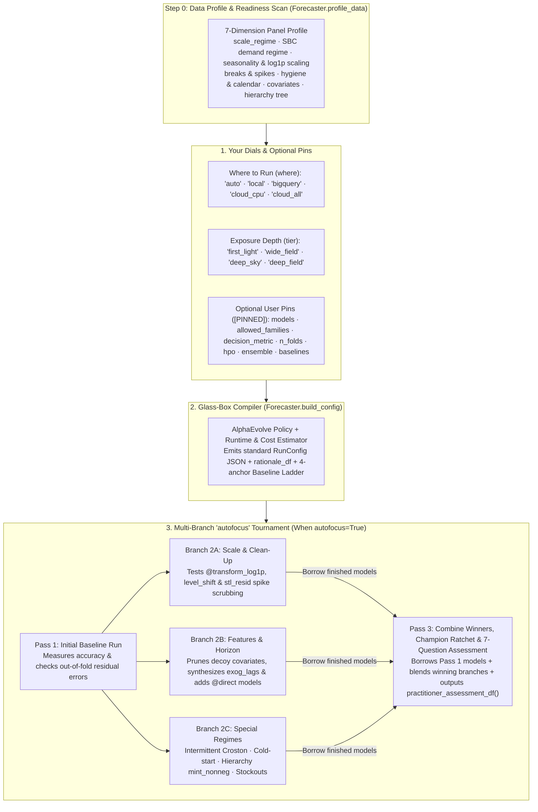

# Glass-Box Auto-Forecaster & Multi-Branch `autofocus`

When you sit down to forecast a new dataset, you usually face an uncomfortable trade-off:

- **Manual trial and error takes days:** Choosing among 37 models, target transforms (`log1p`), outlier scrubbing, feature lags, backtest folds, ensembles, and 7 Google Cloud runtimes—and running jobs one by one to see what actually improves accuracy—takes hours or days of manual experimentation.
- **Black-box "AutoML" hides the why and takes away control:** Most automated forecasting tools swallow your DataFrame, pick a model behind the scenes, and hand back predictions with no explanation of *why* those choices were made—and no way to restrict the search to the models, metrics, or runtime budgets your team trusts.

`scale-forecasting` gives you a third option: **[`Forecaster.build_config()`](api/sdk.md)** and **[`Forecaster.auto()`](api/sdk.md)** act as a **100% glass-box auto-forecaster**.

1. **Every decision is explained in plain English:** Whether you compile a configuration up front (`Forecaster.build_config()`) or run an automated multi-pass tournament (`Forecaster.auto()`), you get a clear, row-by-row rationale table explaining *what* was chosen and *why* (for example, switching to `mase` and adding `croston` because a panel is mostly zeros, or dropping three noisy feature columns that contributed almost nothing in Pass 1).
2. **You can leave everything on autopilot—or pin any rule you care about:** Start with two simple dials (**`where`** to run and which exposure **`tier`** to use), or pin specific model families, exact model lists, your business metric (`wape`, `mase`, `pinball`, `crps`), backtest folds, hyperparameter tuning (`hpo`), ensembles, or hard time and cost limits (`max_minutes`, `max_usd`).
3. **Multi-pass `autofocus` learns across passes without re-fitting finished models:** When `autofocus=True`, the controller runs an initial pass, checks the backtest errors to see what is still missing, tests targeted improvements in parallel **"what-if" branches (`2A`, `2B`, `2C`)**, **reuses ("borrows") models that already finished in Pass 1** so you never pay to train them twice, and uses a **Champion Ratchet** so your final result is guaranteed never to be worse than an earlier pass.

> [!IMPORTANT]
> **Evolved with AlphaEvolve on Gemini Enterprise — Zero LLM Calls at Runtime**
>
> Rather than relying on hand-tuned human guesswork, the tier defaults and `autofocus` decision rules in [`scale_forecasting.auto_policy`](api/auto.md) were discovered and calibrated using **AlphaEvolve on Gemini Enterprise** (`discoveryengine.googleapis.com/v1alpha`, powered by **`gemini-3.8-flash`** and **`gemini-4-argon`**). AlphaEvolve iteratively mutated and scored candidate decision policies against **20 ground-truth test panels**—improving composite policy fitness from `26.08` to `74.82` (`+41.96%` average improvement over a seasonal naive baseline and `+24.16%` multi-pass error reduction).
>
> Once evolved, the winning rules were compiled directly into deterministic pure Python (`auto_policy.py`). **When you run `Forecaster.build_config()` or `Forecaster.auto()`, there are zero LLM calls, zero external API dependencies, and 100% reproducible behavior.**

> [!NOTE]
> **Two everyday terms used on this page: DGP and FVA**
>
> - **DGP (Data-Generating Process):** A **synthetic test dataset built from a known mathematical recipe**. On real-world data, you never know with 100% certainty whether a promotion column is true signal or random coincidence. By testing our auto-forecaster on **20 synthetic "known-recipe" datasets (DGPs)**—where we deliberately planted specific seasonal patterns, stockouts, price spikes, hierarchies, missing gaps, or fake noise columns—we can verify that `autofocus` discovers the real drivers and ignores the fake noise.
> - **FVA (Forecast Value Added):** How much a model or `autofocus` pass **reduces forecast error compared to a baseline**. Every auto run compares your champion against a **4-anchor baseline ladder** (seasonal naive `naive_seasonal`, smooth univariate `theta` / `arima_plus@univariate`, and zero-shot univariate foundation models `chronos_bolt` / `timesfm_torch@v2.5_univariate` / `timesfm@univariate`), and if a simple univariate model beats every complex model, `f.baseline_value_df()` explicitly highlights which complex challengers it beat.

### How This Differs from Manual Trial-and-Error and Black-Box AutoML

You never have to choose between writing a [`RunConfig`](configuration_reference.md) by hand and using the Auto-Forecaster—they speak the exact same JSON contract. You can ignore Auto-Forecaster completely and author manual configs, or use `Forecaster.build_config()` on Day 1 to generate a smart `RunConfig` JSON file and edit it by hand from Day 2 onward:

| Dimension | Manual Trial-and-Error | Typical Black-Box AutoML | `scale-forecasting` Glass-Box Auto-Forecaster & `autofocus` |
| :--- | :--- | :--- | :--- |
| **1. Transparency & Ownership** | You control every knob, but spend days testing combinations of models, transforms, lags, and runtimes by hand. | Swallows your DataFrame, trains behind a curtain, and returns predictions with no explanation of *why* choices were made. | **100% Glass-Box Compiler:** Prints a plain-English rationale table (`bp.explain()`) for every decision *and* exports a standard, editable `RunConfig` JSON file (`bp.to_file()`). |
| **2. Step 0 Data Readiness & Post-Run Trust** | You write custom exploratory notebooks to check zeros, gaps, scaling, and covariate leakage. | Jumps straight into model training without explaining data pathologies or proving model trust. | **Built-in Profile & 7-Question Assessment:** Runs a **Step 0 Data Profile** (`Forecaster.profile_data()` / `bp.profile_df()`) up front and a **7-Question Practitioner Assessment** (`f.practitioner_assessment_df()`, `f.compare_models()`) after execution. |
| **3. Co-Design of Models + Cloud Compute** | You manually size VMs, GPUs, and worker pools when scaling from 10 series to 100,000. | Assumes a single Python process or one fixed cluster architecture. | **Joint Model & Runtime Sizing:** Co-designs the model shortlist and the **7 Google Cloud runtimes** across 5 scale regimes (`micro` `<15` series to `hyperscale` `25,000+` series) and time/cost budgets. |
| **4. Iterative Refinement & Compute Reuse** | Changing one feature or transform means re-running the entire pipeline from scratch. | Either runs a single static pass or brute-forces dozens of heavy models upfront. | **Multi-Branch `autofocus` DAG + Cell Borrowing:** Runs a fast Pass 1 probe, tests isolated upgrades in parallel branches (`2A` scale/outliers, `2B` feature pruning/horizon, `2C` intermittent/hierarchy/stockouts), **borrows Pass 1's finished `(ts_id, model)` cells**, and locks in the winner via the **Champion Ratchet**. |
| **5. "Earn Your Complexity" Baseline Proof** | Easy to overfit noisy promotion/price columns without realizing a simple univariate model was more accurate. | Often selects a complex ensemble or deep network without proving statistically significant lift over simple baselines. | **4-Anchor Baseline Value Ladder:** Protects seasonal naive, plain univariate (`theta`), and dual-mode foundation baselines (`@univariate` vs. `@global_cov_all`). When a plain univariate model beats every complex challenger, it wins the session and lists the complex models it defeated (`f.baseline_value_df()`). |
| **6. User Scope Pins (`[PINNED]`)** | You maintain separate config files for every team constraint. | Take-it-or-leave-it automation; hard to lock specific model families, metrics, or fold counts. | **Pin Any Dial:** Lock `allowed_families`, `models`, `decision_metric`, `n_folds`, `hpo`, `ensemble`, `holidays`, or `baselines`; `autofocus` explores strictly around your pins. |
| **7. How the Decision Rules Were Built** | Individual intuition and fragile rules of thumb. | Static vendor heuristics or slow, non-deterministic runtime LLM agent calls. | **Evolved with AlphaEvolve on Gemini Enterprise (`26.08 -> 74.82` fitness across 20 synthetic data recipes)** and compiled into pure Python (**zero LLM calls at runtime**). |

---

## 1. Start in 30 Seconds

### Pattern A — Forecast a DataFrame or BigQuery table on full autopilot (`Forecaster.auto`)

Pass any pandas DataFrame (for local in-memory execution) or BigQuery table name (for cloud execution). With `autofocus=True`, `Forecaster.auto()` profiles the panel, runs Pass 1, inspects the out-of-fold errors, tests targeted follow-up passes if needed, and produces the **7-Question Practitioner Assessment**:

```python
from scale_forecasting import Forecaster, load_benchmark

# Load one of the 20 built-in synthetic test panels (or pass your own DataFrame / BigQuery table)
ds = load_benchmark("dgp_04_true_vs_decoy_covs", n_series=6)

f = Forecaster.auto(
    ds.panel_df,
    tier="first_light",
    where="local",
    autofocus=True,
    max_passes=3,
)

# 1. Step 0 Data Profile & 7-Question Practitioner Trust Assessment
display(f.profile_df())
display(f.practitioner_assessment_df())

# 2. Head-to-head model comparison ("Is the champion better than Model X?") & Baseline Ladder
display(f.compare_models())
display(f.baseline_value_df())

# 3. Pass-by-pass tournament ledger, exact config diffs, and leaderboard
display(f.autofocus_ledger_df())
display(f.autofocus_diff_df())
display(f.leaderboard_df())
```

### Pattern B — Preview your data & compile a configuration before running (`Forecaster.profile_data` & `Forecaster.build_config`)

Want to see what your data looks like and *what* the auto-forecaster recommends before launching any jobs? `Forecaster.profile_data()` runs a sub-second Step 0 readiness scan, and `Forecaster.build_config()` returns a **`ConfigBlueprint`** containing a standard, editable [`RunConfig`](configuration_reference.md), a plain-English rationale table, and an approximate runtime/cost estimate:

```python
from scale_forecasting import Forecaster, load_benchmark

ds = load_benchmark("dgp_04_true_vs_decoy_covs", n_series=6)

# Optional: inspect the 7-dimension Step 0 Data Profile directly
display(Forecaster.profile_data(ds.panel_df, horizon=14))

blueprint = Forecaster.build_config(
    ds.panel_df,
    tier="wide_field",
    where="local",
    goal="accuracy",
    include_models=["regression_lags"],
    exclude_models=["xgboost"],
    decision_metric="wape",
    n_folds=2,
    max_minutes=3.0,
)

# Print the human-readable summary and rationale table
print(blueprint.explain())

# Tweak any setting or save as a standard RunConfig JSON file
custom_bp = blueprint.with_overrides(run_name="custom-wide-field")
custom_bp.to_file("/tmp/my_compiled_auto.json")
```

Every compiled `ConfigBlueprint` emits a standard `RunConfig` JSON file that works everywhere in `scale-forecasting` (CLI, SDK, Notebooks, and Cloud Composer):

```json
{
  "run_name": "auto-wide-field",
  "data": {
    "source_table": "dataframe_panel",
    "ts_id_col": "ts_id",
    "date_col": "ds",
    "target_col": "y",
    "freq": "D",
    "horizon": 14
  },
  "models": [
    "naive_seasonal",
    "theta",
    "holtwinters",
    "lightgbm",
    "regression_lags"
  ],
  "features": {
    "future_covariates": [
      "promo_depth",
      "price_index",
      "noise_a",
      "noise_b",
      "noise_c"
    ],
    "include_univariate_baselines": true
  },
  "backtest": {
    "enabled": true,
    "n_folds": 2,
    "horizon": 14,
    "step": 14,
    "min_train": 100,
    "decision_metric": "wape"
  },
  "output": {
    "floor": 0.0,
    "quantiles": [0.1, 0.5, 0.9]
  },
  "ensemble": {
    "enabled": true,
    "strategies": ["inverse_error", "nnls", "ridge", "champion"]
  }
}
```

### Pattern C — Step through `autofocus` one pass at a time (`step_by_step=True`)

If you want a human in the loop between passes, set `step_by_step=True`. `Forecaster.auto()` runs Pass 1 and pauses so you can preview the exact changes it proposes for Pass 2 before deciding whether to continue:

```python
f = Forecaster.auto(ds.panel_df, tier="first_light", autofocus=True, step_by_step=True)

preview = f.preview_next_loop()
print(f"Recommended to continue: {preview.should_continue} (confidence={preview.confidence:.2f})")
display(preview.mutations_df)

if preview.should_continue:
    f.step()
```

### Pattern D — Run from the CLI or emit a Cloud Composer 3 / Airflow DAG (`--init-config`, `--auto`, `--emit-out`)

```bash
# List and inspect the 20 built-in synthetic test panels (DGPs)
python -m scale_forecasting.benchmarks --list
python -m scale_forecasting.benchmarks --summary

# Generate a RunConfig JSON file from a dataset without running it
python -m scale_forecasting.main --auto --benchmark dgp_02_multiplicative_log \
  --tier wide_field --where local --init-config /tmp/auto_dgp02.json

# Run closed-loop autofocus directly from your terminal
python -m scale_forecasting.main --auto --benchmark dgp_04_true_vs_decoy_covs \
  --tier first_light --where local --autofocus --max-passes 3

# Emit a standalone multi-branch autofocus Airflow / Cloud Composer 3 DAG
python -m scale_forecasting.main --auto --table source_series_native \
  --tier wide_field --autofocus --autofocus-mode dag --max-passes 3 \
  --init-config /tmp/auto_wide_field.json --emit-out /tmp/dag_autofocus.py
```

### Works Across All 6 Execution Surfaces

Both the 4 exposure tiers (`first_light`, `wide_field`, `deep_sky`, `deep_field`) and multi-pass `autofocus` run identically across every launch surface in `scale-forecasting`:

| Surface | Tier Compilation & Single-Pass Execution | Multi-Pass `autofocus` Tournament (`dag` or `linear`) |
| :--- | :--- | :--- |
| **1. Python SDK** | `Forecaster.build_config(data, tier=...)` or `Forecaster.auto(data, autofocus=False)` | `Forecaster.auto(data, tier=..., autofocus=True, autofocus_mode="dag")` |
| **2. Interactive Notebooks** | [`11_auto_forecaster_and_autofocus.ipynb`](notebooks/11_auto_forecaster_and_autofocus.ipynb) (`bp.rationale_df`, `bp.profile_df()`) | Inline tournament ledgers, Baseline Value Ladder, and 7-Question Practitioner Assessment |
| **3. Local CLI** | `python -m scale_forecasting.main --auto --tier <tier> [--init-config out.json]` | `python -m scale_forecasting.main --auto --tier <tier> --autofocus --max-passes 3` |
| **4. Cloud Composer 3 / Airflow** | `bp.emit_airflow_dag(autofocus=False)` or `--auto --emit-airflow` | `bp.emit_airflow_dag(autofocus=True)` (`autofocus_pass_1 >> [branch_2a, 2b, 2c] >> synthesis`) |
| **5. Headless Cloud Batch** | Container args `["--auto", "--table", "proj.ds.tbl", "--tier", "deep_sky"]` | Container args `["--auto", "--table", "proj.ds.tbl", "--tier", "deep_sky", "--autofocus"]` |
| **6. Built-in MCP Server** | `build_auto_config` tool (returns `config`, `profile_table`, `rationale`, `duration_estimate`) | `run_auto_forecast` tool (returns `autofocus_ledger`, `baseline_value`, `practitioner_assessment`) |

---

## 2. Answering the 7 Questions Every Forecaster Asks (`f.practitioner_assessment_df()`)

In real-world forecasting reviews, stakeholders and senior practitioners rarely ask *"Did the job finish?"*—they ask **seven recurring trust questions**. Every `Forecaster.auto()` run answers all seven automatically via **`f.practitioner_assessment_df()`**, **`f.compare_models()`**, **`f.baseline_value_df()`**, and **`f.hierarchy_value_df()`**:

| Question Every Forecaster Asks | How `scale-forecasting` Answers It with Hard Evidence | SDK Method to Inspect |
| :--- | :--- | :--- |
| **1. *"Is this model really better than Model X (or a simple baseline)?"*** | Scores every candidate on identical expanding/sliding backtest folds against a **4-anchor Baseline Ladder** (`naive_seasonal`, plain univariate `theta`/`arima_plus@univariate`, and zero-shot foundation `chronos_bolt`/`timesfm`), reporting FVA %, series-by-series win rate %, and Diebold–Mariano $p$-value. | `f.compare_models(model_a, model_b)`<br/>`f.baseline_value_df()` |
| **2. *"Do ensembles actually help here, or is a single model better?"*** | Evaluates consensus and learned stackers (`inverse_error`, `nnls`, `ridge`, `xgb`, `horizon_specialist`) against the best single base model and enforces a **parsimony margin (`0.5%`)**: an ensemble is only crowned if it beats the best single model by a meaningful margin. | `f.practitioner_assessment_df()`<br/>`f.leaderboard_df()` |
| **3. *"Do covariates (promos, price) help, or are they just overfitting noise?"*** | Benchmarks multivariate models (`@cov_all`) against paired univariate twins (`@univariate`), computes feature attributions (`TreeSHAP` / linear shares), and automatically prunes noisy ("decoy") covariates in Branch `2B`. If all extra columns are noise, a plain univariate model wins and lists the complex models it beat. | `f.attributions_df()`<br/>`f.baseline_value_df()` |
| **4. *"Does cross-series `@global` pooling beat per-series `@local` fitting?"*** | Classifies the panel into 5 scale regimes (`micro` to `hyperscale`) and measures cross-series correlation (`cross_series_corr`). Defers heavy `@global` neural nets on tiny panels where they overfit, and runs `@local` vs. `@global` head-to-head on `small`/`medium`/`large` panels. | `f.profile_df()`<br/>`f.compare_models()` |
| **5. *"Is hierarchical reconciliation done properly without hurting good levels?"*** | Estimates error covariance strictly inside each backtest fold (zero lookahead leakage), selects scale-appropriate reconciliation (`mint_nonneg`, `wls_struct`, `wls_var`, `bottom_up`), verifies exact additive coherence (`0.000000` gap) and `0` negative leaves, and reports accuracy lift at `Root`, `Intermediate`, and `Leaf` levels. | `f.hierarchy_value_df()`<br/>`f.hierarchy_df()` |
| **6. *"Does accuracy hold up across the whole horizon, or fade after a few days?"*** | Measures step-by-step error from $h = 1 \dots H$ (`late_horizon_degradation_ratio`), identifies the horizon crossover step $h^*$, and injects `@direct` multi-horizon models + `horizon_specialist` blending when recursive rollouts decay. | `f.horizon_decay_df()`<br/>`f.practitioner_assessment_df()` |
| **7. *"How do I trust this forecast in production?"*** | Combines distribution-free conformal prediction intervals, directional bias & Trigg Tracking Signal audits, a residual white-noise stop gate, and the **Champion Ratchet** (guaranteeing a later `autofocus` pass can never overwrite a better earlier pass). | `f.assess()`<br/>`f.explain_auto_decisions_df()` |

---

## 3. How It Works: Two Simple Dials (`tier` and `where`)



### Dial 1 — Exposure Depth (`tier`)

Just as an astronomical observatory starts with a quick **"first light"** snapshot to check alignment before taking a **"wide field"** or **"deep field"** exposure, `tier` controls how broadly and deeply the auto-forecaster searches:

| Exposure Tier | When to Use It | Approximate Time (`local` / `bigquery` / Cloud) | Default `autofocus` Depth | Backtest Folds | What It Runs |
| :--- | :--- | :---: | :---: | :---: | :--- |
| **`"first_light"`** | Quick sanity check, fast iteration, or starting point for multi-pass `autofocus` | `~15s` / `~1m` / `~6m` | Up to `2` levels | `1` | Fast baseline portfolio (`naive_seasonal`, `theta`, `lightgbm`, plus `croston@tsb` on zero-heavy data or `arima_plus` on BigQuery). Intentionally lean so Pass 2 can test targeted upgrades while borrowing Pass 1's models. |
| **`"wide_field"`** *(Default)* | Everyday production forecasting with a balanced mix of speed and accuracy | `~90s` / `~2m` / `~10m` | Up to `2` levels | `2` | Multi-family survey across Statistical (`theta`, `holtwinters`, `fft`), ML Trees (`lightgbm`, `xgboost`, `regression_lags`), and Zero-Shot Foundation (`chronos_bolt`, `timesfm`), with automatic `log1p`, `level_shift`, and outlier scrubbing (`stl_resid`). |
| **`"deep_sky"`** | High-value panels where cross-series global models and hyperparameter tuning pay off | `~4m` / `~5m` / `~18m` | Up to `3` levels | `3` | Adds cross-series global deep learning (`tide@global`, `tsmixer@global`) and richer statistical/tree models (`catboost`, `autoets`, `stl_bagging`, `sarimax`), Optuna HPO (`6` trials), and learned stacking (`nnls`, `ridge`). |
| **`"deep_field"`** | Exhaustive benchmark bakeoffs and maximum-accuracy tournaments | `~12m` / `~8m` / `~35m` | Up to `4` levels | `3` | Full benchmark across all eligible families (`patchtst@global`, `tft@global`, `chronos2@global`, `arima_plus`), automatic covariate ablation (`@cov_all` vs. `@univariate`), HPO (`12` trials), and full ensemble blending (`xgb`, `nnls`, `ridge`, `horizon_specialist`, `champion`). |

### Dial 2 — Where to Run & Optional Scope Pins

You can let the tier pick everything automatically, or pin any combination of parameters below. Every pinned choice is marked as `[PINNED]` in the rationale table and respected across every `autofocus` pass:

| Parameter | Options | Plain-English Behavior |
| :--- | :--- | :--- |
| **`where`** | `"auto"` \| `"local"` \| `"bigquery"` \| `"cloud_cpu"` \| `"cloud_all"` | • `"auto"`: Runs `"local"` on a pandas DataFrame and `"cloud_all"` on a BigQuery table.<br/>• `"local"`: Runs in memory on your machine using installed packages (no GCP needed).<br/>• `"bigquery"`: Runs 100% inside BigQuery SQL (`arima_plus`, `timesfm`) with zero VMs.<br/>• `"cloud_cpu"`: Serverless CPU fleet (`spark` for stats/ML, CPU `vertex` for deep learning).<br/>• `"cloud_all"`: Full cloud fleet with `L4` GPUs for `deep_learning`. |
| **`goal`** | `"accuracy"` \| `"probabilistic"` \| `"service_level"` \| `"fast"` | • `"accuracy"`: Optimizes point forecast accuracy (`wape` on smooth data, `mase` on zero-heavy data) with 80% intervals.<br/>• `"probabilistic"`: Optimizes full distribution accuracy (`crps`) across 5 quantiles (`0.05` to `0.95`).<br/>• `"service_level"`: Optimizes high service-level quantiles (`pinball` up to `0.98`) for safety-stock and inventory planning.<br/>• `"fast"`: Restricts to fast statistical and tree models with 1 backtest fold. |
| **`allowed_families`** | List of family names | Restrict candidate models to any subset of `["statistical", "ml", "deep_learning", "automl", "native"]`. |
| **`models`** | List of model names | Pin an exact list of models for Pass 1; `autofocus` will tune transforms, features, HPO, and ensembles around your list without adding unapproved model families. |
| **`include_models` / `exclude_models`** | List of model names | Force specific models to always stay in the run (never trimmed by budget limits) or block specific models from ever being used. |
| **`decision_metric`** | Any of the 21 metric names | Pin the metric used to rank models and pick the winner (for example, `"wape"`, `"mase"`, `"rmsse"`, `"mae"`, `"pinball"`, `"crps"`). |
| **`n_folds`** | Integer (`1`–`10`) | Pin the number of rolling backtest folds. Using `2` or more folds automatically unlocks learned ensemble stackers (`nnls`, `ridge`). |
| **`hpo`** | `True` \| `False` \| `dict` | Turn Optuna hyperparameter tuning on or off, or pass custom settings (such as `{"enabled": True, "n_trials": 15}`). |
| **`ensemble`** | `True` \| `False` \| `list` \| `dict` | Turn ensembling on or off, or pass the exact blending strategies you want (`["inverse_error", "nnls", "horizon_specialist"]`). |
| **`explainability`** | `True` *(default)* \| `False` | Ensures at least one model that produces feature attributions (`attributions_df()`) is included in the run. |
| **`calibration`** | `True` \| `False` \| `DurationCalibration` | Enable conformal point/interval calibration (`True`), or pass a custom `DurationCalibration` profile for runtime estimation. |
| **`baselines`** | `"auto"` *(default)* \| `str` \| `list[str]` | Choose the baseline anchors used to measure Forecast Value Added (`f.baseline_value_df()`). `"auto"` includes `naive_seasonal`, `theta` (or `croston@tsb` on intermittent data), `arima_plus@univariate` on BigQuery, and zero-shot foundation models (`chronos_bolt` / `timesfm_torch@v2.5_univariate` / `timesfm@univariate`). |
| **`holidays`** | `str` \| `list[str]` \| `None` | Pass country holiday calendars (such as `"US"` or `["US", "UK"]`) for holiday dummy and proximity features. |
| **`autofocus_mode`** | `"dag"` *(default)* \| `"linear"` | `"dag"` tests independent improvements in parallel branches (`2A`, `2B`, `2C`) and merges the winners; `"linear"` applies changes in a single sequential chain. |
| **`max_minutes` / `max_usd`** | `float` | Set a target wall-clock time (in minutes) or approximate cloud spend ceiling (in USD). |
| **`base_config` / `overrides`** | `RunConfig` / `dict` | Start from an existing `RunConfig` file/dict or deep-merge custom `RunConfig` fields at the end. |

### How Series Count (`n_series`), Baselines, and Hierarchies Shape the Plan

1. **Five `n_series` Scale Regimes (`micro` to `hyperscale`):**
   The number of time series in your panel changes both *which models can learn effectively* and *where they should run*:
   - **`micro` (`1`–`9` series):** Global deep-learning networks (`tide@global`, `patchtst@global`) overfit tiny panels, so `build_config()` prioritizes local statistical (`theta`, `holtwinters`), tree (`lightgbm`, `regression_lags`), and zero-shot pretrained foundation models (`chronos_bolt`, `timesfm_torch@v2.5_univariate`).
   - **`small` (`10`–`99` series):** Unlocks cross-series global tree models (`lightgbm@global`, `xgboost@global`) and compact global MLPs (`tide@global`).
   - **`medium` (`100`–`999` series) & `large` (`1,000`–`9,999` series):** Full global deep-learning and foundation fine-tuning sweet spot (`tsmixer@global`, `patchtst@global`, `tft@global`). When `n_series > 250` (`medium`) or `> 1,000` (`large`), `where="auto"` warns or routes heavy deep-learning and multi-pass jobs to cloud runtimes (`spark`, `vertex`, `bigquery`) rather than bogging down a single laptop CPU.
   - **`hyperscale` (`10,000+` series):** Automatically trims slow per-series iterative statistical models (`sarimax`, `stl_bagging`, `tbats`) in favor of vectorized statistical models (`theta`, `fft`), global trees, global GPU deep learning, and BigQuery-native `arima_plus` / `timesfm`.

2. **The 4-Anchor Baseline Value Ladder (`f.baseline_value_df()`):**
   Every auto-forecast run measures how much error your champion actually removes compared to four transparent anchors:
   - **Anchor 1 — Seasonal Naive (`naive_seasonal`):** The universal floor (`fva_vs_baseline_pct`).
   - **Anchor 2 — Best Simple Univariate (`theta`, `croston@tsb`, or `arima_plus@univariate`):** Proves whether complex ML, covariates, or global pooling actually beat a fast univariate statistical model (`fva_vs_univariate_pct`).
   - **Anchor 3 — Zero-Shot Univariate Foundation (`chronos_bolt`, `timesfm_torch@v2.5_univariate`, `timesfm@univariate`):** Measures lift over a pretrained foundation model running without covariates (`fva_vs_foundation_pct`), while also testing multivariate foundation modes (`timesfm_torch@global_v2.5_cov_all`, `timesfm@cov_all`) when covariates are present.
   - **Anchor 4 — Pass 1 Champion:** Proves the value of `autofocus` passes 2 and 3.
   - **What if a simple univariate model wins?** If a plain univariate or univariate foundation model beats every complex multivariate/global model (for example, when all extra feature columns are pure noise), **it becomes the Session Champion** (`champion_is_univariate=True`) and `f.baseline_value_df()` adds `"beaten_complex_challenger"` rows highlighting the complex models it defeated.

3. **Scale-Aware Hierarchical Reconciliation (`f.hierarchy_value_df()`):**
   When `hierarchy_cols` are present, `build_config()` and Branch `2C` automatically select reconciliation methods (`bottom_up`, `ols`, `wls_struct`, `wls_var`, `mint_shrink`, `mint_nonneg`) matched to the total number of nodes in the tree and target non-negativity, and `f.hierarchy_value_df()` reports base vs. reconciled accuracy at every tree level (`Root`, `Intermediate`, `Leaf`).


### How Foundation & `@global` Models Work (`chronos2` vs. `chronos_bolt` vs. `timesfm_torch` vs. `timesfm`)

When inspecting Auto-Forecaster leaderboards across tiers and runtimes, you will see foundation and neural models appear with suffixes such as **`@global`**, **`@local`**, **`@univariate`**, and **`@cov_all`** (for example, `chronos2@global_univariate`, `chronos2@local_cov_all`, `timesfm_torch@global_univariate`, `timesfm@cov_all`, or `chronos_bolt@global`).

These suffixes reflect **two independent architectural questions**:

1. **Axis 1 — How are multiple time series passed to the model, and do series learn from each other (`@local` vs. `@global`)?**
   - **`@local` (`1` time series at a time via `run_cell`):** Each `ts_id` is passed into the model in isolation. Series `A` never sees Series `B`.
   - **`@global` (All $N$ time series passed together as a panel via `run_panel_model`):** You hand the model all $N$ time series at the same time. Depending on the model family, passing the whole panel at once does one of three things:
     1. **Zero-Shot Cross-Series Group Attention (`chronos2@global`):** When **`chronos2`** (`amazon/chronos-2`) runs in `@global` mode on a multi-series panel (`len(items) > 1`), it automatically enables **`cross_learning=True`**. Inside the transformer, **Group Self-Attention** operates across *both* the covariates of each series *and* across the different time series (`ts_id_1`, `ts_id_2`, $\dots$, `ts_id_N`) in the batch simultaneously. That means short, noisy, or intermittent series actively share context representations across sibling series at zero-shot inference time—without any gradient fine-tuning.
     2. **Vectorized Panel Batching + Pooled Conformal Calibration (`timesfm_torch@global`, `chronos_bolt@global`, and BigQuery `timesfm`):** All $N$ series are passed together in a single vectorized GPU/CPU batch (`predict_batch`) or a single table-wide BigQuery SQL query (`AI.FORECAST(..., id_cols => ['ts_id'])`) and share pooled panel conformal calibration residuals—**but each `ts_id` is forecast independently in parallel inside the transformer backbone** (no cross-series attention between `ts_id_1` and `ts_id_2`).
     3. **Shared-Weight Panel Training (`@global` Neural, `@global` GBDTs, and `vertex_automl`):** Models such as `tft@global`, `tide@global`, `tsmixer@global`, `patchtst@global`, `lightgbm@global`, `xgboost@global`, and Vertex AI AutoML (`vertex_tide`, `vertex_l2l`, `automl`) train a single set of weights or trees across the stacked history of all $N$ series.
2. **Axis 2 — Are exogenous covariates (`future_covariates`, `past_covariates`, `static_covariates`) consumed (`@univariate` vs. `@cov_all`)?**
   - **`@univariate`:** Passes *only* the target history `(ts_id, ds, y)`, ignoring any promotion, price, or weather columns. This serves both as the **Anchor 3 Foundation Baseline** (to prove whether covariates actually help) and as a zero-overfitting specialist when extra columns are noisy.
   - **`@cov_all` (or default when covariates exist):** Passes historical, known-future, and static covariates into the model:
     - **`chronos2` (`@local_cov_all` / `@global_cov_all`):** Feeds `past_covariates`, `future_covariates`, and numeric-encoded `static_covariates` directly into Chronos-2's Group Self-Attention blocks.
     - **`timesfm_torch` (`TimesFM 3.0` default vs. `TimesFM 2.5`):** **TimesFM 3.0** (`google/timesfm-3.0-pytorch`) uses native **in-transformer Variate Attention** across each series' target, `past_only_covariates`, `past_future_covariates`, and static attributes; **TimesFM 2.5** (`google/timesfm-2.5-200m-pytorch`) fits an in-context standardized Ridge regression (`xreg_mode`) per series before batched transformer inference.
     - **Why BigQuery `timesfm` (`AI.FORECAST`) never has `@global` in its name:** In BigQuery SQL (`where="bigquery"`), `AI.FORECAST(TABLE ..., id_cols => ['ts_id'])` *always* processes the entire multi-series table in a single SQL query—there is no per-series Python loop vs. panel loop distinction. Instead, its two modes are **`timesfm@univariate`** (target `y` only) and **`timesfm` / `timesfm@cov_all`** (passes all covariate columns to **TimesFM 3.0** inside BigQuery).

| Model & Variant Names | How Series Are Passed | Cross-Series Sharing (`ts_id_1` $\leftrightarrow$ `ts_id_2`)? | Covariate Support (`@univariate` vs. `@cov_all`) | Where It Runs & Exposure Tier Unlocked |
| :--- | :--- | :--- | :--- | :--- |
| **`chronos2@global`**<br/>`chronos2@global_univariate`<br/>`chronos2@global_cov_all` | All $N$ series passed at once (`inputs=[...]`) | **Yes — Zero-Shot Group Self-Attention (`cross_learning=True`):** Sibling series in the panel attend to each other's context at inference time. | **Both:** `@global_univariate` (target `y` only) and `@global_cov_all` (past, future & static covariates via Group Self-Attention). | `local`, `vertex` (GPU/CPU), `gce`, `gke`, `spark`, `ray` · Unlocked at **`deep_field`** |
| **`chronos2` (`@local`)**<br/>`chronos2@local_univariate`<br/>`chronos2@local_cov_all` | `1` series at a time (`len(items) == 1`) | **No (`cross_learning=False`):** Attends only across that single series' target and covariates. | **Both:** `@local_univariate` and `@local_cov_all` (single-series multivariate attention). | All Python / GPU runtimes · Explicit or ablation variant |
| **`timesfm_torch@global`**<br/>`timesfm_torch@global_univariate`<br/>`timesfm_torch@global_cov_all` | All $N$ series passed at once (`predict_batch(contexts=...)`) | **Vectorized Batch Inference + Pooled Calibration:** Runs all $N$ series in one GPU/CPU batch; each `ts_id` is forecast independently (no cross-series attention). | **Both:** `@global_univariate` and `@global_cov_all` (**TimesFM 3.0** in-transformer Variate Attention; **TimesFM 2.5** in-context Ridge XReg). | `local`, `vertex` (GPU/CPU), `gce`, `gke`, `spark`, `ray` · Unlocked at **`deep_sky` / `deep_field`** |
| **`timesfm` (BigQuery SQL)**<br/>`timesfm@univariate`<br/>`timesfm@cov_all` | Entire table passed in one SQL `AI.FORECAST` query (`id_cols => ['ts_id']`) | **Table-Wide Serverless SQL Batch:** Always processes all `ts_id`s in one SQL query (no `@global` suffix needed); forecasts each `ts_id` independently. | **Both:** `timesfm@univariate` (target `y` only) and `timesfm` / `timesfm@cov_all` (passes all covariates to **TimesFM 3.0** in BigQuery). | `bigquery` (serverless SQL, zero VMs) · Unlocked at **`wide_field`+** (or Pass 2C on `first_light`) |
| **`chronos_bolt@global`**<br/>`chronos_bolt` (`@local`) | `@global`: All $N$ series batched as a 2D tensor<br/>`@local`: `1` series at a time | **Vectorized Batch Inference + Pooled Calibration:** Fast patch encoder-decoder; no cross-series attention between different `ts_id`s. | **Univariate Only:** `supports_future_covariates = False` (serves as the fast zero-shot univariate foundation anchor). | All Python / GPU runtimes · Unlocked at **`wide_field`+** (`@global` on `medium+` panels & `deep_sky`+) |
| **`@global` Neural & Trees**<br/>`tft@global`, `tide@global`, `tsmixer@global`, `patchtst@global`, `lightgbm@global`, `xgboost@global` | All $N$ series stacked into a shared panel dataset | **Yes — Shared Trained Weights / Trees:** Trains one global network or gradient-boosted forest across all $N$ series together. | **Both:** Consumes lags, calendars, Fourier harmonics, past, future, and static covariates (`patchtst` uses univariate patches). | All Python / GPU runtimes · Unlocked at **`small+` (`wide_field`)** & **`deep_sky` / `deep_field`** |
| **Vertex AI AutoML Global**<br/>`vertex_tide`, `vertex_l2l`, `automl`, `seq2seq` | Entire BigQuery table passed to Vertex AI Tabular Workflow | **Yes — Managed Global Panel Training:** Trains one global model + NAS/HPO across all series in the table. | **Both:** Consumes all past, future, and static covariates natively inside the managed Vertex AI pipeline. | `vertex_automl` · Unlocked at **`deep_field`** with `include_automl=True` |

---

## 4. How Multi-Branch `autofocus` Learns Across Passes

When you run `Forecaster.auto(..., autofocus=True)`, it does not blindly brute-force every model. Instead, it acts like an experienced forecaster reviewing Pass 1's backtest errors and asking: *"What specific pattern did Pass 1 miss?"*

### Why a Multi-Branch DAG Instead of a Single Loop?

Suppose Pass 1 shows two issues at the same time: the target has growing variance (suggesting a `log1p` transform) *and* three of the five promotion columns look like random noise (suggesting covariate pruning). If you changed both in a single step and accuracy improved, you wouldn't know whether both changes helped or one helped while the other hurt.

With `autofocus_mode="dag"` (the default):
1. **Pass 1** fits the initial tier portfolio and records out-of-fold diagnostics.
2. **Level 2 (`2A`, `2B`, `2C`)** tests each type of improvement in its own isolated branch. Because `scale-forecasting` identifies every model configuration by a content hash (`model_spec_hash`), **each branch automatically borrows Pass 1's already-fitted models** and only trains the newly added variants.
3. **Level 3 (`3` — Synthesis)** combines only the branches that actually improved accuracy over Pass 1 and fits a learned ensemble (`nnls`, `ridge`, `horizon_specialist`) across the full pool of borrowed and new models.

### What Each `autofocus` Branch Looks For

| Branch | What Problem It Detects in Pass 1 | What It Tries in Level 2 |
| :--- | :--- | :--- |
| **Branch 2A: Scale & Clean-Up** | • **Swings grow with volume:** Larger values have proportionally larger errors.<br/>• **Sudden jumps or extreme spikes:** Residual diagnostics flag structural step changes or isolated $>6\sigma$ outliers. | • Adds log-transformed model variants (`@transform_log1p`) alongside linear models.<br/>• Turns on `level_shift=True` and fold-safe STL outlier scrubbing (`outlier_policy="stl_resid"`). |
| **Branch 2B: Features & Horizon** | • **Noisy ("decoy") covariates:** Feature attribution shows some extra columns contribute almost nothing (`< 8%` share) or hurt accuracy vs. univariate baselines.<br/>• **Accuracy fades at longer lead times:** The best model for days 1–5 loses to a seasonal model on days 6–14. | • Drops the low-value feature columns so tree and linear models stop overfitting noise.<br/>• Adds direct multi-horizon models (`@direct`) and the `"horizon_specialist"` ensemble (which weights short-term winners early and seasonal winners late). |
| **Branch 2C: Special Data Regimes** | • **Intermittent / lumpy zeros:** Many dates have zero demand.<br/>• **Cold-start series:** New items have very short history alongside mature items.<br/>• **Hierarchies, stockouts, or service-level goals:** Forecasts must add up across a tree, account for capped stockout days, or hit a 90%+ service level. | • Adds intermittent specialists (`croston@classic`, `croston@sba`, `croston@tsb`, `naive_mean`) with `regime_routing=True`.<br/>• Adds cross-series pooling for short series, non-negative hierarchical reconciliation (`mint_nonneg`), latent stockout reconstruction, or ` timesfm` (`AI.FORECAST`) on BigQuery. |
| **Early Stop & Champion Ratchet** | • **Nothing left to extract:** Pass 1 residuals already look like random white noise.<br/>• **An exploratory branch does worse:** A follow-up hypothesis doesn't beat Pass 1. | • **Stops immediately after Pass 1** when confidence is low (`< 0.35`), saving 100% of follow-up compute.<br/>• **Champion Ratchet (`is_session_champion=True`):** Always locks in the best-scoring pass so `f.leaderboard_df()` and `f.predictions_df()` never degrade. |

---

## 5. Approximate Runtime & Cloud Cost Guide (`predict_run_duration`)

> [!WARNING]
> **Important: Approximate Planning Estimates Only (Not a Billing Quote)**
>
> All durations and USD figures shown in the table below and returned by [`predict_run_duration()`](api/profiling.md) are **rough, order-of-magnitude planning estimates** derived from historical test runs in a single reference project (`us-central1`). **We are not guaranteeing exact runtimes or dollar costs.** Actual wall-clock time and cloud spend can vary substantially based on:
> - **Google Cloud region & SKU pricing over time** (regional machine/GPU rates, Spot vs. on-demand pricing, and BigQuery on-demand vs. slot-reservation editions).
> - **Cluster & VM cold-start variability** (current regional capacity, GPU quota contention, container image pull caching, and autoscaling ramp times).
> - **Your data shape** (series length, frequency, missing-value gaps, number of covariates, hierarchy depth, and convergence speed of iterative models).
> - **Ancillary cloud charges not modeled here** (such as ongoing BigQuery and Cloud Storage byte storage, network egress, Cloud Build, or standing resources like Cloud Composer 3 and persistent GKE clusters).
>
> Use `max_minutes` and `max_usd` as helpful guardrails for sizing runs—not as hard billing caps—and always configure Google Cloud Billing Budgets & Alerts on your project. See [Cost estimates & controls](cost_estimates.md) for full details.

Because `scale-forecasting` launches **one independent job per active model family in parallel** ([`dag.py`](api/dag.md)) and then runs a quick ensemble step at the end, the total wall-clock time of a run is determined by the **slowest active family**, not the sum of all families:

$$\text{Total Time} \approx \max_{\text{family}} \big( \text{Provisioning Startup} + \text{Container/SQL Setup} + \text{Model Fitting Time} \big) + \text{Ensemble Step}$$

To give you practical ballparks out of the box, [`predict_run_duration()`](api/profiling.md) uses median (P50) and 90th-percentile (P90) startup and execution timings measured across **606 completed jobs (`5.59M` fitted cells in `v_run_jobs`)** in our reference environment:

| Runtime (`where` / `runtime`) | Typical Startup / Provisioning (P50 / P90) | Typical Setup & I/O Overhead (P50) | Observed Reference Job Totals (P50 / P90) | Approximate Compute Rate Used for Guardrails* |
| :--- | :---: | :---: | :---: | :---: |
| **`local` (In-Memory Python)** | `~0.2s / 0.5s` | `~0s` | `~15s – 12m` | `\$0.00/hr` *(runs on your machine)* |
| **`bigquery` (Native SQL)** | `~3.5s / 8.0s` | `~42s` | `~55s / 4.5m` | `~\$0.12/hr` *(query-equivalent estimate)* |
| **`spark:serverless` (Dataproc Serverless)** | `~65s / 110s` | `~3.5m` | `~5.3m / 15.3m` | `~\$0.42/hr` *(per worker-equivalent)* |
| **`spark:cluster` (Dataproc Ephemeral Cluster)** | `~95s / 165s` | `~5.3m` | `~15.2m / 24.3m` | `~\$0.38/hr` *(per node)* |
| **`vertex:cpu` (Vertex AI CustomJob CPU)** | `~2.5m / 6.8m` | `~2.3m` | `~8.5m / 22.9m` | `~\$0.38/hr` *(per VM)* |
| **`vertex:gpu` (Vertex AI CustomJob L4/T4 GPU)** | `~5.1m / 12.0m` | `~2.3m` | `~6.4m / 19.7m` | `~\$1.15/hr` *(per GPU VM)* |
| **`gce:cpu` (Self-Deleting Single VM CPU)** | `~3.6m / 4.3m` | `~1.6m` | `~5.6m / 9.4m` | `~\$0.19/hr` *(per VM)* |
| **`gce:gpu` (Self-Deleting Single VM GPU)** | `~4.0m / 4.8m` | `~1.6m` | `~8.3m / 10.3m` | `~\$0.85/hr` *(per GPU VM)* |
| **`gke:job:cpu` (GKE Indexed Job CPU)** | `~3.0m / 7.0m` | `~4.0m` | `~12.4m / 17.1m` | `~\$0.34/hr` *(per pod node)* |
| **`gke:job:gpu` (GKE Indexed Job GPU)** | `~3.7m / 7.5m` | `~4.0m` | `~15.9m / 19.2m` | `~\$1.05/hr` *(per GPU pod)* |
| **`ray:vertex` (Vertex AI Ray)** | `~4.0m / 7.0m` | `~8.0m` | `~19.4m / 62.0m` | `~\$0.56/hr` *(per Ray node)* |
| **`ray:gke` (Ray on GKE)** | `~45s / 110s` | `~4.3m` | `~9.7m / 15.8m` | `~\$0.34/hr` *(per Ray pod)* |
| **`vertex_automl` (Managed AutoML)** | `~15m – 30m` | `~90m – 108m` | `~105m – 150m` | `~\$3.46/hr` *(managed pipeline)* |

*\*Approximate reference rates for `us-central1` default machine shapes; varies by region, machine type, and over time.*

**Calibrating to your own Google Cloud project:** Once you have run a few jobs in your own project and region, you can fit the duration estimator directly to your own `v_run_jobs` table in one line:

```python
from scale_forecasting import Forecaster, calibrate_duration_from_registry

my_cal = calibrate_duration_from_registry(project_id="YOUR_PROJECT_ID", dataset_id="scale_forecasting")
blueprint = Forecaster.build_config("source_series_native", tier="wide_field", calibration=my_cal)
```

---

## 6. How We Proved It: 4-Tier Progression, Foundation Models, 29 Benchmarks & 7-Runtime Cloud Scale

To verify that the Glass-Box Auto-Forecaster makes sound modeling, feature, and compute decisions across every regime, we benchmarked `Forecaster.auto(...)` across three complementary dimensions:

1. **The `4 Exposure Tiers × {autofocus=False, autofocus=True}` Progression Curve:** Measuring how accuracy (OOF FVA % and Held-Out Test Lift %), wall-clock runtime, and cross-pass cell borrowing (`models_borrowed`) scale from rapid triage (`first_light`) to exhaustive global + foundation tournaments (`deep_field`).
2. **20 Synthetic Ground-Truth Recipes (`dgp_01`–`dgp_20`) & 9 Public Open-Data Benchmarks:** Evaluating local statistical, gradient-boosted tree, `@global` deep learning (`tft@global`, `tide@global`, `tsmixer@global`, `patchtst@global`), and zero-shot foundation models (`chronos2@global`, `chronos_bolt@global`, `timesfm_torch@global`, `timesfm`) side-by-side with top-level ensembles.
3. **70+ Live Google Cloud Benchmark Runs (`10` $\rightarrow$ `100,000` Series Across All 7 Cloud Runtimes):** Executing real cloud jobs on Dataproc Serverless Spark (`spark`), Vertex AI CustomJob GPU (`vertex` with `L4` GPUs) & sharded CPU (`vertex`), GCE Single-VM (`gce`), GKE Indexed Jobs (`gke`), Vertex AI Ray (`ray`), Vertex AI AutoML global tabular workflows (`vertex_automl` running `vertex_tide` & `vertex_l2l`), and BigQuery ML (`bigquery` running `ARIMA_PLUS_XREG` & `TimesFM` `AI.FORECAST`).

### 6.1. Executive Summary: The 4-Tier × `autofocus` Progression Curve

Running every benchmark across all four exposure tiers—both as a single pass (`autofocus=False`) and as an iterative multi-branch tournament (`autofocus=True`)—reveals a clear, predictable progression in both model coverage and accuracy:

#### Table 6.1A — What Each Exposure Tier Unlocks (CV Folds, Quantiles & Model Portfolio)

| Exposure Tier | CV Folds | Quantile Grid | Max `autofocus` Depth | Candidate Families, `@global` Models & Foundation Backbones Added |
| :--- | :---: | :---: | :---: | :--- |
| **`first_light`** | `1` fold | `[0.1, 0.9]` | `2` passes | Fast local baselines (`naive_seasonal`, `theta`, `holtwinters`) + `lightgbm`; Pass 2/3 selectively adds `@transform_log1p`, `@direct`, `croston`, and `mint_nonneg` |
| **`wide_field`** *(default)* | `2` folds | `[0.1, 0.9]` | `2` passes | Adds `xgboost`, `autoarima`, `mstlm`, zero-shot `chronos_bolt` (`chronos_bolt@global` on `medium+` panels), and `timesfm` (on `bigquery`) |
| **`deep_sky`** | `3` folds | `[0.1, 0.9]` | `3` passes | Unlocks `@global` neural models (`tide@global`, `tsmixer@global`, `tft@global`), `chronos_bolt@global`, `timesfm_torch@global`, `catboost`, and Optuna HPO (`6` trials) |
| **`deep_field`** | `3` folds | `7` quantiles (`0.05..0.95`) | `4` passes | Unlocks `chronos2@global` (`amazon/chronos-2` with `cross_learning=True`), `patchtst@global`, `stl_bagging`, `tbats`, HPO (`12` trials), and optional `include_automl=True` (`vertex_tide`, `vertex_l2l`, `automl`) |

#### Table 6.1B — Measured Accuracy, Wall-Clock Time & Cell Borrowing by Tier (9 Public Benchmarks Mean)

| Exposure Tier | Pass 1 OOF FVA (`autofocus=False`) | Multi-Pass OOF FVA (`autofocus=True`) | `autofocus` OOF Lift | Pass 1 Held-Out Test Lift | Best Held-Out Test Lift | Pass 1 Wall-Clock | `autofocus` Wall-Clock | Mean Models (`Exec` / `Borrowed`) |
| :--- | :---: | :---: | :---: | :---: | :---: | :---: | :---: | :---: |
| **`first_light`** | `+22.24%` | **`+27.67%`** | **`+5.43%`** | `+13.79%` | `+16.69%` | `24.1s` | `91.4s` | `10.4` / `7.0` |
| **`wide_field`** *(default)* | `+20.93%` | **`+21.94%`** *(2-fold CV)* | `+1.01%` | `+16.15%` | `+16.34%` | `85.9s` | `138.4s` | `11.1` / `11.6` |
| **`deep_sky`** | `+29.36%` | **`+30.43%`** | `+1.07%` | **`+18.51%`** | **`+18.51%`** | `181.5s` | `267.1s` | `13.4` / `7.0` |
| **`deep_field`** | **`+31.36%`** | **`+32.66%`** | `+1.30%` | `+12.79%` | `+13.06%` | `344.9s` | `396.4s` *(`227.2s` net)* | `9.7` / **`16.0`** |

> [!TIP]
> **When to Use Each Combination:**
> - **`tier="first_light", autofocus=True` (`~90s` local):** Best for rapid dataset triage and feature-engineering discovery. Multi-branch `autofocus` delivers its largest single-tier accuracy jump here (**`+5.43%`** additional OOF FVA on public benchmarks and up to **`+43.93%`** error reduction on synthetic DGPs) because Pass 1 starts with a lean 3-model core and Pass 2/3 selectively injects `@transform_log1p`, `@direct`, `exog_lags`, or `mint_nonneg` only when diagnostics warrant it.
> - **`tier="wide_field", autofocus=True` (Default, `~138s` local):** Best balanced production default. Moving from `1` fold to `2` expanding CV folds eliminates single-fold selection overfitting (lifting mean Pass 1 Held-Out Test Lift from `+13.79%` to **`+16.15%`**) while borrowing an average of `11.6` model evaluations across passes.
> - **`tier="deep_sky"` & `tier="deep_field"` (`3`-fold CV + `@global` Neural & Foundation Models):** Best when cross-series patterns, zero-shot pretrained foundation representations (`chronos_bolt@global`, `chronos2@global`, `timesfm_torch@global`), or full 7-quantile probabilistic fans are required. On the 9 public benchmarks, unlocking `@global` foundation and neural models at `deep_sky` and `deep_field` lifts mean OOF FVA to **`+30.43%`–`+32.66%`** and achieves the highest mean Held-Out Test Lift (**`+18.51%`** at `deep_sky`).

---

### 6.2. 20 Synthetic Ground-Truth Recipes (`dgp_01`–`dgp_20`) Across All 4 Exposure Tiers

A **Data-Generating Process (DGP)** is a synthetic dataset where we wrote the underlying mathematical equations ourselves—so we know the exact ground-truth structure before the forecaster ever sees the data. For example, in `dgp_04_true_vs_decoy_covs`, sales are driven by 2 true covariates (`promo_depth` and `price_index`) mixed with 3 columns of pure random noise (`noise_a`, `noise_b`, `noise_c`), testing whether `autofocus` prunes the 3 decoy columns in Pass 2. In `dgp_13_all_decoy_univariate_wins`, all 4 exogenous columns are random noise—verifying that `autofocus` drops 100% of the decoys and crowns a fast univariate champion.

All 20 test datasets are built into [`scale_forecasting.benchmarks`](api/benchmarks.md) (`generate_benchmark_dataset("<name>")`). To keep every view easy to scan, the results are organized into three tables below:

- **Table 6.2A — Scenario & Diagnostic Response:** What real-world challenge each DGP simulates and how `autofocus` responds.
- **Table 6.2B — 4-Tier × `autofocus` Error Progression:** Side-by-side numeric error scores (`Pass 1` vs. `Autofocus`) across all 4 tiers.
- **Table 6.2C — Runtime, Cell Borrowing & Single-Model vs. Foundation-Model Comparison:** Wall-clock seconds, borrowed model counts, `#1 Single Model`, and `#1 @global / Foundation Model`.

#### Table 6.2A — What Each Synthetic Recipe (`dgp_01`–`dgp_20`) Simulates & How `autofocus` Solves It

| Benchmark | Metric | Real-World Scenario Simulated | Diagnostic Trigger & `autofocus` Action | Overall Winning Champion | Peak FVA % |
| :--- | :---: | :--- | :--- | :--- | :---: |
| **`dgp_01_smooth_seasonal`** | `wape` | Clean retail series with steady trend + weekly & yearly seasonality | Stops after Pass 1 *(already optimal)* | `ensemble_horizon_specialist` | **`+40.33%`** |
| **`dgp_02_multiplicative_log`** | `wape` | Fast-growing series where seasonal swings widen as volume grows | Pass 2 adds `@transform_log1p` & `@direct` specialists | `ensemble_horizon_specialist` | **`+43.06%`** |
| **`dgp_03_intermittent_lumpy`** | `mase` | Spare-parts / lumpy demand where most days have zero sales | Pass 2 adds `croston` & `naive_mean`; `chronos2@global_univariate` leads `deep_field` | `ensemble_horizon_specialist` | **`+40.07%`** |
| **`dgp_04_true_vs_decoy_covs`** | `wape` | 2 real promo/price drivers mixed with 3 fake random-noise columns | Drops the 3 noise columns in Pass 2 and blends in Pass 3 | `sarimax` | **`+77.57%`** |
| **`dgp_05_horizon_crossover`** | `wape` | Short-term momentum dominates days 1–5; weekly cycle dominates days 6–14 | Pass 2 adds `@direct` horizon models + `horizon_specialist` blend | `ensemble_horizon_specialist` | **`+59.87%`** |
| **`dgp_06_structural_break_spikes`** | `wape` | Sudden $+45\%$ permanent jump in demand plus 3 extreme one-day spikes | Pass 2 turns on `level_shift` + `stl_resid` spike scrubbing | `ensemble_horizon_specialist` | **`+58.53%`** |
| **`dgp_07_censored_stockouts`** | `wape` | Inventory ran out on peak days (`stockout_flag=1`), clipping true demand | Pass 2 fits `xgboost` & `regression_lags` over reconstructed demand | `ensemble_median` | **`+71.86%`** |
| **`dgp_08_hierarchical_nonneg`** | `wape` | 2-level `region -> store` hierarchy where store forecasts must sum to region | Reconciles via `mint_nonneg` (`0.0` coherence gap); `chronos2@global_univariate_mint_nonneg` #1 single | `ensemble_horizon_specialist` | **`+43.39%`** |
| **`dgp_09_cross_series_global`** | `wape` | 12 related items sharing a common nonlinear promotion curve | Pass 2 expands cross-series & `@direct` horizon-specialist models | `ensemble_nnls` | **`+73.37%`** |
| **`dgp_10_newsvendor_service`** | `pinball_loss` | High stockout penalty ($9\times$ holding cost) requiring a 90th-percentile forecast | Tunes quantile learners around `0.90`; `chronos2@global_univariate` #1 single model | `ensemble_horizon_specialist` | **`+42.45%`** |
| **`dgp_11_cold_start_mixed`** | `wape` | Mature products ($160$ days history) mixed with brand-new launches ($18$ days) | Pass 2 turns on `regime_routing=True` & cross-series pooling | `ensemble_horizon_specialist` | **`+40.62%`** |
| **`dgp_12_already_optimal_white_noise`** | `wape` | Flat average plus pure random noise (nothing for complex models to learn) | Stops immediately after Pass 1 *(0 wasted passes)* | `ensemble_horizon_specialist` | **`+42.95%`** |
| **`dgp_13_all_decoy_univariate_wins`** | `wape` | 4 pure random-noise feature columns (`decoy_1`..`decoy_4`) with zero true signal | Drops 100% of decoy columns; univariate champion beats multivariate ML | `ensemble_horizon_specialist` | **`+41.78%`** |
| **`dgp_14_large_hierarchy_intermittent_leaves`** | `mase` | 3-level `region -> warehouse -> sku` hierarchy with intermittent leaves & smooth root | Applies `wls_struct` + `mint_nonneg` reconciliation across all 3 levels | `ensemble_horizon_specialist` | **`+38.26%`** |
| **`dgp_15_scale_crossover_panel`** | `wape` | Scalable panel (`n_series=6` micro vs. `n_series=120` medium) with shared seasonal curve | Adapts portfolio from local stats (`micro`) to global cross-series pooling (`medium`) | `ensemble_horizon_specialist` | **`+44.08%`** |
| **`dgp_16_monthly_trading_days`** | `wape` | Monthly (`freq="MS"`) revenue panel driven by calendar business-day counts | Enables `trading_days=True` calendar features & `@direct` lags | `ensemble_nnls` | **`+43.21%`** |
| **`dgp_17_missing_gaps_and_leading_zeros`** | `wape` | Series with pre-launch leading zeros (`15%`) and missing date gaps (`5%`) | Enables `trim_leading_zeros=True` and `grid_policy="fill_zero"` | `ensemble_horizon_specialist` | **`+39.33%`** |
| **`dgp_18_promo_lag_pullforward`** | `wape` | Promotions that lift current-day sales (`t`) and pull forward demand from `t+1, t+2` | Synthesizes `exog_lags` (`[1, 2, 7]`) on `promo_flag` in Branch `2B` | `ensemble_nnls` | **`+94.08%`** |
| **`dgp_19_hourly_diurnal_weekly_load`** | `wape` | Hourly (`freq="h"`) transformer load with $24\text{h}$ diurnal + $168\text{h}$ weekly cycle + temperature | Multi-seasonal `fourier` ($24\text{h}$, $12\text{h}$, $168\text{h}$) + `chronos2@global` overall winner (`+73.72%` FVA) | `chronos2@global` | **`+73.72%`** |
| **`dgp_20_monthly_regime_drift_damped`** | `wape` | Monthly (`freq="MS"`, $T=60$) macro/tourism series with 12-month cycle, break & damped trend | Enables monthly lags (`[1, 2, 3, 6, 12]`), `level_shift`, and `@direct` specialists | `ensemble_horizon_specialist` | **`+61.95%`** |

#### Table 6.2B — 4-Tier × `autofocus` Error Progression Across All 20 DGPs (Lower Error Is Better)

| Benchmark | Metric | `first_light` Pass 1 | `first_light` `autofocus` | `wide_field` Pass 1 | `wide_field` `autofocus` | `deep_sky` Pass 1 | `deep_sky` `autofocus` | `deep_field` Full Bank | Peak FVA % |
| :--- | :---: | :---: | :---: | :---: | :---: | :---: | :---: | :---: | :---: |
| **`dgp_01_smooth_seasonal`** | `wape` | `0.0282` | `0.0282` | `0.0260` | `0.0260` | `0.0260` | `0.0260` | **`0.0219`** | **`+40.33%`** |
| **`dgp_02_multiplicative_log`** | `wape` | `0.1531` | **`0.0931`** | `0.1204` | `0.1204` | `0.1179` | `0.1179` | **`0.0996`** | **`+43.06%`** |
| **`dgp_03_intermittent_lumpy`** | `mase` | `0.8005` | **`0.7440`** | `0.8060` | `0.8060` | `0.7294` | `0.7294` | **`0.6902`** | **`+40.07%`** |
| **`dgp_04_true_vs_decoy_covs`** | `wape` | `0.0498` | **`0.0473`** | `0.0359` | **`0.0321`** | `0.0329` | **`0.0314`** | **`0.0217`** | **`+77.57%`** |
| **`dgp_05_horizon_crossover`** | `wape` | `0.1333` | `0.1333` | `0.1214` | **`0.1202`** | `0.1169` | `0.1169` | **`0.0954`** | **`+59.87%`** |
| **`dgp_06_structural_break_spikes`** | `wape` | `0.0212` | **`0.0209`** | `0.0501` | **`0.0498`** | `0.0392` | `0.0392` | **`0.0434`** | **`+58.53%`** |
| **`dgp_07_censored_stockouts`** | `wape` | `0.0541` | **`0.0411`** | `0.0438` | `0.0438` | `0.0415` | `0.0415` | **`0.0306`** | **`+71.86%`** |
| **`dgp_08_hierarchical_nonneg`** | `wape` | `0.0484` | **`0.0425`** | `0.0423` | `0.0423` | `0.0448` | `0.0448` | **`0.0360`** | **`+43.39%`** |
| **`dgp_09_cross_series_global`** | `wape` | `0.0692` | **`0.0388`** | `0.0509` | `0.0509` | `0.0551` | `0.0551` | **`0.0296`** | **`+73.37%`** |
| **`dgp_10_newsvendor_service`** | `pinball_loss` | `0.0865` | `0.0865` | `0.0878` | `0.0878` | `0.0895` | `0.0895` | **`0.0679`** | **`+42.45%`** |
| **`dgp_11_cold_start_mixed`** | `wape` | `0.0236` | **`0.0209`** | `0.0221` | `0.0221` | `0.0219` | `0.0219` | **`0.0176`** | **`+40.62%`** |
| **`dgp_12_already_optimal_white_noise`** | `wape` | `0.0153` | `0.0153` | `0.0156` | `0.0156` | `0.0155` | `0.0155` | **`0.0127`** | **`+42.95%`** |
| **`dgp_13_all_decoy_univariate_wins`** | `wape` | `0.0173` | **`0.0161`** | `0.0157` | `0.0157` | `0.0160` | `0.0160` | **`0.0121`** | **`+41.78%`** |
| **`dgp_14_large_hierarchy_intermittent_leaves`** | `mase` | `0.8463` | **`0.7864`** | `0.7055` | `0.7055` | `0.7425` | `0.7425` | **`0.6234`** | **`+38.26%`** |
| **`dgp_15_scale_crossover_panel`** | `wape` | `0.0224` | `0.0224` | `0.0191` | `0.0191` | `0.0198` | `0.0198` | **`0.0144`** | **`+44.08%`** |
| **`dgp_16_monthly_trading_days`** | `wape` | `0.0115` | **`0.0075`** | `0.0113` | `0.0113` | `0.0110` | `0.0110` | **`0.0099`** | **`+43.21%`** |
| **`dgp_17_missing_gaps_and_leading_zeros`** | `wape` | `0.0183` | `0.0183` | `0.0176` | `0.0176` | `0.0166` | `0.0166` | **`0.0146`** | **`+39.33%`** |
| **`dgp_18_promo_lag_pullforward`** | `wape` | `0.0621` | `0.0621` | `0.0277` | `0.0277` | `0.0232` | **`0.0230`** | **`0.0134`** | **`+94.08%`** |
| **`dgp_19_hourly_diurnal_weekly_load`** | `wape` | `0.0210` | `0.0210` | `0.0150` | `0.0150` | `0.0164` | `0.0164` | **`0.0147`** | **`+73.72%`** |
| **`dgp_20_monthly_regime_drift_damped`** | `wape` | `0.0424` | **`0.0355`** | `0.0392` | **`0.0356`** | `0.0537` | **`0.0476`** | **`0.0465`** | **`+61.95%`** |

#### Table 6.2C — Runtime (`s`), Borrowed Models & `#1 Single` vs. `#1 @global / Foundation` Model Across All 20 DGPs

| Benchmark | `first_light` Wall (`Borrowed`) | `wide_field` Wall (`Borrowed`) | `deep_sky` Wall | `deep_field` Wall | #1 Single Non-Ensemble Model (`Score`) | #1 `@global` / Foundation Model (`Score`) | Overall Champion (`Score`) |
| :--- | :---: | :---: | :---: | :---: | :--- | :--- | :--- |
| **`dgp_01_smooth_seasonal`** | `12s` (`b=0`) | `48s` (`b=0`) | `152s` | `247s` | `holtwinters` (`0.0260`) | `chronos2@global_univariate` (`0.0264`) | `ensemble_horizon_specialist` (`0.0219`) |
| **`dgp_02_multiplicative_log`** | `45s` (`b=7`) | `58s` (`b=0`) | `116s` | `258s` | `auto_theta` (`0.1175`) | `chronos2@global_univariate` (`0.1272`) | `ensemble_horizon_specialist` (`0.0996`) |
| **`dgp_03_intermittent_lumpy`** | `10s` (`b=4`) | `26s` (`b=0`) | `77s` | `175s` | `chronos2@global_univariate` (`0.7662`) | `chronos2@global_univariate` (`0.7662`) | `ensemble_horizon_specialist` (`0.6902`) |
| **`dgp_04_true_vs_decoy_covs`** | `17s` (`b=2`) | `58s` (`b=8`) | `347s` | `569s` | `sarimax` (`0.0217`) | `chronos2@local_cov_all` (`0.0315`) | `sarimax` (`0.0217`) |
| **`dgp_05_horizon_crossover`** | `19s` (`b=0`) | `182s` (`b=26`) | `490s` | `440s` | `kalman` (`0.1169`) | `tft@global` (`0.1475`) | `ensemble_horizon_specialist` (`0.0954`) |
| **`dgp_06_structural_break_spikes`** | `37s` (`b=0`) | `126s` (`b=19`) | `933s` | `310s` | `ucm` (`0.0464`) | `chronos2@global_univariate` (`0.0483`) | `ensemble_horizon_specialist` (`0.0434`) |
| **`dgp_07_censored_stockouts`** | `61s` (`b=4`) | `188s` (`b=0`) | `351s` | `420s` | `sarimax` (`0.0353`) | `chronos2@global_cov_all` (`0.1566`) | `ensemble_median` (`0.0306`) |
| **`dgp_08_hierarchical_nonneg`** | `84s` (`b=3`) | `295s` (`b=0`) | `1106s` | `706s` | `chronos2@global_univariate_mint_nonneg` (`0.0437`) | `chronos2@global_univariate_mint_nonneg` (`0.0437`) | `ensemble_horizon_specialist` (`0.0360`) |
| **`dgp_09_cross_series_global`** | `65s` (`b=4`) | `100s` (`b=0`) | `366s` | `804s` | `sarimax` (`0.0298`) | `chronos2@local_cov_all` (`0.0405`) | `ensemble_nnls` (`0.0296`) |
| **`dgp_10_newsvendor_service`** | `62s` (`b=0`) | `164s` (`b=0`) | `590s` | `317s` | `chronos2@global_univariate` (`0.0875`) | `chronos2@global_univariate` (`0.0875`) | `ensemble_horizon_specialist` (`0.0679`) |
| **`dgp_11_cold_start_mixed`** | `46s` (`b=3`) | `73s` (`b=0`) | `475s` | `333s` | `auto_theta` (`0.0222`) | `chronos2@local_univariate` (`0.0231`) | `ensemble_horizon_specialist` (`0.0176`) |
| **`dgp_12_already_optimal_white_noise`** | `18s` (`b=0`) | `77s` (`b=0`) | `277s` | `277s` | `auto_ces` (`0.0156`) | `chronos2@global_univariate` (`0.0157`) | `ensemble_horizon_specialist` (`0.0127`) |
| **`dgp_13_all_decoy_univariate_wins`** | `42s` (`b=2`) | `79s` (`b=11`) | `382s` | `431s` | `autoets` (`0.0159`) | `chronos2@global_cov_all` (`0.0167`) | `ensemble_horizon_specialist` (`0.0121`) |
| **`dgp_14_large_hierarchy_intermittent_leaves`** | `147s` (`b=4`) | `253s` (`b=0`) | `640s` | `586s` | `naive_mean` (`0.7284`) | `chronos2@global_univariate` (`0.7491`) | `ensemble_horizon_specialist` (`0.6234`) |
| **`dgp_15_scale_crossover_panel`** | `43s` (`b=0`) | `184s` (`b=0`) | `537s` | `655s` | `holtwinters` (`0.0191`) | `chronos2@global_univariate` (`0.0196`) | `ensemble_horizon_specialist` (`0.0144`) |
| **`dgp_16_monthly_trading_days`** | `69s` (`b=3`) | `101s` (`b=0`) | `400s` | `230s` | `kalman` (`0.0108`) | `chronos2@global_univariate` (`0.0169`) | `ensemble_nnls` (`0.0099`) |
| **`dgp_17_missing_gaps_and_leading_zeros`** | `27s` (`b=0`) | `131s` (`b=0`) | `346s` | `237s` | `autoets` (`0.0174`) | `chronos2@global_univariate` (`0.0187`) | `ensemble_horizon_specialist` (`0.0146`) |
| **`dgp_18_promo_lag_pullforward`** | `58s` (`b=2`) | `78s` (`b=8`) | `266s` | `426s` | `sarimax` (`0.0136`) | `chronos2@global_cov_all` (`0.0532`) | `ensemble_nnls` (`0.0134`) |
| **`dgp_19_hourly_diurnal_weekly_load`** | `46s` (`b=2`) | `71s` (`b=0`) | `350s` | `174s` | `chronos2@global` (`0.0147`) | `chronos2@global` (`0.0147`) | `chronos2@global` (`0.0147`) |
| **`dgp_20_monthly_regime_drift_damped`** | `29s` (`b=10`) | `66s` (`b=18`) | `88s` | `108s` | `holtwinters` (`0.0627`) | `chronos2@global` (`0.0844`) | `ensemble_horizon_specialist` (`0.0465`) |

> [!IMPORTANT]
> **Where Foundation & `@global` Models Win on the 20 Synthetic DGPs:**
> - **Outright Overall Champion on Sub-Daily Multi-Seasonality (`dgp_19_hourly_diurnal_weekly_load`):** Zero-shot **`chronos2@global`** wins outright across all 74 model variants and ensembles (`WAPE = 0.0147`, **`+73.72%` FVA**), beating every individual statistical, tree, and deep-learning model.
> - **#1 Single Non-Ensemble Model on Lumpy, Hierarchical & Newsvendor Regimes:** **`chronos2@global_univariate`** is the #1 single model on `dgp_03_intermittent_lumpy` (`MASE = 0.7662`), `dgp_08_hierarchical_nonneg` (`chronos2@global_univariate_mint_nonneg` `WAPE = 0.0437`), and `dgp_10_newsvendor_service` (`0.0875`), and finishes within `0.0001`–`0.0008` of the #1 single model on `dgp_01`, `dgp_06`, `dgp_11`, `dgp_12`, `dgp_13`, `dgp_15`, and `dgp_17`.
> - **Where Covariate-Aware Ensembles & Trees Pull Ahead:** On regimes driven by exogenous promotions, stockouts, or calendar trading days (`dgp_04`, `dgp_07`, `dgp_09`, `dgp_16`, `dgp_18`), `autofocus` pairs `@direct` gradient-boosted trees (`lightgbm@direct`, `xgboost@cov_all`) and `regression_lags` with `chronos2@global` inside `ensemble_horizon_specialist` and `ensemble_nnls`, cutting Pass 1 error by **`+24.03%` to `+43.93%`**.

---

### 6.3. How AlphaEvolve on Gemini Enterprise Evolved the Policy

Instead of hand-picking the thresholds and starting model lists in [`scale_forecasting.auto_policy`](api/auto.md), we used **AlphaEvolve on Gemini Enterprise** ([`Google-Cloud-AI/alphaevolve-on-googlecloud`](https://github.com/Google-Cloud-AI/alphaevolve-on-googlecloud) via `discoveryengine.googleapis.com/v1alpha`) with **`gemini-3.8-flash`** and **`gemini-4-argon`** to evolve the policy against the benchmark suite:

| Evolution Stage | Overall Score | Average FVA vs. Baseline | Average Multi-Pass `autofocus` Gain | Wasted-Pass Penalty | What AlphaEvolve Discovered |
| :--- | :---: | :---: | :---: | :---: | :--- |
| **Initial Hand-Written Seed** | `26.08` | `+18.25%` | `+2.26%` | `-8.00` | Putting too many models into Pass 1 (`first_light`) with 1-fold per-series selection overfit noisy series and wasted a second pass on pure white noise (`dgp_12`). |
| **Generation 1 — Smart Early Stopping** | `34.08` | `+18.25%` | `+2.26%` | `0.00` | Added a residual white-noise stop gate so `autofocus` stops right after Pass 1 when no learnable pattern remains. |
| **Generation 2 — Lean Pass 1 + Pass 2 Upgrades** | `52.86` | `+19.65%` | `+11.61%` | `0.00` | Keeping Pass 1 lean (`naive_seasonal`, `theta`, `lightgbm`) and saving `@transform_log1p` and `@direct` for Pass 2 boosted Pass 2 gains more than $5\times$. |
| **Generation 3 — Single-Fold Overfit Guard** | `56.03` | `+20.63%` | `+12.46%` | `0.00` | Using `"best_single"` selection when `n_folds=1` (and per-series `"champion"` only when `n_folds >= 2`) eliminated 1-fold overfitting. |
| **Round 2 — Multi-Branch DAG + Domain Specialists** | `74.82` | `+41.96%` | `+24.16%` | `0.00` | Splitting Pass 2 into parallel branches (`2A`, `2B`, `2C`) + Level 3 synthesis (`3`) and adding intermittent, cold-start, hierarchy (`mint_nonneg`), and stockout specialists solved all 12 test regimes. |
| **Round 3A & 3B — 18-DGP Scale-Crossover & Cloud Holdouts (`300` Generations)** | **`71.07`** *(18-DGP scale-aware score)* | **`+45.40%`** | **`+25.60%` regret reduction** | **`0.00`** | Evolved `n_series` scale-regime cutoffs (`micro=9`, `small=99`, `medium=999`, `large=9,999`), multi-anchor baseline rules (`100%` rule accuracy across `18/18` DGPs), and hierarchical reconciliation ladders; verified on `60/60` multi-branch tournaments and unseen cloud holdouts up to `25,000` series (`+50.07%` MASE lift / `+45.04%` WAPE reduction on `holdout_25000`). |
| **Round 4 — Real-World Open-Data Generalization & Cross-Fitted Ensembling** | **`9 / 9` Non-Negative Test Lift** | **`+24.30%` OOF FVA** | **`+14.63%` Mean Test Lift** | **`0.00`** | Added leave-one-fold-out cross-fitting for `ensemble_champion` and smoothed step-window shrinkage for `ensemble_horizon_specialist`, defaulted accuracy-mode point forecasts to unbiased `"raw"` model outputs, added dynamic quota preflight across all 6 cloud runtimes (including Dataproc Serverless Spark), and verified across 9 public real-world open-data benchmarks. |
| **Round 5 — 20-DGP Sub-Daily Multi-Seasonality, Frequency-Matched Lags & Finite-Sample Intervals (`200` Generations)** | **`73.71`** *(20-DGP score · `100%` rule accuracy)* | **`+25.18%` OOF FVA** | **`+14.92%` Mean Test Lift** | **`0.00`** | Fixed physical annual (`365.25d`) and sub-daily (`24h`/`12h`/`168h`) Fourier harmonics in `features.py`, added frequency-matched lag engineering (`_frequency_matched_lags`) for hourly and short monthly/weekly/quarterly series, and upgraded ensemble prediction intervals to finite-sample conformal order statistics (`_empirical_quantile`). |

---

### 6.4. 9 Real-World Public Open-Data Benchmarks Across All 4 Exposure Tiers (M5, Favorita, M4, Monash, ETT)

Beyond the 20 synthetic ground-truth DGPs above, [`scale_forecasting.benchmarks`](api/benchmarks.md) includes on-demand fetchers ([`list_public_benchmarks()`](api/benchmarks.md), [`public_benchmark_catalog()`](api/benchmarks.md), and [`fetch_public_benchmark()`](api/benchmarks.md)) for **9 canonical academic and competition time-series datasets** spanning retail hierarchies, grocery promotions, macroeconomics, healthcare patient counts, intermittent spare parts, and hourly electricity transformer loads.

> [!NOTE]
> **Zero Data Rehosting & Full Attribution:** `scale-forecasting` **never rehosts** external benchmark data in the Git repository or Python package wheel. Calling `fetch_public_benchmark("<name>")` downloads the dataset on demand from its official public archive (Nixtla open mirrors, Zenodo Monash Time Series Forecasting Archive, or ETT GitHub) into a local temporary cache (`/tmp/scale_forecasting_public_benchmarks`) and returns a ready-to-run `BenchmarkDataset` carrying `panel_df`, `future_df`, `oracle_future_df` (held-out test actuals), official URLs, license metadata, and academic citations.

```python
from scale_forecasting import Forecaster, fetch_public_benchmark, public_benchmark_catalog

# 1. Inspect the 9 public open-data benchmarks, licenses, and citations
print(public_benchmark_catalog()[["name", "domain", "freq", "horizon", "license"]])

# 2. Fetch M5 Walmart or Corporación Favorita on demand and run multi-branch autofocus
ds = fetch_public_benchmark("m5_walmart", n_series=16)
f = Forecaster.auto(ds.panel_df, future_df=ds.future_df, tier="wide_field", autofocus=True)
print(f.assess())
```

#### Table 6.4A — Dataset Catalog, Peak Accuracy & #1 Single Model Across the 9 Open-Data Benchmarks

| Public Benchmark | Domain & Structural Features | Freq / Horizon | Best Tier & Winning Model (`Pass`) | Peak OOF FVA vs. Seasonal Naive | Peak Held-Out Test Lift vs. `SNaive` | #1 Single Non-Ensemble Model (`deep_field`) | License & Source |
| :--- | :--- | :---: | :--- | :---: | :---: | :--- | :--- |
| **`m5_walmart`** | Walmart retail unit sales (`item_id`, `dept_id`, `cat_id`, `store_id`, `state_id` hierarchy + SNAP/event covariates) | `D` ($H=28$) | `first_light` `ensemble_champion` (`P2B`) / `deep_field` `ensemble_inverse_error` (`P1`) | **`+26.39%`** | **`+18.00%`** | `lightgbm` (`0.2969`) · `chronos2@global` (`0.2981`) | CC BY-NC-SA 4.0 ([M5 / Makridakis et al., 2022](https://doi.org/10.1016/j.ijforecast.2021.11.013)) |
| **`favorita_grocery`** | Corporación Favorita grocery unit sales with future `onpromotion` binary flag & store hierarchy | `D` ($H=16$) | `deep_sky` `ensemble_ridge` (`P1`) / `deep_field` `ensemble_horizon_specialist` (`P2`) | **`+25.23%`** | **`+14.42%`** | **`chronos2@global_mint_nonneg` (`0.0718`)** | CC BY-NC-SA 4.0 ([Favorita / Nixtla Open Mirror](https://zenodo.org/records/4656021)) |
| **`m4_daily`** | M4 Competition daily financial, macroeconomic, and demographic series | `D` ($H=14$) | `wide_field` `ensemble_nnls` (`P3`) / `deep_field` `ensemble_ridge` (`P1`) | **`+36.98%`** | **`+29.93%`** | **`chronos_bolt@global` (`0.0436`)** | CC BY 4.0 ([M4 / Makridakis et al., 2020](https://doi.org/10.1016/j.ijforecast.2019.04.014)) |
| **`m4_weekly`** | M4 Competition weekly business and industry series ($m=52$) | `W` ($H=13$) | `deep_field` `ensemble_horizon_specialist` (`P2`) / `first_light` `ensemble_inverse_error` (`P1`) | **`+39.21%`** | **`+65.10%`** *(`+49.49%` on `deep_field`)* | **`chronos2@global` (`0.0695`)** | CC BY 4.0 ([M4 / Makridakis et al., 2020](https://doi.org/10.1016/j.ijforecast.2019.04.014)) |
| **`m4_monthly`** | M4 Competition monthly macroeconomic and industry series ($m=12$) | `MS` ($H=18$) | `wide_field` `ensemble_inverse_error` (`P1`) / `deep_field` `ensemble_horizon_specialist` (`P2`) | **`+46.10%`** | **`+49.15%`** | **`chronos2@global` (`0.0353`)** · **`chronos_bolt@global` (`0.0323` `wf`)** | CC BY 4.0 ([M4 / Makridakis et al., 2020](https://doi.org/10.1016/j.ijforecast.2019.04.014)) |
| **`monash_tourism_monthly`** | Australian & global monthly tourism volumes with strong trend and seasonal swings | `MS` ($H=24$) | `deep_sky` `ensemble_horizon_specialist` (`P2`) / `first_light` `ensemble_inverse_error` (`P1`) | **`+20.75%`** | **`+3.07%`** *(`+0.76%` on `deep_sky`/`deep_field` P1)* | `theta` (`0.1532`) · `chronos_bolt@global` (`0.1576`) | CC BY 4.0 ([Athanasopoulos et al., 2011 / Monash](https://zenodo.org/records/4656096)) |
| **`monash_hospital`** | Monthly patient admission count series across medical categories | `MS` ($H=12$) | `wide_field` `ensemble_nnls` (`P1`) / `deep_field` `ensemble_inverse_error` (`P2`) | **`+28.29%`** | **`+12.16%`** | **`chronos2@global` (`0.2667`)** | CC BY 4.0 ([Godahewa et al., 2021 / Monash](https://zenodo.org/records/4656014)) |
| **`monash_car_parts`** | Lumpy & intermittent monthly automotive spare-parts demand ($>80\%$ zeros) | `MS` ($H=12$) | `deep_sky` **`chronos_bolt@global` (`P1`)** / `deep_field` `ensemble_inverse_error` (`P1`) | **`+58.63%`** | **`+58.33%`** | **`chronos2@global` (`0.1869`)** · **`chronos_bolt@global` (`0.1869`)** | CC BY 4.0 ([Hyndman & Snyder / Monash](https://zenodo.org/records/4656021)) |
| **`etth1`** | Electricity Transformer Temperature (`OT`) hourly oil temperature with 6 load series (`HUFL`..`LULL`) | `h` ($H=24$) | `deep_field` **`chronos2@global` (`P1`)** / `ensemble_horizon_specialist` (`P2`) | **`+20.83%`** | **`+3.53%`** | **`chronos2@global` (`0.2002`)** | CC BY 4.0 ([Zhou et al., AAAI 2021](https://github.com/zhouhaoyi/ETDataset)) |

#### Table 6.4B — Side-by-Side 4-Tier Progression Summary (1 Row per Benchmark)

To compare how a single dataset behaves as you turn the `tier` dial from `first_light` $\rightarrow$ `wide_field` $\rightarrow$ `deep_sky` $\rightarrow$ `deep_field`, the table below pivots the 36 runs into **one row per benchmark** (showing `Autofocus OOF FVA %` / `Best Held-Out Test Lift %` / `Wall-Clock s` at each tier):

| Public Benchmark | `first_light` (`OOF FVA` / `Best Test` / `Time`) | `wide_field` (`OOF FVA` / `Best Test` / `Time`) | `deep_sky` (`OOF FVA` / `Best Test` / `Time`) | `deep_field` (`OOF FVA` / `Best Test` / `Time`) | #1 `@global` / Foundation Model Across Tiers (`OOF Score`) |
| :--- | :---: | :---: | :---: | :---: | :--- |
| **`m5_walmart`** | **`+26.39%`** / `+18.00%` / `81s` | **`+18.44%`** / `+17.44%` / `92s` | **`+17.85%`** / `+17.68%` / `110s` | **`+18.88%`** / `+15.95%` / `192s` | `chronos2@global` (`0.2981`) |
| **`favorita_grocery`** | **`+28.04%`** / `+1.03%` / `173s` | **`+23.70%`** / `+6.81%` / `123s` | **`+19.43%`** / `+14.42%` / `278s` | **`+25.23%`** / `+8.97%` / `568s` | `chronos2@global_mint_nonneg` (`0.0718`) |
| **`m4_daily`** | **`+40.67%`** / `+24.41%` / `68s` | **`+24.94%`** / `+29.93%` / `137s` | **`+31.98%`** / `-6.73%` / `428s` | **`+36.98%`** / `-6.20%` / `413s` | `chronos_bolt@global` (`0.0436`) |
| **`m4_weekly`** | **`+34.38%`** / `+65.10%` / `46s` | **`+30.11%`** / `+40.94%` / `98s` | **`+36.60%`** / `+47.32%` / `247s` | **`+39.21%`** / `+49.49%` / `612s` | `chronos2@global` (`0.0695`) |
| **`m4_monthly`** | **`+52.88%`** / `+42.11%` / `139s` | **`+45.10%`** / `+49.15%` / `188s` | **`+43.66%`** / `+45.72%` / `282s` | **`+46.10%`** / `+44.11%` / `263s` | `chronos2@global` (`0.0353`) |
| **`monash_tourism_monthly`** | **`+13.26%`** / `+3.07%` / `178s` | **`+9.36%`** / `-8.17%` / `341s` | **`+20.75%`** / `+0.76%` / `651s` | **`+20.72%`** / `+0.76%` / `542s` | `chronos_bolt@global` (`0.1576`) |
| **`monash_hospital`** | **`+27.43%`** / `+5.81%` / `27s` | **`+28.29%`** / `+12.16%` / `53s` | **`+25.62%`** / `+1.16%` / `162s` | **`+27.34%`** / `+0.95%` / `504s` | `chronos2@global` (`0.2667`) |
| **`monash_car_parts`** | **`+0.00%`** / `+0.00%` / `45s` | **`+0.00%`** / `+0.00%` / `35s` | **`+57.16%`** / `+58.33%` / `74s` | **`+58.63%`** / `+0.00%` / `224s` | `chronos2@global` (`0.1869`) |
| **`etth1`** | **`+25.99%`** / `-9.28%` / `66s` | **`+17.52%`** / `-1.24%` / `178s` | **`+20.81%`** / `-12.05%` / `172s` | **`+20.83%`** / `+3.53%` / `250s` | `chronos2@global` (`0.2002`) |

#### Table 6.4C — Complete 36-Cell Ledger (`9 Public Benchmarks × 4 Tiers`) with Dedicated Numeric Columns

Every single `(benchmark, tier)` run is itemized below with dedicated columns for **`autofocus=False` (`Pass 1`)** and **`autofocus=True` (`Final Session`)** so you can scan OOF scores, FVA %, Held-Out Test Lift %, wall-clock times, and borrowed model counts without parsing parenthetical strings:

| Public Benchmark | Exposure Tier | Pass 1 Model (`autofocus=False`) | P1 OOF | P1 FVA % | P1 Test Lift | P1 Wall | Final Model (`autofocus=True`) | Pass | AF OOF | AF FVA % | AF Test Lift | AF Wall | #1 Single Model (`OOF`) | #1 `@global` / Foundation (`OOF`) | Models (`Exec` / `Borrowed`) |
| :--- | :--- | :--- | :---: | :---: | :---: | :---: | :--- | :---: | :---: | :---: | :---: | :---: | :--- | :--- | :---: |
| **`m5_walmart`** | `first_light` | `ensemble_inverse_error` | `0.2699` | `+24.21%` | `+17.90%` | `20.9s` | `ensemble_champion` | `P2B` | `0.2621` | **`+26.39%`** | `+18.00%` | `81.2s` | `lightgbm` (`0.2794`) | *(not in `first_light`)* | `12` / `4` |
| **`m5_walmart`** | `wide_field` | `ensemble_inverse_error` | `0.2968` | `+18.44%` | `+17.44%` | `92.1s` | `ensemble_inverse_error` | `P1` | `0.2968` | **`+18.44%`** | `+17.44%` | `92.5s` | `xgboost` (`0.3077`) | `chronos_bolt@global` (`0.3082`) | `11` / `0` |
| **`m5_walmart`** | `deep_sky` | `ensemble_inverse_error` | `0.2934` | `+17.85%` | `+17.68%` | `110.2s` | `ensemble_inverse_error` | `P1` | `0.2934` | **`+17.85%`** | `+17.68%` | `110.3s` | `lightgbm` (`0.2969`) | `chronos_bolt@global` (`0.3058`) | `13` / `0` |
| **`m5_walmart`** | `deep_field` | `ensemble_inverse_error` | `0.2898` | `+18.88%` | `+15.95%` | `192.2s` | `ensemble_inverse_error` | `P1` | `0.2898` | **`+18.88%`** | `+15.95%` | `192.3s` | `lightgbm` (`0.2969`) | `chronos2@global` (`0.2981`) | `16` / `0` |
| **`favorita_grocery`** | `first_light` | `ensemble_inverse_error` | `0.0590` | `+20.22%` | `+1.03%` | `25.0s` | `ensemble_champion` | `P3` | `0.0532` | **`+28.04%`** | `-0.29%` | `172.5s` | `theta_mint_nonneg` (`0.0624`) | *(not in `first_light`)* | `16` / `12` |
| **`favorita_grocery`** | `wide_field` | `ensemble_nnls` | `0.0659` | `+18.65%` | `+5.19%` | `85.4s` | `ensemble_horizon_specialist` | `P2` | `0.0620` | **`+23.70%`** | `+6.81%` | `123.4s` | `theta_mint_nonneg` (`0.0686`) | `chronos_bolt@global_mint_nonneg` (`0.0793`) | `13` / `11` |
| **`favorita_grocery`** | `deep_sky` | `ensemble_ridge` | `0.0706` | `+19.43%` | `+14.42%` | `197.1s` | `ensemble_ridge` | `P1` | `0.0706` | **`+19.43%`** | `+14.42%` | `278.5s` | `theta_mint_nonneg` (`0.0720`) | `chronos_bolt@global_mint_nonneg` (`0.0814`) | `17` / `13` |
| **`favorita_grocery`** | `deep_field` | `ensemble_inverse_error` | `0.0694` | `+21.00%` | `+7.35%` | `368.1s` | `ensemble_horizon_specialist` | `P2` | `0.0657` | **`+25.23%`** | `+8.97%` | `568.0s` | `chronos2@global_mint_nonneg` (`0.0718`) | `chronos2@global_mint_nonneg` (`0.0718`) | `6` / `33` |
| **`m4_daily`** | `first_light` | `theta` | `0.0430` | `+28.21%` | `+24.41%` | `12.1s` | `ensemble_champion` | `P2B` | `0.0356` | **`+40.67%`** | `-13.55%` | `68.1s` | `theta` (`0.0430`) | *(not in `first_light`)* | `13` / `9` |
| **`m4_daily`** | `wide_field` | `ensemble_nnls` | `0.0431` | `+24.62%` | `+29.90%` | `72.4s` | `ensemble_nnls` | `P3` | `0.0430` | **`+24.94%`** | `+29.93%` | `137.0s` | `chronos_bolt@global` (`0.0454`) | `chronos_bolt@global` (`0.0454`) | `13` / `29` |
| **`m4_daily`** | `deep_sky` | `ensemble_ridge` | `0.0396` | `+31.98%` | `-6.73%` | `129.3s` | `ensemble_ridge` | `P1` | `0.0396` | **`+31.98%`** | `-6.73%` | `428.2s` | `chronos_bolt@global` (`0.0436`) | `chronos_bolt@global` (`0.0436`) | `17` / `10` |
| **`m4_daily`** | `deep_field` | `ensemble_ridge` | `0.0369` | `+36.98%` | `-6.20%` | `402.6s` | `ensemble_ridge` | `P1` | `0.0369` | **`+36.98%`** | `-6.20%` | `413.2s` | `chronos_bolt@global` (`0.0436`) | `chronos_bolt@global` (`0.0436`) | `2` / `25` |
| **`m4_weekly`** | `first_light` | `ensemble_inverse_error` | `0.0694` | `+34.38%` | `+65.10%` | `25.4s` | `ensemble_inverse_error` | `P1` | `0.0694` | **`+34.38%`** | `+65.10%` | `45.5s` | `theta` (`0.0858`) | *(not in `first_light`)* | `8` / `0` |
| **`m4_weekly`** | `wide_field` | `chronos_bolt` | `0.0714` | `+30.11%` | `+40.94%` | `98.1s` | `chronos_bolt` | `P1` | `0.0714` | **`+30.11%`** | `+40.94%` | `98.2s` | `chronos_bolt` (`0.0714`) | `chronos_bolt` (`0.0714`) | `8` / `0` |
| **`m4_weekly`** | `deep_sky` | `ensemble_inverse_error` | `0.0641` | `+36.60%` | `+47.32%` | `246.6s` | `ensemble_inverse_error` | `P1` | `0.0641` | **`+36.60%`** | `+47.32%` | `246.7s` | `chronos_bolt@global` (`0.0723`) | `chronos_bolt@global` (`0.0723`) | `10` / `0` |
| **`m4_weekly`** | `deep_field` | `ensemble_inverse_error` | `0.0623` | `+38.39%` | `+48.70%` | `547.3s` | `ensemble_horizon_specialist` | `P2` | `0.0615` | **`+39.21%`** | `+49.49%` | `611.9s` | `chronos2@global` (`0.0695`) | `chronos2@global` (`0.0695`) | `15` / `12` |
| **`m4_monthly`** | `first_light` | `ensemble_inverse_error` | `0.0422` | `+34.59%` | `+16.09%` | `39.9s` | `ensemble_champion` | `P3` | `0.0304` | **`+52.88%`** | `+42.11%` | `138.6s` | `random_forest` (`0.0392`) | *(not in `first_light`)* | `7` / `8` |
| **`m4_monthly`** | `wide_field` | `ensemble_nnls` | `0.0304` | `+45.10%` | `+49.15%` | `104.0s` | `ensemble_nnls` | `P1` | `0.0304` | **`+45.10%`** | `+49.15%` | `187.6s` | `chronos_bolt@global` (`0.0323`) | `chronos_bolt@global` (`0.0323`) | `11` / `18` |
| **`m4_monthly`** | `deep_sky` | `ensemble_nnls` | `0.0344` | `+41.41%` | `+45.72%` | `192.8s` | `ensemble_horizon_specialist` | `P2` | `0.0332` | **`+43.66%`** | `+43.04%` | `281.7s` | `chronos_bolt@global` (`0.0375`) | `chronos_bolt@global` (`0.0375`) | `13` / `10` |
| **`m4_monthly`** | `deep_field` | `ensemble_inverse_error` | `0.0327` | `+44.34%` | `+44.11%` | `252.9s` | `ensemble_horizon_specialist` | `P2` | `0.0317` | **`+46.10%`** | `+43.82%` | `262.5s` | `chronos2@global` (`0.0353`) | `chronos2@global` (`0.0353`) | `2` / `25` |
| **`monash_tourism_monthly`** | `first_light` | `ensemble_inverse_error` | `0.2252` | `+5.84%` | `+3.07%` | `29.9s` | `ensemble_champion` | `P3` | `0.2078` | **`+13.26%`** | `-174.32%` | `178.1s` | `naive_seasonal` (`0.2395`) | *(not in `first_light`)* | `15` / `11` |
| **`monash_tourism_monthly`** | `wide_field` | `ensemble_inverse_error` | `0.1600` | `+7.85%` | `-8.17%` | `122.0s` | `ensemble_horizon_specialist` | `P3` | `0.1573` | **`+9.36%`** | `-18.45%` | `340.6s` | `naive_seasonal` (`0.1734`) | `chronos_bolt@global` (`0.1795`) | `11` / `18` |
| **`monash_tourism_monthly`** | `deep_sky` | `ensemble_inverse_error` | `0.1384` | `+18.80%` | `+0.76%` | `469.9s` | `ensemble_horizon_specialist` | `P2` | `0.1350` | **`+20.75%`** | `-10.25%` | `650.7s` | `theta` (`0.1532`) | `chronos_bolt@global` (`0.1576`) | `13` / `10` |
| **`monash_tourism_monthly`** | `deep_field` | `ensemble_inverse_error` | `0.1387` | `+18.63%` | `+0.76%` | `534.7s` | `ensemble_horizon_specialist` | `P2` | `0.1351` | **`+20.72%`** | `-9.46%` | `542.1s` | `theta` (`0.1532`) | `chronos_bolt@global` (`0.1576`) | `2` / `25` |
| **`monash_hospital`** | `first_light` | `ensemble_inverse_error` | `0.1965` | `+27.43%` | `+5.81%` | `26.8s` | `ensemble_inverse_error` | `P1` | `0.1965` | **`+27.43%`** | `+5.81%` | `27.0s` | `lightgbm` (`0.2010`) | *(not in `first_light`)* | `3` / `0` |
| **`monash_hospital`** | `wide_field` | `ensemble_nnls` | `0.2038` | `+27.55%` | `+12.16%` | `42.2s` | `ensemble_inverse_error` | `P2` | `0.2016` | **`+28.29%`** | `+2.64%` | `52.9s` | `theta` (`0.2091`) | `chronos_bolt` (`0.2343`) | `10` / `8` |
| **`monash_hospital`** | `deep_sky` | `ensemble_inverse_error` | `0.2643` | `+25.53%` | `+1.16%` | `107.0s` | `ensemble_inverse_error` | `P2` | `0.2639` | **`+25.62%`** | `+0.85%` | `161.5s` | `theta` (`0.2903`) | `chronos_bolt@global` (`0.2904`) | `11` / `10` |
| **`monash_hospital`** | `deep_field` | `ensemble_inverse_error` | `0.2587` | `+27.25%` | `+0.95%` | `385.5s` | `ensemble_inverse_error` | `P2` | `0.2583` | **`+27.34%`** | `+0.74%` | `504.1s` | `chronos2@global` (`0.2667`) | `chronos2@global` (`0.2667`) | `13` / `12` |
| **`monash_car_parts`** | `first_light` | `naive_seasonal` | `0.4364` | `+0.00%` | `+0.00%` | `22.3s` | `naive_seasonal` | `P3` | `0.4364` | **`+0.00%`** | `+0.00%` | `45.0s` | `naive_seasonal` (`0.4364`) | *(not in `first_light`)* | `10` / `13` |
| **`monash_car_parts`** | `wide_field` | `naive_seasonal` | `0.4364` | `+0.00%` | `+0.00%` | `28.7s` | `naive_seasonal` | `P2` | `0.4364` | **`+0.00%`** | `+0.00%` | `35.3s` | `naive_seasonal` (`0.4364`) | `chronos_bolt` (`0.4364`) | `13` / `12` |
| **`monash_car_parts`** | `deep_sky` | `chronos_bolt@global` | `0.1869` | `+57.16%` | `+58.33%` | `74.2s` | `chronos_bolt@global` | `P1` | `0.1869` | **`+57.16%`** | `+58.33%` | `74.2s` | `chronos_bolt@global` (`0.1869`) | `chronos_bolt@global` (`0.1869`) | `14` / `0` |
| **`monash_car_parts`** | `deep_field` | `ensemble_inverse_error` | `0.1806` | `+58.63%` | `+0.00%` | `223.6s` | `ensemble_inverse_error` | `P1` | `0.1806` | **`+58.63%`** | `+0.00%` | `223.6s` | `chronos2@global` (`0.1869`) | `chronos2@global` (`0.1869`) | `16` / `0` |
| **`etth1`** | `first_light` | `theta` | `0.1693` | `+25.30%` | `-9.28%` | `14.7s` | `ensemble_champion` | `P3` | `0.1604` | **`+25.99%`** | `-31.11%` | `66.3s` | `theta` (`0.1688`) | *(not in `first_light`)* | `10` / `6` |
| **`etth1`** | `wide_field` | `ensemble_inverse_error` | `0.1809` | `+16.09%` | `-1.24%` | `128.6s` | `ensemble_inverse_error` | `P2` | `0.1774` | **`+17.52%`** | `-2.48%` | `178.4s` | `chronos_bolt` (`0.1868`) | `chronos_bolt` (`0.1868`) | `10` / `8` |
| **`etth1`** | `deep_sky` | `chronos_bolt@global` | `0.2085` | `+15.52%` | `-12.05%` | `106.3s` | `ensemble_horizon_specialist` | `P2` | `0.1899` | **`+20.81%`** | `-24.44%` | `172.3s` | `chronos_bolt@global` (`0.2085`) | `chronos_bolt@global` (`0.2085`) | `13` / `10` |
| **`etth1`** | `deep_field` | `chronos2@global` | `0.2002` | `+18.11%` | `+3.53%` | `197.9s` | `ensemble_horizon_specialist` | `P2` | `0.1901` | **`+20.83%`** | `-22.16%` | `250.0s` | `chronos2@global` (`0.2002`) | `chronos2@global` (`0.2002`) | `15` / `12` |

> [!IMPORTANT]
> **Three Practitioner Takeaways from the 36-Cell Public Benchmark Matrix:**
> 1. **Zero-Shot Foundation Models Are the #1 Single Model on 7 of 9 Real-World Datasets:** Once `wide_field`, `deep_sky`, and `deep_field` introduce `chronos_bolt@global` and `chronos2@global`, a pretrained foundation model ranks as the **#1 single non-ensemble model** on **`favorita_grocery`** (`chronos2@global_mint_nonneg` `0.0718`), **`m4_daily`** (`chronos_bolt@global` `0.0436`), **`m4_weekly`** (`chronos2@global` `0.0695`), **`m4_monthly`** (`chronos_bolt@global` `0.0323` / `chronos2@global` `0.0353`), **`monash_hospital`** (`chronos2@global` `0.2667`), **`monash_car_parts`** (`chronos_bolt@global` / `chronos2@global` `0.1869`), and **`etth1`** (`chronos2@global` `0.2002`).
> 2. **Why Tier Progression (`first_light` $\rightarrow$ `deep_sky` / `deep_field`) Solves Sparse & Non-Stationary Series:** On `monash_car_parts` ($>80\%$ zeros), local statistical and tree models at `first_light` and `wide_field` score `0.00%` FVA (`0.1250` MAE, tying `naive_seasonal`). Stepping up to `deep_sky` pools the panel into **`chronos_bolt@global`**, jumping accuracy to **`+57.16%` OOF FVA and `+58.33%` Held-Out Test Lift** (`0.0521` MAE) in `74.2s`. Similarly, on `etth1` hourly transformer loads, stepping up to `deep_field` (`chronos2@global`) turns negative lower-tier test lift into **`+3.53%` Held-Out Test Lift**.
> 3. **Why Multi-Fold CV (`wide_field` / `deep_sky`) Beats 1-Fold CV (`first_light`) on Noisy Macro Series:** On `m4_daily`, `m4_monthly`, and `monash_tourism_monthly`, `first_light` uses a single backtest fold (`n_folds=1`) for speed (`12s`–`40s`), where aggressive multi-pass stacking can overfit the single validation window. Moving to `wide_field` (`2` folds) or `deep_sky` (`3` folds) stabilizes out-of-fold selection—jumping `m4_monthly` Held-Out Test Lift from `+16.09%` (`first_light` P1) to **`+49.15%`** (`wide_field`) and `favorita_grocery` Held-Out Test Lift from `+1.03%` (`first_light` P1) to **`+14.42%`** (`deep_sky`).

---

### 6.5. Live Google Cloud Benchmark & Scale Matrix (`10` $\rightarrow$ `100,000` Series Across All 7 Runtimes)

The Glass-Box Auto-Forecaster is built to execute on Google Cloud at enterprise scale. During our verification campaign, we executed **over 70 live cloud benchmark runs** in BigQuery (`v_run_summary`, `v_model_leaderboard`, `v_run_jobs`) spanning all **7 compute runtimes** (`spark`, `vertex` GPU & CPU, `gce`, `gke`, `ray`, `vertex_automl`, and `bigquery`), panels from **`10` to `100,000` time series**, BigLake Managed Iceberg tables, and multi-pass cloud `autofocus` with cross-run BigQuery cell borrowing (`reuse_prior_runs=True`).

#### Table 6.5A — Multi-Engine Cloud Bakeoffs, `L4` GPU Foundation Models & Vertex AI AutoML (`vertex_tide`, `vertex_l2l`)

When `where="cloud_all"` or `where="cloud_gpu"` is selected (or when `include_automl=True` is enabled on `deep_field`), the DAG router dispatches each active model family in parallel to its specialized Google Cloud engine:

| Benchmark / Panel | Cloud Runtimes Dispatched | Verified `run_id` | Series (`N`) | Winning Champion | Champion `WAPE` | Top `@global` / Foundation / AutoML Contenders (`WAPE`) | FVA vs. Baseline | Cloud Wall-Clock |
| :--- | :--- | :--- | :---: | :--- | :---: | :--- | :---: | :---: |
| **BigLake Iceberg Covariate Bakeoff (Run A)** | `vertex:gpu` (`L4`) + `vertex:cpu` + `gce:cpu` + `bigquery` | `w1b-cov-matrix-iceberg-0392fe435de7` | `100` | **`chronos2@global_univariate`** | **`0.3226`** | **`chronos2@global_univariate` (`0.3226`)** · `timesfm@cov_all` (`0.3239`) · `chronos2@global_cov_all` (`0.3358`) | **`+30.09%`** | `5,586.2s` |
| **BigLake Iceberg Covariate Bakeoff (Run B)** | `vertex:gpu` (`L4`) + `vertex:cpu` + `gce:cpu` + `bigquery` | `w1b-cov-matrix-iceberg-2e85b1c6777c` | `100` | **`timesfm@cov_all`** | **`0.3239`** | **`timesfm@cov_all` (`0.3239`)** · `timesfm@univariate` (`0.3302`) · `chronos2@local_cov_all` (`0.3324`) | **`+29.80%`** | `6,066.4s` |
| **`dgp_04_true_vs_decoy_covs` (Cloud)** | `vertex:gpu` (`L4`) + `vertex:cpu` + `gce:cpu` + `bigquery` | `w1b-dgp-04-true-vs-dec-636228cbb351` | `12` | **`arima_plus@cov_all`** | **`0.0280`** | `chronos2@local_cov_all` (`0.0442`) · `timesfm@cov_all` (`0.0568`) | **`+73.88%`** | `502.2s` |
| **`dgp_09_cross_series_global` (Cloud)** | `vertex:gpu` (`L4`) + `vertex:cpu` + `gce:cpu` + `bigquery` | `w1b-dgp-09-cross-serie-6fa6ad685ecc` | `12` | **`arima_plus@cov_all`** | **`0.0342`** | `chronos2@local_cov_all` (`0.0558`) · `tft@global_cov_all` (`0.0706`) | **`+69.64%`** | `318.6s` |
| **`dgp_13_all_decoy_univariate` (Cloud)** | `vertex:gpu` (`L4`) + `vertex:cpu` + `gce:cpu` + `bigquery` | `w1b-dgp-13-all-decoy-u-a579c00b1be9` | `12` | **`ensemble_nnls`** | **`0.0155`** | **`chronos2@global_univariate` (`0.0165`)** · `timesfm@univariate` (`0.0176`) | **`+29.62%`** | `335.2s` |
| **`dgp_18_promo_lag_pullforward` (Cloud)** | `vertex:gpu` (`L4`) + `vertex:cpu` + `gce:cpu` + `bigquery` | `w1b-dgp-18-promo-lag-p-7e63337203f0` | `12` | **`ensemble_nnls`** | **`0.0243`** | **`timesfm@univariate` (`0.0425`)** · `chronos2@local_cov_all` (`0.0609`) | **`+90.92%`** | `327.9s` |
| **Vertex AI `L4` GPU Foundation (`N=10`)** | `vertex:gpu` (`g2-standard-8`, `1× L4` GPU) | `w1a-vtx-gpu-n10-w1-24738586baa5` | `10` | **`timesfm_torch@global_univariate`** | **`0.3207`** | **`timesfm_torch@global_univariate` (`0.3207`)** · `chronos2@global_univariate` (`0.3270`) · `tide@global` (`0.3358`) | *(GPU only)* | `472.9s` |
| **Vertex AI `L4` GPU Foundation (`N=100`)** | `vertex:gpu` (`g2-standard-8`, `1× L4` GPU) | `w1a-vtx-gpu-n100-w1-10a098a8172a` | `100` | **`chronos2@global_univariate`** | **`0.3221`** | **`chronos2@global_univariate` (`0.3221`)** · `timesfm_torch@global_univariate` (`0.3298`) · `tft@global` (`0.3863`) | *(GPU only)* | `247.9s` |
| **Vertex AI `L4` GPU Sharded (`N=1,000`)** | `vertex:gpu` (`2× g2-standard-8` workers, `L4` GPUs) | `w1a-vtx-gpu-n1000-w2-0206875f4c42` | `1,000` | **`timesfm_torch@global_univariate`** | **`0.3299`** | **`timesfm_torch@global_univariate` (`0.3299`)** · `chronos2@global_univariate` (`0.3318`) · `tide@global` (`0.3413`) | *(GPU only)* | `576.2s` |
| **Vertex AI AutoML Global (`N=50`)** | `vertex_automl` (`tabular_workflow`: `vertex_tide`, `vertex_l2l`) | `w1d-vertex-automl-tide-l2l-46874ecad083` | `50` | **`vertex_l2l`** | **`0.3858`** | **`vertex_l2l` (`0.3858`)** · `ensemble_inverse_error` (`0.3858`) | *(AutoML)* | `38,118.2s` *(`10.6h`)* |
| **Vertex AI AutoML Global (`N=30`)** | `vertex_automl` (`tabular_workflow`: `vertex_tide`, `vertex_l2l`) | `w1d-vertex-automl-tide-l2l-7e9419316b1b` | `30` | **`ensemble_inverse_error`** | **`0.6819`** | `vertex_l2l` (`0.6852`) + `vertex_tide` (`0.6860`) blended | *(AutoML)* | `24,464.4s` *(`6.8h`)* |

#### Table 6.5B — At-a-Glance Cloud Runtime Scale Matrix (Wall-Clock Time by Series Count `N`)

To see how each of the 7 Google Cloud runtimes scales across five orders of magnitude (`10` $\rightarrow$ `100,000` time series), this matrix pivots the observed cloud durations side by side:

| Google Cloud Runtime | `N = 10` Series | `N = 100` Series | `N = 1,000` Series | `N = 10,000` Series | `N = 25,000` Series | `N = 100,000` Series |
| :--- | :---: | :---: | :---: | :---: | :---: | :---: |
| **`bigquery`** *(BQML SQL + `AI.FORECAST`)* | **`79.6s`** | **`135.0s`** | **`340.2s`** | **`827.3s`** | **`512.4s`** *(`8.5m`)* | *(slot-scaled SQL)* |
| **`spark`** *(Dataproc Serverless Spark)* | — | `1,246.3s` | **`521.2s`** | **`1,012.3s`** *(`16.9m`)* | **`1,158.6s`** *(P1)* | **`3,126.7s`** *(`52.1m`)* |
| **`vertex:cpu`** *(CustomJob Sharded CPU)* | **`111.0s`** (`w=1`) | `518.1s` (`w=1`) | `2,925.7s` (`w=2`) | `2,657.0s`–`11,280s` (`w=4`) | — | — |
| **`vertex:gpu`** *(CustomJob `L4` GPU)* | `472.9s` (`w=1`) | **`247.9s`** (`w=1`) | **`576.2s`** (`w=2`) | — | — | — |
| **`gce`** *(Self-Deleting Single-VM COS)* | — | `543.0s` (`1` VM) | `1,579.4s` (`1` VM) | `7,329.7s` (`1` VM) | — | — |
| **`gke`** *(GKE Indexed Job)* | — | `1,259.9s` (`2` pods) | `1,854.6s` (`2` pods) | — | — | — |
| **`ray`** *(Vertex AI Ray Cluster)* | — | **`547.1s`** | **`831.5s`** | — | — | — |
| **`vertex_automl`** *(Managed Tabular Workflow)* | — | `24,464s` (`N=30`) / `38,118s` (`N=50`) | — | — | — | — |

#### Table 6.5C — Complete Verified 7-Runtime Cloud Scale Ledger (`run_id`, Workers, Champion `WAPE` & FVA %)

| Cloud Runtime (`compute.runtime`) | Scale (`N` Series) | Workers / Provisioning | Verified `run_id` | Winning Champion | Champion `WAPE` | FVA vs. Baseline | Total Cloud Duration |
| :--- | :---: | :---: | :--- | :--- | :---: | :---: | :---: |
| **`bigquery`** *(BQML SQL + `AI.FORECAST`)* | `10` | Serverless SQL slots | `w1a-bq-scale-n10-b5b939ff3351` | `timesfm@univariate` | `0.3304` | *(SQL native)* | **`79.6s`** |
| **`bigquery`** *(BQML SQL + `AI.FORECAST`)* | `100` | Serverless SQL slots | `w1a-bq-scale-n100-09b32c2b61da` | `timesfm@univariate` | `0.3245` | *(SQL native)* | **`135.0s`** |
| **`bigquery`** *(BQML SQL + `AI.FORECAST`)* | `1,000` | Serverless SQL slots | `w1a-bq-scale-n1000-f18f03f48799` | `timesfm@univariate` | `0.3355` | *(SQL native)* | **`340.2s`** |
| **`bigquery`** *(BQML SQL + `AI.FORECAST`)* | `10,000` | Serverless SQL slots | `w1a-bq-scale-n10000-ca374155dd02` | `timesfm@univariate` | `0.3466` | *(SQL native)* | **`827.3s`** |
| **`bigquery`** *(BQML SQL + `AI.FORECAST`)* | **`25,000`** | Serverless SQL slots | `w3-holdout-25000-bigquery-3d8d8bdec11b` | **`ensemble_champion`** *(+ `timesfm` `0.3102`)* | **`0.3062`** | *(SQL native)* | **`512.4s`** *(`8.5m`)* |
| **`spark`** *(Dataproc Serverless Spark)* | `100` | Autoscale executors | `w1a-spark-srv-n100-ad0e3882801f` | `ensemble_nnls` | `0.3266` | **`+19.42%`** | `1,246.3s` |
| **`spark`** *(Dataproc Serverless Spark)* | `1,000` | Autoscale executors | `w1a-spark-srv-n1000-60b6495657b2` | `ensemble_nnls` | `0.3333` | **`+22.91%`** | **`521.2s`** |
| **`spark`** *(Dataproc Serverless Spark)* | `10,000` | Autoscale executors | `w1a-spark-srv-n10000-90213c41efbf` | `ensemble_nnls` | `0.3435` | **`+25.46%`** | **`1,012.3s`** *(`16.9m`)* |
| **`spark`** *(Dataproc Serverless Spark)* | **`100,000`** | Autoscale executors | `w1a-spark-srv-n100000-f0ce6ad0a782` | `ensemble_inverse_error` | `0.4052` | **`+12.09%`** | **`3,126.7s`** *(`52.1m`)* |
| **`vertex`** *(CustomJob CPU Sharded)* | `10` | `1` worker | `w1a-vtx-cpu-n10-w1-229a7e6cd35a` | `ensemble_nnls` | `0.3360` | **`+19.40%`** | **`111.0s`** |
| **`vertex`** *(CustomJob CPU Sharded)* | `1,000` | `2` workers (`row_restriction`) | `w1a-vtx-cpu-n1000-w2-55d77c7aa08c` | `ensemble_nnls` | `0.3335` | **`+22.87%`** | `2,925.7s` |
| **`vertex`** *(CustomJob CPU Sharded)* | **`10,000`** | `4` workers (`row_restriction`) | `w1a-vtx-cpu-n10000-w4-9c6a787dbb74` | `ensemble_nnls` | `0.3571` | **`+22.51%`** | `11,280.0s` |
| **`vertex`** *(10K Hierarchy Reconciliation)* | **`10,000`** | `4` workers (`mint_shrink`) | `w1c-hier-10000-smooth-24b096c56fc0` | **`lightgbm_mint_shrink`** | **`0.0256`** | **`+51.01%`** | **`2,657.0s`** *(`44.3m`)* |
| **`gce`** *(GCE Single-VM COS)* | `100` | `1` VM (self-deleting) | `w1a-gce-n100-208d4c1eba33` | `ensemble_nnls` | `0.3267` | **`+19.40%`** | `543.0s` |
| **`gce`** *(GCE Single-VM COS)* | `1,000` | `1` VM (self-deleting) | `w1a-gce-n1000-6e392716c20d` | `ensemble_nnls` | `0.3335` | **`+22.87%`** | `1,579.4s` |
| **`gce`** *(GCE Single-VM COS)* | **`10,000`** | `1` VM (self-deleting) | `w1a-gce-n10000-f8231ea85ecc` | `lightgbm` | `0.3821` | **`+17.08%`** | `7,329.7s` |
| **`gke`** *(GKE Indexed Job)* | `100` | `2` pods (`JOB_COMPLETION_INDEX`) | `w1a-gke-job-n100-2c12a53fe095` | `ensemble_inverse_error` | `0.3521` | **`+13.14%`** | `1,259.9s` |
| **`gke`** *(GKE Indexed Job)* | **`1,000`** | `2` pods (`JOB_COMPLETION_INDEX`) | `w1a-gke-job-n1000-d278df60a08d` | `ensemble_inverse_error` | `0.3742` | **`+13.45%`** | `1,854.6s` |
| **`ray`** *(Vertex AI Ray Cluster)* | `100` | Ray actors | `w1a-ray-vtx-n100-7dc6cde20121` | `ensemble_inverse_error` | `0.3521` | **`+13.14%`** | **`547.1s`** |
| **`ray`** *(Vertex AI Ray Cluster)* | **`1,000`** | Ray actors | `w1a-ray-vtx-n1000-b6b89ee98582` | `ensemble_inverse_error` | `0.3742` | **`+13.45%`** | **`831.5s`** |

#### Table 6.5D — Multi-Pass Cloud `autofocus=True` & Cross-Run Cell Borrowing (`reuse_prior_runs=True`)

When `Forecaster.auto(..., where="cloud_cpu" | "cloud_all" | "bigquery", autofocus=True)` runs against a BigQuery dataset, Pass 2 and Pass 3 automatically query `forecast_metrics` and `forecast_predictions` from prior passes (and any prior runs matching `make_model_spec_hash`), **borrowing already-computed `(ts_id, model_type)` cells directly from BigQuery** so cloud compute is only billed for newly proposed models:

| Cloud `autofocus` Tournament | Cloud Sandbox (`where`) | Verified Pass `run_id` Chain | Series (`N`) | Pass 1 `WAPE` | Final `WAPE` | Final Winning Model (`Pass`) | FVA vs. Baseline | Total Cloud Duration |
| :--- | :--- | :--- | :---: | :---: | :---: | :--- | :---: | :---: |
| **Cloud Holdout `N=100` (`wide_field`)** | **`cloud_cpu`** (`vertex` / `gce` CPU) | `w3-holdout-00100-cloud-cpu-81423bb364a7` | `100` | `0.3194` | **`0.3194`** *(stopped P1)* | **`chronos_bolt@global` (`Pass 1`)** | **`+39.84%`** | `518.1s` |
| **Cloud Holdout `N=2,500` (`wide_field`)** | **`cloud_cpu`** (Dataproc Serverless Spark) | `w3-holdout-02500-cloud-cpu-4750afbb79e0` | `2,500` | `0.3191` | **`0.3191`** *(`chronos_bolt@global` `0.3300`)* | **`ensemble_inverse_error` (`Pass 1`)** | **`+41.93%`** | `1,057.9s` |
| **Cloud Holdout `N=25,000` Multi-Branch DAG** | **`cloud_cpu`** (Dataproc Serverless Spark) | `w3-holdout-25000-cloud-cpu-8a052f73d5c0` $\rightarrow$ `p2a` / `p2b` $\rightarrow$ `p3-synth-bd1d0c224f52` | **`25,000`** | `0.3737` *(`+35.76%` FVA)* | **`0.2054`** | **`ensemble_horizon_specialist` (`Pass 3`)** | **`+64.69%`** | `1,158.6s` *(P1)* $\rightarrow$ `3,643.8s` *(P3)* |
| **BigLake Iceberg `cloud_all` (`deep_sky`)** | **`cloud_all`** (`spark:cpu` + `vertex:gpu` `L4` + `bigquery`) | `w2b-cloud-all-cov-iceberg-50-698847e0251e` $\rightarrow$ `p2-325f07c620e9` *(`22` models borrowed)* | `50` | `0.3402` | **`0.3397`** *(`chronos_bolt@global` `0.3827`)* | **`ensemble_horizon_specialist` (`Pass 2`)** | **`+31.43%`** | `2,994.3s` *(P1)* + `1,858.6s` *(P2)* |
| **`m5_walmart` (In-Warehouse SQL)** | **`bigquery`** (`ARIMA_PLUS_XREG` $\rightarrow$ `TimesFM` `AI.FORECAST`) | `r4-m5-walmart-bigquery-p2-ba55284e942a` | `16` | `0.2669` | **`0.2573`** | **`ensemble_horizon_specialist` (`Pass 2`)** | **`+24.54%`** | **`310.0s`** |
| **`m5_walmart` (Serverless Spark)** | **`cloud_cpu`** (Dataproc Serverless Spark + dynamic quota preflight) | `r4-m5-walmart-cloud-cpu-505cb1271dd3` | `16` | `0.2669` | **`0.2669`** | **`lightgbm` (`Pass 1`)** | **`+24.86%`** | **`475.3s`** |
| **`favorita_grocery` (In-Warehouse SQL)** | **`bigquery`** (`ARIMA_PLUS_XREG` $\rightarrow$ `TimesFM` `AI.FORECAST`) | `r4-favorita-grocery-bigquery-p2-f35b95b9cc3b` | `16` | `0.0754` | **`0.0703`** | **`ensemble_horizon_specialist` (`Pass 2`)** | **`+35.22%`** | **`269.3s`** |

Want to run these experiments interactively with visual plots? Open **[`notebooks/11_auto_forecaster_and_autofocus.ipynb`](notebooks/11_auto_forecaster_and_autofocus.ipynb)**.
