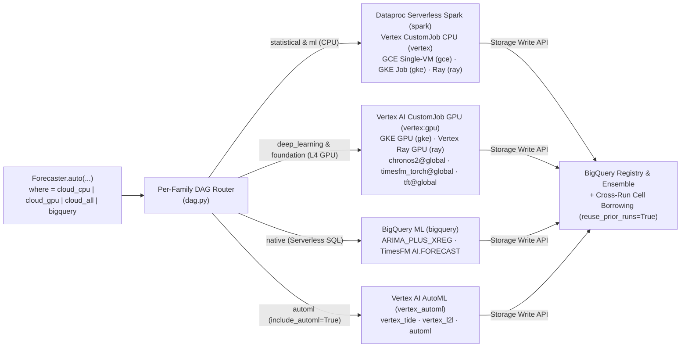

# Auto-Forecaster Cloud Scale: 7-Runtime Matrix, L4 GPU Foundation Models, Vertex AI AutoML & Cloud autofocus

> **Part of the Glass-Box Auto-Forecaster Guide:** [**Main Guide & Architecture (`auto_forecaster.md`)**](./auto_forecaster.md) · [**29 Benchmarks & AlphaEvolve (`auto_forecaster_benchmarks.md`)**](./auto_forecaster_benchmarks.md) · **7-Runtime Cloud Scale & AutoML (`auto_forecaster_cloud_scale.md`)**

The Glass-Box Auto-Forecaster is designed to execute on Google Cloud at enterprise scale. During our verification campaign, we executed **over 70 live cloud benchmark runs** in BigQuery (`v_run_summary`, `v_model_leaderboard`, `v_run_jobs`) spanning all **7 compute runtimes** (`spark`, `vertex` `L4` GPU & sharded CPU, `gce`, `gke`, `ray`, `vertex_automl`, and `bigquery`), panels from **`10` to `100,000` time series**, BigLake Managed Iceberg tables, and multi-pass cloud `autofocus` with cross-run BigQuery cell borrowing (`reuse_prior_runs=True`).

---

## 1. Multi-Engine Cloud Bakeoffs, `L4` GPU Foundation Models & Vertex AI AutoML (`vertex_tide`, `vertex_l2l`)

When `where="cloud_all"` or `where="cloud_gpu"` is selected (or when `include_automl=True` is enabled on `deep_field`), the DAG router dispatches each active model family in parallel to its specialized Google Cloud engine.

### Table 1A — Verified Multi-Engine Cloud Bakeoffs, `L4` GPU Foundation Runs & Vertex AI AutoML Runs

*How to read the scores in this table:* **`Champion WAPE` & Contender `WAPE`** = out-of-fold Weighted Absolute Percentage Error recorded in BigQuery `v_model_leaderboard` (**$\downarrow$ lower is better**) · **`FVA vs. Baseline`** = `%` `WAPE` reduction vs. `naive_seasonal` (**$\uparrow$ higher is better**) · **`Cloud Wall-Clock`** = end-to-end cloud run duration in `v_run_summary` including VM/cluster provisioning and container startup (**$\downarrow$ lower is faster**).

| Benchmark / Panel | Cloud Runtimes Dispatched | Verified `run_id` | Series (`N`) | Winning Champion | Champion `WAPE` $\downarrow$ | Top `@global` / Foundation / AutoML Contenders (`WAPE` $\downarrow$) | FVA vs. Baseline $\uparrow$ | Cloud Wall-Clock $\downarrow$ |
| :--- | :--- | :--- | :---: | :--- | :---: | :--- | :---: | :---: |
| **BigLake Iceberg Covariate Bakeoff (Run A)** | `vertex:gpu` (`L4`) + `vertex:cpu` + `gce:cpu` + `bigquery` | `w1b-cov-matrix-iceberg-0392fe435de7` | `100` | **`chronos2@global_univariate`** | **`0.3226`** | **`chronos2@global_univariate` (`0.3226`)** · `timesfm@cov_all` (`0.3239`) · `chronos2@global_cov_all` (`0.3358`) | **`+30.09%`** | `5,586.2s` |
| **BigLake Iceberg Covariate Bakeoff (Run B)** | `vertex:gpu` (`L4`) + `vertex:cpu` + `gce:cpu` + `bigquery` | `w1b-cov-matrix-iceberg-2e85b1c6777c` | `100` | **`timesfm@cov_all`** | **`0.3239`** | **`timesfm@cov_all` (`0.3239`)** · `timesfm@univariate` (`0.3302`) · `chronos2@local_cov_all` (`0.3324`) | **`+29.80%`** | `6,066.4s` |
| **`dgp_04_true_vs_decoy_covs` (Cloud)** | `vertex:gpu` (`L4`) + `vertex:cpu` + `gce:cpu` + `bigquery` | `w1b-dgp-04-true-vs-dec-636228cbb351` | `12` | **`arima_plus@cov_all`** | **`0.0280`** | `chronos2@local_cov_all` (`0.0442`) · `timesfm@cov_all` (`0.0568`) | **`+73.88%`** | `502.2s` |
| **`dgp_09_cross_series_global` (Cloud)** | `vertex:gpu` (`L4`) + `vertex:cpu` + `gce:cpu` + `bigquery` | `w1b-dgp-09-cross-serie-6fa6ad685ecc` | `12` | **`arima_plus@cov_all`** | **`0.0342`** | `chronos2@local_cov_all` (`0.0558`) · `tft@global_cov_all` (`0.0706`) | **`+69.64%`** | `318.6s` |
| **`dgp_13_all_decoy_univariate` (Cloud)** | `vertex:gpu` (`L4`) + `vertex:cpu` + `gce:cpu` + `bigquery` | `w1b-dgp-13-all-decoy-u-a579c00b1be9` | `12` | **`ensemble_nnls`** | **`0.0155`** | **`chronos2@global_univariate` (`0.0165`)** · `timesfm@univariate` (`0.0176`) | **`+29.62%`** | `335.2s` |
| **`dgp_18_promo_lag_pullforward` (Cloud)** | `vertex:gpu` (`L4`) + `vertex:cpu` + `gce:cpu` + `bigquery` | `w1b-dgp-18-promo-lag-p-7e63337203f0` | `12` | **`ensemble_nnls`** | **`0.0243`** | **`timesfm@univariate` (`0.0425`)** · `chronos2@local_cov_all` (`0.0609`) | **`+90.92%`** | `327.9s` |
| **Vertex AI `L4` GPU Foundation (`N=10`)** | `vertex:gpu` (`g2-standard-8`, `1× L4` GPU) | `w1a-vtx-gpu-n10-w1-24738586baa5` | `10` | **`timesfm_torch@global_univariate`** | **`0.3207`** | **`timesfm_torch@global_univariate` (`0.3207`)** · `chronos2@global_univariate` (`0.3270`) · `tide@global` (`0.3358`) | **`+23.96%`** | `472.9s` |
| **Vertex AI `L4` GPU Foundation (`N=100`)** | `vertex:gpu` (`g2-standard-8`, `1× L4` GPU) | `w1a-vtx-gpu-n100-w1-10a098a8172a` | `100` | **`chronos2@global_univariate`** | **`0.3221`** | **`chronos2@global_univariate` (`0.3221`)** · `timesfm_torch@global_univariate` (`0.3298`) · `tft@global` (`0.3863`) | **`+26.37%`** | `247.9s` |
| **Vertex AI `L4` GPU Sharded (`N=1,000`)** | `vertex:gpu` (`2× g2-standard-8` workers, `L4` GPUs) | `w1a-vtx-gpu-n1000-w2-0206875f4c42` | `1,000` | **`timesfm_torch@global_univariate`** | **`0.3299`** | **`timesfm_torch@global_univariate` (`0.3299`)** · `chronos2@global_univariate` (`0.3318`) · `tide@global` (`0.3413`) | **`+29.58%`** | `576.2s` |
| **Vertex AI `L4` GPU Sharded (`N=10,000`)** | `vertex:gpu` (`2× g2-standard-8` workers, `L4` GPUs) | `w1a-vtx-gpu-n10000-w2-83cd82781455` | `10,000` | **`timesfm_torch@global_univariate`** | **`0.3423`** | **`timesfm_torch@global_univariate` (`0.3423`)** · `chronos2@global_univariate` (`0.3453`) · `chronos_bolt@global` (`0.3599`) | **`+30.82%`** | `2,969.0s` *(`3,832.9s` total)* |
| **Vertex AI AutoML Global (`N=20`)** | `vertex_automl` (`tabular_workflow`: `vertex_tide`, `vertex_l2l` + baselines) | `smoke-42-vertex-automl-tabular-workflow-d3fea0c6efc5` | `20` | **`ensemble_inverse_error`** | **`0.3675`** | **`ensemble_inverse_error` (`0.3675`)** · `vertex_tide` (`0.4363`) · `vertex_l2l` (`0.4535`) | **`+18.31%`** | `7,725.2s` *(`2.1h`)* |
| **Vertex AI AutoML Global (`N=50`)** | `vertex_automl` (`tabular_workflow`: `vertex_tide`, `vertex_l2l`) | `w1d-vertex-automl-tide-l2l-46874ecad083` | `50` | **`vertex_l2l`** | **`0.3858`** | **`vertex_l2l` (`0.3858`)** · `ensemble_inverse_error` (`0.3858`) | **`+25.24%`** | `38,118.2s` *(`10.6h`)* |
| **Vertex AI AutoML Global (`N=30`)** | `vertex_automl` (`tabular_workflow`: `vertex_tide`, `vertex_l2l`) | `w1d-vertex-automl-tide-l2l-7e9419316b1b` | `30` | **`ensemble_inverse_error`** | **`0.6819`** | `vertex_l2l` (`0.6852`) + `vertex_tide` (`0.6860`) blended | `-49.62%` *(AutoML-only)* | `24,464.4s` *(`6.8h`)* |

---

## 2. 7-Runtime Cloud Scale Matrix (`10` $\rightarrow$ `100,000` Time Series)

### Table 2A — At-a-Glance Cloud Runtime Scale Matrix (Wall-Clock Time by Series Count `N`)

*How to read the numbers in this table:* Every cell reports **total end-to-end cloud wall-clock time (`s` or `m`)** from `v_run_summary` / `v_run_jobs`—including cluster/VM provisioning, container startup, parallel model training across `N` time series, and BigQuery result landing (**$\downarrow$ lower is faster**; `w=N` denotes worker count).

| Google Cloud Runtime | `N = 10` Series $\downarrow$ | `N = 100` Series $\downarrow$ | `N = 1,000` Series $\downarrow$ | `N = 10,000` Series $\downarrow$ | `N = 25,000` Series $\downarrow$ | `N = 100,000` Series $\downarrow$ |
| :--- | :---: | :---: | :---: | :---: | :---: | :---: |
| **`bigquery`** *(BQML SQL + `AI.FORECAST`)* | **`79.6s`** | **`135.0s`** | **`340.2s`** | **`827.3s`** | **`512.4s`** *(`8.5m`)* | **`3,358.7s`** *(`56.0m` SQL / `5,095s` total)* |
| **`spark`** *(Dataproc Serverless Spark)* | `993.5s` *(`1,114s` total)* | `1,246.3s` | **`521.2s`** | **`1,012.3s`** *(`16.9m`)* | **`1,158.6s`** *(P1)* | **`3,126.7s`** *(`52.1m`)* |
| **`vertex:cpu`** *(CustomJob Sharded CPU)* | **`111.0s`** (`w=1`) | `518.1s`–`1,657.7s` (`w=1`) | `2,925.7s` (`w=2`) | `2,657.0s`–`11,280s` (`w=4`) | `1,813.9s` (`w=4`) | *(use `spark` or `bigquery`)* |
| **`vertex:gpu`** *(CustomJob `L4` / `T4` GPU)* | `472.9s` (`w=1`) | **`247.9s`** (`w=1`) | **`576.2s`** (`w=2`) | **`2,969.0s`** (`w=2` / `3,833s` total) | *(GPU batch sharded)* | *(GPU batch sharded)* |
| **`gce`** *(Self-Deleting Single-VM COS)* | `408.9s` (`1` VM) | `543.0s` (`1` VM) | `1,579.4s` (`1` VM) | `7,329.7s` (`1` VM) | *(Single-VM `workers=1` cap)* | *(Single-VM `workers=1` cap)* |
| **`gke`** *(GKE Indexed Job)* | `1,100.2s` (`2` pods) | `1,259.9s` (`2` pods) | `1,854.6s` (`2` pods) | `1,512.6s` `ml` / `2,543.6s` `stat` (`3,025s` total) | *(GKE Autopilot/Std pods)* | *(GKE Autopilot/Std pods)* |
| **`ray`** *(Vertex AI Ray Cluster)* | `496.9s` *(`1,342s` total)* | **`547.1s`** | **`831.5s`** | **`999.3s`** *(`2,685s` total)* | *(Ray actor pool)* | *(Ray actor pool)* |
| **`vertex_automl`** *(Managed Tabular Workflow)* | `7,725.2s` *(`2.1h`, `N=20`)* | `24,464s` (`N=30`) / `38,118s` (`N=50`) | *(Managed neural search)* | *(Managed neural search)* | *(Managed neural search)* | *(Managed neural search)* |

### Table 2B — Complete Verified 7-Runtime Cloud Scale Ledger (`run_id`, Workers, Champion `WAPE` & FVA %)

*How to read the scores in this table:* **`Champion WAPE`** = out-of-fold Weighted Absolute Percentage Error (**$\downarrow$ lower is better**) · **`FVA vs. Baseline`** = `%` `WAPE` reduction vs. `naive_seasonal` on the identical series slice (**$\uparrow$ higher is better**) · **`Total Cloud Duration`** = end-to-end cloud wall-clock seconds recorded in `v_run_summary` / `v_run_jobs` (**$\downarrow$ lower is faster**).

| Cloud Runtime (`compute.runtime`) | Scale (`N` Series) | Workers / Provisioning | Verified `run_id` | Winning Champion | Champion `WAPE` $\downarrow$ | FVA vs. Baseline $\uparrow$ | Total Cloud Duration $\downarrow$ |
| :--- | :---: | :---: | :--- | :--- | :---: | :---: | :---: |
| **`bigquery`** *(BQML SQL + `AI.FORECAST`)* | `10` | Serverless SQL slots | `w1a-bq-scale-n10-b5b939ff3351` | `timesfm@univariate` | `0.3304` | **`+21.66%`** | **`79.6s`** |
| **`bigquery`** *(BQML SQL + `AI.FORECAST`)* | `100` | Serverless SQL slots | `w1a-bq-scale-n100-09b32c2b61da` | `timesfm@univariate` | `0.3245` | **`+25.82%`** | **`135.0s`** |
| **`bigquery`** *(BQML SQL + `AI.FORECAST`)* | `1,000` | Serverless SQL slots | `w1a-bq-scale-n1000-f18f03f48799` | `timesfm@univariate` | `0.3355` | **`+28.39%`** | **`340.2s`** |
| **`bigquery`** *(BQML SQL + `AI.FORECAST`)* | `10,000` | Serverless SQL slots | `w1a-bq-scale-n10000-ca374155dd02` | `timesfm@univariate` | `0.3466` | **`+29.96%`** | **`827.3s`** |
| **`bigquery`** *(BQML SQL + `AI.FORECAST`)* | **`25,000`** | Serverless SQL slots | `w3-holdout-25000-bigquery-3d8d8bdec11b` | **`ensemble_champion`** *(+ `timesfm` `0.3102`)* | **`0.3062`** | **`+47.36%`** | **`512.4s`** *(`8.5m`)* |
| **`bigquery`** *(BQML SQL + `AI.FORECAST`)* | **`100,000`** | Serverless SQL slots | `w1a-bq-scale-n100000-97e2fbd32ed2` | **`timesfm@univariate`** *(+ `ensemble_nnls` `0.3499`)* | **`0.3425`** | **`+29.33%`** | **`3,358.7s`** *(`5,095.0s` total)* |
| **`spark`** *(Dataproc Serverless Spark)* | `10` | Autoscale executors | `w1a-spark-srv-n10-e839bf6f74ef` | `holtwinters` | `0.3370` | **`+20.08%`** | `993.5s` *(`1,114.1s` total)* |
| **`spark`** *(Dataproc Serverless Spark)* | `100` | Autoscale executors | `w1a-spark-srv-n100-ad0e3882801f` | `ensemble_nnls` | `0.3266` | **`+19.42%`** | `1,246.3s` |
| **`spark`** *(Dataproc Serverless Spark)* | `1,000` | Autoscale executors | `w1a-spark-srv-n1000-60b6495657b2` | `ensemble_nnls` | `0.3333` | **`+22.91%`** | **`521.2s`** |
| **`spark`** *(Dataproc Serverless Spark)* | `10,000` | Autoscale executors | `w1a-spark-srv-n10000-90213c41efbf` | `ensemble_nnls` | `0.3435` | **`+25.46%`** | **`1,012.3s`** *(`16.9m`)* |
| **`spark`** *(Dataproc Serverless Spark)* | **`100,000`** | Autoscale executors | `w1a-spark-srv-n100000-f0ce6ad0a782` | `ensemble_inverse_error` | `0.4052` | **`+12.09%`** | **`3,126.7s`** *(`52.1m`)* |
| **`vertex:cpu`** *(CustomJob CPU Sharded)* | `10` | `1` worker | `w1a-vtx-cpu-n10-w1-229a7e6cd35a` | `ensemble_nnls` | `0.3360` | **`+19.40%`** | **`111.0s`** |
| **`vertex:cpu`** *(CustomJob CPU Sharded)* | `100` | `1` worker | `w1a-vtx-cpu-n100-w1-d6cb6c294638` | `ensemble_inverse_error` | `0.3515` | **`+19.65%`** | `1,657.7s` |
| **`vertex:cpu`** *(CustomJob CPU Sharded)* | `1,000` | `2` workers (`row_restriction`) | `w1a-vtx-cpu-n1000-w2-55d77c7aa08c` | `ensemble_nnls` | `0.3335` | **`+22.87%`** | `2,925.7s` |
| **`vertex:cpu`** *(CustomJob CPU Sharded)* | **`10,000`** | `4` workers (`row_restriction`) | `w1a-vtx-cpu-n10000-w4-9c6a787dbb74` | `ensemble_nnls` | `0.3571` | **`+22.51%`** | `11,280.0s` |
| **`vertex:cpu`** *(10K Hierarchy Reconciliation)* | **`10,000`** | `4` workers (`mint_shrink`) | `w1c-hier-10000-smooth-24b096c56fc0` | **`lightgbm_mint_shrink`** | **`0.0256`** | **`+51.01%`** | **`2,657.0s`** *(`44.3m`)* |
| **`vertex:gpu`** *(CustomJob `L4` GPU)* | `10` | `1× g2-standard-8` (`L4`) | `w1a-vtx-gpu-n10-w1-24738586baa5` | `timesfm_torch@global_univariate` | `0.3207` | **`+23.96%`** | `472.9s` |
| **`vertex:gpu`** *(CustomJob `L4` GPU)* | `100` | `1× g2-standard-8` (`L4`) | `w1a-vtx-gpu-n100-w1-10a098a8172a` | `chronos2@global_univariate` | `0.3221` | **`+26.37%`** | **`247.9s`** |
| **`vertex:gpu`** *(CustomJob `L4` GPU)* | `1,000` | `2× g2-standard-8` (`L4`) | `w1a-vtx-gpu-n1000-w2-0206875f4c42` | `timesfm_torch@global_univariate` | `0.3299` | **`+29.58%`** | **`576.2s`** |
| **`vertex:gpu`** *(CustomJob `T4`/`L4` GPU)* | **`10,000`** | `2` GPU workers (`row_restriction`) | `w1a-vtx-gpu-n10000-w2-83cd82781455` | **`timesfm_torch@global_univariate`** *(+ `chronos2@global` `0.3453`)* | **`0.3423`** | **`+30.82%`** | `2,969.0s` *(`3,832.9s` total)* |
| **`gce`** *(GCE Single-VM COS)* | `10` | `1` VM (self-deleting) | `w1a-gce-n10-b086f07c77ee` | `ensemble_inverse_error` | `0.3915` | **`+7.18%`** | `408.9s` *(`454.3s` total)* |
| **`gce`** *(GCE Single-VM COS)* | `100` | `1` VM (self-deleting) | `w1a-gce-n100-208d4c1eba33` | `ensemble_nnls` | `0.3267` | **`+19.40%`** | `543.0s` |
| **`gce`** *(GCE Single-VM COS)* | `1,000` | `1` VM (self-deleting) | `w1a-gce-n1000-6e392716c20d` | `ensemble_nnls` | `0.3335` | **`+22.87%`** | `1,579.4s` |
| **`gce`** *(GCE Single-VM COS)* | **`10,000`** | `1` VM (self-deleting) | `w1a-gce-n10000-f8231ea85ecc` | `lightgbm` | `0.3821` | **`+17.08%`** | `7,329.7s` |
| **`gke`** *(GKE Indexed Job)* | `10` | `2` pods (`JOB_COMPLETION_INDEX`) | `w1a-gke-job-n10-75276ed3cc94` | `ensemble_inverse_error` | `0.3896` | **`+7.62%`** | `1,100.2s` *(`1,203.5s` total)* |
| **`gke`** *(GKE Indexed Job)* | `100` | `2` pods (`JOB_COMPLETION_INDEX`) | `w1a-gke-job-n100-2c12a53fe095` | `ensemble_inverse_error` | `0.3521` | **`+13.14%`** | `1,259.9s` |
| **`gke`** *(GKE Indexed Job)* | `1,000` | `2` pods (`JOB_COMPLETION_INDEX`) | `w1a-gke-job-n1000-d278df60a08d` | `ensemble_inverse_error` | `0.3742` | **`+13.45%`** | `1,854.6s` |
| **`gke`** *(GKE Indexed Job)* | **`10,000`** | `4` pods (`JOB_COMPLETION_INDEX`) | `w1a-gke-job-n10000-d0954836165d` | `ensemble_inverse_error` | `0.4105` | **`+17.05%`** | `2,543.6s` *(`3,024.7s` total)* |
| **`ray`** *(Vertex AI Ray Cluster)* | `10` | Ray actors | `w1a-ray-vtx-n10-e3d7a104feb0` | `ensemble_inverse_error` | `0.3896` | **`+7.62%`** | `496.9s` *(`1,342.3s` total)* |
| **`ray`** *(Vertex AI Ray Cluster)* | `100` | Ray actors | `w1a-ray-vtx-n100-7dc6cde20121` | `ensemble_inverse_error` | `0.3521` | **`+13.14%`** | **`547.1s`** |
| **`ray`** *(Vertex AI Ray Cluster)* | `1,000` | Ray actors | `w1a-ray-vtx-n1000-b6b89ee98582` | `ensemble_inverse_error` | `0.3742` | **`+13.45%`** | **`831.5s`** |
| **`ray`** *(Vertex AI Ray Cluster)* | **`10,000`** | Ray actors | `w1a-ray-vtx-n10000-4561cc4adfa4` | `ensemble_inverse_error` | `0.4105` | **`+17.05%`** | **`999.3s`** *(`2,684.9s` total)* |
| **`vertex_automl`** *(Managed Tabular Workflow)* | `20` | Managed Vertex AI Pipeline | `smoke-42-vertex-automl-tabular-workflow-d3fea0c6efc5` | `ensemble_inverse_error` *(+ `vertex_tide` `0.4363`)* | `0.3675` | **`+18.31%`** | `7,725.2s` *(`2.1h`)* |
| **`vertex_automl`** *(Managed Tabular Workflow)* | **`50`** | Managed Vertex AI Pipeline | `w1d-vertex-automl-tide-l2l-46874ecad083` | **`vertex_l2l`** | **`0.3858`** | **`+25.24%`** | `38,118.2s` *(`10.6h`)* |

---

## 3. Multi-Pass Cloud `autofocus=True` & Cross-Run Cell Borrowing (`reuse_prior_runs=True`)

When `Forecaster.auto(..., where="cloud_cpu" | "cloud_all" | "bigquery", autofocus=True)` runs against a BigQuery dataset, Pass 2 and Pass 3 automatically query `forecast_metrics` and `forecast_predictions` from prior passes (and any prior runs matching `make_model_spec_hash`), **borrowing already-computed `(ts_id, model_type)` cells directly from BigQuery** so cloud compute is only billed for newly proposed models.

### Table 3A — Verified Multi-Pass Cloud `autofocus` Tournaments (Synthetic Holdouts + All 9 Public Open-Data Benchmarks)

*How to read the scores in this table:* **`Pass 1 Error` & `Final Error`** = out-of-fold `WAPE` (or `MASE` on `monash_car_parts`) before and after multi-pass `autofocus` (**$\downarrow$ lower is better**) · **`FVA vs. Baseline`** = final `%` error reduction vs. `naive_seasonal` (**$\uparrow$ higher is better**) · **`Total Cloud Duration`** = elapsed cloud wall-clock seconds (**$\downarrow$ lower is faster**).

| Cloud `autofocus` Tournament | Cloud Sandbox (`where`) | Verified Pass `run_id` Chain | Series (`N`) | Pass 1 Error $\downarrow$ | Final Error $\downarrow$ | Final Winning Model (`Pass`) | FVA vs. Baseline $\uparrow$ | Total Cloud Duration $\downarrow$ |
| :--- | :--- | :--- | :---: | :---: | :---: | :--- | :---: | :---: |
| **Cloud Holdout `N=100` (`wide_field`)** | **`cloud_cpu`** (`vertex` / `gce` CPU) | `w3-holdout-00100-cloud-cpu-81423bb364a7` | `100` | `0.3194` | **`0.3194`** *(stopped P1)* | **`chronos_bolt@global` (`Pass 1`)** | **`+39.84%`** | `518.1s` |
| **Cloud Holdout `N=2,500` (`wide_field`)** | **`cloud_cpu`** (Dataproc Serverless Spark) | `w3-holdout-02500-cloud-cpu-4750afbb79e0` | `2,500` | `0.3191` | **`0.3191`** *(`chronos_bolt@global` `0.3300`)* | **`ensemble_inverse_error` (`Pass 1`)** | **`+41.93%`** | `1,057.9s` |
| **Cloud Holdout `N=25,000` Multi-Branch DAG** | **`cloud_cpu`** (Dataproc Serverless Spark) | `w3-holdout-25000-cloud-cpu-8a052f73d5c0` $\rightarrow$ `p2a` / `p2b` $\rightarrow$ `p3-synth-bd1d0c224f52` | **`25,000`** | `0.3737` *(`+35.76%` FVA)* | **`0.2054`** | **`ensemble_horizon_specialist` (`Pass 3`)** | **`+64.69%`** | `1,158.6s` *(P1)* $\rightarrow$ `3,643.8s` *(P3)* |
| **BigLake Iceberg `cloud_all` (`deep_sky`)** | **`cloud_all`** (`spark:cpu` + `vertex:gpu` `L4` + `bigquery`) | `w2b-cloud-all-cov-iceberg-50-698847e0251e` $\rightarrow$ `p2-325f07c620e9` *(`22` models borrowed)* | `50` | `0.3402` | **`0.3397`** *(`chronos_bolt@global` `0.3827`)* | **`ensemble_horizon_specialist` (`Pass 2`)** | **`+31.43%`** | `2,994.3s` *(P1)* + `1,858.6s` *(P2)* |
| **`m5_walmart` (In-Warehouse SQL)** | **`bigquery`** (`ARIMA_PLUS_XREG` $\rightarrow$ `TimesFM` `AI.FORECAST`) | `r4-m5-walmart-bigquery-p2-ba55284e942a` | `16` | `0.2669` | **`0.2573`** | **`ensemble_horizon_specialist` (`Pass 2`)** | **`+24.54%`** | **`310.0s`** |
| **`m5_walmart` (Serverless Spark)** | **`cloud_cpu`** (Dataproc Serverless Spark) | `r4-m5-walmart-cloud-cpu-505cb1271dd3` | `16` | `0.2669` | **`0.2669`** | **`lightgbm` (`Pass 1`)** | **`+24.86%`** | **`475.3s`** |
| **`m5_walmart` (All Cloud Engines + GPU)** | **`cloud_all`** (`spark` + `vertex:gpu` + `bigquery`, `deep_sky`) | `r5-m5-walmart-cloud-5670ec40d632` | `16` | `0.2925` *(3-fold CV)* | **`0.2925`** | **`ensemble_nnls` (`Pass 1`)** | **`+18.61%`** | **`821.7s`** |
| **`favorita_grocery` (In-Warehouse SQL)** | **`bigquery`** (`ARIMA_PLUS_XREG` $\rightarrow$ `TimesFM` `AI.FORECAST`) | `r4-favorita-grocery-bigquery-p2-f35b95b9cc3b` | `16` | `0.0754` | **`0.0703`** | **`ensemble_horizon_specialist` (`Pass 2`)** | **`+35.22%`** | **`269.3s`** |
| **`favorita_grocery` (Serverless Spark)** | **`cloud_cpu`** (Dataproc Serverless Spark, `b=5` borrowed) | `r5-favorita-gro-cloud-3a1fbd6cc0e0` $\rightarrow$ `p2-1520ac9b3aa5` | `16` | `0.0600` | **`0.0573`** | **`ensemble_champion` (`Pass 2`)** | **`+22.47%`** | **`890.4s`** |
| **`m4_daily` (In-Warehouse SQL)** | **`bigquery`** (`ARIMA_PLUS` $\rightarrow$ `TimesFM` `AI.FORECAST`) | `r5-m4-daily-bigque-f16701d75990` $\rightarrow$ `p2-1eec73dcf9a3` | `16` | `0.0424` | **`0.0336`** | **`ensemble_champion` (`Pass 2`)** | **`+41.57%`** *(`+20.73%` AF lift)* | **`324.2s`** |
| **`m4_weekly` (In-Warehouse SQL)** | **`bigquery`** (`ARIMA_PLUS` $\rightarrow$ `TimesFM` `AI.FORECAST`) | `r5-m4-weekly-bigque-6bae01cd625d` $\rightarrow$ `p2-c65969d4f866` | `16` | `0.0742` | **`0.0676`** | **`ensemble_inverse_error` (`Pass 2`)** | **`+35.98%`** *(`+8.90%` AF lift)* | **`272.2s`** |
| **`m4_monthly` (In-Warehouse SQL)** | **`bigquery`** (`ARIMA_PLUS` $\rightarrow$ `TimesFM` `AI.FORECAST`, `b=1`) | `r5-m4-monthly-bigque-0f684261ba11` $\rightarrow$ `p2-caa1046d2639` | `16` | `0.0420` | **`0.0396`** | **`ensemble_champion` (`Pass 2`)** | **`+38.60%`** *(`+5.76%` AF lift)* | **`249.8s`** |
| **`monash_tourism_monthly` (In-Warehouse SQL)** | **`bigquery`** (`ARIMA_PLUS` $\rightarrow$ `TimesFM` `AI.FORECAST`) | `r5-monash-touri-bigque-7a00067b5385` $\rightarrow$ `p2-8ad47606bf59` | `16` | `0.2585` | **`0.2091`** | **`ensemble_champion` (`Pass 2`)** | **`+12.69%`** *(`+19.14%` AF lift)* | **`258.3s`** |
| **`monash_hospital` (In-Warehouse SQL)** | **`bigquery`** (`ARIMA_PLUS` $\rightarrow$ `TimesFM` `AI.FORECAST`, `b=1`) | `r5-monash-hospi-bigque-b9731c8a6514` $\rightarrow$ `p2-11c6813a8a53` | `16` | `0.2251` | **`0.2050`** | **`ensemble_inverse_error` (`Pass 2`)** | **`+33.98%`** *(`+8.93%` AF lift)* | **`280.8s`** |
| **`monash_car_parts` (In-Warehouse SQL)** | **`bigquery`** (`ARIMA_PLUS` $\rightarrow$ `TimesFM` `AI.FORECAST`, `b=1`) | `r5-monash-car-p-bigque-fdf754dfcab8` $\rightarrow$ `p2-d69e739377af` | `16` | `0.8041` (`MASE`) | **`0.7559`** (`MASE`) | **`ensemble_horizon_specialist` (`Pass 2`)** | **`+24.41%`** *(`+6.00%` AF lift)* | **`247.7s`** |
| **`etth1` (Serverless Spark Sub-Daily `h`)** | **`cloud_cpu`** (Dataproc Serverless Spark, `b=2` borrowed) | `r5-etth1-cloud-5b65406ef6b2` $\rightarrow$ `p2-494d6e56f1bf` | `7` | `0.0937` | **`0.0935`** | **`ensemble_inverse_error` (`Pass 2`)** | **`+33.38%`** | **`902.6s`** |
| **`etth1` (All Cloud Engines + GPU `h`)** | **`cloud_all`** (`spark` + `vertex:gpu` + `bigquery`, `deep_sky`) | `r5-etth1-cloud-229ca03fbc68` | `7` | `0.0955` *(3-fold CV)* | **`0.0955`** | **`ensemble_ridge` (`Pass 1`)** | **`+55.37%`** | **`507.1s`** |

---

Return to the **[Main Auto-Forecaster Guide (`auto_forecaster.md`)](./auto_forecaster.md)** or view the **[29 Synthetic & Open-Data Benchmarks (`auto_forecaster_benchmarks.md`)](./auto_forecaster_benchmarks.md)**.
