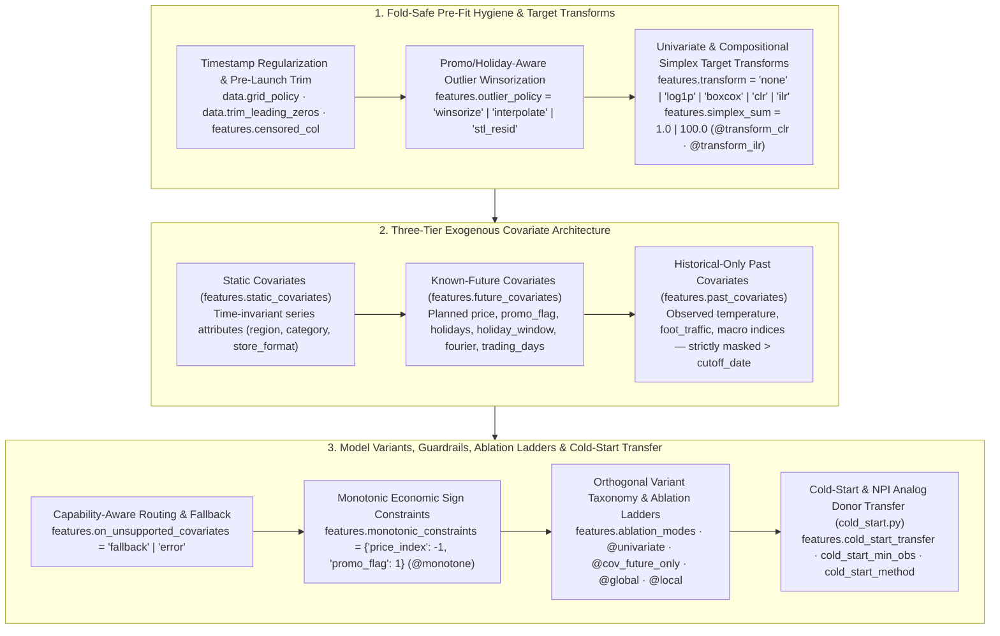

# Feature Engineering, Three-Tier Covariates, Compositional Simplex & Cold-Start Transfer

`scale-forecasting` provides a declarative, leak-free feature engineering, target-transformation, and cold-start transfer pipeline across [`features.py`](https://github.com/statmike/scale-forecasting/blob/main/src/scale_forecasting/features.py), [`simplex.py`](https://github.com/statmike/scale-forecasting/blob/main/src/scale_forecasting/simplex.py), [`monotonicity.py`](https://github.com/statmike/scale-forecasting/blob/main/src/scale_forecasting/monotonicity.py), [`holiday_window.py`](https://github.com/statmike/scale-forecasting/blob/main/src/scale_forecasting/holiday_window.py), and [`cold_start.py`](https://github.com/statmike/scale-forecasting/blob/main/src/scale_forecasting/cold_start.py). Every transformation executes strictly inside each rolling-origin backtest fold (`ds <= cutoff_date`) so future observations never leak into historical training windows.



---

## 1. Three-Tier Exogenous Covariate Contract (`FeaturesConfig`)

Different model families consume exogenous information in fundamentally different ways. `FeaturesConfig` separates covariates into three explicit tiers and routes each tier only to models that declare support (`supports_static_covariates`, `supports_future_covariates`, `supports_past_covariates`):

| Covariate Tier | `RunConfig` Field | Cutoff & Horizon Rule | Models Supporting Tier |
| :--- | :--- | :--- | :--- |
| **Static Covariates** | `features.static_covariates` | Constant per `ts_id` across history and horizon (e.g., `["region", "category"]`). Categorical strings are deterministically encoded. | Global/hybrid panel models (`tide`, `tft`, `tsmixer`, `lightgbm@global`, `xgboost@global`, `catboost@global`) and Vertex AI AutoML (`vertex_l2l`, `vertex_tide`, `vertex_tft`, `vertex_seq2seq`). |
| **Known-Future Covariates** | `features.future_covariates` (alias `features.exog`) | Must be present in both historical training rows (`ds <= cutoff_date`) and future horizon rows (`cutoff_date < ds <= cutoff_date + H`). | `sarimax`, `prophet`, `regression_lags`, all `ml` tree models (`lightgbm`, `xgboost`, `catboost`, `random_forest`, `extra_trees`), `neuralprophet`, `tide`, `tft`, `tsmixer`, `chronos2`, `vertex_*`, and `arima_plus`. |
| **Historical-Only Past Covariates** | `features.past_covariates` | Observed only up to `ds <= cutoff_date`. Strictly masked beyond `cutoff_date` during backtesting and HPO to prevent lookahead leakage; projected into future steps via `exog_lags` or cutoff carry-forward for tabular models. | Native encoder consumption in `tide`, `tft`, `tsmixer`, `neuralprophet`, and `vertex_*`; lagged/carried consumption in `ml`, `statistical`, and `arima_plus`. |

### Deterministic Calendar, Holiday Window & Structural Regressors
- **Country & Custom Holidays (`features.holidays`, `features.custom_holidays`):** Generates binary holiday indicators (`is_holiday`) for any ISO country code (e.g., `["US", "GB"]`) plus custom event dates.
- **Moving-Holiday Lead/Lag Windows (`features.holiday_window`):** Adds continuous pre-holiday ramp-up (`pre_holiday_window`, `days_to_next_holiday`) and post-holiday dip (`post_holiday_window`, `days_since_prev_holiday`, `holiday_offset_days`) features around movable holidays (Easter, Ramadan, Lunar New Year, Cyber Week) using `"linear"`, `"cosine"`, or `"gaussian"` kernels.
- **Fourier Seasonality (`features.fourier`), Trading Days (`features.trading_days`) & Level Shifts (`features.level_shift`):** Appends harmonic sine/cosine pairs, monthly/weekly business-day counts (`trading_days_in_period`), and automatic structural step-change indicators (`level_shift`).

---

## 2. Compositional Simplex Transforms (`clr` & `ilr`)

When forecasting **market shares, category mix percentages, portfolio weights, or channel split proportions**, the $D$ series across the panel are coupled by the constant-sum simplex constraint at every timestamp $t$:

$$y_{i,t} > 0, \qquad \sum_{i=1}^{D} y_{i,t} = S \quad (S = 1.0 \text{ or } S = 100.0)$$

Forecasting each share independently in raw space produces predictions that drift below $0$, exceed $S$, or sum to $\ne S$. Setting `features.transform = "clr"` or `"ilr"` (or appending `@transform_clr` / `@transform_ilr` to any model name, such as `"lightgbm@transform_ilr"` or `"theta@transform_clr"`) activates Aitchison geometry in [`simplex.py`](https://github.com/statmike/scale-forecasting/blob/main/src/scale_forecasting/simplex.py):

| Transform Mode | Forward Mapping ($\mathcal{S}^D \to \mathbb{R}^K$) | Inverse Closure ($\mathbb{R}^K \to \mathcal{S}^D$) | Key Properties |
| :--- | :--- | :--- | :--- |
| **Centered Log-Ratio (`"clr"` / `@transform_clr`)** | $z_{i,t} = \ln y_{i,t}^* - \frac{1}{D}\sum_{j=1}^D \ln y_{j,t}^*$ | $\hat{y}_{i,t} = S \cdot \frac{\exp(\hat{z}_{i,t})}{\sum_{j=1}^D \exp(\hat{z}_{j,t})}$ | Symmetric 1-to-1 series mapping; works seamlessly with per-series (`local`), panel (`global`), and ensemble models followed by softmax simplex closure. |
| **Isometric Log-Ratio (`"ilr"` / `@transform_ilr`)** | $\mathbf{z}_t = \operatorname{clr}(\mathbf{y}_t^*) \cdot \mathbf{V}$ using the $D \times (D-1)$ orthonormal **Helmert contrast matrix** $\mathbf{V}$ | $\hat{\mathbf{y}}_t = \operatorname{clr}^{-1}(\hat{\mathbf{z}}_t \mathbf{V}^\top, S)$ | Full-rank isometric coordinate representation in $\mathbb{R}^{D-1}$ (`ilr_transform` / `ilr_inverse`, `forecast_simplex_panel`) and per-series log-odds closure across all 37 models and 9 ensemble strategies. |

### Zero Replacement, Post-Blend Evolution & Simplex Coherence Verification
1. **Martín-Fernández Multiplicative Zero Replacement (`multiplicative_replacement`):** Structural or transient zeros ($y_{i,t} = 0$) are replaced prior to log-transformation using $y_{i,t}^* = \delta$ for zero parts and $y_{i,t}^* = y_{i,t} \cdot (1 - c \cdot \delta / S)$ for positive parts, preserving exact cross-series sums $\sum_i y_{i,t}^* = S$ with zero NaNs or infinities.
2. **Calibrated Bounded Intervals:** Prediction intervals (`yhat_lower`, `yhat_upper`) are mapped back into $[0, S]$ with strict ordering $0 \le \hat{y}_{\text{lower}} \le \hat{y} \le \hat{y}_{\text{upper}} \le S$.
3. **Automatic Detection, `f.assess()` & `Forecaster.evolve()` Closure:** `Forecaster.profile_data()` automatically flags compositional panels (`is_compositional_simplex=True`, `simplex_total=1.0` or `100.0`), `f.assess()` surfaces causal guardrails (`@monotone`, `monotonic_constraints`, `holiday_window`, and `f.promo_elasticity_df()`) in Question 3 and simplex closure status in Question 5, `Forecaster.evolve(target="ensemble")` enforces post-blend `enforce_simplex_closure()` across inner CV, Gate-3 lockdown, and materialized `result.predictions_df`, and `verify_simplex(predictions_df, simplex_sum=S)` verifies $\max_t |\sum_i \hat{y}_{i,t} - S| < 10^{-6}$ (auto-detecting `"ds"`, `"forecast_date"`, or `"date"`).

---

## 3. Cold-Start & New Product Introduction (NPI) Analog Transfer (`cold_start.py`)

When launching **new SKUs, newly opened stores, or short-history products** with fewer than `features.cold_start_min_obs` observations (default `14`), univariate local statistical models lack sufficient degrees of freedom to estimate seasonal profiles or trend slopes reliably. Setting `features.cold_start_transfer = True` activates [`cold_start.py`](https://github.com/statmike/scale-forecasting/blob/main/src/scale_forecasting/cold_start.py):

| `features.cold_start_method` | Mechanism | Best For |
| :--- | :--- | :--- |
| **`"auto"`** *(default)* | Selects `"analog_transfer"` when mature donor series ($n \ge \max(2 \cdot \text{min\_obs}, m + H)$) exist in the panel and falls back to `"bass_diffusion"` / `"weibull_lifecycle"` otherwise. | Heterogeneous enterprise catalogs mixing mature and newly launched series (`cold_start_short_history`). |
| **`"analog_transfer"`** | Computes a composite donor similarity score combining static covariate affinity, hierarchical lineage overlap, and normalized early-ramp trajectory correlation over the $k$ observed post-launch periods, then transfers the top-$K$ donors' seasonal shape scaled by empirical-Bayes level shrinkage. | Retail SKU launches, new store openings, and replacement product rollouts with peer history. |
| **`"bass_diffusion"`** | Fits the Bass (1969) innovation/imitation S-curve $y(t) = m \cdot \frac{(p+q)^2}{p} \frac{e^{-(p+q)t}}{(1 + (q/p)e^{-(p+q)t})^2}$ regularized toward panel priors $(\bar{p}, \bar{q})$. | Technology adoption, subscription cohorts, and cumulative launch ramps without close analogs. |
| **`"weibull_lifecycle"`** | Fits a 3-parameter Weibull launch-peak-decay curve $y(t) = A \cdot (k/\lambda)(t/\lambda)^{k-1} e^{-(t/\lambda)^k}$ with empirical-Bayes shape stabilization. | Fashion, seasonal apparel, media, and promotional limited-edition lifecycles. |

`Forecaster.profile_data()` automatically counts short-history series (`n_cold_start_series`, `cold_start_fraction`), `Forecaster.auto()` evaluates Branch 2c (`cold_start_analog_transfer`) when cold-start series are detected, and `f.assess()` reports cold-start transfer lift in Question 4.

---

## 4. Declarative `RunConfig` & Python SDK Examples

```json
{
  "run_name": "compositional_market_share_tournament",
  "python_runtime": "gce",
  "data": {
    "source_table": "source_series_covariates_iceberg",
    "freq": "D",
    "horizon": 14,
    "series_limit": 12
  },
  "models": [
    "theta@transform_ilr",
    "holtwinters@transform_clr",
    "lightgbm@transform_ilr"
  ],
  "features": {
    "transform": "ilr",
    "simplex_sum": 100.0,
    "future_covariates": ["is_holiday", "promo_flag"],
    "on_unsupported_covariates": "fallback",
    "cold_start_transfer": true,
    "cold_start_min_obs": 14,
    "cold_start_method": "auto"
  },
  "backtest": {
    "enabled": true,
    "horizon": 14,
    "n_folds": 2,
    "step": 14,
    "decision_metric": "wape"
  },
  "ensemble": {
    "enabled": true,
    "strategies": ["mean", "inverse_error", "nnls"]
  }
}
```

### Offline & SDK Walkthrough

```python
import scale_forecasting as sf

# 1. Load a 5-brand market-share compositional panel (sums to 100.0% at every date)
bench = sf.load_benchmark("compositional_market_share_simplex")

# 2. Forecast in full-rank ILR Helmert coordinates or via @transform_ilr / @transform_clr variants
ilr_preds = sf.forecast_simplex_panel(
    bench.df,
    model_name="theta",
    transform="ilr",
    horizon=14,
    simplex_sum=100.0,
)
print("Max simplex discrepancy:", sf.verify_simplex(ilr_preds, simplex_sum=100.0))

# 3. Synthesize cold-start / NPI trajectories on dgp_11_cold_start_mixed
cs_bench = sf.load_benchmark("dgp_11_cold_start_mixed")
cs_df = sf.cold_start_transfer_df(cs_bench.df, min_obs=14, method="auto", horizon=14)
print(cs_df[["ts_id", "n_obs", "is_cold_start", "selected_archetype", "donor_ts_ids", "yhat_mean"]].head())

# 4. Run an automated bake-off and inspect the 7-Question Assessment
f = sf.Forecaster.auto(
    data=bench.df,
    target_col="y",
    horizon=14,
)
print(f.leaderboard_df()[["model_type", "wape", "mase"]].head())
print(f.assess())
```

See also:
- [Notebook 05: Covariates and Global Models](./notebooks/05_covariates_and_global_models.ipynb)
- [Notebook 06: Hierarchical Reconciliation, THieF & Compositional Simplex](./notebooks/06_hierarchical_reconciliation.ipynb)
- [Configuration Reference](./configuration_reference.md)
- [API Reference: `features`](./api/features.md), [`simplex`](./api/simplex.md), [`monotonicity`](./api/monotonicity.md), [`holiday_window`](./api/holiday_window.md), [`cold_start`](./api/cold_start.md)

