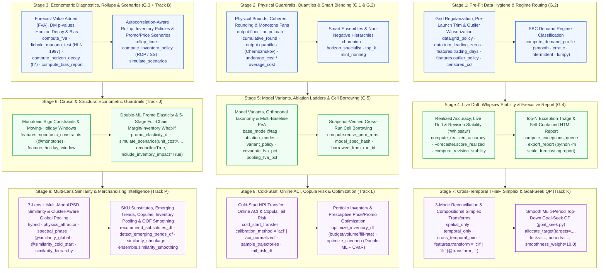
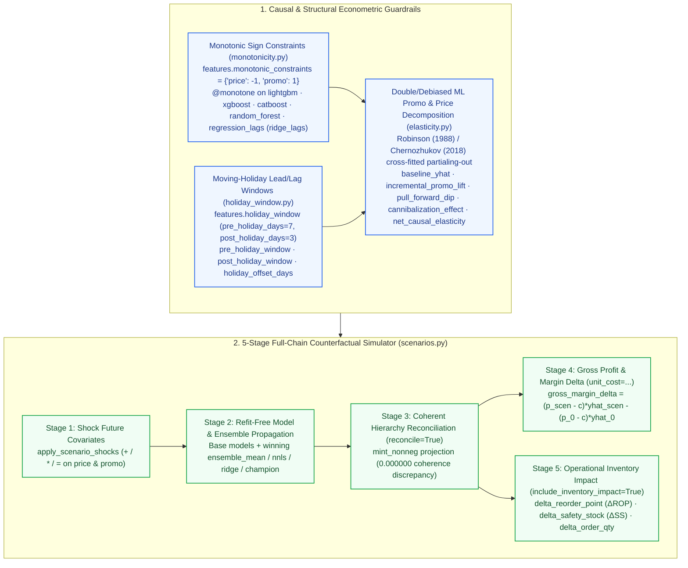
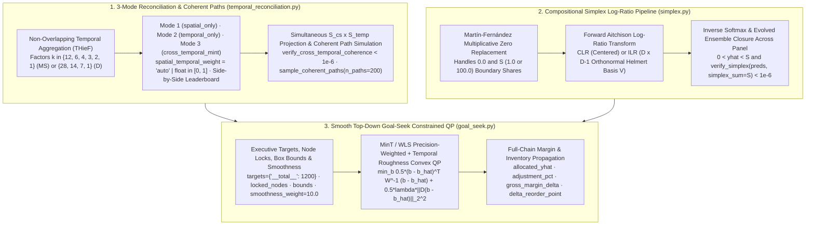
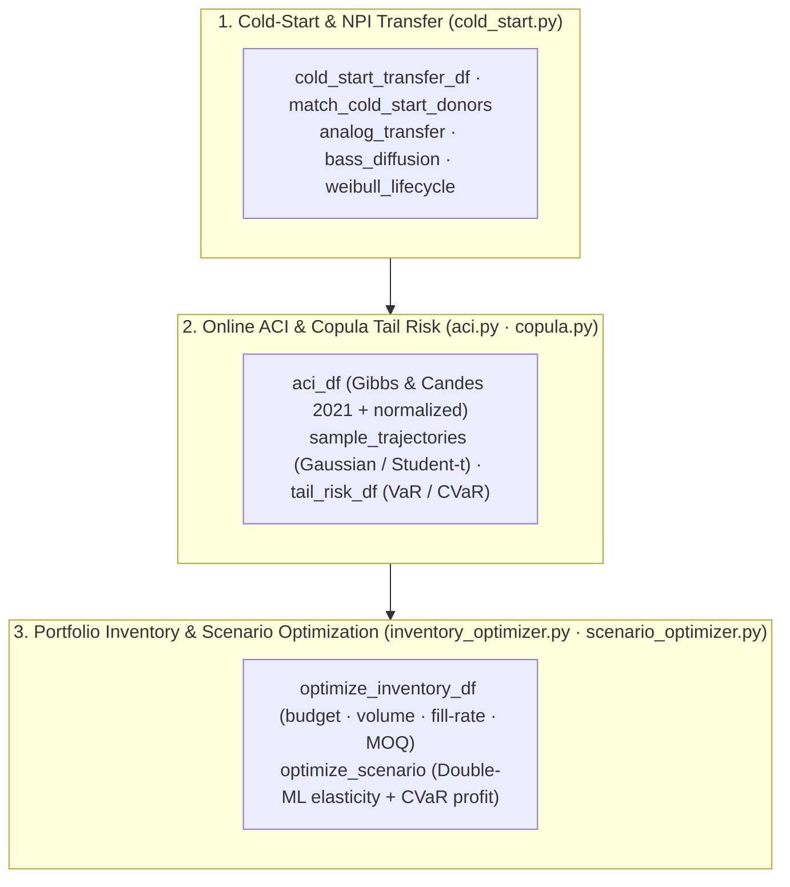
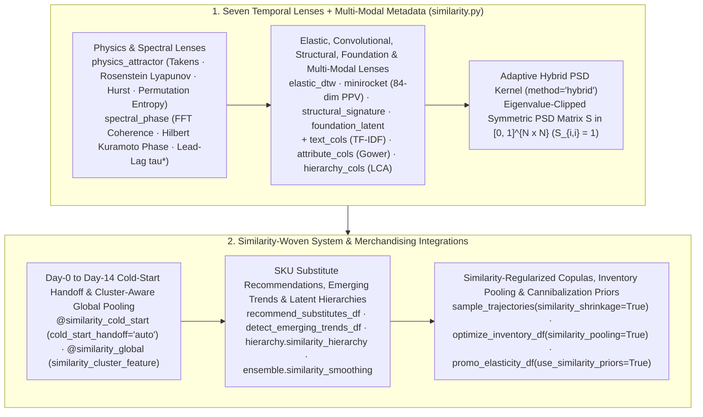
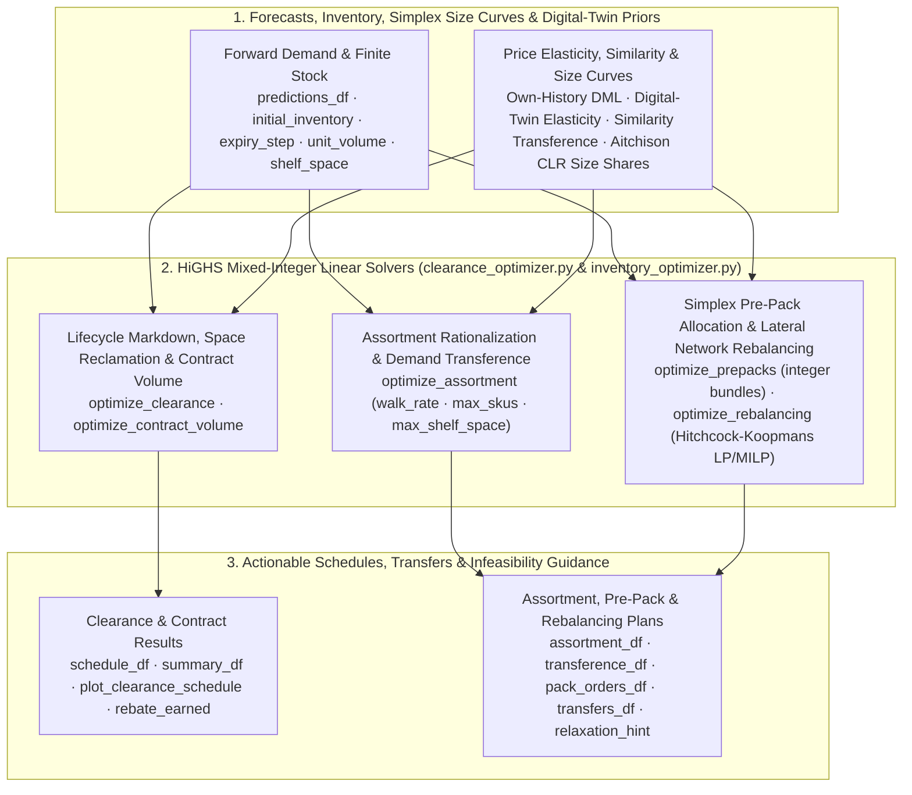

# Forecaster Workbench: Bounds, Quantiles, Econometrics, Scenarios & Reports

Beyond scaling 37 models across 7 Google Cloud runtimes, `scale-forecasting` includes an end-to-end **Forecaster Workbench** designed around the daily workflow of demand planners, supply-chain analysts, retail merchandisers, and econometricians. Every capability runs identically in the zero-GCP local playground (`scale_forecasting.playground`), the Python SDK (`sf.Forecaster`), the built-in MCP server (`scale_forecasting.mcp`), and distributed cloud jobs.



---

## 1. Physical Bounds, Non-Negative Hierarchies & Smart Ensembles

Real-world operational forecasts must obey physical constraints (non-negative demand, warehouse or hotel capacity ceilings, discrete shipment units) and avoid blending noisy tail models into ensembles.

### Declarative `output`, `ensemble`, and `hierarchy` guardrails

| Config Path | Type / Values | Default | Operational Purpose |
| :--- | :--- | :--- | :--- |
| `output.floor` | `float \| null` | `null` | Clips point forecasts (`yhat`), intervals (`yhat_lower`, `yhat_upper`), and all quantiles at a lower bound (e.g., `0.0` for non-negative physical demand). |
| `output.cap` | `float \| null` | `null` | Clips point forecasts, intervals, and quantiles at a static ceiling (e.g., `100.0` for utilization percentages or fixed plant capacity). |
| `output.floor_col` / `output.cap_col` | `str \| null` | `null` | Reads dynamic per-series, per-date floor or ceiling bounds directly from a source column (e.g., store shelf capacity or min safety stock). |
| `output.integer_rounding` | `"none"` \| `"round"` \| `"ceil"` \| `"floor"` \| `"cumulative_round"` | `"none"` | Rounds discrete unit forecasts after interval calibration. `"cumulative_round"` applies error-diffusion rounding so multi-step horizon totals are preserved without systematic downward bias on slow movers. |
| `ensemble.strategies` | `list[str]` | `["mean", "inverse_error", "nnls", "xgb"]` | Supports 9 strategies: `"mean"`, `"median"`, `"trimmed_mean"`, `"inverse_error"`, `"champion"` (per-series OOF winner), `"horizon_specialist"` (per-series, per-horizon-bucket OOF weights), `"nnls"`, `"ridge"`, and `"xgb"`. |
| `ensemble.top_k` | `int \| null` | `null` | Prunes the candidate pool per series to the top-$K$ lowest-error base models before computing ensemble weights. |
| `ensemble.parsimony_margin` | `float` | `0.0` | Complexity guardrail (e.g., `0.01` = 1%): if a complex model or ensemble does not beat the simplest baseline (`naive_seasonal` / `theta`) by at least this relative margin on OOF folds, `"champion"` falls back to the simpler model. |
| `ensemble.variant_policy` | `"all"` \| `"best_per_base_model"` \| `"primary_only"` | `"all"` | Controls how `<base_model>@<tag>` variants participate in ensemble blending (`"best_per_base_model"` selects the single best variant per `(ts_id, base_model)` before blending). |
| `hierarchy.reconciliation_methods` | `list[str]` | `["bottom_up", "mint_shrink"]` | Adds `"mint_nonneg"` (active-set non-negative Minimum Trace projection) and `"cross_temporal_mint"` (simultaneous cross-sectional and temporal reconciliation) so reconciled bottom-level SKU forecasts are guaranteed $\ge 0$ and sum coherently across the tree and calendar. |

All 9 ensemble strategies automatically propagate conformal prediction intervals (`yhat_lower`, `yhat_upper`) and score all 5 interval evaluation metrics (`coverage`, `pinball`, `interval_score`, `interval_width`, `msis`) alongside the 16 point metrics.

---

## 2. Multi-Quantile Fans, Newsvendor Targets & Pre-Fit Hygiene

Inventory replenishment and safety-stock systems require full probability fans (`p10`, `p25`, `p50`, `p75`, `p90`, `p95`, `p99`) and asymmetric cost optimization rather than symmetric mean forecasts.

### Multi-percentile fans & Newsvendor critical fractile (`output`)

| Config Path | Type / Values | Default | Operational Purpose |
| :--- | :--- | :--- | :--- |
| `output.quantiles` | `list[float]` | `[]` | Emits empirical conformal quantiles (e.g., `[0.1, 0.25, 0.5, 0.75, 0.9, 0.95]`) into `quantiles` (`{"p10": ..., "p95": ...}`) with **Chernozhukov et al. (2010) monotone rearrangement** so $q_{\tau_1}(t) \le q_{\tau_2}(t)$ is strictly guaranteed at every horizon step. |
| `output.target_quantile` | `float \| null` | `null` | Shifts the primary `yhat` column to a target service-level percentile $\tau \in (0, 1)$ (e.g., `0.90` for a 90% cycle service level). |
| `output.underage_cost` / `output.overage_cost` | `float \| null` | `null` | Computes the **Newsvendor critical fractile** $\tau^* = c_u / (c_u + c_o)$ from unit stockout cost $c_u$ (`underage_cost`) and holding/spoilage cost $c_o$ (`overage_cost`), setting `yhat` to the profit-maximizing order quantity $q_{\tau^*}$. |

### Fold-safe pre-fit hygiene & SBC regime routing (`data` & `features`)

Every pre-fit transformation runs **strictly inside each backtest fold** (`ds <= cutoff_date`) so future observations never leak into historical training windows:

| Config Path | Type / Values | Default | Operational Purpose |
| :--- | :--- | :--- | :--- |
| `data.grid_policy` | `"none"` \| `"zero_fill"` \| `"fill_zero"` \| `"ffill"` \| `"linear"` | `"none"` | Regularizes ragged timestamp grids to the declared `data.freq` before fitting (`"zero_fill"` for missing POS transaction days; `"ffill"` or `"linear"` for sensor/inventory snapshots). |
| `data.trim_leading_zeros` | `bool` | `false` | Strips pre-launch leading zeros prior to the first non-zero demand observation so newly launched products are not fit on pre-existence zeros. |
| `features.trading_days` | `bool` | `false` | Adds calendar business-day counts (`trading_days_in_period`) for monthly/weekly series to separate calendar-length noise from real demand changes. |
| `features.censored_col` | `str \| null` | `null` | Column flagging historical stockout or capacity-censored dates (`1`/`True`); treats censored observations as missing actuals and imputes uncensored demand within each training fold. |
| `features.outlier_policy` | `"none"` \| `"winsorize"` \| `"interpolate"` \| `"flag"` \| `"stl_resid"` | `"none"` | Detects unflagged historical spikes exceeding `outlier_sigma` seasonal MADs and winsorizes, interpolates, or flags them while **preserving rows where `promo_flag` or `is_holiday` is active**. |
| `features.outlier_sigma` | `float` | `3.5` | Robust seasonal-MAD threshold ($\ge 1.5$) for `outlier_policy`. |
| `features.regime_routing` | `bool` | `false` | Classifies each series using the **Syntetos–Boylan–Croston (SBC) matrix** (`ADI` vs. $CV^2$ into `smooth`, `erratic`, `intermittent`, or `lumpy`) and routes `intermittent`/`lumpy` series away from smooth continuous models unless intermittent-capable (`croston`, `naive_*`, tree models). |

---

## 3. Econometric Diagnostics, Promo Elasticity, Lead-Time Rollups & Full-Chain What-If Scenarios

The pure offline modules [`scale_forecasting.diagnostics`](./api/review.md), [`scale_forecasting.monotonicity`](./api/monotonicity.md), [`scale_forecasting.holiday_window`](./api/holiday_window.md), [`scale_forecasting.elasticity`](./api/elasticity.md), and [`scale_forecasting.scenarios`](./api/review.md) answer the core questions every S&OP and merchandising review asks: *Did complex models add statistically significant value over a naive baseline? What is the true causal price elasticity and net promo lift after removing seasonal confounding, post-promo pull-forward dips, and cross-SKU cannibalization? What happens to units, reconciled hierarchy totals, gross profit, and inventory reorder points if we change next month's promo or price plan?*



| Function / SDK Method | Purpose & Key Outputs |
| :--- | :--- |
| `sf.compute_fva(oof_df, ...)` / `bo.fva_df()` / `forecaster.fva_df()` | Computes the **Forecast Value Added (FVA)** waterfall (`Baseline` $\to$ `Statistical` $\to$ `ML` $\to$ `Deep Learning` $\to$ `AutoML` $\to$ `Ensemble`) with `fva_vs_baseline_pct`, **Sibling Covariate Lift (`covariate_fva_pct`)**, **Sibling Pooling Lift (`pooling_fva_pct`)**, `pct_series_beating_baseline`, **Harvey–Leybourne–Newbold (1997) modified Diebold–Mariano** `dm_stat` & `dm_pvalue`, and **paired Wilcoxon** `wilcoxon_pvalue`. |
| `sf.promo_elasticity_df(data, cfg, ...)` / `bo.promo_elasticity_df()` / `forecaster.promo_elasticity_df()` | Performs **Robinson (1988) / Chernozhukov et al. (2018) Double/Debiased ML** cross-fitted partialing-out against seasonal/trend/holiday baseline nuisance controls to decompose demand into `baseline_yhat`, `incremental_promo_lift`, `pull_forward_dip` (post-promo pantry-loading slump), `cannibalization_effect` (leave-one-out peer promo halo/cannibalization), `price_effect`, and `net_causal_elasticity` vs. `naive_ols_elasticity`. Pair with `forecaster.plot_promo_elasticity()` and `sf.summarize_promo_elasticity()`. |
| `sf.compute_horizon_decay(oof_df, ...)` / `bo.horizon_decay_df()` / `forecaster.horizon_decay_df()` | Evaluates accuracy and empirical interval coverage at each step $h = 1 \dots H$ and identifies `crossover_step` ($h^*$), the first lead-time step where a model's error exceeds the baseline. |
| `sf.compute_bias_report(oof_df)` / `bo.bias_df()` / `forecaster.bias_df()` | Audits per-`(ts_id, model_type)` signed `bias_pct`, **Trigg / APICS Tracking Signal** ($\text{TS} = \sum e_t / \text{MAD}$), `max_over_streak`, `max_under_streak`, and `bias_status` (`unbiased`, `over_forecasting`, `under_forecasting`). |
| `sf.rollup_time(predictions_df, freq="W", oof_df=...)` / `bo.rollup_time(...)` | Aggregates daily/weekly forecasts to Weekly (`"W"`), Monthly (`"MS"`), Quarterly (`"QS"`), or $L$-day supplier lead-time windows (`window=7`) using **empirical AR(1) multi-step error covariance** so cumulative uncertainty bands are realistic rather than naively summed. |
| `sf.compute_inventory_policy(predictions_df, oof_df=..., ...)` / `bo.inventory_policy_df(...)` / `forecaster.inventory_policy_df(...)` | Translates non-stationary forward forecasts ($\hat{y}_1 \dots \hat{y}_H$), empirical AR(1) residual autocorrelation ($\hat{\rho}_1$ from `oof_df`), and supplier lead-time variability ($\mu_L, \sigma_L$) into continuous-review $(s, S)$ and periodic-review $(R, S)$ **Reorder Points (`reorder_point`)**, **Calibrated Safety Stock (`safety_stock` vs. `naive_iid_safety_stock` and `naive_linear_safety_stock`)**, **Order-Up-To Levels (`order_up_to_level`)**, **Recommended Order Quantities (`recommended_order_qty` with `min_order_qty` & `order_multiple` lot-sizing)**, and **Expected Holding vs. Stockout Cost** across **Cycle Service Level ($\alpha$)**, **Unit Fill Rate ($\beta$ via standard normal loss $G(z)$)**, or **Newsvendor Critical Fractile ($\alpha^* = c_u / (c_u + c_o)$)**. |
| `sf.plot_inventory_policy(policy_df)` / `bo.plot_inventory_policy(...)` / `forecaster.plot_inventory_policy(...)` | Plots a horizontal stacked bar chart of Lead-Time Demand ($\mu_L$), Calibrated Safety Stock (`SS`), Review-Period Demand ($R$), current Inventory Position (`IP`), and annotated Recommended Order Quantities ($Q$). |
| `sf.simulate_scenarios(..., unit_cost=..., reconcile=True, include_inventory_impact=True)` / `forecaster.simulate_scenarios(...)` | Runs counterfactual future covariate trajectories (additive `+`, multiplicative `*`, or override `=` shocks to `price_index`, `promo_flag`, etc.) across base models and winning ensembles, reconciles hierarchy nodes via `mint_nonneg` (`0.000000` coherence discrepancy), and computes delta units (`delta_yhat`, `delta_pct`), revenue (`delta_revenue`), gross profit (`baseline_gross_margin`, `scenario_gross_margin`, `gross_margin_delta`, `gross_margin_delta_pct`), and replenishment shifts (`delta_reorder_point`, `delta_safety_stock`, `delta_order_qty`). |
| `sf.list_monotonic_models()` / `sf.audit_scenario_monotonicity(sim_df)` / `forecaster.audit_monotonicity_df(sim_df)` | Discovers all models with native training-time monotonic sign constraints (`supports_monotonic_constraints = True`: `lightgbm`, `xgboost`, `catboost`, `random_forest`, `regression_lags`) and audits counterfactual scenario runs for directional sign violations (`n_violations`, `violation_rate`, `max_violation`, `status = "PASS" \| "VIOLATION"`). |

---

## 4. Realized Drift, Revision Stability, Exception Triage & Executive HTML Reports

Once forecasts are published into operations, [`scale_forecasting.diagnostics`](./api/review.md) and [`scale_forecasting.report`](./api/review.md) close the loop as actuals arrive and weekly/monthly runs refresh:

| Capability | Function / SDK / CLI Entrypoint | What It Detects & Produces |
| :--- | :--- | :--- |
| **Realized Accuracy & Live Drift** | `sf.compute_realized_accuracy(pred_df, actuals_df, oof_df=...)`<br/>`forecaster.score_realized(actuals_df)` | Joins published forecasts against newly arrived actuals, scores all 21 metrics + realized interval coverage, and flags `drift_flagged = True` when live error exceeds `drift_threshold` $\times$ backtest OOF expectation (`drift_ratio`). |
| **Cross-Run Revision Stability ("Whipsaw")** | `sf.compute_revision_stability(runs_predictions)`<br/>`forecaster.revision_stability_df([run_1, run_2, ...])` | Compares overlapping forecast target dates across consecutive runs (`run_t-2`, `run_t-1`, `run_t`) to measure Mean Absolute Revision (`mar`), Revision CoV (`revision_cov`), and `max_single_step_jump_pct`, flagging supply-chain whipsaw (`whipsaw_flagged`). |
| **Top-$N$ Exception Triage Queue** | `sf.compute_exceptions_queue(...)`<br/>`bo.exceptions_df()` · `forecaster.exceptions_df()` | Ranks `(ts_id, model_type)` cells by a composite `severity_score` across 5 operational flags (`worse_than_naive`, `chronic_bias`, `realized_drift`, `whipsaw_jump`, `capacity_ceiling_hit`) with plain-English `exception_reasons`. |
| **Self-Contained HTML & JSON Report** | `sf.export_report(target, "report.html", write_json=True)`<br/>`python -m scale_forecasting.report --out report.html` | Exports a single-file, zero-server interactive `.html` report (and optional `.json` sidecar) with KPI cards, SVG FVA waterfall + DM significance badges, Double-ML Promo Elasticity & Full-Chain Scenario Margin/Inventory cards, Top-Down Goal-Seek Allocation card, filterable Exception Triage table, SVG Horizon Decay & Bias tables, Operational Inventory Policy (`ROP` / `SS` / `Order-Up-To`) tab, and an interactive client-side Series & Multi-Quantile Fan Explorer. |

---

## 5. Model Variants (`<base_model>@<tag>`), Ablation Ladders & Cross-Run Cell Borrowing

Forecasters routinely need to answer: *Did future promo calendars, `@monotone` sign constraints, or past weather lags actually improve `xgboost` and `tide` over their own univariate fits? Did cross-series global pooling beat per-series local fitting? Can my next experiment reuse the 10 models I already ran on the same table snapshot without re-running them?*

| Surface / Config Knob | Type / Values | Purpose |
| :--- | :--- | :--- |
| `<base_model>@<tag>` in `models` & `model_params` | e.g., `"xgboost@univariate"`, `"lightgbm@monotone"`, `"regression_lags@monotone"`, `"naive_mean@transform_ilr"`, `"tide@local_cov_all"` | Runs multiple configurations of the same base estimator in a single run, with per-variant hyperparameters, economic sign constraints (`@monotone`), compositional log-ratio transforms (`@transform_clr`, `@transform_ilr`), and covariate/scope overrides (`training_mode`, `use_covariates`, `future_covariates`, `past_covariates`, `static_covariates`, `exog_lags`). |
| `features.include_univariate_baselines` | `bool` (`false`) | Automatically appends `<model>@univariate` for every covariate-capable model in `models`. |
| `features.ablation_modes` & `features.ablation_models` | `list[AblationMode]`, `list[str] \| null` | Expands a full or targeted covariate/scope ablation ladder (`"univariate"`, `"cov_future_only"`, `"cov_past_only"`, `"cov_static_only"`, `"cov_all"`, `"local_cov_all"`, `"local_univariate"`, `"global_cov_all"`, `"global_univariate"`), deduplicating equivalent `(training_mode, cov_profile)` specs automatically. |
| `forecaster.variant_matrix()` | `pd.DataFrame` | Offline preflight table showing every expanded variant's `scope_capability` (`local`, `global`, `hybrid`), `training_mode`, dynamic `cov_profile` (`univariate`, `cov_future_only`, `cov_future_past`, `cov_all`, `cov_custom`), `covariates_used`, `monotonic_constraints`, and deterministic `model_spec_hash`. |
| `compute.reuse_prior_runs` & `data.snapshot_millis` | `bool` (`false`), `int \| null` | Queries BigQuery before compute launch for prior `COMPLETED` cells matching `(source_table, snapshot_millis, ts_id, model_type, model_spec_hash)`, copies matching `forecast_metadata`, `forecast_predictions`, and `backtest_oof` rows (`borrowed_from_run_id`), and skips or narrows cloud compute jobs to only the uncached models/series. Overridden by `--force`. |

---

## 6. Temporal & Cross-Temporal Reconciliation (THieF), Compositional Simplex Transforms & Top-Down Goal-Seek QP

Enterprise S&OP and financial planning require three mathematical coherence guarantees beyond standard cross-sectional hierarchy reconciliation:
1. **Three-Mode Reconciliation & Coherent Sample Paths (`THieF`, [`temporal_reconciliation.py`](./api/temporal_reconciliation.md)):** `HierarchyConfig` supports Mode 1 (`spatial_only`, `spatial_weight_alpha = 1.0`), Mode 2 (`temporal_only`, `levels = []` with `reconcile_temporal = true` and OOF metric recomputation), and Mode 3 (`cross_temporal = true`, `"cross_temporal_mint"` raced side-by-side on the leaderboard against pure spatial `<model>_mint_shrink` / `<model>_mint_nonneg` with `spatial_temporal_weight = "auto"` or float $\alpha \in [0, 1]$), plus `sample_coherent_paths(n_paths=200)` for cross-sectionally and temporally coherent sample trajectories.
2. **Compositional Simplex Coherence ([`simplex.py`](./api/simplex.md)):** Market-share, category-mix, and budget-allocation panels on the simplex $\mathcal{S}^D = \lbrace x \in (0, S)^D : \sum_{j=1}^D x_{t,j} = S\rbrace$ ($S = 1.0$ or $100.0$) use Aitchison `clr` or Egozcue `ilr` Helmert log-ratio transforms (`features.transform = "clr" | "ilr"`, `<model>@transform_clr`, `<model>@transform_ilr`) with Martín-Fernández multiplicative zero replacement and post-blend `enforce_simplex_closure()` in `Forecaster.evolve(target="ensemble")` so forecasts stay strictly inside $(0, S)$ and sum to $S$ (`verify_simplex < 1e-6`).
3. **Top-Down Goal-Seek & Smooth Multi-Period Target Allocation ([`goal_seek.py`](./api/goal_seek.md)):** When executives set a top-down target on `"__total__"` or a regional sub-tree (e.g., `+8%` Q4 volume or \$50M revenue) while locking contractual SKU cells and enforcing warehouse capacity bounds $[l_i, u_i]$, `forecaster.allocate_target(..., smoothness_weight=10.0)` solves the precision-weighted convex quadratic program $\min_b \frac{1}{2}(b - \hat{b})^\top W^{-1}(b - \hat{b}) + \frac{\lambda_{\text{smooth}}}{2}\|D(b - \hat{b})\|_2^2$ subject to $C b = d$ and $l \le b \le u$, propagating adjustments into reconciled nodes, gross margin (`gross_margin_delta`), and inventory policy ($\Delta\text{ROP}$, $\Delta\text{SS}$).



| Capability | SDK / Workbench Entrypoint | Key Parameters & Outputs |
| :--- | :--- | :--- |
| **Temporal & Cross-Temporal Reconciliation (`THieF`) & Coherent Paths** | `forecaster.temporal_reconcile_df(method="cross_temporal_mint")`<br/>`forecaster.sample_coherent_paths(n_paths=200)`<br/>`sf.reconcile_temporal_forecasts(preds_df, history_df=...)`<br/>`sf.reconcile_cross_temporal(preds_df, spec, spatial_temporal_weight="auto")` | Reconciles per-series or panel forecasts across temporal factors (`aggregations=[3, 6, 12]`, `[7, 14, 28]`, `[4, 13, 52]`) and optional cross-sectional `HierarchySpec`, recording `out_df.attrs["cross_temporal_diagnostics"]`. Verify with `sf.verify_temporal_coherence()`, `sf.verify_cross_temporal_coherence()`, and simulate joint trajectories via `sf.sample_coherent_paths()`. |
| **Compositional Simplex Transforms (`clr` & `ilr`)** | `features={"transform": "ilr", "simplex_sum": 100.0}`<br/>`models=["lightgbm@transform_ilr", "ridge_lags@transform_clr"]`<br/>`sf.forecast_simplex_panel(panel_df, horizon=6, transform="ilr")` | Maps $D$-part compositional shares to unconstrained log-ratio space and closes predictions (including `Forecaster.evolve(target="ensemble")`) back onto the simplex $\sum_{j=1}^D \hat{y}_{t,j} = S$. Verify with `sf.verify_simplex(preds_df, simplex_sum=100.0)`. Automatically detected by `Forecaster.profile_data()` (`is_compositional_simplex=True`) and reported in `f.assess()` Question 5. |
| **Top-Down Goal-Seek Target Allocation QP (`smoothness_weight`)** | `forecaster.allocate_target(1200.0, locked_nodes=[...], floor=0.0, cap=500.0, smoothness_weight=10.0)`<br/>`bo.allocate_target(targets={"__total__": 1200.0}, smoothness_weight=5.0)`<br/>`sf.allocate_forecast_target(preds_df, targets=..., ...)` | Solves the constrained QP (raising `sf.GoalSeekInfeasibleError` with an exact diagnostic message if locks or bounds make the target mathematically unreachable) with optional $\ell_2$ first-difference trajectory smoothing (`smoothness_weight`) and returns `baseline_yhat`, `allocated_yhat`, `adjustment_delta`, `adjustment_pct`, `is_locked`, `bound_hit`, plus optional `gross_margin_delta` and `delta_reorder_point`. Visualize with `forecaster.plot_goal_seek(goal_seek_df)` or pass `goal_seek_df=...` to `export_report()`. |

---

## 7. Cold-Start Transfer, Online ACI, Copula Risk & Prescriptive Optimization (Track L)

Track L bridges probabilistic forecasting to **closed-loop prescriptive supply-chain & commercial decisioning**, handling ultra-short-history new product introductions (NPIs), non-exchangeable post-shock drift, cross-series tail dependencies, working-capital-constrained replenishment, and optimal price/promo calendar design:



| Capability | SDK / Workbench Entrypoint | Key Parameters & Outputs |
| :--- | :--- | :--- |
| **Cold-Start & NPI Analog Donor Transfer** | `features={"cold_start_transfer": True, "cold_start_min_obs": 14, "cold_start_method": "auto"}`<br/>`forecaster.cold_start_transfer_df(method="auto", top_k_donors=3)`<br/>`sf.cold_start_transfer_df(panel_df, min_obs=14)` | Matches ultra-short-history series (`n < min_obs`) to mature donor peers using static metadata, hierarchy lineage, and normalized early-ramp shape (`analog_transfer`), or fits parametric `bass_diffusion` ($p, q, m$) and `weibull_lifecycle` curves with empirical-Bayes shrinkage. Automatically evaluated as Branch 2c (`cold_start_analog_transfer`) in `Forecaster.auto()` and surfaced in `f.assess()` Question 4. |
| **Online Adaptive Conformal Inference (ACI)** | `output={"calibration_method": "aci_normalized", "aci_gamma": 0.05}`<br/>`forecaster.aci_df(gamma=0.05, normalized=True, horizon_delay=True)`<br/>`sf.compute_aci_df(oof_df, predictions_df=..., gamma=0.05)` | Updates the effective miscoverage rate $\alpha_{t+1} = \text{clip}(\alpha_t + \gamma(\alpha - \text{err}_{t-h+1}), [0.001, 0.999])$ online under distribution shift (`aci`) and scales intervals by an exponentially weighted volatility estimate $\hat{\sigma}_t$ (`aci_normalized`), guaranteeing finite-sample long-run coverage recovery after structural breaks. |
| **Joint Cross-Series & Cross-Horizon Copula Trajectories & Tail Risk** | `forecaster.sample_trajectories(n_paths=500, copula_type="auto")`<br/>`forecaster.tail_risk_df(alphas=(0.90, 0.95, 0.99), window=7)`<br/>`sf.sample_trajectories(preds_df, oof_df=..., copula_type="student_t")` | Fits shrinkage-regularized Gaussian or heavy-tailed Student-$t$ copulas ($\nu=4$) over out-of-fold residual rank correlations across $(H \times N)$ series-horizon cells, enforces non-negative `floor`/`cap`, simplex closure, and hierarchical coherence per path, and computes portfolio `var_alpha`, `cvar_alpha`, `stockout_prob`, and `expected_shortfall_cost`. |
| **Multi-SKU Portfolio-Constrained Inventory Optimizer** | `forecaster.optimize_inventory_df(max_budget=50000.0, max_volume=1200.0, target_portfolio_fill_rate=0.96, uncertainty_source="copula")`<br/>`sf.optimize_inventory_portfolio(preds_df, oof_df=..., max_budget=...)` | Solves joint multi-SKU replenishment (`recommended_order_qty`, `reorder_point`, `safety_stock`, `achieved_service_level`, `expected_total_cost`, `shadow_price_budget`) under shared working-capital (`max_budget`), warehouse capacity (`max_volume`), aggregate fill-rate (`target_portfolio_fill_rate`), and discrete `vendor_moq` / `order_multiple` constraints using either analytical or copula-trajectory distributions. Visualize with `forecaster.plot_inventory_frontier()`. |
| **Prescriptive Price & Promo Calendar Optimizer** | `forecaster.optimize_scenario(objective="risk_adjusted_profit", price_bounds=(-0.10, 0.10), max_promo_days=3, min_cooldown_days=2, risk_aversion_lambda=0.3)`<br/>`sf.optimize_scenario(panel_df, config=..., objective="gross_profit")` | Optimizes the forward price and promotional calendar over the Double-ML causal response surface (`elasticity.py`)—incorporating own-price elasticity, promo lift, post-promo pull-forward dip, cross-SKU halo/cannibalization, hierarchical coherence, and inventory holding/stockout cost—subject to price bounds, promo frequency/cooldown rules, margin floors, and capacity caps. Visualize with `forecaster.plot_optimal_scenario()`. |

---

## 8. Multi-Lens & Multi-Modal Time-Series Similarity, Merchandising Intelligence & Similarity-Woven Decisioning (Track P)

Track P ([`similarity.py`](./api/similarity.md)) elevates time-series similarity from an isolated diagnostic into a **first-class structural primitive** woven across cold-start transfer, global model pooling, hierarchy discovery, SKU substitution & emerging trend detection, copula tail-risk shrinkage, portfolio inventory pooling, promo cannibalization priors, ensemble OOF selection, and AlphaEvolve kernel synthesis:



| Similarity Lens / Integration | SDK / Config Entrypoint | Mathematical & Operational Behavior |
| :--- | :--- | :--- |
| **7 Similarity Lenses, Multi-Modal Fusion & Digital-Twin Search** | `forecaster.similarity_df(method="hybrid", text_cols=..., attribute_cols=..., hierarchy_cols=...)`<br/>`forecaster.cluster_by_similarity_df(n_clusters=None)`<br/>`forecaster.find_similar_series_df(query_ts_id, top_k=5)`<br/>`forecaster.plot_similarity_map()` | Computes symmetric positive semi-definite (PSD) similarity matrices ($S_{i,i}=1, S_{i,j} \in [0, 1]$) across `"hybrid"`, `"physics_attractor"`, `"spectral_phase"`, `"elastic_dtw"`, `"minirocket"`, `"structural_signature"`, and `"foundation_latent"`, fused with character/word $n$-gram TF-IDF (`semantic_sim`), Gower attributes, and LCA tree similarity (`hierarchy_sim`), plus directed lead-lag shift discovery ($\tau_{i \to j}^*$) and spectral clustering. |
| **SKU Substitute & Cannibalization Recommender** | `forecaster.recommend_substitutes_df(inventory_df=..., text_cols=..., hierarchy_cols=..., within_hierarchy_level=...)`<br/>`sf.recommend_substitutes_df(panel_df, inventory_df=...)` | Ranks in-stock digital-twin substitutes for each query SKU (`substitution_score`, `similarity_score`, `semantic_sim`, `hierarchy_sim`, `available_units`, `stock_status` in `{"in_stock_surplus", "adequate_stock", "low_stock_risk", "out_of_stock"}`, `substitution_rationale`), optionally restricted to the same category/department (`within_hierarchy_level`). |
| **Emerging Trend & Breakout Detector** | `forecaster.emerging_trends_df(window=14)`<br/>`sf.detect_emerging_trends_df(panel_df, window=14)` |Combines kinematic velocity ($\dot{y}_t$), acceleration ($\ddot{y}_t$), recent-vs-baseline breakout $z$-scores, Hurst persistence ($H > 0.55$), and Kuramoto lead-lag bellwether shifts ($\tau_{i \to j}^* > 0$) to classify `trend_regime` (`{"accelerating_breakout", "steady_growth", "maturing_plateau", "declining", "stable"}`) and prescribe `recommended_merchandising_action` (`{"promote_trend_leader", "co_promote_lagging_twin", "replenish_breakout_risk", "clearance_candidate", "hold_baseline"}`). |
| **Cluster-Aware Global Pooling (`@similarity_global`)** | `models=["lightgbm@similarity_global", "regression_lags@similarity_global"]`<br/>`features={"similarity_cluster_feature": True}` | Partitions heterogeneous panels into homogeneous dynamical clusters before fitting global tabular or deep-learning models (both locally and via distributed `spark_io.add_bucket` panel isolation), eliminating cross-regime negative transfer. |
| **Day-0 to Day-14 Cold-Start Transfer (`@similarity_cold_start`)** | `models=["theta@similarity_cold_start"]`<br/>`features={"cold_start_transfer": True, "cold_start_matching": "hybrid", "cold_start_handoff": "auto"}`<br/>`sf.match_cold_start_launch_prefix_df(panel_df)` | Smoothly transitions from Day-0 pre-launch metadata/semantic/hierarchy donor matching (`0` history observations) through Day-1 to Day-14 launch-prefix kinematic/DTW matching via ramp weight $\alpha(n) = \text{clip}(n / n_{\text{min}}, 0, 1)$. |
| **Latent Similarity Hierarchy (`similarity_hierarchy`)** | `hierarchy={"enabled": True, "similarity_hierarchy": True, "reconciliation_methods": ["mint_shrink"]}` | Auto-discovers a 2-level hierarchy (`__total__ -> similarity_cluster_id -> ts_id`) on flat panels without metadata columns and reconciles via `mint_shrink`, `mint_nonneg`, `cross_temporal_mint`, and `allocate_target()`. |
| **Copula Shrinkage, Inventory Pooling, Cannibalization & OOF Smoothing** | `sample_trajectories(similarity_shrinkage=True)`<br/>`optimize_inventory_df(similarity_pooling=True)`<br/>`promo_elasticity_df(use_similarity_priors=True)`<br/>`ensemble={"similarity_smoothing": 0.25}` | Regularizes high-dimensional copula correlations toward $S_{i,j}$ when $K_{\text{folds}} < N_{\text{series}}$, pools sparse OOF residuals across digital twins for safety-stock sizing, weights cross-SKU cannibalization candidates by $S_{i,j}$ (`similarity_prior_weight`), and smooths noisy per-series OOF losses across top-$K$ neighbors before `"champion"` / `"inverse_error"` selection. |

---

## 9. Lifecycle Markdown, Perishable Expiry, Space Reclamation, Contract Volume, Assortment Transference, Simplex Pre-Packs & Lateral Rebalancing (Tracks Q & R)

When managing seasonal apparel, consumer electronics transitions, perishable grocery inventory, vendor purchase/off-take agreements, retail assortment rationalization, pre-pack bundle allocation, or store-to-store inventory imbalances, planners need to solve **state-dependent depletion, compositional size-curve, demand transference, and network transshipment problems**. [`clearance_optimizer.py`](./api/clearance_optimizer.md) and [`inventory_optimizer.py`](./api/inventory_optimizer.md) formulate these problems as fast `scipy.optimize.milp` (`HiGHS`) Mixed-Integer Linear Programs coupled with `Track P` similarity and compositional simplex geometry:



| Optimization Capability | SDK / Workbench Entrypoint | Mathematical & Operational Behavior |
| :--- | :--- | :--- |
| **Lifecycle Markdown & Perishable Expiry MILP** | `forecaster.optimize_clearance_df(initial_inventory=..., expiry_step=..., discount_ladder=(0.0, 0.10, 0.20, 0.30, 0.50), salvage_value=2.0, spoilage_cost=4.0)`<br/>`sf.optimize_clearance(preds_df, history_df=...)`<br/>`forecaster.plot_clearance_schedule()` | Selects a discount rung $d_{i,t}$ from `discount_ladder` at each horizon step $t = 1 \dots H$ subject to non-decreasing markdowns ($d_{i,t} \le d_{i,t+1}$ when `monotone_markdown=True`), finite starting stock $\sum_{t=1}^{T_{\text{expiry},i}} q_{i,t} \le I_{i,0}$, zero post-expiry sales ($t > T_{\text{expiry},i}$), terminal salvage value minus spoilage cost, and cross-SKU substitute cannibalization penalties. |
| **Digital-Twin Deep-Discount Elasticity Borrowing** | `use_digital_twin_elasticity=True` (default in `optimize_clearance` & `optimize_contract_volume`) | When a seasonal or newly launched SKU has never been discounted before ($p_{i,t} \equiv p_{i,0}$), automatically borrows a similarity-weighted price elasticity $\epsilon_i < 0$ from its top-$K$ `Track P` digital-twin neighbors that have measured markdown history, stamping `elasticity_source` in `\lbrace "own_history", "digital_twin_borrowed", "prior_default" \rbrace`. |
| **Warehouse & Shelf Space Reclamation** | `forecaster.optimize_clearance_df(target_space_freed=500.0, unit_volume={"coat": 4.0, "hat": 0.5}, reclaim_by_step=7)` | Enforces $\sum_i v_i \sum_{t=1}^{T_{\text{reclaim}}} q_{i,t}(d_{i,t}) \ge V_{\text{target}}$ so the solver identifies the minimum-margin-erosion clearance schedule that frees target cubic feet, pallet positions, or shelf facings by `reclaim_by_step`. If `target_space_freed` exceeds physical stock or maximum-discount demand, returns `status="infeasible"`, `is_feasible=False`, and an actionable `relaxation_hint`. |
| **Vendor Contract Volume, Tiered Rebate & Take-or-Pay Solver** | `forecaster.optimize_contract_volume_df(contract_tiers=[(500.0, 1500.0), (650.0, 3200.0)], min_contract_volume=450.0, shortfall_penalty_per_unit=10.0)`<br/>`sf.optimize_contract_volume(preds_df, ...)` | Jointly allocates promotional discounts across a vendor SKU portfolio (or energy Take-or-Pay / Cloud FinOps commitment lines) to cross cumulative all-units rebate tiers $(\tau_m, R_m)$ or avoid Take-or-Pay shortfall penalties when the unlocked rebate exceeds the promotional margin cost, with optional Copula $\text{CVaR}_{\alpha}$ tail-shortfall buffering (`risk_aversion_lambda > 0`). |
| **Assortment Delisting, Demand Transference & Walk-Rate MILP** | `forecaster.optimize_assortment_df(max_skus=..., max_shelf_space=..., walk_rate=..., must_keep_skus=...)`<br/>`sf.optimize_assortment(preds_df, similarity_df=...)` | Solves for binary SKU retention $z_i \in \lbrace 0, 1 \rbrace$ under SKU count (`min_skus`, `max_skus`) and shelf-space (`max_shelf_space`) budgets. When SKU $i$ is delisted ($z_i = 0$), its baseline demand $D_i$ partitions exactly into demand transferred to retained digital-twin substitutes $j$ ($t_{ij} \le (1 - w_i^{\text{walk}}) z_j$, weighted by pairwise similarity $S_{ij}$) and lost shopper walk-away volume (`lost_walk_units` $= D_i - \sum_{j \ne i} D_i t_{ij}$). |
| **Simplex Size-Curve & Integer Pre-Pack Allocation MILP** | `forecaster.optimize_prepacks_df(prepacks=..., size_curves=..., allow_eaches=False, summary=False)`<br/>`sf.estimate_simplex_size_curves(df, sizes=...)`<br/>`sf.optimize_prepacks(preds_df, ...)` | Estimates strictly positive store-level size shares ($p_{s,k} > 0, \sum_k p_{s,k} = 1.0$) via Aitchison CLR Empirical-Bayes shrinkage (`estimate_simplex_size_curves`) and solves for integer pre-pack bundle counts $n_{s,b} \in \mathbb{Z}_{\ge 0}$ minimizing size-level stockout underage plus leftover broken-size overstock and pack procurement cost. |
| **Lateral Store-to-Store / Depot Rebalancing LP & MILP** | `forecaster.optimize_rebalancing_df(initial_inventory=..., transfer_cost=2.5, safety_stock=..., integer_transfers=False, summary=False)`<br/>`sf.optimize_rebalancing(preds_df, ...)` | Solves the Hitchcock–Koopmans transshipment problem across stores and depots within the replenishment lead-time window (`transfer_lead_time <= max_transfer_lead_time`), shipping surplus inventory from overstocked origins to deficit destinations whenever unit freight cost is strictly smaller than avoided stockout plus holding cost ($c_{o \to d}^{\text{trans}} < p_d + h_o$). |

---

## Complete Declarative Example (`RunConfig`)

```json
{
  "run_name": "workbench_supply_chain_plan",
  "data": {
    "source_table": "source_series_iceberg",
    "series_limit": 100,
    "freq": "D",
    "horizon": 14,
    "grid_policy": "zero_fill",
    "trim_leading_zeros": true
  },
  "models": ["naive_seasonal", "theta", "croston", "lightgbm", "lightgbm@monotone"],
  "features": {
    "holidays": ["US"],
    "holiday_window": {
      "enabled": true,
      "pre_holiday_days": 7,
      "post_holiday_days": 3,
      "kernel": "linear"
    },
    "future_covariates": ["promo_flag", "price_index"],
    "exog_lags": {"promo_flag": [1, 2, 3]},
    "monotonic_constraints": {"price_index": -1, "promo_flag": 1},
    "outlier_policy": "winsorize",
    "outlier_sigma": 3.5,
    "regime_routing": true,
    "cold_start_transfer": true,
    "cold_start_min_obs": 14,
    "cold_start_method": "auto"
  },
  "backtest": {
    "enabled": true,
    "scheme": "expanding",
    "n_folds": 3,
    "horizon": 14,
    "step": 14,
    "decision_metric": "wape"
  },
  "output": {
    "point_forecast": "auto",
    "floor": 0.0,
    "cap": 5000.0,
    "integer_rounding": "cumulative_round",
    "quantiles": [0.1, 0.25, 0.5, 0.75, 0.9, 0.95],
    "underage_cost": 4.0,
    "overage_cost": 1.0,
    "calibration_method": "aci_normalized",
    "aci_gamma": 0.05
  },
  "ensemble": {
    "enabled": true,
    "strategies": ["champion", "horizon_specialist", "nnls"],
    "top_k": 3,
    "parsimony_margin": 0.01
  },
  "hierarchy": {
    "enabled": true,
    "levels": [["region"], ["region", "category"]],
    "reconciliation_methods": ["bottom_up", "mint_nonneg"]
  }
}
```

### Quick Python & CLI Walkthrough

```python
import scale_forecasting as sf
from scale_forecasting.playground import bakeoff

# 1. Run an offline multi-model bake-off with @monotone guardrails, floor=0, and multi-quantile fan
bo = bakeoff(
    models=["naive_seasonal", "theta", "lightgbm", "lightgbm@monotone"],
    horizon=14,
    n_folds=3,
    floor=0.0,
    quantiles=[0.10, 0.50, 0.90, 0.95],
)

# 2. Inspect econometric FVA waterfall, Double-ML promo elasticity decomposition, decay, bias & exceptions
print(bo.fva_df()[["model_type", "fva_stage", "mean_metric", "fva_pct", "p_value_dm", "significant_at_05"]])
print(bo.promo_elasticity_df()[["ts_id", "ds", "baseline_yhat", "incremental_promo_lift", "pull_forward_dip", "cannibalization_effect", "net_causal_elasticity"]].head())
print(bo.horizon_decay_df().head())
print(bo.bias_df().head())
print(bo.exceptions_df().head())

# 3. Run a full-chain price/promo What-If with gross-margin and inventory replenishment impact
sim_df = bo.simulate_scenarios(
    scenarios={"price_hike_10pct": {"price_index": "*1.10"}, "promo_push": {"promo_flag": "=1.0", "price_index": "*0.90"}},
    price_col="price_index",
    unit_cost=0.55,
    reconcile=True,
    include_inventory_impact=True,
)
print(sf.summarize_scenarios(sim_df)[["scenario", "model_type", "delta_pct", "gross_margin_delta", "delta_reorder_point", "delta_safety_stock"]])
print(sf.audit_scenario_monotonicity(sim_df))

# 4. Online ACI intervals, joint Copula VaR/CVaR tail risk, portfolio inventory, scenario & clearance/contract optimization
aci_df = bo.aci_df(gamma=0.05, normalized=True)
risk_df = bo.tail_risk_df(n_paths=200, copula_type="auto")
port_inv_df = bo.optimize_inventory_df(max_budget=25000.0, service_level=0.95, uncertainty_source="copula")
scen_opt = bo.optimize_scenario(objective="gross_profit", price_bounds=(-0.10, 0.10), max_promo_days=3)
clear_df = bo.optimize_clearance_df(summary=True, initial_inventory=180.0, expiry_step=10, target_space_freed=60.0)
contract_df = bo.optimize_contract_volume_df(summary=True, min_contract_volume=150.0)
assort_df = bo.optimize_assortment_df(max_skus=2)
prepack_df = bo.optimize_prepacks_df(allow_eaches=True)
rebal_df = bo.optimize_rebalancing_df(summary=True)

# 5. Roll daily forecasts up to weekly replenishment buckets and export an interactive HTML + JSON report
weekly_df = bo.rollup_time(freq="W")
inv_df = bo.inventory_policy_df(lead_time=7.0, lead_time_std=1.0, service_level=0.95, on_hand=150.0, order_multiple=10.0)
bo.export_report("workbench_report.html", write_json=True)
```

```bash
# Generate an interactive HTML + JSON report directly from the CLI:
python -m scale_forecasting.report --models naive_seasonal theta --horizon 14 --out report.html --json
```

