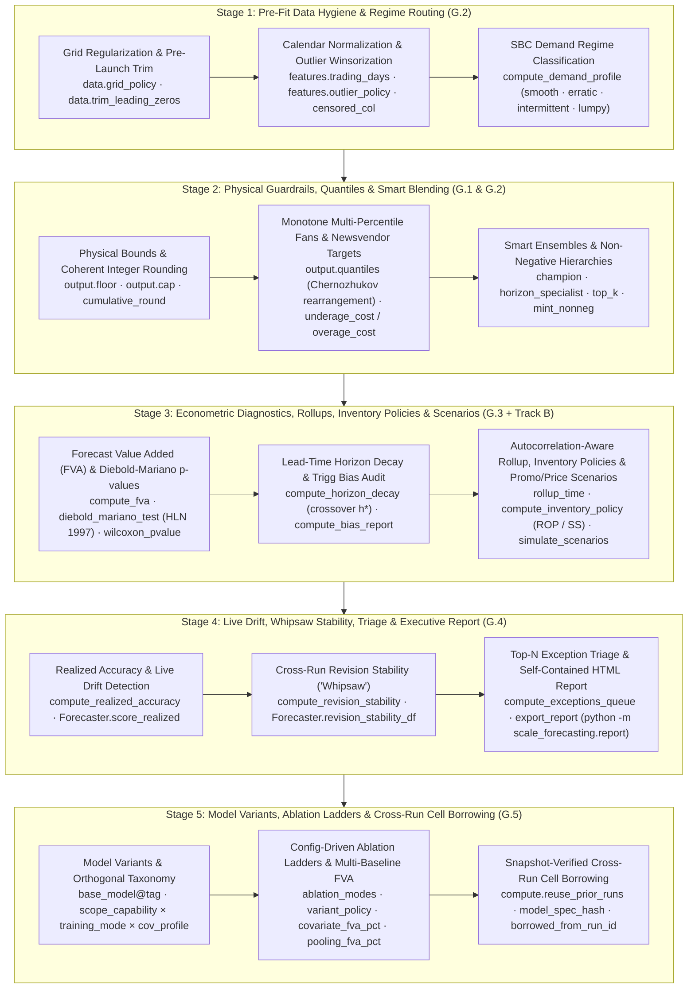

# Forecaster Workbench: Bounds, Quantiles, Econometrics, Scenarios & Reports

Beyond scaling 37 models across 7 Google Cloud runtimes, `scale-forecasting` includes an end-to-end **Forecaster Workbench** designed around the daily workflow of demand planners, supply-chain analysts, retail merchandisers, and econometricians. Every capability runs identically in the zero-GCP local playground (`scale_forecasting.playground`), the Python SDK (`sf.Forecaster`), the built-in MCP server (`scale_forecasting.mcp`), and distributed cloud jobs.



---

## 1. Physical Bounds, Non-Negative Hierarchies & Smart Ensembles

Real-world operational forecasts must obey physical constraints (non-negative demand, warehouse or hotel capacity ceilings, discrete shipment units) and avoid blending noisy tail models into ensembles.

### Declarative `output`, `ensemble`, and `hierarchy` guardrails

| Config Path | Type / Values | Default | Operational Purpose |
| :--- | :--- | :--- | :--- |
| `output.floor` | `float \| null` | `null` | Clips point forecasts (`yhat`), intervals (`yhat_lower`, `yhat_upper`), and all quantiles at a lower bound (e.g., `0.0` for non-negative physical demand). |
| `output.cap` | `float \| null` | `null` | Clips point forecasts, intervals, and quantiles at a static ceiling (e.g., `100.0` for utilization percentages or fixed plant capacity). |
| `output.floor_col` / `output.cap_col` | `str \| null` | `null` | Reads dynamic per-series, per-date floor or ceiling bounds directly from a source column (e.g., store shelf capacity or min safety stock). |
| `output.integer_rounding` | `"none"` \| `"round"` \| `"ceil"` \| `"floor"` \| `"cumulative_round"` | `"none"` | Rounds discrete unit forecasts after interval calibration. `"cumulative_round"` applies error-diffusion rounding so multi-step horizon totals are preserved without systematic downward bias on slow movers. |
| `ensemble.strategies` | `list[str]` | `["mean", "inverse_error", "nnls", "xgb"]` | Supports 9 strategies: `"mean"`, `"median"`, `"trimmed_mean"`, `"inverse_error"`, `"champion"` (per-series OOF winner), `"horizon_specialist"` (per-series, per-horizon-bucket OOF weights), `"nnls"`, `"ridge"`, and `"xgb"`. |
| `ensemble.top_k` | `int \| null` | `null` | Prunes the candidate pool per series to the top-$K$ lowest-error base models before computing ensemble weights. |
| `ensemble.parsimony_margin` | `float` | `0.0` | Complexity guardrail (e.g., `0.01` = 1%): if a complex model or ensemble does not beat the simplest baseline (`naive_seasonal` / `theta`) by at least this relative margin on OOF folds, `"champion"` falls back to the simpler model. |
| `ensemble.variant_policy` | `"all"` \| `"best_per_base_model"` \| `"primary_only"` | `"all"` | Controls how `<base_model>@<tag>` variants participate in ensemble blending (`"best_per_base_model"` selects the single best variant per `(ts_id, base_model)` before blending). |
| `hierarchy.reconciliation_methods` | `list[str]` | `["bottom_up", "mint_shrink"]` | Adds `"mint_nonneg"` (active-set non-negative Minimum Trace projection) so reconciled bottom-level SKU forecasts are guaranteed $\ge 0$ while summing coherently across the tree. |

All 9 ensemble strategies automatically propagate conformal prediction intervals (`yhat_lower`, `yhat_upper`) and score all 5 interval evaluation metrics (`coverage`, `pinball`, `interval_score`, `interval_width`, `msis`) alongside the 16 point metrics.

---

## 2. Multi-Quantile Fans, Newsvendor Targets & Pre-Fit Hygiene

Inventory replenishment and safety-stock systems require full probability fans (`p10`, `p25`, `p50`, `p75`, `p90`, `p95`, `p99`) and asymmetric cost optimization rather than symmetric mean forecasts.

### Multi-percentile fans & Newsvendor critical fractile (`output`)

| Config Path | Type / Values | Default | Operational Purpose |
| :--- | :--- | :--- | :--- |
| `output.quantiles` | `list[float]` | `[]` | Emits empirical conformal quantiles (e.g., `[0.1, 0.25, 0.5, 0.75, 0.9, 0.95]`) into `quantiles` (`{"p10": ..., "p95": ...}`) with **Chernozhukov et al. (2010) monotone rearrangement** so $q_{\tau_1}(t) \le q_{\tau_2}(t)$ is strictly guaranteed at every horizon step. |
| `output.target_quantile` | `float \| null` | `null` | Shifts the primary `yhat` column to a target service-level percentile $\tau \in (0, 1)$ (e.g., `0.90` for a 90% cycle service level). |
| `output.underage_cost` / `output.overage_cost` | `float \| null` | `null` | Computes the **Newsvendor critical fractile** $\tau^* = c_u / (c_u + c_o)$ from unit stockout cost $c_u$ (`underage_cost`) and holding/spoilage cost $c_o$ (`overage_cost`), setting `yhat` to the profit-maximizing order quantity $q_{\tau^*}$. |

### Fold-safe pre-fit hygiene & SBC regime routing (`data` & `features`)

Every pre-fit transformation runs **strictly inside each backtest fold** (`ds <= cutoff_date`) so future observations never leak into historical training windows:

| Config Path | Type / Values | Default | Operational Purpose |
| :--- | :--- | :--- | :--- |
| `data.grid_policy` | `"none"` \| `"zero_fill"` \| `"fill_zero"` \| `"ffill"` \| `"linear"` | `"none"` | Regularizes ragged timestamp grids to the declared `data.freq` before fitting (`"zero_fill"` for missing POS transaction days; `"ffill"` or `"linear"` for sensor/inventory snapshots). |
| `data.trim_leading_zeros` | `bool` | `false` | Strips pre-launch leading zeros prior to the first non-zero demand observation so newly launched products are not fit on pre-existence zeros. |
| `features.trading_days` | `bool` | `false` | Adds calendar business-day counts (`trading_days_in_period`) for monthly/weekly series to separate calendar-length noise from real demand changes. |
| `features.censored_col` | `str \| null` | `null` | Column flagging historical stockout or capacity-censored dates (`1`/`True`); treats censored observations as missing actuals and imputes uncensored demand within each training fold. |
| `features.outlier_policy` | `"none"` \| `"winsorize"` \| `"interpolate"` \| `"flag"` \| `"stl_resid"` | `"none"` | Detects unflagged historical spikes exceeding `outlier_sigma` seasonal MADs and winsorizes, interpolates, or flags them while **preserving rows where `promo_flag` or `is_holiday` is active**. |
| `features.outlier_sigma` | `float` | `3.5` | Robust seasonal-MAD threshold ($\ge 1.5$) for `outlier_policy`. |
| `features.regime_routing` | `bool` | `false` | Classifies each series using the **Syntetos–Boylan–Croston (SBC) matrix** (`ADI` vs. $CV^2$ into `smooth`, `erratic`, `intermittent`, or `lumpy`) and routes `intermittent`/`lumpy` series away from smooth continuous models unless intermittent-capable (`croston`, `naive_*`, tree models). |

---

## 3. Econometric Diagnostics, Lead-Time Rollups & What-If Scenarios

The pure offline modules [`scale_forecasting.diagnostics`](./api/review.md) and [`scale_forecasting.scenarios`](./api/review.md) answer the four questions every S&OP review asks: *Did complex models add statistically significant value over a naive baseline? At what lead time does forecast skill decay? Which SKUs have chronic directional bias? What happens to units and revenue if we change next month's promo or price plan?*

| Function / SDK Method | Purpose & Key Outputs |
| :--- | :--- |
| `sf.compute_fva(oof_df, ...)` / `bo.fva_df()` / `forecaster.fva_df()` | Computes the **Forecast Value Added (FVA)** waterfall (`Baseline` $\to$ `Statistical` $\to$ `ML` $\to$ `Deep Learning` $\to$ `AutoML` $\to$ `Ensemble`) with `fva_vs_baseline_pct`, **Sibling Covariate Lift (`covariate_fva_pct`)**, **Sibling Pooling Lift (`pooling_fva_pct`)**, `pct_series_beating_baseline`, **Harvey–Leybourne–Newbold (1997) modified Diebold–Mariano** `dm_stat` & `dm_pvalue`, and **paired Wilcoxon** `wilcoxon_pvalue`. |
| `sf.compute_horizon_decay(oof_df, ...)` / `bo.horizon_decay_df()` / `forecaster.horizon_decay_df()` | Evaluates accuracy and empirical interval coverage at each step $h = 1 \dots H$ and identifies `crossover_step` ($h^*$), the first lead-time step where a model's error exceeds the baseline. |
| `sf.compute_bias_report(oof_df)` / `bo.bias_df()` / `forecaster.bias_df()` | Audits per-`(ts_id, model_type)` signed `bias_pct`, **Trigg / APICS Tracking Signal** ($\text{TS} = \sum e_t / \text{MAD}$), `max_over_streak`, `max_under_streak`, and `bias_status` (`unbiased`, `over_forecasting`, `under_forecasting`). |
| `sf.rollup_time(predictions_df, freq="W", oof_df=...)` / `bo.rollup_time(...)` | Aggregates daily/weekly forecasts to Weekly (`"W"`), Monthly (`"MS"`), Quarterly (`"QS"`), or $L$-day supplier lead-time windows (`window=7`) using **empirical AR(1) multi-step error covariance** so cumulative uncertainty bands are realistic rather than naively summed. |
| `sf.compute_inventory_policy(predictions_df, oof_df=..., ...)` / `bo.inventory_policy_df(...)` / `forecaster.inventory_policy_df(...)` | Translates non-stationary forward forecasts ($\hat{y}_1 \dots \hat{y}_H$), empirical AR(1) residual autocorrelation ($\hat{\rho}_1$ from `oof_df`), and supplier lead-time variability ($\mu_L, \sigma_L$) into continuous-review $(s, S)$ and periodic-review $(R, S)$ **Reorder Points (`reorder_point`)**, **Calibrated Safety Stock (`safety_stock` vs. `naive_iid_safety_stock` and `naive_linear_safety_stock`)**, **Order-Up-To Levels (`order_up_to_level`)**, **Recommended Order Quantities (`recommended_order_qty` with `min_order_qty` & `order_multiple` lot-sizing)**, and **Expected Holding vs. Stockout Cost** across **Cycle Service Level ($\alpha$)**, **Unit Fill Rate ($\beta$ via standard normal loss $G(z)$)**, or **Newsvendor Critical Fractile ($\alpha^* = c_u / (c_u + c_o)$)**. |
| `sf.plot_inventory_policy(policy_df)` / `bo.plot_inventory_policy(...)` / `forecaster.plot_inventory_policy(...)` | Plots a horizontal stacked bar chart of Lead-Time Demand ($\mu_L$), Calibrated Safety Stock (`SS`), Review-Period Demand ($R$), current Inventory Position (`IP`), and annotated Recommended Order Quantities ($Q$). |
| `sf.simulate_scenarios(...)` / `run.simulate_scenarios(scenarios={...})` | Runs counterfactual future covariate trajectories (additive `+`, multiplicative `*`, or override `=` shocks to `price_index`, `promo_flag`, etc.) without refitting models, returning delta units (`delta_yhat`, `delta_pct`) and revenue impact (`baseline_revenue`, `scenario_revenue`, `delta_revenue`). |

---

## 4. Realized Drift, Revision Stability, Exception Triage & Executive HTML Reports

Once forecasts are published into operations, [`scale_forecasting.diagnostics`](./api/review.md) and [`scale_forecasting.report`](./api/review.md) close the loop as actuals arrive and weekly/monthly runs refresh:

| Capability | Function / SDK / CLI Entrypoint | What It Detects & Produces |
| :--- | :--- | :--- |
| **Realized Accuracy & Live Drift** | `sf.compute_realized_accuracy(pred_df, actuals_df, oof_df=...)`<br/>`forecaster.score_realized(actuals_df)` | Joins published forecasts against newly arrived actuals, scores all 21 metrics + realized interval coverage, and flags `drift_flagged = True` when live error exceeds `drift_threshold` $\times$ backtest OOF expectation (`drift_ratio`). |
| **Cross-Run Revision Stability ("Whipsaw")** | `sf.compute_revision_stability(runs_predictions)`<br/>`forecaster.revision_stability_df([run_1, run_2, ...])` | Compares overlapping forecast target dates across consecutive runs (`run_t-2`, `run_t-1`, `run_t`) to measure Mean Absolute Revision (`mar`), Revision CoV (`revision_cov`), and `max_single_step_jump_pct`, flagging supply-chain whipsaw (`whipsaw_flagged`). |
| **Top-$N$ Exception Triage Queue** | `sf.compute_exceptions_queue(...)`<br/>`bo.exceptions_df()` · `forecaster.exceptions_df()` | Ranks `(ts_id, model_type)` cells by a composite `severity_score` across 5 operational flags (`worse_than_naive`, `chronic_bias`, `realized_drift`, `whipsaw_jump`, `capacity_ceiling_hit`) with plain-English `exception_reasons`. |
| **Self-Contained HTML & JSON Report** | `sf.export_report(target, "report.html", write_json=True)`<br/>`python -m scale_forecasting.report --out report.html` | Exports a single-file, zero-server interactive `.html` report (and optional `.json` sidecar) with KPI cards, SVG FVA waterfall + DM significance badges, filterable Exception Triage table, SVG Horizon Decay & Bias tables, Operational Inventory Policy (`ROP` / `SS` / `Order-Up-To`) tab, and an interactive client-side Series & Multi-Quantile Fan Explorer. |

---

## 5. Model Variants (`<base_model>@<tag>`), Ablation Ladders & Cross-Run Cell Borrowing

Forecasters routinely need to answer: *Did future promo calendars or past weather lags actually improve `xgboost` and `tide` over their own univariate fits? Did cross-series global pooling beat per-series local fitting? Can my next experiment reuse the 10 models I already ran on the same table snapshot without re-running them?*

| Surface / Config Knob | Type / Values | Purpose |
| :--- | :--- | :--- |
| `<base_model>@<tag>` in `models` & `model_params` | e.g., `"xgboost@univariate"`, `"xgboost@promo_only"`, `"tide@local_cov_all"` | Runs multiple configurations of the same base estimator in a single run, with per-variant hyperparameters and covariate/scope overrides (`training_mode`, `use_covariates`, `future_covariates`, `past_covariates`, `static_covariates`, `exog_lags`). |
| `features.include_univariate_baselines` | `bool` (`false`) | Automatically appends `<model>@univariate` for every covariate-capable model in `models`. |
| `features.ablation_modes` & `features.ablation_models` | `list[AblationMode]`, `list[str] \| null` | Expands a full or targeted covariate/scope ablation ladder (`"univariate"`, `"cov_future_only"`, `"cov_past_only"`, `"cov_static_only"`, `"cov_all"`, `"local_cov_all"`, `"local_univariate"`, `"global_cov_all"`, `"global_univariate"`), deduplicating equivalent `(training_mode, cov_profile)` specs automatically. |
| `forecaster.variant_matrix()` | `pd.DataFrame` | Offline preflight table showing every expanded variant's `scope_capability` (`local`, `global`, `hybrid`), `training_mode`, dynamic `cov_profile` (`univariate`, `cov_future_only`, `cov_future_past`, `cov_all`, `cov_custom`), `covariates_used`, and deterministic `model_spec_hash`. |
| `compute.reuse_prior_runs` & `data.snapshot_millis` | `bool` (`false`), `int \| null` | Queries BigQuery before compute launch for prior `COMPLETED` cells matching `(source_table, snapshot_millis, ts_id, model_type, model_spec_hash)`, copies matching `forecast_metadata`, `forecast_predictions`, and `backtest_oof` rows (`borrowed_from_run_id`), and skips or narrows cloud compute jobs to only the uncached models/series. Overridden by `--force`. |

---

## Complete Declarative Example (`RunConfig`)

```json
{
  "run_name": "workbench_supply_chain_plan",
  "data": {
    "source_table": "source_series_iceberg",
    "series_limit": 100,
    "freq": "D",
    "horizon": 14,
    "grid_policy": "zero_fill",
    "trim_leading_zeros": true
  },
  "models": ["naive_seasonal", "theta", "croston", "lightgbm"],
  "features": {
    "holidays": ["US"],
    "future_covariates": ["promo_flag", "price_index"],
    "outlier_policy": "winsorize",
    "outlier_sigma": 3.5,
    "regime_routing": true
  },
  "backtest": {
    "enabled": true,
    "scheme": "expanding",
    "n_folds": 3,
    "horizon": 14,
    "step": 14,
    "decision_metric": "wape"
  },
  "output": {
    "point_forecast": "auto",
    "floor": 0.0,
    "cap": 5000.0,
    "integer_rounding": "cumulative_round",
    "quantiles": [0.1, 0.25, 0.5, 0.75, 0.9, 0.95],
    "underage_cost": 4.0,
    "overage_cost": 1.0
  },
  "ensemble": {
    "enabled": true,
    "strategies": ["champion", "horizon_specialist", "nnls"],
    "top_k": 3,
    "parsimony_margin": 0.01
  },
  "hierarchy": {
    "enabled": true,
    "levels": [["region"], ["region", "category"]],
    "reconciliation_methods": ["bottom_up", "mint_nonneg"]
  }
}
```

### Quick Python & CLI Walkthrough

```python
import scale_forecasting as sf
from scale_forecasting.playground import bakeoff

# 1. Run an offline multi-model bake-off with physical floor=0 and multi-quantile fan
bo = bakeoff(
    models=["naive_seasonal", "theta", "lightgbm"],
    horizon=14,
    n_folds=3,
    floor=0.0,
    quantiles=[0.10, 0.50, 0.90, 0.95],
)

# 2. Inspect econometric FVA waterfall (with HLN Diebold-Mariano p-values), decay, bias & exceptions
print(bo.fva_df()[["model_type", "fva_stage", "mean_metric", "fva_pct", "p_value_dm", "significant_at_05"]])
print(bo.horizon_decay_df().head())
print(bo.bias_df().head())
print(bo.exceptions_df().head())

# 3. Roll daily forecasts up to weekly replenishment buckets and translate into (s, S) / (R, S) inventory policies
weekly_df = bo.rollup_time(freq="W")
inv_df = bo.inventory_policy_df(lead_time=7.0, lead_time_std=1.0, service_level=0.95, on_hand=150.0, order_multiple=10.0)
print(inv_df[["ts_id", "model_type", "reorder_point", "safety_stock", "recommended_order_qty", "expected_total_cost"]])

# 4. Export a standalone interactive HTML + JSON executive report
bo.export_report("workbench_report.html", write_json=True)
```

```bash
# Generate an interactive HTML + JSON report directly from the CLI:
python -m scale_forecasting.report --models naive_seasonal theta --horizon 14 --out report.html --json
```
