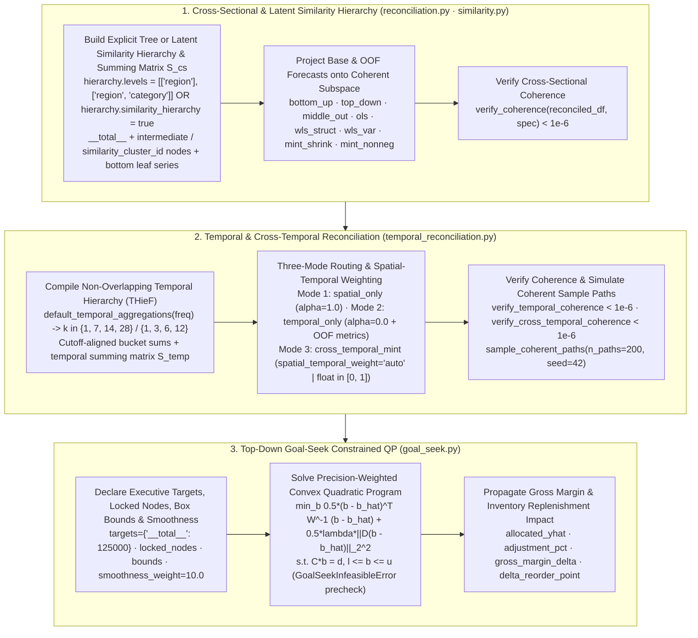

# Hierarchical, Temporal & Cross-Temporal Reconciliation + Top-Down Goal-Seek

Enterprise supply-chain, retail, and financial planning require forecasts that add up coherently across **both** the organizational tree (SKU $\to$ Category $\to$ Region $\to$ Total) and the planning calendar (Daily $\to$ Weekly $\to$ Bi-Weekly $\to$ 4-Week $\to$ Quarterly $\to$ Annual), as well as top-down target allocation when executives revise aggregate revenue or unit targets.

`scale-forecasting` provides a unified, pure-NumPy/SciPy reconciliation and constrained target-allocation stack across [`reconciliation.py`](https://github.com/statmike/scale-forecasting/blob/main/src/scale_forecasting/reconciliation.py), [`temporal_reconciliation.py`](https://github.com/statmike/scale-forecasting/blob/main/src/scale_forecasting/temporal_reconciliation.py), and [`goal_seek.py`](https://github.com/statmike/scale-forecasting/blob/main/src/scale_forecasting/goal_seek.py) that executes identically in offline local runs (`playground.bakeoff`, `Forecaster.auto`), the Python SDK (`Forecaster`), and all distributed cloud runtimes (`spark`, `ray`, `vertex`, `gce`, `gke`).



---

## 1. Three Orthogonal Reconciliation Regimes (`HierarchyConfig`)

`HierarchyConfig` organizes spatial and temporal reconciliation around three clear, opt-in regimes while keeping all 62 shipped configurations 100% `run_id` hash-stable:

| Mode | Configuration Trigger | `spatial_weight_alpha` | Operational & Leaderboard Behavior |
| :--- | :--- | :--- | :--- |
| **Mode 1: Spatial-Only** (`"spatial_only"`) | `hierarchy.levels` non-empty (or `similarity_hierarchy = true`), `reconcile_temporal = false` (default) | `1.0` | Reconciles strictly across the organizational/spatial tree ($\mathbf{S}_{\text{cs}}$: e.g., `store -> region -> __total__` or `ts_id -> similarity_cluster_id -> __total__`) at each timestamp without altering temporal trajectories. |
| **Mode 2: Temporal-Only (`THieF`)** (`"temporal_only"`) | `hierarchy.levels = []`, `hierarchy.reconcile_temporal = true` | `0.0` | Reconciles each flat-panel series across calendar aggregation buckets ($\mathbf{S}_{\text{temp}}$: e.g., `Daily -> Weekly -> Bi-Weekly -> 4-Week`) on both forward `predictions` and rolling-origin `oof` folds, recomputing cell `metrics` (`compute_metrics`) so `<model>_<method>` is scored on `v_model_leaderboard`. |
| **Mode 3: Joint Cross-Temporal** (`"cross_temporal"`) | (`hierarchy.levels` non-empty or `similarity_hierarchy = true`) + `cross_temporal = true` (or `"cross_temporal_mint"` in `reconciliation_methods`) | `"auto"` ($\alpha^* \in [0, 1]$) or explicit float | Auto-enables `reconcile_temporal = true` and `enabled = true`, appends `"cross_temporal_mint"`, keeps standard spatial methods (`<model>_mint_nonneg`, `<model>_mint_shrink`) as **pure spatial ($\mathbf{S}_{\text{cs}}$)** entries on the leaderboard alongside `<model>_cross_temporal_mint`, and refines via alternating projections to $< 10^{-6}$ discrepancy on both axes simultaneously. |

### Latent Similarity Hierarchy Discovery on Flat Panels (`hierarchy.similarity_hierarchy`)

Many real-world panels (IoT telemetry, SaaS usage metrics, financial tickers, uncataloged SKUs) lack explicit `region` or `category` grouping columns, yet exhibit strong latent dynamical clusters. Setting `hierarchy.similarity_hierarchy = true` (with optional `hierarchy.similarity_n_clusters` and `hierarchy.similarity_method`, default `"hybrid"`) when `hierarchy.levels = []` automatically clusters the bottom-level series via [`cluster_by_similarity_df()`](./api/similarity.md), synthesizes a `"similarity_cluster_id"` grouping column (`levels = [["similarity_cluster_id"]]`), and builds a 2-level hierarchy (`__total__ -> similarity_cluster_id -> leaf series`) that reconciles cleanly (`< 1e-6`) with `mint_shrink`, `mint_nonneg`, `cross_temporal_mint`, `sample_coherent_paths()`, and `allocate_target()`.

### Cross-Sectional & Cross-Temporal Methods (`reconciliation_methods`)

When `hierarchy.enabled = true`, `build_hierarchy(df, cfg)` aggregates bottom-level leaf series bottom-up into every level declared in `hierarchy.levels` plus the root `"__total__"` series, fits every selected model across all hierarchy nodes, and reconciles both forward horizon predictions (`forecast_predictions`) and rolling-origin backtest folds (`backtest_oof`) using $\tilde{\mathbf{y}}_t = \mathbf{S}\mathbf{G}\hat{\mathbf{y}}_t$:

| Method (`reconciliation_methods`) | Weighting / Projection Matrix $\mathbf{W}$ | Operational Characteristics |
| :--- | :--- | :--- |
| `"bottom_up"` | Sums bottom-level leaf forecasts ($\mathbf{G} = [\mathbf{0} \mid \mathbf{I}_{n_b}]$) | Zero upper-level influence; preserves noisy bottom-level dynamics. |
| `"top_down"` | Disaggregates `"__total__"` by historical average proportions | Best when top-level signal is smooth and leaf proportions are stationary. |
| `"middle_out"` | Anchors on `hierarchy.middle_level` (e.g., `["region"]`), sums up to root, and disaggregates down to leaves | Ideal when regional/category forecasts are most reliable. |
| `"ols"` | Ordinary Least Squares ($\mathbf{W} = \mathbf{I}_n$) | Unweighted orthogonal projection onto the coherent subspace. |
| `"wls_struct"` | Structural WLS ($\mathbf{W} = \operatorname{diag}(\mathbf{S}\mathbf{1}_{n_b})$) | Weights each node by the number of bottom-level series it aggregates; requires no OOF residuals. |
| `"wls_var"` | Variance-weighted WLS ($\mathbf{W} = \operatorname{diag}(\hat{\sigma}_1^2, \dots, \hat{\sigma}_n^2)$) | Weights each node by its inverse out-of-fold residual variance. |
| `"mint_shrink"` | Minimum Trace with Schäfer–Strimmer covariance shrinkage ($\hat{\mathbf{W}}_{\text{shrink}}$) | Exploits cross-series error correlations while guaranteeing positive-definiteness when $n > T$. |
| `"mint_nonneg"` | Active-set non-negative Minimum Trace QP ($\tilde{\mathbf{b}}_t \ge \mathbf{0}$) | Guarantees strictly non-negative bottom and upper-level forecasts while maintaining exact coherence. |
| `"cross_temporal_mint"` | Simultaneous cross-sectional ($\mathbf{S}_{\text{cs}}$) and temporal ($\mathbf{S}_{\text{temp}}$) MinT | Guarantees $< 10^{-6}$ discrepancy across both the hierarchy tree and all temporal aggregation buckets simultaneously while keeping pure spatial methods on the leaderboard for head-to-head OOF comparison. |

---

## 2. Temporal Hierarchies (`THieF`), `spatial_temporal_weight` & Coherent Sample Paths

Standard single-frequency forecasts often conflict across planning horizons: daily store replenishment models fail to sum to weekly distribution-center plans or monthly financial guidance. Following Athanasopoulos et al. (2017) (*Forecasting with Temporal Hierarchies*, `THieF`) and Di Fonzo & Girolimetto (2023), `scale-forecasting` reconciles forecasts across multiple temporal aggregation factors $k \in \{k_1, \dots, k_M, 1\}$:

### Default Temporal Aggregation Ladders (`default_temporal_aggregations`)

When `hierarchy.reconcile_temporal = true` and `hierarchy.temporal_aggregations` is omitted (`null`), canonical factors are inferred automatically from `data.freq`:

| Base Frequency (`data.freq`) | Default Coarse Factors (`temporal_aggregations`) | Macro-Cycle $m = \operatorname{lcm}(k)$ | Planning Levels Reconciled |
| :--- | :--- | :--- | :--- |
| Daily (`"D"` / `"B"`) | `[7, 14, 28]` | `28` days | Daily ($k=1$), Weekly ($k=7$), Bi-Weekly ($k=14$), and 4-Week ($k=28$) |
| Weekly (`"W"`) | `[4, 13, 52]` | `52` weeks | Weekly ($k=1$), 4-Week ($k=4$), Quarterly ($k=13$), and Annual ($k=52$) |
| Monthly (`"MS"` / `"ME"`) | `[3, 6, 12]` | `12` months | Monthly ($k=1$), Quarterly ($k=3$), Semi-Annual ($k=6$), and Annual ($k=12$) |
| Quarterly (`"QS"` / `"QE"`) | `[2, 4]` | `4` quarters | Quarterly ($k=1$), Semi-Annual ($k=2$), and Annual ($k=4$) |
| Hourly (`"h"`) | `[6, 12, 24]` | `24` hours | Hourly ($k=1$), 6-Hour ($k=6$), 12-Hour ($k=12$), and Daily ($k=24$) |

### Data-Driven Spatial–Temporal Blending (`hierarchy.spatial_temporal_weight`)
- When `hierarchy.spatial_temporal_weight` is a float $\alpha \in [0, 1]$, `reconcile_cross_temporal()` blends the spatial-last projection ($\tilde{\mathbf{B}}_{\text{temp}\to\text{cs}}$) and the temporal-last projection ($\tilde{\mathbf{B}}_{\text{cs}\to\text{temp}}$) as $\tilde{\mathbf{B}}(\alpha) = \alpha \tilde{\mathbf{B}}_{\text{temp}\to\text{cs}} + (1 - \alpha) \tilde{\mathbf{B}}_{\text{cs}\to\text{temp}}$ and refines via alternating projections onto $\mathbf{S}_{\text{cs}}$ and $\mathbf{S}_{\text{temp}}$ (plus $\mathbb{R}_+$ when `nonneg=True`).
- When `hierarchy.spatial_temporal_weight = "auto"` (default), $\alpha^* \in [0, 1]$ is learned from out-of-fold (`oof_df`) or in-sample residual variances across the spatial vs. temporal projections ($\alpha^* = \frac{\sigma_{\text{temp}}^{-2}}{\sigma_{\text{cs}}^{-2} + \sigma_{\text{temp}}^{-2}}$, defaulting to `0.5` when no residuals are provided).
- Every reconciled DataFrame attaches `out_df.attrs["cross_temporal_diagnostics"]` with keys `mode` (`"spatial_only"` | `"temporal_only"` | `"cross_temporal"`), `spatial_weight_alpha`, `cs_first_discrepancy`, `temp_first_discrepancy`, `final_cs_discrepancy`, and `final_temp_discrepancy`.

### Coherent Cross-Temporal Sample-Path Simulation (`sample_coherent_paths`)
- `sf.sample_coherent_paths(predictions_df, spec=None, *, n_paths=200, seed=42, method="mint_shrink", oof_df=None, cfg=None, nonneg=False)` (also exposed on `Forecaster.sample_coherent_paths()`, `PlaygroundRun.sample_coherent_paths()`, and `BakeOff.sample_coherent_paths()`) draws $N$ joint Gaussian/residual trajectories across the horizon and projects every single path onto the coherent cross-sectional and/or temporal subspace, returning a tidy DataFrame (`path_id`, `ts_id`, `forecast_date`, `yhat_sample`) where every `path_id` satisfies $< 10^{-6}$ coherence.

### Edge-Case Guarantees
- **Cutoff-Aligned Non-Overlapping Aggregation:** When historical length $T$ is not a multiple of $k$, the oldest $T \bmod k$ observations at the start of the series are trimmed so every coarse bucket ends on the **exact same forecast cutoff timestamp**.
- **Non-Divisible Horizons ($H \bmod m \ne 0$):** When `data.horizon` is not an exact multiple of the macro-period $m$, `build_temporal_hierarchy` pads the internal forecast to $P \cdot m = \lceil H / m \rceil \cdot m$, projects onto the coherent temporal subspace, and slices back to the requested $H$ steps while preserving exact coherence on all complete coarse buckets ($\lfloor H / k \rfloor$).
- **Short Series ($T < 2 \cdot m_{\max}$):** Automatically drops any coarse factor $k$ with fewer than 2 complete historical blocks (`history_len < 2 * k`).

---

## 3. Top-Down Goal-Seek & Smooth Multi-Period Target Allocation (`allocate_target`)

When leadership sets a top-down target (e.g., *"Increase Q4 Total Revenue to `125,000` while locking Region East at `45,000` and keeping every SKU within $[0, 500]$ units"*), proportional scaling violates node locks, breaches capacity bounds, or ignores forecast uncertainty.

`Forecaster.allocate_target` (and standalone `scale_forecasting.allocate_target`) solves the precision-weighted convex Quadratic Program with optional multi-period temporal smoothness regularization (`smoothness_weight`):

$$\min_{\mathbf{b} \in \mathbb{R}^{n_b \cdot H}} \frac{1}{2} (\mathbf{b} - \hat{\mathbf{b}})^\top \mathbf{W}^{-1} (\mathbf{b} - \hat{\mathbf{b}}) + \frac{\lambda_{\text{smooth}}}{2} \sum_{i \in \text{bottom}} \sum_{t=2}^{H} \bigl((b_{i,t} - b_{i,t-1}) - (\hat{b}_{i,t} - \hat{b}_{i,t-1})\bigr)^2 \quad \text{s.t.} \quad \mathbf{C}\mathbf{b} = \mathbf{d}, \quad \boldsymbol{\ell} \le \mathbf{b} \le \mathbf{u}$$

where $\mathbf{W}$ weights adjustments by each leaf series' historical forecast uncertainty (`method="mint_shrink"`, `"wls_var"`, `"wls_struct"`, `"ols"`, or `"proportional"`), and `smoothness_weight` ($\lambda_{\text{smooth}} \ge 0$) penalizes abrupt period-over-period step-cliffs when partial-horizon locks or capacity bounds are active:

| Parameter | Type | Description |
| :--- | :--- | :--- |
| `target_total` / `targets` | `float \| dict \| Sequence \| DataFrame` | Top-down target total across the horizon (scalar), per-node targets (`{"__total__": 12000.0, "region=East": 4500.0}`), or per-date targets. |
| `target_metric` | `"auto"` \| `"units"` \| `"revenue"` | When `"revenue"` (or when `price_col` / `prices` is supplied with `target_metric="revenue"`), enforces the equality constraint in currency units ($\sum_{i,t} p_{i,t} b_{i,t} = \text{Target}$). |
| `locked_nodes` / `locks` | `list[str] \| dict[str, float]` | Hierarchy nodes or leaf `ts_id`s held fixed at their baseline forecast (`list[str]`) or pinned to an explicit value (`dict[str, float]`). |
| `lower_bounds` / `upper_bounds` | `dict[str, float] \| float \| DataFrame` | Per-series, per-date, or global box bounds $[\ell_{i,t}, u_{i,t}]$ (combined with `floor` and `cap`). |
| `smoothness_weight` | `float` (`0.0`) | Non-negative $\ell_2$ first-difference roughness penalty ($\lambda_{\text{smooth}} \ge 0$) across $H \ge 2$ horizon steps so multi-period allocations transition smoothly without step-cliffs while satisfying all equality targets and box bounds to $< 10^{-6}$. |
| `price_col` / `unit_cost` | `str \| dict[str, float] \| float` | Computes `baseline_revenue`, `allocated_revenue`, `revenue_delta`, `baseline_gross_margin`, `allocated_gross_margin`, and `gross_margin_delta`. |
| `include_inventory_impact` | `bool` | Propagates allocated demand and uncertainty shifts into `baseline_safety_stock`, `allocated_safety_stock`, `delta_safety_stock`, `baseline_reorder_point`, `allocated_reorder_point`, and `delta_reorder_point`. |

If the requested target is mathematically unreachable given `locked_nodes` and `[lower_bounds, upper_bounds]`, `allocate_target` raises `GoalSeekInfeasibleError` naming the exact achievable range $[T_{\min}, T_{\max}]$.

---

## 4. Declarative `RunConfig` & Python SDK Examples

```json
{
  "run_name": "cross_temporal_hierarchy_plan",
  "python_runtime": "gce",
  "data": {
    "source_table": "source_series_covariates_iceberg",
    "freq": "D",
    "horizon": 28,
    "series_limit": 40
  },
  "models": ["theta", "holtwinters", "lightgbm"],
  "backtest": {
    "enabled": true,
    "horizon": 28,
    "n_folds": 2,
    "step": 28,
    "decision_metric": "rmsse"
  },
  "hierarchy": {
    "enabled": true,
    "levels": [
      ["region"],
      ["region", "category"]
    ],
    "reconciliation_methods": [
      "bottom_up",
      "wls_struct",
      "mint_shrink",
      "cross_temporal_mint"
    ],
    "reconcile_temporal": true,
    "cross_temporal": true,
    "spatial_temporal_weight": "auto",
    "temporal_aggregations": [7, 14, 28]
  },
  "ensemble": {
    "enabled": true,
    "strategies": ["mean", "inverse_error", "nnls"]
  }
}
```

### Offline & SDK Walkthrough

```python
import scale_forecasting as sf

# 1. Load a hierarchical benchmark panel and fit with cross-temporal reconciliation
bench = sf.load_benchmark("hierarchical_supply_tree")
f = sf.Forecaster.auto(
    data=bench.df,
    target_col="y",
    horizon=28,
    hierarchy_levels=[["region"], ["region", "category"]],
)
print(f.assess())  # 7-Question Practitioner Assessment (Questions 3 & 5 report causal & 3-mode coherence)

# 2. Reconcile across temporal factors (Daily -> Weekly -> Bi-Weekly -> 4-Week) & cross-section simultaneously
rec_df, coarse_aggs = f.temporal_reconcile_df(
    method="cross_temporal_mint",
    temporal_aggregations=[7, 14, 28],
    return_aggregations=True,
)
print("Cross-temporal diagnostics:", rec_df.attrs["cross_temporal_diagnostics"])

# 3. Draw 50 cross-sectionally and temporally coherent sample paths (< 1e-6 discrepancy per path_id)
paths_df = f.sample_coherent_paths(forecasts_df=rec_df, n_paths=50, seed=42)

# 4. Allocate a +15% executive top-down target with smooth multi-period trajectory control (smoothness_weight=10.0)
root_rows = rec_df[rec_df["ts_id"] == "__total__"]
baseline_total = float(root_rows["yhat"].sum())
goal_df = f.allocate_target(
    target_total=baseline_total * 1.15,
    forecasts_df=rec_df,
    floor=0.0,
    smoothness_weight=10.0,
    prices=25.0,
    unit_cost=14.0,
    include_inventory_impact=True,
)
print(sf.summarize_goal_seek(goal_df))
```

See also:
- [Notebook 06: Hierarchical Reconciliation, THieF & Top-Down Goal-Seek](./notebooks/06_hierarchical_reconciliation.ipynb)
- [Forecaster Workbench Guide](./forecaster_workbench.md)
- [API Reference: `reconciliation`](./api/reconciliation.md), [`temporal_reconciliation`](./api/temporal_reconciliation.md), [`goal_seek`](./api/goal_seek.md)
