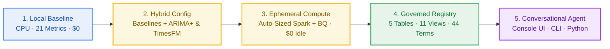

# Forecaster showcase: your models + Google's models, governed in BigQuery

<p align="center">
  <b>From a 5-Second Local Baseline to Hybrid Spark &amp; TimesFM, Knowledge Catalog Governance, and Conversational Q&amp;A</b><br>
  <i>Benchmark your trusted statistical and tree models alongside BigQuery ARIMA_PLUS &amp; TimesFM without cloud DevOps — then explore every metric, bias alert, and driver in BigQuery or plain English.</i>
</p>

Every step below is backed by [`configs/forecaster_showcase.json`](https://github.com/statmike/scale-forecasting/blob/main/configs/forecaster_showcase.json) (`run_id`: `forecaster-showcase-f67fec77de66`) with expandable cloud outputs and a live 4-turn BigQuery `DataAgent` transcript (`sf-conv-953ee3a44057`).



## What This Walkthrough Proves

| Practitioner Question | Key Proof | Surface &amp; Step |
| :--- | :--- | :--- |
| **"Can I keep my trusted baselines?"** | Run `holtwinters`, `theta`, and `lightgbm` side-by-side with BigQuery `arima_plus`, zero-shot **`timesfm`** (`AI.FORECAST`), and an **`nnls`** ensemble on the same holdout fold. | **`[Terminal / Python]`**<br>[Step 1](#step-1--prototype-locally-in-5-seconds-000-cloud-spend) · [Step 2](#step-2--run-your-baselines-alongside-googles-models-in-one-config) |
| **"Do I have to manage Spark or VMs?"** | One JSON config right-sizes Spark from measured profiles, runs BigQuery in parallel, and tears down to **`0` idle compute**. | **`[Terminal]` → `[Cloud Console]`**<br>[Step 2](#step-2--run-your-baselines-alongside-googles-models-in-one-config) · [Step 3](#step-3--inspect-the-cloud-services-that-ran-zero-devops) |
| **"How are accuracy &amp; bias governed at scale?"** | 5 append-only BigQuery tables, 11 S&amp;OP SQL views, and a 44-term **Knowledge Catalog** glossary — identical from `25` to `100,000+` series. | **`[Cloud Console]`**<br>[Step 4](#step-4--govern-accuracy-fva--scale-in-bigquery-25-to-100000-series) |
| **"Can planners explore without writing SQL?"** | Stateful **BigQuery Conversational Analytics `DataAgent`** in **BigQuery Agents Hub** or `--chat` — backed by auditable SQL. | **`[Cloud Console]` or `[Terminal]`**<br>[Step 5](#step-5--talk-to-your-forecast-in-terminal-python-or-bigquery-studio) |

<details markdown="1">
<summary><b>Tip — 60-second terminal &amp; browser tab setup (run any step live in any order)</b></summary>

To run commands interactively alongside Google Cloud Console (deployed via [Deploying on GCP](./deploying_on_gcp.md)), run these three short blocks once in your terminal:

**1. Activate your virtual environment:**

```bash
source .venv/bin/activate
```

**2. Set your GCP Project ID** *(or run `set -a && source .env && set +a` if stored in a local `.env`)*:

```bash
read -rp "Enter your GCP Project ID: " PROJECT
```

**3. Export convention-based `SF_*` variables, verify health &amp; print clickable Console links:**

```bash
REGION="${REGION:-us-central1}"
export SF_PROJECT_ID="${SF_PROJECT_ID:-$PROJECT}"
export SF_REGION="$REGION"
export SF_DATASET_ID="${SF_DATASET_ID:-scale_forecasting}"
export SF_CONNECTION="${SF_CONNECTION:-$SF_PROJECT_ID.$REGION.sf-iceberg}"
export SF_WAREHOUSE_URI="${SF_WAREHOUSE_URI:-gs://$SF_PROJECT_ID-warehouse/warehouse}"
export SF_CODE_BUCKET="${SF_CODE_BUCKET:-$SF_PROJECT_ID-code}"
export SF_COMPUTE_SA="${SF_COMPUTE_SA:-scale-forecasting-compute@$SF_PROJECT_ID.iam.gserviceaccount.com}"
export SF_CONTAINER_IMAGE="${SF_CONTAINER_IMAGE:-$REGION-docker.pkg.dev/$SF_PROJECT_ID/scale-forecasting/spark-runtime:latest}"
export SF_SUBNETWORK_URI="${SF_SUBNETWORK_URI:-https://www.googleapis.com/compute/v1/projects/$SF_PROJECT_ID/regions/$REGION/subnetworks/scale-forecasting-compute}"

python -m scale_forecasting.registry.ops doctor
python -m scale_forecasting.bq_agent --dataset scale_forecasting --run-id forecaster-showcase-f67fec77de66 --links
```

- **Pre-open Console tabs:** **Cmd+Click** `[1]` (BigQuery Agents Hub), `[2]` (Dataset `scale_forecasting`), `[3]` (Knowledge Catalog Glossary), `[5]`/`[7]` (Serverless Spark Batches), and `[8]` (GCS Artifacts).
- **100% Idempotent:** Every command in Steps 1–5 can be run in any order, any number of times (`playground` is offline, `--feasibility` / `doctor` / `--links` are read-only, `main` skips `COMPLETED` runs in seconds at `\$0.00`, and `--chat` runs read-only `SELECT` queries).

</details>

---

## Step 1 — Prototype Locally in 5 Seconds (`$0.00` Cloud Spend)

**Surface:** **`[Terminal or Python]`** · *Local CPU only — no GCP credentials or cloud spend required.*

Test any of the 31 Python models (or your own one-file `BaseModel` plugin) locally across all **21 evaluation metrics**:

```bash
source .venv/bin/activate  # repo clone — or in a fresh venv: pip install "scale-forecasting[models-stats,models-trees]"
```

```bash
python -m scale_forecasting.playground --model holtwinters --horizon 14 --backtest
```

<details markdown="1">
<summary><b>View pre-recorded output — <code>python -m scale_forecasting.playground</code> (~5s, $0.00 cloud spend)</b></summary>

```text
model      : holtwinters
series     : s_000000  (730 obs)
engine     : spark
status     : ok
forecast   : 14 steps
horizon    : 2023-01-01 → 2023-01-14
metrics    : mae=11.201, rmse=16.206, mse=282.629, mape=0.059, smape=0.061, wape=0.061, mase=0.430, rmsse=0.528, bias=-3.168, coverage=0.667, pinball=3.168, mase_seasonal=0.919, maape=0.059, interval_score=63.353, interval_width=24.332, ope=0.048, rmsle=0.087, msse=0.300, msis=5.203, r2=0.769, cv=0.088
```

</details>

<details markdown="1">
<summary><b>Python / Notebook SDK equivalent (<code>notebooks/00_model_playground.ipynb</code>)</b></summary>

See [`notebooks/00_model_playground.ipynb`](./notebooks/00_model_playground.ipynb):

```python
from scale_forecasting import playground

run = playground.run_model("holtwinters", horizon=14, backtest=True)
print(playground.summarize(run))
```

</details>

<details markdown="1">
<summary><b>Tip — Live modification to try (swap models or run a 4-model local bake-off in ~5s)</b></summary>

```bash
python -m scale_forecasting.playground --list
python -m scale_forecasting.playground --model lightgbm --horizon 14 --backtest --exog

# 4-model local bake-off + automatic inverse_error & nnls ensemble leaderboard (~5s)
python -c 'from scale_forecasting import playground; bo = playground.bakeoff(models=["naive_seasonal", "holtwinters", "theta", "lightgbm"], horizon=14); print(bo.leaderboard[["model", "wape", "mae", "mase", "r2"]].to_string(index=False))'
```

</details>

---

## Step 2 — Run Your Baselines Alongside Google's Models in One Config

**Surface:** **`[Editor + Terminal]`** · *Review [`configs/forecaster_showcase.json`](https://github.com/statmike/scale-forecasting/blob/main/configs/forecaster_showcase.json), check cost/feasibility, and execute.*

Without rewriting modeling code, one declarative config benchmarks Python baselines on Serverless Spark in parallel with BigQuery `arima_plus` and zero-shot **`timesfm`** (`AI.FORECAST`), fits an **`nnls`** ensemble, and refreshes the BigQuery `DataAgent`:

```json
{
  "run_name": "forecaster_showcase",
  "python_runtime": "spark",
  "data": {
    "source_table": "source_series_covariates_iceberg",
    "horizon": 14,
    "series_limit": 25
  },
  "models": [
    "naive_seasonal",
    "holtwinters",
    "theta",
    "lightgbm",
    "arima_plus",
    "timesfm"
  ],
  "features": {
    "future_covariates": [
      "is_holiday",
      "promo_flag",
      "price_index"
    ],
    "on_unsupported_covariates": "fallback"
  },
  "backtest": {
    "enabled": true,
    "n_folds": 2,
    "horizon": 14,
    "step": 14
  },
  "ensemble": {
    "enabled": true,
    "strategies": [
      "inverse_error",
      "nnls"
    ]
  },
  "compute": {
    "reuse_prior_runs": true
  },
  "output": {
    "ensure_bq_agent": true
  }
}
```

- **Mixed covariates without friction (`on_unsupported_covariates: "fallback"`):** `lightgbm`, `arima_plus`, and `timesfm` use `is_holiday`, `promo_flag`, and `price_index`; univariate baselines fall back automatically.
- **Pre-flight FinOps (`--dry-run --feasibility`):** Verifies 100% fold survival and estimates duration/cost before launching compute ([Cost estimates & controls](./cost_estimates.md)).
- **Idempotency & cell borrowing (`reuse_prior_runs: true`):** Skips duplicate runs and reuses unchanged `(series, model)` cells across edits.

> [!NOTE]
> **Runtime & Approximate Cloud Cost:** **Cold run:** `~\$0.22–\$0.35 USD` total (`~2m` BigQuery `timesfm`/`arima_plus`; `~4–6m` Serverless Spark with warm image cache or `~12–16m` on first regional pull; `\$0.00` idle afterward). **Unchanged repeat run:** `~9s` (`\$0.00`). **Incremental edit:** `~25–45s` (`0.00s` borrow of unchanged models; pass `--force` for a full cold re-run).

### 2a. Preview Fold Survival & Cost (`~3s`)

```bash
python -m scale_forecasting.main --config configs/forecaster_showcase.json --dry-run --feasibility
```

<details markdown="1">
<summary><b>View pre-recorded output — <code>--dry-run --feasibility</code> (~$0.22 USD estimate)</b></summary>

```text
INFO scale_forecasting.launch_plan | dry-run forecaster-showcase-f67fec77de66: runtime=spark python=['naive_seasonal', 'holtwinters', 'theta', 'lightgbm'] bq=['arima_plus', 'timesfm'] fanout=Fanout(n_series=25, n_models=6, n_folds=2, n_cells=150)
INFO scale_forecasting.launch_plan |   node statistical: sf-forecaster-showcase-f67fec77de66-statistical-a1 on spark
INFO scale_forecasting.launch_plan |   node ml: sf-forecaster-showcase-f67fec77de66-ml-a1 on spark
INFO scale_forecasting.launch_plan |   node native: sf-forecaster-showcase-f67fec77de66-native-a1 on bigquery
INFO scale_forecasting.launch_plan |   node ensemble: sf-forecaster-showcase-f67fec77de66-ensemble-a1 on bigquery after [sf-forecaster-showcase-f67fec77de66-statistical-a1, sf-forecaster-showcase-f67fec77de66-ml-a1, sf-forecaster-showcase-f67fec77de66-native-a1]
INFO scale_forecasting.launch_plan |   estimate (approx, not a quote): p50=4.0m p90=5.1m | ~est_cost=$0.22 USD | bottleneck=ml (25 series)
INFO __main__ | feasibility: 25 series x 6 models = 150 cells
INFO __main__ |   fits: 450 (650,700 training rows) = 2.971 whole-history fits per cell
INFO __main__ |   2 of 2 folds: 25 series (100.0%) — all folds
INFO __main__ |   min_train=180 is within budget: up to 1432 still keeps 90% of series at full folds
INFO __main__ |   estimate (approx, not a quote): p50=4.0m p90=5.1m | ~est_cost=$0.22 USD (bottleneck=ml, median_obs=1460)
INFO __main__ |     families: statistical=$0.14 (serverless (CPU DCU)), ml=$0.06 (serverless (CPU DCU)), native=$0.02 (bq dry-run 0 B + BQML)
```

</details>

### 2b. Execute the Hybrid Run (`~9s` Cached / Cold Launch)

```bash
python -m scale_forecasting.main --config configs/forecaster_showcase.json
```

<details markdown="1">
<summary><b>View pre-recorded output — Cold Cloud Execution &amp; ~9s Cached Re-Run</b></summary>

**First execution (parallel Serverless Spark + BigQuery `AI.FORECAST` + `NNLS` ensemble + `DataAgent` sync):**

```text
INFO __main__ | run forecaster-showcase-f67fec77de66 start: families=['statistical', 'ml', 'native'] ensemble=True
INFO scale_forecasting.engines.bigquery_engine | bigquery run start: run_id=forecaster-showcase-f67fec77de66 models=['arima_plus', 'timesfm'] manage_header=False backtest=True
INFO scale_forecasting.submit | submitting batch sf-forecaster-showcase-f67fec77de66-statistical-a1 to projects/your-gcp-project-id/locations/us-central1
INFO scale_forecasting.submit | submitting batch sf-forecaster-showcase-f67fec77de66-ml-a1 to projects/your-gcp-project-id/locations/us-central1
INFO scale_forecasting.engines.bigquery_engine | bigquery run done: run_id=forecaster-showcase-f67fec77de66 status=COMPLETED models=2 series=25 runtime=125.7s
INFO scale_forecasting.submit | batch sf-forecaster-showcase-f67fec77de66-ml-a1 finished: state=SUCCEEDED
INFO scale_forecasting.submit | batch sf-forecaster-showcase-f67fec77de66-statistical-a1 finished: state=SUCCEEDED
INFO scale_forecasting.ensemble_run | ensemble run start (barrier): run_id=forecaster-showcase-f67fec77de66 ensemble_id=34432fdde9fa strategies=['inverse_error', 'nnls']
INFO scale_forecasting.ensembler | fit nnls ensemble on 350 holdout OOF rows
INFO scale_forecasting.ensemble_run | ensemble predictions appended: run_id=forecaster-showcase-f67fec77de66 ensemble_id=34432fdde9fa rows=700 strategies=['inverse_error', 'nnls']
INFO scale_forecasting.ensemble_run | ensemble OOF appended: run_id=forecaster-showcase-f67fec77de66 ensemble_id=34432fdde9fa rows=1400
INFO scale_forecasting.ensemble_run | ensemble run done: run_id=forecaster-showcase-f67fec77de66 ensemble_id=34432fdde9fa scored=50 models=['ensemble_inverse_error', 'ensemble_nnls']
INFO __main__ | registered BigQuery Conversational Agent: projects/your-gcp-project-id/locations/global/dataAgents/sf-registry-scale-forecasting
INFO __main__ | run forecaster-showcase-f67fec77de66 done: status=COMPLETED
INFO __main__ | console registry dataset: https://console.cloud.google.com/bigquery?project=your-gcp-project-id&p=your-gcp-project-id&d=scale_forecasting&page=dataset
INFO __main__ | console BigQuery Studio Agents Hub (sf-registry-scale-forecasting): https://console.cloud.google.com/bigquery/agents_hub?project=your-gcp-project-id
INFO __main__ | console Knowledge Catalog glossary: https://console.cloud.google.com/dataplex/dp-glossaries/projects/000000000000/locations/global/glossaries/sf-glossary-scale-forecasting?project=your-gcp-project-id
INFO __main__ | console Job [ensemble] on bigquery: https://console.cloud.google.com/bigquery?project=your-gcp-project-id
INFO __main__ | console Job [ml] on spark: https://console.cloud.google.com/dataproc/batches/us-central1/sf-forecaster-showcase-f67fec77de66-ml-a1/monitoring?project=your-gcp-project-id
INFO __main__ | console Job [native] on bigquery: https://console.cloud.google.com/bigquery?project=your-gcp-project-id
INFO __main__ | console Job [statistical] on spark: https://console.cloud.google.com/dataproc/batches/us-central1/sf-forecaster-showcase-f67fec77de66-statistical-a1/monitoring?project=your-gcp-project-id
```

**Subsequent execution of the unchanged config (~9 seconds, `$0.00` incremental compute):**

```text
INFO scale_forecasting.launch_plan | compute profile source: auto -> forecaster-showcase-f67fec77de66
INFO __main__ | run forecaster-showcase-f67fec77de66 already COMPLETED; skipping relaunch (pass force=True to re-run)
INFO __main__ | console registry dataset: https://console.cloud.google.com/bigquery?project=your-gcp-project-id&p=your-gcp-project-id&d=scale_forecasting&page=dataset
INFO __main__ | console BigQuery Studio Agents Hub (sf-registry-scale-forecasting): https://console.cloud.google.com/bigquery/agents_hub?project=your-gcp-project-id
INFO __main__ | console Knowledge Catalog glossary: https://console.cloud.google.com/dataplex/dp-glossaries/projects/000000000000/locations/global/glossaries/sf-glossary-scale-forecasting?project=your-gcp-project-id
INFO __main__ | submitted: forecaster-showcase-f67fec77de66
```

</details>

<details markdown="1">
<summary><b>Python / Notebook SDK equivalent (<code>Forecaster.from_file</code>)</b></summary>

```python
import scale_forecasting as sf

fc = sf.Forecaster.from_file("configs/forecaster_showcase.json")
res = fc.run()
res.console_urls()  # Renders clickable Cloud Console & BigQuery Agent links in notebooks
```

</details>

<details markdown="1">
<summary><b>Tip — Live modification to try (~25s incremental run via 6-of-6 model borrowing)</b></summary>

Add `"ridge"` to `ensemble.strategies` without touching the JSON file on disk — `reuse_prior_runs: true` borrows **all 6 base models (`6 of 6`)** from `forecaster-showcase-f67fec77de66` via BigQuery SQL (`0` Spark batches, `0` BQML trainings) and fits only the new `ensemble` node (`forecaster-showcase-885a83835385`) in **~25–35s**:

```bash
python -c '
import json, scale_forecasting as sf
raw = json.load(open("configs/forecaster_showcase.json"))
raw["ensemble"]["strategies"] = ["inverse_error", "nnls", "ridge"]
res = sf.Forecaster(raw).run()
print("completed:", res.run_id)
'
```

*(Optional reset to replay the live borrow from scratch later: `python -m scale_forecasting.registry.ops drop-run forecaster-showcase-885a83835385 --yes`.)*

</details>

---

## Step 3 — Inspect the Cloud Services That Ran (Zero DevOps)

**Surface:** **`[Terminal]`** *(print `--links`)* → **`[Cloud Console: Compute & Storage Tabs]`** *(inspect managed execution).*

```bash
python -m scale_forecasting.bq_agent --dataset scale_forecasting --run-id forecaster-showcase-f67fec77de66 --links
```

*(Static links below omit project IDs — select your project in the Console top bar, or **Cmd+Click** the `--links` terminal output where `?project=<your-project-id>` is pre-filled.)*

| `[Cloud Console]` Tab | What to Check | Automated Under the Hood |
| :--- | :--- | :--- |
| **[Dataproc → Serverless → Batches](https://console.cloud.google.com/dataproc/batches)**<br>*(Links `[5]` &amp; `[7]`)* | `sf-forecaster-showcase-...-statistical-a1` &amp; `-ml-a1` → **Details** | Two parallel, profile-sized batches (`OMP_NUM_THREADS=1`, right-sized executor memory); scaled back to **`0` executors** (`\$0.00` idle). |
| **[BigQuery Studio → Project History](https://console.cloud.google.com/bigquery)**<br>*(Links `[4]` &amp; `[6]`)* | Bottom bar → **Personal / Project history** | Executed `arima_plus` (`ARIMA_PLUS_XREG`) + zero-shot **`timesfm`** (`AI.FORECAST`) in **`125.7s`**, then barrier `ensemble` (`14.9s`). |
| **[Cloud Storage → Run Artifacts](https://console.cloud.google.com/storage/browser)**<br>*(Link `[8]`)* | `.../warehouse/artifacts/<project>/scale_forecasting/forecaster-showcase-.../` | Stored fitted stacker artifact (`ensemble_34432fdde9fa_nnls.pkl`) alongside BigLake Iceberg Parquet files. |

All 4 DAG jobs are recorded in `v_run_jobs`:

| Family | `job_id` | Runtime | Models | Status | Cells |
| :--- | :--- | :--- | :--- | :---: | ---: |
| `native` | `sf-forecaster-showcase-f67fec77de66-native-a1` | `bigquery` | `arima_plus`, `timesfm` | `COMPLETED` | `50` |
| `ml` | `sf-forecaster-showcase-f67fec77de66-ml-a1` | `spark` (`serverless`) | `lightgbm` | `COMPLETED` | `25` |
| `statistical` | `sf-forecaster-showcase-f67fec77de66-statistical-a1` | `spark` (`serverless`) | `naive_seasonal`, `holtwinters`, `theta` | `COMPLETED` | `75` |
| `ensemble` | `sf-forecaster-showcase-f67fec77de66-ensemble-a1` | `bigquery` | `ensemble_inverse_error`, `ensemble_nnls` | `COMPLETED` | `50` |

<details markdown="1">
<summary><b>View pre-recorded output — <code>python -m scale_forecasting.bq_agent --links</code></b></summary>

```text
Google Cloud Console Links (project=your-gcp-project-id, dataset=scale_forecasting, run_id=forecaster-showcase-f67fec77de66):
  [1] BigQuery Studio — Agents Hub (Registry Agent: sf-registry-scale-forecasting)
      https://console.cloud.google.com/bigquery/agents_hub?project=your-gcp-project-id
      -> Open scale-forecasting Registry Agent (scale_forecasting) (sf-registry-scale-forecasting) for zero-code chat
  [2] BigQuery Registry Dataset (scale_forecasting)
      https://console.cloud.google.com/bigquery?project=your-gcp-project-id&p=your-gcp-project-id&d=scale_forecasting&page=dataset
      -> 5 append-only registry tables + 11 self-documenting analytical SQL views
  [3] Knowledge Catalog Business Glossary (sf-glossary-scale-forecasting)
      https://console.cloud.google.com/dataplex/dp-glossaries/projects/000000000000/locations/global/glossaries/sf-glossary-scale-forecasting?project=your-gcp-project-id
      -> 44 governed forecasting & S&OP definitions linked to registry tables and views
  [4] Job [ensemble] on bigquery
      https://console.cloud.google.com/bigquery?project=your-gcp-project-id
      -> status=COMPLETED · sf-forecaster-showcase-f67fec77de66-ensemble-a1
  [5] Job [ml] on spark
      https://console.cloud.google.com/dataproc/batches/us-central1/sf-forecaster-showcase-f67fec77de66-ml-a1/monitoring?project=your-gcp-project-id
      -> status=COMPLETED · sf-forecaster-showcase-f67fec77de66-ml-a1
  [6] Job [native] on bigquery
      https://console.cloud.google.com/bigquery?project=your-gcp-project-id
      -> status=COMPLETED · sf-forecaster-showcase-f67fec77de66-native-a1
  [7] Job [statistical] on spark
      https://console.cloud.google.com/dataproc/batches/us-central1/sf-forecaster-showcase-f67fec77de66-statistical-a1/monitoring?project=your-gcp-project-id
      -> status=COMPLETED · sf-forecaster-showcase-f67fec77de66-statistical-a1
  [8] Cloud Storage Warehouse & Run Artifacts
      https://console.cloud.google.com/storage/browser/your-gcp-project-id-warehouse/warehouse/artifacts/your-gcp-project-id/scale_forecasting/forecaster-showcase-f67fec77de66?project=your-gcp-project-id
      -> gs://your-gcp-project-id-warehouse/warehouse
```

</details>

---

## Step 4 — Govern Accuracy, FVA & Scale in BigQuery (25 to 100,000 Series)

**Surface:** **`[Cloud Console: BigQuery Explorer & Knowledge Catalog]`** *(links `[2]`, `[3]`, and `[9]`–`[16]` from `--links`).*

- **[BigQuery Explorer → `scale_forecasting`](https://console.cloud.google.com/bigquery) (Link `[2]`):** Click any of the **5 append-only tables** or **11 analytical SQL views** → **Schema** to inspect governed `OPTIONS(description=...)` column definitions, or **Preview** to inspect rows ([Output schemas](./output_schemas.md)).
- **[Knowledge Catalog → Glossaries](https://console.cloud.google.com/dataplex/dp-glossaries) (Link `[3]`):** Open `sf-glossary-scale-forecasting` to browse **44 governed forecasting & S&OP terms** (*WAPE*, *Forecast Value Added*, *Trigg's Tracking Signal*, *MASE*) linked directly to the registry.

<details markdown="1">
<summary><b>Reference — All 5 Registry Tables &amp; 11 Analytical SQL Views (click to expand)</b></summary>

| Object Name | Kind | Row Grain | Contents |
| :--- | :---: | :--- | :--- |
| **`run_registry`** | Table | `1 row / run_id` | Run header: validated `RunConfig` JSON, `snapshot_millis`, status, wall time, lineage, and borrowed-model telemetry. |
| **`run_jobs`** | Table | `1 row / (run, family, attempt)` | Cloud compute trace: `job_id`, `runtime`, `system_job_id`, sizing, duration, and `borrowed:*` markers. |
| **`forecast_predictions`** | Table | `1 row / (run, ts_id, model, date)` | Forward horizon forecasts (`yhat`, `yhat_lower`, `yhat_upper`, `quantiles`) and per-step explanations (`2,800` rows here). |
| **`forecast_metadata`** | Table | `1 row / (run, ts_id, model, fold)` | All **21 point &amp; interval metrics**, CPU/RSS telemetry, calibration status, and global attributions (`200` rows here). |
| **`backtest_oof`** | Table | `1 row / (run, ts_id, model, fold, date)` | Rolling-origin out-of-fold (`OOF`) actuals vs. predictions (`y_true`, `yhat`, `horizon_step`; `5,600` rows here). |
| **`v_executive_sop_summary`** | View | `1 row / run_id` | One-row S&amp;OP scorecard: champion model, comparable WAPE, FVA lift %, exception count, coverage, and total volume. |
| **`v_model_leaderboard_comparable`** | View | `1 row / (run, model)` | **Apples-to-apples leaderboard:** pooled holdout WAPE, MAE, and MASE on the shared `(ts_id, holdout_fold_id)` support set. |
| **`v_fva_waterfall`** | View | `1 row / (run, stage, model)` | **Forecast Value Added (FVA)** ladder from `1_baseline_naive` → `2_statistical` → `4_covariate_ml_dl` → `5_ensemble`. |
| **`v_bias_and_exceptions`** | View | `1 row / (run, model, ts_id)` | Planner exception queue: signed bias, **Trigg's tracking signal** (`\|tracking_signal\| > 4.0`), and `SBC` demand class. |
| **`v_horizon_decay`** | View | `1 row / (run, model, step)` | Lead-time accuracy curve (`Day 1` → `Day H` pooled WAPE, MAE, bias, coverage, and interval width). |
| **`v_feature_attributions`** | View | `1 row / (run, model, ts_id, scope, feature)` | Global and horizon-local driver impacts (`price_index`, `promo_flag`, `is_holiday`, lags, trend, seasonality). |
| **`v_anomalies`** | View | `1 row / flagged point` | Historical outlier spikes/dips and structural changepoints across backtest residuals and BQML anomaly runs. |
| **`v_model_leaderboard`** | View | `1 row / (run, model)` | Full per-model cell summary across all folds (`mean_wape`, `median_fit_seconds`, `no_artifact_rate`). |
| **`v_backtest_coverage`** | View | `1 row / (run, model)` | Fold-survival audit showing series counts at full folds vs. short-series fallbacks. |
| **`v_run_summary`** | View | `1 row / run_id` | Cross-run fleet ledger (`n_series` from `25` to `100,000+`, `runtime_seconds`, orchestration overhead). |
| **`v_run_jobs`** | View | `1 row / (run, family)` | Latest attempt per family node (`native`, `statistical`, `ml`, `deep_learning`, `automl`, `ensemble`, `*_repair`). |

</details>

### Holdout Leaderboard & Forecast Value Added (`v_fva_waterfall`)

All **6 base models + 2 ensembles** scored on the exact same `350` holdout points (`25` series × `14` days, `holdout_fold_id = 1`):

| Rank | `model_type` | Stage | Engine | Pooled WAPE | Pooled MAE | FVA Lift vs. `naive_seasonal` |
| :---: | :--- | :--- | :--- | ---: | ---: | ---: |
| **1** | **`timesfm`** | `4_covariate_ml_dl` | BigQuery `AI.FORECAST` | **9.84%** (`0.0984`) | **9.57** | **+54.09%** |
| **2** | **`ensemble_nnls`** | `5_ensemble` | BigQuery + OOF Stacker | **10.83%** (`0.1083`) | **10.54** | **+49.45%** |
| **3** | **`arima_plus`** | `2_statistical` | BigQuery ML SQL | **10.96%** (`0.1096`) | **10.67** | **+48.84%** |
| **4** | **`ensemble_inverse_error`** | `5_ensemble` | BigQuery + OOF Blend | **12.47%** (`0.1247`) | **12.13** | **+41.81%** |
| **5** | **`lightgbm`** | `4_covariate_ml_dl` | Serverless Spark | **14.21%** (`0.1421`) | **13.82** | **+33.70%** |
| **6** | **`holtwinters`** | `2_statistical` | Serverless Spark | **14.78%** (`0.1478`) | **14.38** | **+31.03%** |
| **7** | **`theta`** | `2_statistical` | Serverless Spark | **16.50%** (`0.1650`) | **16.05** | **+23.00%** |
| **8** | **`naive_seasonal`** | `1_baseline_naive` | Serverless Spark | **21.43%** (`0.2143`) | **20.85** | **0.00%** *(anchor)* |

- **Zero-Shot Foundation Winner:** **`timesfm`** (`AI.FORECAST`) ranked `#1` at **9.84% WAPE** (**+54.09% FVA lift** over `naive_seasonal` and **33% lower error** than `holtwinters`) in ~2 minutes of BigQuery SQL with zero tuning.
- **Cross-Engine Stacker:** **`ensemble_nnls`** (`10.83%` WAPE) blended Spark Python models with BigQuery models to beat every statistical and tree baseline.

### Same Governance Schema at 100,000 Series (`v_run_summary`)

Without changing a single table or view, the same registry governs `25`-series runs alongside **100,000-series** fleet runs ([`configs/explode_100k.json`](https://github.com/statmike/scale-forecasting/blob/main/configs/explode_100k.json), [`configs/ray_100k.json`](https://github.com/statmike/scale-forecasting/blob/main/configs/ray_100k.json), [Quota, throughput, and scale](./quota_and_scale.md)):

| `run_id` | Series | Runtime | Backtest | Wall Time | Champion | Forecast Volume |
| :--- | ---: | :--- | :---: | ---: | :--- | ---: |
| `forecaster-showcase-f67fec77de66` | **25** | Spark + BigQuery | 2 folds | `16.5 min` cold (`~9s` cached) | `timesfm` (`9.84%` WAPE) | `33,271` |
| `w1a-spark-srv-n100000-f0ce6ad0a782` | **100,000** | Serverless Spark | Enabled | `66.7 min` (`4,000s`) | `ensemble_inverse_error` (`14.10%` WAPE) | — |
| `w1a-bq-scale-n100000-97e2fbd32ed2` | **100,000** | BigQuery Native | Enabled | `84.3 min` (`5,056s`) | `ensemble_nnls` (`11.24%` WAPE) | — |
| `explode-100k-ef602ea229b4` | **100,000** | Serverless Spark (`400k` cells) | Forward | `97.9 min` (`5,873s`) | `holtwinters` | `295,862,672` |
| `ray-100k-3fbc82fe3b6d` | **100,000** | Vertex AI Ray (`400k` cells) | Forward | `123.4 min` (`7,405s`) | `holtwinters` | `295,862,639` |

---

## Step 5 — Talk to Your Forecast in Terminal, Python, or BigQuery Studio

**Surface:** **`[Cloud Console: BigQuery Agents Hub]`** *(zero-code UI)* **OR** **`[Terminal: --chat]`** *(developer CLI).*

- **Option A — `[Cloud Console]` (Zero Code):** Open **[BigQuery Studio → Agents Hub](https://console.cloud.google.com/bigquery/agents_hub)** (link `[1]` from `--links`), click **`scale-forecasting Registry Agent (scale_forecasting)`**, and paste any question below.
- **Option B — `[Terminal]` (`--chat` REPL):** Launch `--chat`, then type `/starters` → **`1`–`4`** (and **`/sql`** after any turn to print the exact BigQuery SQL from memory):

```bash
python -m scale_forecasting.bq_agent --dataset scale_forecasting --run-id forecaster-showcase-f67fec77de66 --chat
```

<details markdown="1">
<summary><b>Tip — Interactive <code>--chat</code> slash commands &amp; Python SDK (<code>reg.chat()</code>)</b></summary>

- **`/sql`:** Prints the exact `data.generatedSql` executed by `DataAgent` on the previous turn in `0ms` (zero extra API call).
- **`/starters` then `1`–`4`:** Sends built-in S&amp;OP questions (`4` auto-widens scope to `all` runs for that turn).
- **`/run <id|latest|all>` · `/links` · `/new` · `/quit`:** Switch run scope mid-session, reprint Console links, reset thread, or exit.
- **Python / Notebook SDK** ([`notebooks/12_conversational_analytics_and_knowledge_catalog.ipynb`](./notebooks/12_conversational_analytics_and_knowledge_catalog.ipynb)):
  ```python
  import scale_forecasting as sf

  chat = sf.Registry().chat(run_id="forecaster-showcase-f67fec77de66")
  r1 = chat("Which model won on comparable WAPE and what was the Forecast Value Added (FVA) lift over naive_seasonal?")
  r2 = chat("On that winning model, which series have directional bias or Trigg tracking-signal exceptions?")
  print(r2.answer, "\n", r2.sql)
  ```

</details>

### 4 Ready-to-Ask Questions (Console Agents Hub or `--chat`)

| Turn | Copy-Paste Question (Works in Console Agents Hub &amp; `--chat`) | `--chat` Key | View(s) Queried &amp; Live Answer Summary |
| :---: | :--- | :---: | :--- |
| **1** | `In run forecaster-showcase-f67fec77de66, which model won on comparable WAPE and what was the Forecast Value Added (FVA) lift over naive_seasonal?` | `1` | **`v_fva_waterfall`** — **`timesfm`** won at **`9.84%` WAPE** (**`+54.09%`** FVA lift); **`ensemble_nnls`** `#2` at `10.83%`. |
| **2** | `On that winning model, which series have directional bias or Trigg tracking-signal exceptions?` | `2` | **`v_bias_and_exceptions`** — Stateful follow-up (*"that winning model"* → `timesfm`); flags **`23` series** (`18` under, `5` over). |
| **3** | `How does forecast accuracy decay from day 1 to day 14, and which promo or holiday covariates mattered most?` | `3` | **`v_horizon_decay`** &amp; **`v_feature_attributions`** — Day 1 (`9.6%`) → Day 14 (`17.2%` WAPE); top drivers: **`price_index`**, **`is_holiday`**, **`promo_flag`**. |
| **4** | `Compare recent runs in v_run_summary including our 100,000-series benchmark runs.` | `4` | **`v_run_summary`** &amp; **`v_executive_sop_summary`** — Compares `25`-series run against **`100,000`-series** Spark (`66.7m`), BQ (`84.3m`), and Ray runs. |

### Pre-Recorded Live `DataAgent` Transcript & SQL (`sf-conv-953ee3a44057`)

<details markdown="1">
<summary><b>Turn 1 Output — Champion Model &amp; FVA Waterfall (<code>timesfm</code> 9.84% WAPE, +54.09% lift · <code>v_fva_waterfall</code>)</b></summary>

For run `forecaster-showcase-f67fec77de66`, **`timesfm`** won on comparable holdout WAPE with a pooled WAPE of **0.0984** (9.84%) and achieved an FVA relative lift of **54.09%** (absolute WAPE reduction of **0.1159**) over `naive_seasonal` (pooled WAPE of `0.2143`). `ensemble_nnls` placed second at **0.1083** pooled WAPE (**49.45%** lift), outperforming `arima_plus` (`0.1096`), and every candidate model achieved positive FVA delta over baseline.

```sql
SELECT f.run_id, f.stage_order, f.stage_name, f.model_type,
       f.pooled_wape, f.pooled_mae, f.baseline_model,
       f.baseline_wape, f.fva_wape_delta, f.fva_relative_lift_pct
FROM `your-gcp-project-id.scale_forecasting.v_fva_waterfall` AS f
WHERE f.run_id = 'forecaster-showcase-f67fec77de66'
ORDER BY f.pooled_wape ASC;
```

| `stage_name` | `model_type` | `pooled_wape` | `pooled_mae` | `baseline_wape` | `fva_wape_delta` | `fva_relative_lift_pct` |
| :--- | :--- | ---: | ---: | ---: | ---: | ---: |
| `4_covariate_ml_dl` | `timesfm` | `0.0984` | `9.57` | `0.2143` | `+0.1159` | `+54.09%` |
| `5_ensemble` | `ensemble_nnls` | `0.1083` | `10.54` | `0.2143` | `+0.1060` | `+49.45%` |
| `2_statistical` | `arima_plus` | `0.1096` | `10.67` | `0.2143` | `+0.1047` | `+48.84%` |
| `5_ensemble` | `ensemble_inverse_error` | `0.1247` | `12.13` | `0.2143` | `+0.0896` | `+41.81%` |
| `4_covariate_ml_dl` | `lightgbm` | `0.1421` | `13.82` | `0.2143` | `+0.0722` | `+33.70%` |
| `2_statistical` | `holtwinters` | `0.1478` | `14.38` | `0.2143` | `+0.0665` | `+31.03%` |
| `2_statistical` | `theta` | `0.1650` | `16.05` | `0.2143` | `+0.0493` | `+23.00%` |
| `1_baseline_naive` | `naive_seasonal` | `0.2143` | `20.85` | `0.2143` | `0.0000` | `0.00%` |

</details>

<details markdown="1">
<summary><b>Turn 2 Output — Stateful Follow-Up: Trigg Bias Exceptions (23 series flagged · <code>v_bias_and_exceptions</code>)</b></summary>

Without naming `timesfm` in Question 2 (*"On that winning model..."*), `DataAgent` carried Turn 1 context automatically: **23 series** on **`timesfm`** triggered Trigg tracking-signal alerts (`|tracking_signal| > 4.0`), comprising **18 chronically under-forecasted** series (led by `s_000011` at `-26.14`, stockout risk) and **5 chronically over-forecasted** series (led by `s_000020` at `+14.05`).

```sql
SELECT e.ts_id, e.model_type, e.sbc_class, e.exception_reason,
       e.tracking_signal, e.signed_bias, e.mean_actual, e.mean_forecast,
       e.wape, e.mase, e.is_exception
FROM `your-gcp-project-id.scale_forecasting.v_bias_and_exceptions` AS e
WHERE e.run_id = 'forecaster-showcase-f67fec77de66'
  AND e.model_type = 'timesfm'
  AND (e.is_exception = TRUE
       OR ABS(e.tracking_signal) > 4.0
       OR e.exception_reason IN ('CHRONIC_OVER_FORECAST', 'CHRONIC_UNDER_FORECAST'))
ORDER BY ABS(e.tracking_signal) DESC NULLS LAST, e.wape DESC NULLS LAST;
```

| `ts_id` | `model_type` | `exception_reason` | `tracking_signal` | `signed_bias` | `mean_actual` | `mean_forecast` | `mase` |
| :--- | :--- | :--- | ---: | ---: | ---: | ---: | ---: |
| `s_000011` | `timesfm` | `CHRONIC_UNDER_FORECAST` | `-26.14` | `-3.75` | `3.96` | `0.21` | `0.605` |
| `s_000001` | `timesfm` | `CHRONIC_UNDER_FORECAST` | `-25.76` | `-2.30` | `2.49` | `0.19` | `0.749` |
| `s_000006` | `timesfm` | `CHRONIC_UNDER_FORECAST` | `-25.73` | `-1.44` | `1.52` | `0.08` | `0.872` |
| `s_000023` | `timesfm` | `CHRONIC_UNDER_FORECAST` | `-24.31` | `-44.51` | `195.94` | `151.42` | `1.073` |
| `s_000002` | `timesfm` | `CHRONIC_UNDER_FORECAST` | `-20.83` | `-7.23` | `173.45` | `166.22` | `0.879` |

</details>

<details markdown="1">
<summary><b>Turn 3 Output — 14-Day Horizon Decay &amp; Promo/Price/Holiday Drivers (<code>v_horizon_decay</code> &amp; <code>v_feature_attributions</code>)</b></summary>

On **`timesfm`**, pooled WAPE holds near **0.07–0.11** across most lead times (`0.0960` on Day 1 → `0.1715` on Day 14, with weekly peaks of `0.184` on Days 7 and 12), while empirical 80% interval coverage remains calibrated at **70%–88%** (width growing smoothly from `23.40` to `31.68` units). Across explainable models in `v_feature_attributions`, **`price_index`** led external covariates (`59.26` mean abs attribution in `arima_plus`), followed by **`is_holiday`** (`~1.08` in `lightgbm`) and **`promo_flag`** (`~0.96` in `arima_plus`).

```sql
SELECT a.model_type, a.attribution_scope, a.feature_name,
       AVG(a.mean_attribution) AS avg_signed_impact,
       AVG(a.mean_abs_attribution) AS avg_abs_importance,
       COUNT(DISTINCT a.ts_id) AS n_series
FROM `your-gcp-project-id.scale_forecasting.v_feature_attributions` AS a
WHERE a.run_id = 'forecaster-showcase-f67fec77de66'
GROUP BY a.model_type, a.attribution_scope, a.feature_name
ORDER BY avg_abs_importance DESC;
```

| `model_type` | `attribution_scope` | `feature_name` | `avg_signed_impact` | `avg_abs_importance` | `n_series` |
| :--- | :--- | :--- | ---: | ---: | ---: |
| `arima_plus` | `horizon_local` | `trend` | `+46.08` | `81.94` | `25` |
| `arima_plus` | `horizon_local` | `price_index` | `+59.26` | `59.26` | `25` |
| `arima_plus` | `horizon_local` | `seasonal` | `+0.05` | `9.74` | `25` |
| `lightgbm` | `horizon_local` | `lag_1` | `+4.26` | `9.01` | `25` |
| `lightgbm` | `horizon_local` | `lag_7` | `+5.10` | `8.52` | `25` |
| `lightgbm` | `horizon_local` | `doy` | `+2.62` | `4.26` | `25` |

</details>

<details markdown="1">
<summary><b>Turn 4 Output — Cross-Run Scale Comparison: 25 vs. 100,000 Series (<code>v_run_summary</code> + <code>v_executive_sop_summary</code>)</b></summary>

Across `scale_forecasting`, **100,000-series** production benchmarks run under the identical schema alongside agile `25`-series runs: `w1a-spark-srv-n100000-f0ce6ad0a782` (`4,000.0s`, `0.1410` WAPE, `+16.53%` lift), `w1a-bq-scale-n100000-97e2fbd32ed2` (`5,055.7s`, `0.1124` WAPE, `+9.19%` lift), `explode-100k-ef602ea229b4` (`400,000` cells in `5,872.9s`), and `ray-100k-3fbc82fe3b6d` (`400,000` cells in `7,405.3s`).

```sql
SELECT s.run_id, s.created_at, s.status, s.n_series, s.n_models, s.backtest_on,
       s.runtime_seconds, s.n_jobs, s.longest_job_seconds, s.overhead_seconds,
       e.champion_model, e.champion_pooled_wape, e.fva_relative_lift_pct
FROM `your-gcp-project-id.scale_forecasting.v_run_summary` AS s
LEFT JOIN `your-gcp-project-id.scale_forecasting.v_executive_sop_summary` AS e USING (run_id)
WHERE s.n_series >= 1000 OR s.run_id LIKE '%100k%' OR s.run_id LIKE '%scale%'
ORDER BY s.n_series DESC NULLS LAST, s.created_at DESC
LIMIT 10;
```

| `run_id` | `n_series` | `n_models` | `backtest_on` | `runtime_seconds` | `champion_model` | `champion_pooled_wape` | `fva_relative_lift_pct` |
| :--- | ---: | ---: | :---: | ---: | :--- | ---: | ---: |
| `w1a-bq-scale-n100000-97e2fbd32ed2` | `100,000` | `2` | `true` | `5,055.7s` | `ensemble_nnls` | `0.1124` | `+9.19%` |
| `w1a-spark-srv-n100000-f0ce6ad0a782` | `100,000` | `2` | `true` | `4,000.0s` | `ensemble_inverse_error` | `0.1410` | `+16.53%` |
| `explode-100k-ef602ea229b4` | `100,000` | `4` | `false` | `5,872.9s` | `holtwinters` | — | — |
| `ray-100k-3fbc82fe3b6d` | `100,000` | `4` | `false` | `7,405.3s` | `holtwinters` | — | — |

</details>

---

## Reproduce Everything End-to-End

With a deployed project ([15-minute Terraform setup](./deploying_on_gcp.md)) and `SF_*` exported via the setup tip at the top:

```bash
# 1. Local baseline (~5s, $0.00 cloud spend)
python -m scale_forecasting.playground --model holtwinters --horizon 14 --backtest

# 2. Cloud health, pre-flight cost (~$0.22 USD), and hybrid Spark + BigQuery run
python -m scale_forecasting.registry.ops doctor
python -m scale_forecasting.main --config configs/forecaster_showcase.json --dry-run --feasibility
python -m scale_forecasting.main --config configs/forecaster_showcase.json

# 3. Console deep links & stateful BigQuery DataAgent chat
python -m scale_forecasting.bq_agent --dataset scale_forecasting --links
python -m scale_forecasting.bq_agent --dataset scale_forecasting --chat
```

| Next Step | Guide |
| :--- | :--- |
| **Deploy the lakehouse & 100k seed dataset** | [Deploying on GCP](./deploying_on_gcp.md) · [Hands-on workshop](./workshop.md) |
| **Notebook & AI Agent integrations** | [Notebook 12: Conversational Analytics & Knowledge Catalog](./notebooks/12_conversational_analytics_and_knowledge_catalog.ipynb) · [AI agents, skills & MCP](./agent_and_mcp_guide.md) |
| **FinOps, 100k throughput & Python API** | [Cost estimates & controls](./cost_estimates.md) · [Quota, throughput, and scale](./quota_and_scale.md) · [BigQuery Agent API](./api/bq_agent.md) |
