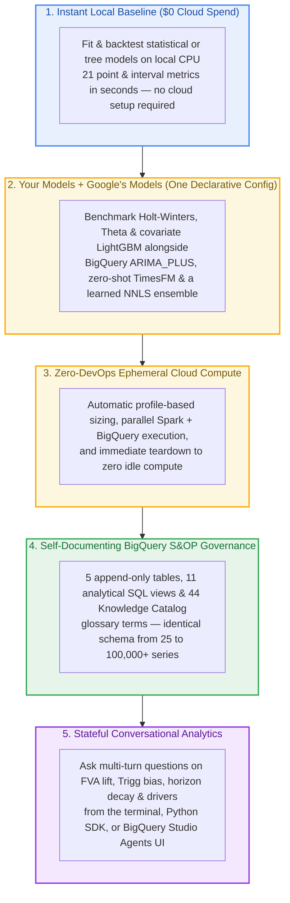

# Forecaster showcase: your models + Google's models, governed in BigQuery

<p align="center">
  <b>From a 5-Second Local Baseline to Hybrid Spark &amp; TimesFM, Governed S&amp;OP Views, and Conversational Q&amp;A</b><br>
  <i>Benchmark your trusted statistical and tree models alongside Google's TimesFM &amp; ARIMA_PLUS without managing cloud infrastructure — then explore every metric, bias alert, and driver in BigQuery or plain English.</i>
</p>

Whether you are evaluating `scale-forecasting` by reading this page or running the commands yourself, every step below is backed by [`configs/forecaster_showcase.json`](https://github.com/statmike/scale-forecasting/blob/main/configs/forecaster_showcase.json) (`run_id`: `forecaster-showcase-f67fec77de66`) and includes **real pre-recorded cloud outputs** and a **live 4-turn BigQuery `DataAgent` transcript** (`sf-conv-953ee3a44057`) that you can expand inline.



---

## What This Walkthrough Proves

| Practitioner Question | How `scale-forecasting` Solves It | Covered In |
| :--- | :--- | :--- |
| **"Can I keep my trusted statistical and tree baselines?"** | **Yes — run your models and Google's models together.** Fit `holtwinters`, `theta`, and covariate `lightgbm` side-by-side with BigQuery `arima_plus`, zero-shot **`timesfm`** (`AI.FORECAST`), and a learned **`nnls`** stacker on the exact same holdout fold. | [Step 1](#step-1--prototype-locally-in-5-seconds-000-cloud-spend) & [Step 2](#step-2--run-your-baselines-alongside-googles-models-in-one-config) |
| **"Do I have to tune Spark executors, build containers, or manage VMs?"** | **No Cloud DevOps overhead.** One JSON config right-sizes executors from measured profiles, dispatches Python and BigQuery SQL engines in parallel, and tears down all ephemeral compute automatically (`\$0.00` idle compute). | [Step 2](#step-2--run-your-baselines-alongside-googles-models-in-one-config) & [Step 3](#step-3--inspect-the-cloud-services-that-ran-zero-devops) |
| **"How are accuracy, Forecast Value Added, and bias governed at scale?"** | **Self-documenting BigQuery S&OP registry.** Every run writes to 5 append-only tables, 11 analytical SQL views (pooled comparable WAPE, FVA waterfall, Trigg tracking signals, horizon decay), and a 44-term **Knowledge Catalog** Business Glossary across 25 to 100,000+ series. | [Step 4](#step-4--govern-accuracy-fva--scale-in-bigquery-25-to-100000-series) |
| **"Can planners and stakeholders explore results without writing SQL?"** | **Stateful conversational analytics.** Ask multi-turn questions in plain English via the **BigQuery Conversational Analytics `DataAgent`** from your terminal (`--chat`), Python (`reg.chat()`), or directly inside **BigQuery Studio → Agents** — with auditable SQL behind every answer. | [Step 5](#step-5--talk-to-your-forecast-in-terminal-python-or-bigquery-studio) |

<details markdown="1">
<summary><b>Tip — 60-second terminal &amp; browser tab setup (run any step live in any order)</b></summary>

If you are walking through this page interactively alongside VS Code and Google Cloud Console (deployed via [Deploying on GCP](./deploying_on_gcp.md)), paste this one-time setup block into your terminal to wire the convention-based `SF_*` environment variables, confirm registry health, and print clickable Console deep links:

```bash
source .venv/bin/activate  # or your Python environment with scale-forecasting installed

# Set your deployed project + region; all remaining SF_* paths follow deployment conventions
PROJECT="your-gcp-project-id"
REGION="us-central1"
export SF_PROJECT_ID="$PROJECT"
export SF_REGION="$REGION"
export SF_DATASET_ID="scale_forecasting"
export SF_CONNECTION="$PROJECT.$REGION.sf-iceberg"
export SF_WAREHOUSE_URI="gs://$PROJECT-warehouse/warehouse"
export SF_CODE_BUCKET="$PROJECT-code"
export SF_COMPUTE_SA="scale-forecasting-compute@$PROJECT.iam.gserviceaccount.com"
export SF_CONTAINER_IMAGE="$REGION-docker.pkg.dev/$PROJECT/scale-forecasting/spark-runtime:latest"
export SF_SUBNETWORK_URI="https://www.googleapis.com/compute/v1/projects/$PROJECT/regions/$REGION/subnetworks/scale-forecasting-compute"

# Verify registry health and print Cmd+Clickable Console & BigQuery Agent links
python -m scale_forecasting.registry.ops doctor
python -m scale_forecasting.bq_agent --dataset scale_forecasting --run-id forecaster-showcase-f67fec77de66 --links
```

- **Pre-open Console tabs in one click:** **Cmd+Click** `[1]` (BigQuery Studio → Agents), `[2]` (BigQuery Dataset `scale_forecasting`), `[3]` (Knowledge Catalog Glossary), and `[5]`/`[7]` (Serverless Spark Batches) from `--links`.
- **100% Idempotent &amp; Order-Independent:** Once setup is confirmed, **every command in Steps 1–5 is safe to run in any order and as many times as you want**:
  - `playground` (Step 1) runs purely in local memory (`\$0.00` cloud spend, zero writes).
  - `--dry-run --feasibility` (Step 2a), `ops doctor`, and `--links` (Step 3) are strictly read-only.
  - `main` (Step 2b) checks the content-addressed `run_id` (`forecaster-showcase-f67fec77de66`), sees `status=COMPLETED`, skips duplicate compute (`\$0.00`), and never double-writes rows.
  - `--chat` (Step 5) opens a fresh `sf-conv-*` conversation thread and runs read-only `SELECT` queries over the governed views.

</details>

---

## Step 1 — Prototype Locally in 5 Seconds (`$0.00` Cloud Spend)

`scale-forecasting` starts as a pure offline Python library — you do **not** need Google Cloud credentials or a deployed project to test any of the 31 Python models (or a custom one-file `BaseModel` plugin) locally across all **21 evaluation metrics**:

```bash
pip install "scale-forecasting[models-stats,models-trees]"
python -m scale_forecasting.playground --model holtwinters --horizon 14 --backtest
```

Equivalent 3-line Python call (see [`notebooks/00_model_playground.ipynb`](./notebooks/00_model_playground.ipynb)):

```python
from scale_forecasting import playground

run = playground.run_model("holtwinters", horizon=14, backtest=True)
print(playground.summarize(run))
```

<details markdown="1">
<summary><b>View pre-recorded output — <code>python -m scale_forecasting.playground</code> (~5s, $0.00 cloud spend)</b></summary>

```text
model      : holtwinters
series     : s_000000  (730 obs)
engine     : spark
status     : ok
forecast   : 14 steps
horizon    : 2023-01-01 → 2023-01-14
metrics    : mae=11.201, rmse=16.206, mse=282.629, mape=0.059, smape=0.061, wape=0.061, mase=0.430, rmsse=0.528, bias=-3.168, coverage=0.667, pinball=3.168, mase_seasonal=0.919, maape=0.059, interval_score=63.353, interval_width=24.332, ope=0.048, rmsle=0.087, msse=0.300, msis=5.203, r2=0.769, cv=0.088
```

</details>

<details markdown="1">
<summary><b>Tip — Live modification to try (swap models or run a 4-model local bake-off in ~5s)</b></summary>

List all 31 offline Python models, test covariate `lightgbm` with synthetic exogenous drivers (`--exog`), or benchmark four models plus automatic `inverse_error` and `nnls` ensembles locally in ~5 seconds (`\$0.00` cloud spend):

```bash
python -m scale_forecasting.playground --list
python -m scale_forecasting.playground --model lightgbm --horizon 14 --backtest --exog

# Multi-model local bake-off + automatic ensemble leaderboard (~5s)
python -c 'from scale_forecasting import playground; bo = playground.bakeoff(models=["naive_seasonal", "holtwinters", "theta", "lightgbm"], horizon=14); print(bo.leaderboard[["model", "wape", "mae", "mase", "r2"]].to_string(index=False))'
```

</details>

---

## Step 2 — Run Your Baselines Alongside Google's Models in One Config

When you are ready to benchmark across a BigQuery / BigLake Iceberg panel (deployed via the 15-minute Terraform setup in [Deploying on GCP](./deploying_on_gcp.md)), you do not rewrite your modeling code. One declarative JSON file — [`configs/forecaster_showcase.json`](https://github.com/statmike/scale-forecasting/blob/main/configs/forecaster_showcase.json) (`run_id`: `forecaster-showcase-f67fec77de66`) — runs Python statistical/ML baselines on Serverless Spark in parallel with BigQuery `arima_plus` and zero-shot `timesfm`, blends them with Non-Negative Least Squares (`nnls`), and refreshes the BigQuery `DataAgent`:

```json
{
  "run_name": "forecaster_showcase",
  "python_runtime": "spark",
  "data": {
    "source_table": "source_series_covariates_iceberg",
    "horizon": 14,
    "series_limit": 25
  },
  "models": [
    "naive_seasonal",
    "holtwinters",
    "theta",
    "lightgbm",
    "arima_plus",
    "timesfm"
  ],
  "features": {
    "future_covariates": [
      "is_holiday",
      "promo_flag",
      "price_index"
    ],
    "on_unsupported_covariates": "fallback"
  },
  "backtest": {
    "enabled": true,
    "n_folds": 2,
    "horizon": 14,
    "step": 14
  },
  "ensemble": {
    "enabled": true,
    "strategies": [
      "inverse_error",
      "nnls"
    ]
  },
  "compute": {
    "reuse_prior_runs": true
  },
  "output": {
    "ensure_bq_agent": true
  }
}
```

Three built-in guardrails keep mixed-model experimentation frictionless:
1. **Graceful Univariate + Multivariate Mixing (`on_unsupported_covariates: "fallback"`):** `lightgbm`, `arima_plus`, and `timesfm` ingest `is_holiday`, `promo_flag`, and `price_index`, while univariate baselines (`naive_seasonal`, `holtwinters`, `theta`) automatically fall back to target history instead of failing the run.
2. **Pre-Run Duration & Cost Estimation (`--dry-run --feasibility`):** Validates fold survival against your live source table and reports critical-path `p50`/`p90` duration and estimated USD cost before provisioning any compute.
3. **Content-Addressed Idempotency & Cell Borrowing (`compute.reuse_prior_runs: true`):** Prevents duplicate runs and borrows already-computed `(series, model)` cells across config iterations when the source table snapshot is unchanged.

> [!NOTE]
> **Expected Runtime & Approximate Google Cloud Cost (First Cold Run vs. Repeat & Incremental Runs):**
> - **First run on a cold project (estimated `~\$0.22–\$0.35 USD` total compute):** `--dry-run --feasibility` estimates **`p50=4.0m / p90=5.1m`** and **`~\$0.22 USD`** (`statistical=\$0.14` Dataproc Serverless CPU DCU, `ml=\$0.06` Dataproc Serverless CPU DCU, `native=\$0.02` BigQuery `ARIMA_PLUS` + `TimesFM`; see [Cost estimates & controls](./cost_estimates.md)). On a cold launch, BigQuery `native` (`arima_plus` + `timesfm`) completes in **~2 minutes (`125.7s`)**, `ensemble` completes in **~15 seconds (`14.9s`)**, and Dataproc Serverless Spark completes in **~4–6 minutes** once the regional container cache is warm (or **~12–16 minutes** on the very first cold container image pull in a region, measured at `988.5s` end-to-end on our initial validation run). Every Spark batch and BigQuery query tears down automatically on completion (`\$0.00` idle compute afterward).
> - **Repeat runs & incremental edits (`~2–9 seconds` / `0.00s` cell borrowing):** Because `run_id` (`forecaster-showcase-f67fec77de66`) is content-addressed from semantic `RunConfig` inputs, re-running an unchanged config sees `status=COMPLETED`, skips duplicate compute, and prints Console deep links in seconds (`\$0.00` incremental compute). With `"compute": {"reuse_prior_runs": true}`, if you edit the config (for example, adding `"ridge"` to `ensemble.strategies` or adding `"xgboost"` to `models`), `scale-forecasting` verifies the BigQuery table snapshot, **borrows all 6 unchanged models in `0.00s` (`borrowed:forecaster-showcase-f67fec77de66`)**, and executes *only* the newly added model or ensemble in **~20–45 seconds**. Pass `--force` whenever you want a full cold re-execution.

### 2a. Preview Fold Survival, Sizing & Estimated Cost (`--feasibility`)

```bash
python -m scale_forecasting.main --config configs/forecaster_showcase.json --dry-run --feasibility
```

<details markdown="1">
<summary><b>View pre-recorded output — <code>--dry-run --feasibility</code> (~$0.22 USD estimate)</b></summary>

```text
INFO scale_forecasting.launch_plan | dry-run forecaster-showcase-f67fec77de66: runtime=spark python=['naive_seasonal', 'holtwinters', 'theta', 'lightgbm'] bq=['arima_plus', 'timesfm'] fanout=Fanout(n_series=25, n_models=6, n_folds=2, n_cells=150)
INFO scale_forecasting.launch_plan |   node statistical: sf-forecaster-showcase-f67fec77de66-statistical-a1 on spark
INFO scale_forecasting.launch_plan |   node ml: sf-forecaster-showcase-f67fec77de66-ml-a1 on spark
INFO scale_forecasting.launch_plan |   node native: sf-forecaster-showcase-f67fec77de66-native-a1 on bigquery
INFO scale_forecasting.launch_plan |   node ensemble: sf-forecaster-showcase-f67fec77de66-ensemble-a1 on bigquery after [sf-forecaster-showcase-f67fec77de66-statistical-a1, sf-forecaster-showcase-f67fec77de66-ml-a1, sf-forecaster-showcase-f67fec77de66-native-a1]
INFO scale_forecasting.launch_plan |   estimate (approx, not a quote): p50=4.0m p90=5.1m | ~est_cost=$0.22 USD | bottleneck=ml (25 series)
INFO __main__ | feasibility: 25 series x 6 models = 150 cells
INFO __main__ |   fits: 450 (650,700 training rows) = 2.971 whole-history fits per cell
INFO __main__ |   2 of 2 folds: 25 series (100.0%) — all folds
INFO __main__ |   min_train=180 is within budget: up to 1432 still keeps 90% of series at full folds
INFO __main__ |   estimate (approx, not a quote): p50=4.0m p90=5.1m | ~est_cost=$0.22 USD (bottleneck=ml, median_obs=1460)
INFO __main__ |     families: statistical=$0.14 (serverless (CPU DCU)), ml=$0.06 (serverless (CPU DCU)), native=$0.02 (bq dry-run 0 B + BQML)
```

</details>

### 2b. Execute the Hybrid Run (CLI or Python SDK)

```bash
python -m scale_forecasting.main --config configs/forecaster_showcase.json
```

Or via the Python SDK (`Forecaster`):

```python
import scale_forecasting as sf

fc = sf.Forecaster.from_file("configs/forecaster_showcase.json")
res = fc.run()
res.console_urls()  # Renders clickable Cloud Console & BigQuery Agent links in notebooks
```

<details markdown="1">
<summary><b>View pre-recorded output — Cold Cloud Execution &amp; Instant Cached Re-Run</b></summary>

**First execution (parallel Serverless Spark + BigQuery `AI.FORECAST` + `NNLS` ensemble + `DataAgent` sync):**

```text
INFO __main__ | run forecaster-showcase-f67fec77de66 start: families=['statistical', 'ml', 'native'] ensemble=True
INFO scale_forecasting.engines.bigquery_engine | bigquery run start: run_id=forecaster-showcase-f67fec77de66 models=['arima_plus', 'timesfm'] manage_header=False backtest=True
INFO scale_forecasting.submit | submitting batch sf-forecaster-showcase-f67fec77de66-statistical-a1 to projects/your-gcp-project-id/locations/us-central1
INFO scale_forecasting.submit | submitting batch sf-forecaster-showcase-f67fec77de66-ml-a1 to projects/your-gcp-project-id/locations/us-central1
INFO scale_forecasting.engines.bigquery_engine | bigquery run done: run_id=forecaster-showcase-f67fec77de66 status=COMPLETED models=2 series=25 runtime=125.7s
INFO scale_forecasting.submit | batch sf-forecaster-showcase-f67fec77de66-ml-a1 finished: state=SUCCEEDED
INFO scale_forecasting.submit | batch sf-forecaster-showcase-f67fec77de66-statistical-a1 finished: state=SUCCEEDED
INFO scale_forecasting.ensemble_run | ensemble run start (barrier): run_id=forecaster-showcase-f67fec77de66 ensemble_id=34432fdde9fa strategies=['inverse_error', 'nnls']
INFO scale_forecasting.ensembler | fit nnls ensemble on 350 holdout OOF rows
INFO scale_forecasting.ensemble_run | ensemble predictions appended: run_id=forecaster-showcase-f67fec77de66 ensemble_id=34432fdde9fa rows=700 strategies=['inverse_error', 'nnls']
INFO scale_forecasting.ensemble_run | ensemble OOF appended: run_id=forecaster-showcase-f67fec77de66 ensemble_id=34432fdde9fa rows=1400
INFO scale_forecasting.ensemble_run | ensemble run done: run_id=forecaster-showcase-f67fec77de66 ensemble_id=34432fdde9fa scored=50 models=['ensemble_inverse_error', 'ensemble_nnls']
INFO __main__ | registered BigQuery Conversational Agent: projects/your-gcp-project-id/locations/global/dataAgents/sf-registry-scale-forecasting
INFO __main__ | run forecaster-showcase-f67fec77de66 done: status=COMPLETED
INFO __main__ | console registry dataset: https://console.cloud.google.com/bigquery?project=your-gcp-project-id&p=your-gcp-project-id&d=scale_forecasting&page=dataset
INFO __main__ | console BigQuery Studio Agents (left rail -> Agents -> sf-registry-scale-forecasting): https://console.cloud.google.com/bigquery?project=your-gcp-project-id
INFO __main__ | console Job [ensemble] on bigquery: https://console.cloud.google.com/bigquery?project=your-gcp-project-id
INFO __main__ | console Job [ml] on spark: https://console.cloud.google.com/dataproc/batches/us-central1/sf-forecaster-showcase-f67fec77de66-ml-a1/monitoring?project=your-gcp-project-id
INFO __main__ | console Job [native] on bigquery: https://console.cloud.google.com/bigquery?project=your-gcp-project-id
INFO __main__ | console Job [statistical] on spark: https://console.cloud.google.com/dataproc/batches/us-central1/sf-forecaster-showcase-f67fec77de66-statistical-a1/monitoring?project=your-gcp-project-id
```

**Subsequent execution of the unchanged config (~9 seconds, `$0.00` incremental compute):**

```text
INFO scale_forecasting.launch_plan | compute profile source: auto -> forecaster-showcase-f67fec77de66
INFO __main__ | run forecaster-showcase-f67fec77de66 already COMPLETED; skipping relaunch (pass force=True to re-run)
INFO __main__ | console registry dataset: https://console.cloud.google.com/bigquery?project=your-gcp-project-id&p=your-gcp-project-id&d=scale_forecasting&page=dataset
INFO __main__ | console BigQuery Studio Agents (left rail -> Agents -> sf-registry-scale-forecasting): https://console.cloud.google.com/bigquery?project=your-gcp-project-id
INFO __main__ | submitted: forecaster-showcase-f67fec77de66
```

</details>

<details markdown="1">
<summary><b>Tip — Live modification to try (~25s incremental run via 6-of-6 model borrowing)</b></summary>

Want to try modifying the run live without waiting for Spark executors or retraining `timesfm` and `arima_plus`? Add `"ridge"` (L2-regularized stacker) to `ensemble.strategies` — either by editing [`configs/forecaster_showcase.json`](https://github.com/statmike/scale-forecasting/blob/main/configs/forecaster_showcase.json) in your editor or running this non-destructive override that leaves the JSON file untouched on disk:

```bash
python -c '
import json, scale_forecasting as sf
raw = json.load(open("configs/forecaster_showcase.json"))
raw["ensemble"]["strategies"] = ["inverse_error", "nnls", "ridge"]
res = sf.Forecaster(raw).run()
print("completed:", res.run_id)
'
```

- **What happens live (`run_id`: `forecaster-showcase-885a83835385`):**
  1. `scale-forecasting` computes a new content-addressed `run_id` (`forecaster-showcase-885a83835385`), keeping `forecaster-showcase-f67fec77de66` untouched.
  2. `compute.reuse_prior_runs: true` verifies the `source_series_covariates_iceberg` snapshot and **borrows all 6 base models (`6 of 6`)** from `forecaster-showcase-f67fec77de66` via BigQuery SQL (`borrowed:forecaster-showcase-f67fec77de66`) — launching **zero Spark batches** and **zero BQML fits**.
  3. Only the downstream `ensemble` node executes (`inverse_error`, `nnls`, and `ridge` on the 350 holdout OOF rows) and refreshes the `DataAgent` in **~25–35 seconds**.
- **Idempotency &amp; Reset:** Re-running that modified config a second time is also idempotent (`already COMPLETED; skipping relaunch`). If you edited `configs/forecaster_showcase.json` directly, run `git checkout configs/forecaster_showcase.json` to restore the file; to delete the variant run so you can demonstrate the live borrow from scratch again later, run:
  ```bash
  python -m scale_forecasting.registry.ops drop-run forecaster-showcase-885a83835385 --yes
  ```

</details>

---

## Step 3 — Inspect the Cloud Services That Ran (Zero DevOps)

At the end of every run (or anytime via `python -m scale_forecasting.bq_agent --dataset scale_forecasting --links` or `reg.console_urls()`), `scale-forecasting` prints direct Google Cloud Console links to every managed service that executed your DAG:

```bash
python -m scale_forecasting.bq_agent --dataset scale_forecasting --run-id forecaster-showcase-f67fec77de66 --links
```

> [!TIP]
> **Opening Google Cloud Console Surfaces:**
> Static links in public documentation omit project IDs — click any link in the table below and select your project in the Google Cloud Console top bar. When you run `--links` (or `res.console_urls()`) locally, `scale-forecasting` automatically populates `?project=<your-project-id>` from `SF_PROJECT_ID` or Application Default Credentials so you can **Cmd+Click** directly into each batch, table, view, and agent.

| Google Cloud Console Surface (Select Your Project in Top Bar) | What Happened Automatically Under the Hood |
| :--- | :--- |
| **[Dataproc → Serverless → Batches](https://console.cloud.google.com/dataproc/batches)** | The DAG router (`dag.py`) launched two independent, right-sized Serverless Spark batches in parallel: `statistical` (`1` vCPU/task, `OMP_NUM_THREADS=1` to avoid BLAS oversubscription) and `ml` (`2` vCPUs/task, `OMP_NUM_THREADS=2` for `lightgbm`), then scaled back to **`0` executors** immediately upon completion. |
| **[BigQuery Studio → Job History](https://console.cloud.google.com/bigquery)** *(Bottom bar → **Personal / Project history**)* | Concurrently, `bigquery_engine.py` executed `arima_plus` (`ARIMA_PLUS_XREG` with covariates) and zero-shot **`timesfm`** (`AI.FORECAST`) directly in BigQuery in **`125.7s`**, followed by the barrier `ensemble` job (`inverse_error` + `nnls` in **`14.9s`**). |
| **[BigQuery Studio → Explorer (`scale_forecasting`)](https://console.cloud.google.com/bigquery)** | All cell predictions, fit diagnostics, and out-of-fold rows streamed via the BigQuery Storage Write API into the 5 append-only registry tables and 11 analytical SQL views. |
| **[Dataplex → Knowledge Catalog → Glossaries](https://console.cloud.google.com/dataplex/glossaries)** | Synchronized 44 governed S&OP and forecasting definitions (`sf-glossary-scale-forecasting`) linked directly to the registry schema. |
| **[BigQuery Studio → Agents](https://console.cloud.google.com/bigquery)** *(Left rail → **Agents** → `scale-forecasting Registry Agent`)* | Registered/updated `sf-registry-scale-forecasting` with the 11 views, 44 glossary terms, and 32 verified Golden SQL examples. |

Every family job is permanently recorded in `v_run_jobs`:

| Family Node | `job_id` | Runtime | Models Executed | Status | Cells Scored |
| :--- | :--- | :--- | :--- | :--- | ---: |
| `native` | `sf-forecaster-showcase-f67fec77de66-native-a1` | `bigquery` | `arima_plus`, `timesfm` | `COMPLETED` | `50` |
| `ml` | `sf-forecaster-showcase-f67fec77de66-ml-a1` | `spark` (`serverless`) | `lightgbm` | `COMPLETED` | `25` |
| `statistical` | `sf-forecaster-showcase-f67fec77de66-statistical-a1` | `spark` (`serverless`) | `naive_seasonal`, `holtwinters`, `theta` | `COMPLETED` | `75` |
| `ensemble` | `sf-forecaster-showcase-f67fec77de66-ensemble-a1` | `bigquery` | `ensemble_inverse_error`, `ensemble_nnls` | `COMPLETED` | `50` |

<details markdown="1">
<summary><b>View pre-recorded output — <code>python -m scale_forecasting.bq_agent --links</code></b></summary>

```text
Google Cloud Console Links (project=your-gcp-project-id, dataset=scale_forecasting, run_id=forecaster-showcase-f67fec77de66):
  [1] BigQuery Studio — Agents (scale-forecasting Registry Agent: sf-registry-scale-forecasting)
      https://console.cloud.google.com/bigquery?project=your-gcp-project-id
      -> In BigQuery Studio left rail -> Agents -> scale-forecasting Registry Agent (scale_forecasting)
  [2] BigQuery Registry Dataset (scale_forecasting)
      https://console.cloud.google.com/bigquery?project=your-gcp-project-id&p=your-gcp-project-id&d=scale_forecasting&page=dataset
      -> 5 append-only registry tables + 11 self-documenting analytical SQL views
  [3] Knowledge Catalog Business Glossary (sf-glossary-scale-forecasting)
      https://console.cloud.google.com/dataplex/glossaries?project=your-gcp-project-id
      -> 44 governed forecasting & S&OP definitions linked to registry tables and views
  [4] Job [ensemble] on bigquery
      https://console.cloud.google.com/bigquery?project=your-gcp-project-id
      -> status=COMPLETED · sf-forecaster-showcase-f67fec77de66-ensemble-a1
  [5] Job [ml] on spark
      https://console.cloud.google.com/dataproc/batches/us-central1/sf-forecaster-showcase-f67fec77de66-ml-a1/monitoring?project=your-gcp-project-id
      -> status=COMPLETED · sf-forecaster-showcase-f67fec77de66-ml-a1
  [6] Job [native] on bigquery
      https://console.cloud.google.com/bigquery?project=your-gcp-project-id
      -> status=COMPLETED · sf-forecaster-showcase-f67fec77de66-native-a1
  [7] Job [statistical] on spark
      https://console.cloud.google.com/dataproc/batches/us-central1/sf-forecaster-showcase-f67fec77de66-statistical-a1/monitoring?project=your-gcp-project-id
      -> status=COMPLETED · sf-forecaster-showcase-f67fec77de66-statistical-a1
  [8] Cloud Storage Warehouse & Run Artifacts
      https://console.cloud.google.com/storage/browser/your-gcp-project-id-warehouse/warehouse/runs/forecaster-showcase-f67fec77de66?project=your-gcp-project-id
      -> gs://your-gcp-project-id-warehouse/warehouse
```

</details>

---

## Step 4 — Govern Accuracy, FVA & Scale in BigQuery (25 to 100,000 Series)

Instead of scattering CSV exports or notebook DataFrames across machines, every run lands in a governed BigQuery warehouse schema ([Output schemas](./output_schemas.md)):

- **5 Append-Only Registry Tables:** `run_registry`, `run_jobs`, `forecast_predictions` (`2,800` rows for `forecaster-showcase-f67fec77de66`), `forecast_metadata` (`200` cell rows), and `backtest_oof` (`5,600` out-of-fold rows).
- **11 Self-Documenting Analytical SQL Views:** Every view and column embeds `OPTIONS(description=...)` metadata synchronized with **44 Knowledge Catalog Business Glossary terms** (`sf-glossary-scale-forecasting`), so BI dashboards, SQL analysts, and AI agents share one canonical definition of pooled WAPE, Forecast Value Added (FVA), and Trigg's tracking signal.

<details markdown="1">
<summary><b>Tip — Inspecting self-documenting column descriptions &amp; Knowledge Catalog lineage in the Console</b></summary>

- **BigQuery Schema Descriptions:** In **BigQuery Studio → Explorer → `scale_forecasting`** (link `[2]` from `--links`), click `v_fva_waterfall`, `v_bias_and_exceptions`, or `v_executive_sop_summary` and open the **Schema** tab — every metric and flag column (`pooled_wape`, `fva_relative_lift_pct`, `tracking_signal`, `sbc_class`) displays governed S&amp;OP definitions populated automatically via DDL `OPTIONS(description=...)`.
- **Knowledge Catalog Business Glossary:** Open **Dataplex → Knowledge Catalog → Glossaries → `sf-glossary-scale-forecasting`** (link `[3]` from `--links`) to browse all **44 governed forecasting &amp; S&amp;OP definitions** linked to the registry tables and views, or click **Lineage** on any view in BigQuery Studio to trace upstream dependencies.
- **Deduplicated Append-Only Safety:** Every analytical view applies `QUALIFY ROW_NUMBER() OVER (...) = 1`, guaranteeing clean, duplicate-free reporting across retries, cell borrowing, and surgical repairs.

</details>

### Holdout Leaderboard & Forecast Value Added (`forecaster-showcase-f67fec77de66`)

Querying `v_model_leaderboard_comparable` and `v_fva_waterfall` ranks all **6 base models + 2 ensembles** on the exact same `350` holdout points (`25` series × `14` days, `2024-12-17` → `2024-12-30`, `holdout_fold_id = 1`):

| Rank | `model_type` | Pipeline Stage (`v_fva_waterfall`) | Engine | Holdout Series (`n_series`) | Pooled Holdout WAPE | Pooled MAE | FVA Relative Lift vs. `naive_seasonal` |
| :---: | :--- | :--- | :--- | :---: | ---: | ---: | ---: |
| **1** | **`timesfm`** | `4_covariate_ml_dl` | BigQuery `AI.FORECAST` | `25` | **9.84%** (`0.0984`) | **9.57** | **+54.09%** |
| **2** | **`ensemble_nnls`** | `5_ensemble` | BigQuery + OOF Stacker | `25` | **10.83%** (`0.1083`) | **10.54** | **+49.45%** |
| **3** | **`arima_plus`** | `2_statistical` | BigQuery ML SQL | `25` | **10.96%** (`0.1096`) | **10.67** | **+48.84%** |
| **4** | **`ensemble_inverse_error`** | `5_ensemble` | BigQuery + OOF Blend | `25` | **12.47%** (`0.1247`) | **12.13** | **+41.81%** |
| **5** | **`lightgbm`** | `4_covariate_ml_dl` | Serverless Spark | `25` | **14.21%** (`0.1421`) | **13.82** | **+33.70%** |
| **6** | **`holtwinters`** | `2_statistical` | Serverless Spark | `25` | **14.78%** (`0.1478`) | **14.38** | **+31.03%** |
| **7** | **`theta`** | `2_statistical` | Serverless Spark | `25` | **16.50%** (`0.1650`) | **16.05** | **+23.00%** |
| **8** | **`naive_seasonal`** | `1_baseline_naive` | Serverless Spark | `25` | **21.43%** (`0.2143`) | **20.85** | **0.00%** *(anchor)* |

Two results stand out immediately:
- **Zero-Shot Foundation Accuracy:** Google's **`timesfm`** (`AI.FORECAST`) ranked `#1` overall at **9.84% pooled WAPE** (**+54.09% FVA lift** over `naive_seasonal` and **33% lower error** than `holtwinters`) in ~2 minutes of BigQuery SQL with zero hyperparameter tuning.
- **Cross-Engine Ensembling:** **`ensemble_nnls`** (`10.83%` WAPE) learned constrained non-negative weights blending the Spark Python models and BigQuery models to beat `arima_plus` (`10.96%`), `lightgbm` (`14.21%`), and `holtwinters` (`14.78%`) on out-of-sample holdout data.

### Same Governance Contract at 100,000 Series

Without changing a single table or view, `v_run_summary` and `v_executive_sop_summary` govern 25-series agile experiments and **100,000-series** fleet benchmarks side-by-side (see [`configs/explode_100k.json`](https://github.com/statmike/scale-forecasting/blob/main/configs/explode_100k.json), [`configs/ray_100k.json`](https://github.com/statmike/scale-forecasting/blob/main/configs/ray_100k.json), and [Quota, throughput, and scale](./quota_and_scale.md)):

| `run_id` | Series (`n_series`) | Compute Runtime | Backtest | End-to-End Wall Time | Champion Model | Total Forecast Volume |
| :--- | ---: | :--- | :---: | ---: | :--- | ---: |
| `forecaster-showcase-f67fec77de66` | **25** | Serverless Spark + BigQuery | 2 folds | `16.5 min` cold (`~9s` cached) | `timesfm` (`9.84%` WAPE) | `33,271` units |
| `w1a-spark-srv-n100000-f0ce6ad0a782` | **100,000** | Dataproc Serverless Spark | Enabled | `66.7 min` (`4,000s`) | `ensemble_inverse_error` (`14.10%` WAPE) | — |
| `w1a-bq-scale-n100000-97e2fbd32ed2` | **100,000** | BigQuery Native SQL | Enabled | `84.3 min` (`5,056s`) | `ensemble_nnls` (`11.24%` WAPE) | — |
| `explode-100k-ef602ea229b4` | **100,000** | Dataproc Serverless Spark (`400k` cells) | Forward | `97.9 min` (`5,873s`) | `holtwinters` | `295,862,672` units |
| `ray-100k-3fbc82fe3b6d` | **100,000** | Vertex AI Ray CPU (`400k` cells) | Forward | `123.4 min` (`7,405s`) | `holtwinters` | `295,862,639` units |

---

## Step 5 — Talk to Your Forecast in Terminal, Python, or BigQuery Studio

Because `output.ensure_bq_agent: true` registered **`sf-registry-scale-forecasting`** with all 11 analytical views, 44 glossary definitions, and 32 golden SQL examples, you can interrogate your forecast in plain English from **either** a developer terminal/notebook or the zero-code Google Cloud Console UI.

### Option A — Interactive Terminal REPL (`--chat`) & Python SDK (`reg.chat()`)

Start a stateful multi-turn terminal session:

```bash
python -m scale_forecasting.bq_agent \
  --dataset scale_forecasting \
  --run-id forecaster-showcase-f67fec77de66 \
  --chat
```

Inside `--chat`, use `/starters` (then type `1`–`4`) to try built-in S&OP questions, ask any free-form question, type `/sql` to inspect the exact BigQuery SQL generated for the last turn, `/run all` to query across all runs in the dataset, `/links` to print Console URLs, or `/quit` to exit.

<details markdown="1">
<summary><b>Tip — How <code>/sql</code>, <code>/starters</code>, and <code>/run</code> work inside interactive <code>--chat</code></b></summary>

- **`/sql` (instant zero-latency SQL audit):** Whenever the BigQuery `DataAgent` answers a question, its streaming response returns `data.generatedSql` (the exact BigQuery SQL executed against your governed views) alongside `data.result` rows and the narrative summary. `--chat` keeps terminal output readable by printing the narrative + a 15-row preview while caching the query on `session.last.sql`. Typing `/sql` at the prompt prints that exact SQL from memory immediately (`0ms`, zero extra API call) so you can verify every metric or paste the query directly into BigQuery Studio:
  ```text
  [forecaster-showcase-f67fec77de66]> /starters
  Starter questions (type 1-4 to ask directly):
    [1] Which model won on comparable WAPE and what was the Forecast Value Added (FVA) lift over naive_seasonal?
    [2] On that winning model, which series have directional bias or Trigg tracking-signal exceptions?
    [3] How does forecast accuracy decay from day 1 to day 14, and which promo or holiday covariates mattered most?
    [4] Compare recent runs in v_run_summary including our 100,000-series benchmark runs.

  [forecaster-showcase-f67fec77de66]> 1
  Asking [1]: Which model won on comparable WAPE and what was the Forecast Value Added (FVA) lift over naive_seasonal?
  ...
  --- Result Preview (type /sql to inspect query) ---

  [forecaster-showcase-f67fec77de66]> /sql
  --- Last Generated SQL ---
  SELECT f.run_id, f.stage_order, f.stage_name, f.model_type, f.pooled_wape, ...
  FROM `your-gcp-project-id.scale_forecasting.v_fva_waterfall` AS f
  WHERE f.run_id = 'forecaster-showcase-f67fec77de66'
  ORDER BY f.pooled_wape ASC;
  ```
- **`/starters` (`1`–`4`):** Typing `1`, `2`, `3`, or `4` asks that starter directly. Starter `4` automatically detects cross-run phrasing and widens scope to `all` for that turn — while keeping `forecaster-showcase-f67fec77de66` pinned for subsequent single-run questions.
- **`/run <id|latest|all>`:** Switches the default `run_id` scope mid-session without losing conversation history (for example, `/run forecaster-showcase-885a83835385` right after trying the Step 2 `ridge` live modification, or `/run all` for dataset-wide questions).
- **`/links` &amp; `/new`:** `/links` reprints clickable Cloud Console URLs for the active `run_id`; `/new` resets the `sf-conv-*` thread.

</details>

From Python or a notebook ([`notebooks/12_conversational_analytics_and_knowledge_catalog.ipynb`](./notebooks/12_conversational_analytics_and_knowledge_catalog.ipynb)):

```python
import scale_forecasting as sf

reg = sf.Registry()
chat = reg.chat(run_id="forecaster-showcase-f67fec77de66")

r1 = chat("Which model won on comparable WAPE and what was the Forecast Value Added (FVA) lift over naive_seasonal?")
print(r1.answer)
print(r1.sql)

# Stateful follow-up — automatically threads conversation_id ("that winning model" -> timesfm)
r2 = chat("On that winning model, which series have directional bias or Trigg tracking-signal exceptions?")
display(r2.df.head())
```

### Option B — Google Cloud Console (`BigQuery Studio → Agents`)

Demand planners and business stakeholders can query the exact same governed agent directly in the browser with **zero code**:

1. Open **[BigQuery Studio](https://console.cloud.google.com/bigquery)** and select your Google Cloud project in the top bar (or **Cmd+Click** link `[1]` from `--links`).
2. In the BigQuery Studio left navigation rail, click **Agents**.
3. Open **`scale-forecasting Registry Agent (scale_forecasting)`** (`sf-registry-scale-forecasting`) and ask any question in the Console chat pane to see narrative summaries, charts, and expandable SQL.

---

### Pre-Recorded 4-Turn Live `DataAgent` Transcript (`sf-conv-953ee3a44057`)

Below is the 4-turn conversation executed live against `sf-registry-scale-forecasting` on `forecaster-showcase-f67fec77de66` (project ID sanitized to `your-gcp-project-id`). Notice how **Turn 2** asks *"On that winning model..."* without naming `timesfm` — the stateful `DataAgent` carries context from Turn 1 automatically.

#### Turn 1 — Champion Model & Forecast Value Added (FVA) Waterfall

> **Question 1:** *Which model won on comparable WAPE and what was the Forecast Value Added (FVA) lift over naive_seasonal?*

**`DataAgent` (`sf-registry-scale-forecasting`):**

For run `forecaster-showcase-f67fec77de66`, **`timesfm`** won on comparable holdout WAPE with a pooled WAPE of **0.0984** (9.84%) and achieved an FVA relative lift of **54.09%** (absolute WAPE reduction of **0.1159**) over the `naive_seasonal` baseline (pooled WAPE of 0.2143).

- **Champion Model:** `timesfm` (Stage 4: Covariate ML/DL) delivered the lowest error at **0.0984** pooled WAPE, beating `naive_seasonal` by **54.09%** relative lift.
- **Top Ensembles:** `ensemble_nnls` followed in second place with **0.1083** pooled WAPE (49.45% lift), outperforming standard statistical models like `arima_plus` (0.1096 pooled WAPE, 48.84% lift).
- **All Models Beat Baseline:** Every candidate model achieved positive FVA delta over `naive_seasonal` (baseline pooled WAPE: 0.2143).

<details markdown="1">
<summary><b>View pre-recorded SQL &amp; result rows — Turn 1 (<code>v_fva_waterfall</code>)</b></summary>

```sql
SELECT f.run_id,
       f.stage_order,
       f.stage_name,
       f.model_type,
       f.pooled_wape,
       f.pooled_mae,
       f.baseline_model,
       f.baseline_wape,
       f.fva_wape_delta,
       f.fva_relative_lift_pct
FROM `your-gcp-project-id.scale_forecasting.v_fva_waterfall` AS f
WHERE f.run_id = 'forecaster-showcase-f67fec77de66'
ORDER BY f.pooled_wape ASC;
```

| `stage_name` | `model_type` | `pooled_wape` | `pooled_mae` | `baseline_wape` | `fva_wape_delta` | `fva_relative_lift_pct` |
| :--- | :--- | ---: | ---: | ---: | ---: | ---: |
| `4_covariate_ml_dl` | `timesfm` | `0.0984` | `9.57` | `0.2143` | `+0.1159` | `+54.09%` |
| `5_ensemble` | `ensemble_nnls` | `0.1083` | `10.54` | `0.2143` | `+0.1060` | `+49.45%` |
| `2_statistical` | `arima_plus` | `0.1096` | `10.67` | `0.2143` | `+0.1047` | `+48.84%` |
| `5_ensemble` | `ensemble_inverse_error` | `0.1247` | `12.13` | `0.2143` | `+0.0896` | `+41.81%` |
| `4_covariate_ml_dl` | `lightgbm` | `0.1421` | `13.82` | `0.2143` | `+0.0722` | `+33.70%` |
| `2_statistical` | `holtwinters` | `0.1478` | `14.38` | `0.2143` | `+0.0665` | `+31.03%` |
| `2_statistical` | `theta` | `0.1650` | `16.05` | `0.2143` | `+0.0493` | `+23.00%` |
| `1_baseline_naive` | `naive_seasonal` | `0.2143` | `20.85` | `0.2143` | `0.0000` | `0.00%` |

</details>

---

#### Turn 2 — Stateful Follow-Up: Planner Bias & Trigg Tracking-Signal Exceptions

> **Question 2:** *On that winning model, which series have directional bias or Trigg tracking-signal exceptions?*

**`DataAgent` (`sf-registry-scale-forecasting`):**

For winning model **`timesfm`** in run `forecaster-showcase-f67fec77de66`, **23 series** are flagged with Trigg tracking-signal exceptions (`|tracking_signal| > 4.0`), consisting of **18 chronically under-forecasted** series (led by `s_000011` with a tracking signal of `-26.14`) and **5 chronically over-forecasted** series (led by `s_000020` with a tracking signal of `+14.05`).

- **Severe Under-Forecasting:** 18 series show strong negative bias (for example, `s_000011`, `s_000001`, `s_000006`, and `s_000016` all have tracking signals `< -24.0` on low-volume series), presenting stockout risk if safety stock is not adjusted.
- **Over-Forecasting Exceptions:** 5 series (`s_000020`, `s_000005`, `s_000019`, `s_000004`, and `s_000003`) exhibit positive tracking signals up to `+14.05`, where `s_000004` has the highest error (`WAPE = 0.480`, `MASE = 1.084`).

<details markdown="1">
<summary><b>View pre-recorded SQL &amp; top exception rows — Turn 2 (<code>v_bias_and_exceptions</code>)</b></summary>

```sql
SELECT e.ts_id,
       e.model_type,
       e.sbc_class,
       e.exception_reason,
       e.tracking_signal,
       e.signed_bias,
       e.mean_actual,
       e.mean_forecast,
       e.wape,
       e.mase,
       e.is_exception
FROM `your-gcp-project-id.scale_forecasting.v_bias_and_exceptions` AS e
WHERE e.run_id = 'forecaster-showcase-f67fec77de66'
  AND e.model_type = 'timesfm'
  AND (e.is_exception = TRUE
       OR ABS(e.tracking_signal) > 4.0
       OR e.exception_reason IN ('CHRONIC_OVER_FORECAST',
                                 'CHRONIC_UNDER_FORECAST'))
ORDER BY ABS(e.tracking_signal) DESC NULLS LAST,
         e.wape DESC NULLS LAST;
```

| `ts_id` | `model_type` | `exception_reason` | `tracking_signal` | `signed_bias` | `mean_actual` | `mean_forecast` | `mase` |
| :--- | :--- | :--- | ---: | ---: | ---: | ---: | ---: |
| `s_000011` | `timesfm` | `CHRONIC_UNDER_FORECAST` | `-26.14` | `-3.75` | `3.96` | `0.21` | `0.605` |
| `s_000001` | `timesfm` | `CHRONIC_UNDER_FORECAST` | `-25.76` | `-2.30` | `2.49` | `0.19` | `0.749` |
| `s_000006` | `timesfm` | `CHRONIC_UNDER_FORECAST` | `-25.73` | `-1.44` | `1.52` | `0.08` | `0.872` |
| `s_000023` | `timesfm` | `CHRONIC_UNDER_FORECAST` | `-24.31` | `-44.51` | `195.94` | `151.42` | `1.073` |
| `s_000002` | `timesfm` | `CHRONIC_UNDER_FORECAST` | `-20.83` | `-7.23` | `173.45` | `166.22` | `0.879` |

</details>

---

#### Turn 3 — 14-Day Lead-Time Horizon Decay & Promo/Holiday Drivers

> **Question 3:** *How does forecast accuracy decay from day 1 to day 14, and which promo or holiday covariates mattered most?*

**`DataAgent` (`sf-registry-scale-forecasting`):**

For winning model **`timesfm`** in run `forecaster-showcase-f67fec77de66`, forecast accuracy holds near **0.07–0.11 pooled WAPE** for most lead times (starting at **0.0960 WAPE** on day 1 and **0.1715 WAPE** on day 14), with weekly peak spikes reaching **0.184 WAPE** at day 7 and day 12. Across the explainable models in `v_feature_attributions`, **`price_index`** was the strongest external covariate (`59.26` mean absolute horizon attribution in `arima_plus`), followed by **`is_holiday`** (`~1.08` in `lightgbm` and `~0.98` in `arima_plus`) and **`promo_flag`** (`~0.96` in `arima_plus` and `~0.64` in `lightgbm`).

- **Accuracy & Interval Calibration:** Empirical 80% interval coverage stays well-calibrated between **70% and 88%** across all 14 horizon steps, while average prediction interval width expands smoothly from **23.40** (day 1) to **31.68** (day 14) target units.
- **Directional Bias Across Lead Times:** Short lead times (days 2–5) exhibit slight over-forecasting (signed bias up to `+3.43`), shifting to under-forecasting on weekly peaks at days 7, 12, and 14.

<details markdown="1">
<summary><b>View pre-recorded SQL &amp; top attribution rows — Turn 3 (<code>v_feature_attributions</code> &amp; <code>v_horizon_decay</code>)</b></summary>

```sql
SELECT a.model_type,
       a.attribution_scope,
       a.feature_name,
       AVG(a.mean_attribution) AS avg_signed_impact,
       AVG(a.mean_abs_attribution) AS avg_abs_importance,
       COUNT(DISTINCT a.ts_id) AS n_series
FROM `your-gcp-project-id.scale_forecasting.v_feature_attributions` AS a
WHERE a.run_id = 'forecaster-showcase-f67fec77de66'
GROUP BY a.model_type,
         a.attribution_scope,
         a.feature_name
ORDER BY avg_abs_importance DESC;
```

| `model_type` | `attribution_scope` | `feature_name` | `avg_signed_impact` | `avg_abs_importance` | `n_series` |
| :--- | :--- | :--- | ---: | ---: | ---: |
| `arima_plus` | `horizon_local` | `trend` | `+46.08` | `81.94` | `25` |
| `arima_plus` | `horizon_local` | `price_index` | `+59.26` | `59.26` | `25` |
| `arima_plus` | `horizon_local` | `seasonal` | `+0.05` | `9.74` | `25` |
| `lightgbm` | `horizon_local` | `lag_1` | `+4.26` | `9.01` | `25` |
| `lightgbm` | `horizon_local` | `lag_7` | `+5.10` | `8.52` | `25` |
| `lightgbm` | `horizon_local` | `doy` | `+2.62` | `4.26` | `25` |

</details>

---

#### Turn 4 — Cross-Run Registry Comparison: 25 Series vs. 100,000 Series

> **Question 4 (auto-detects cross-run scope, or `/run all`):** *Compare recent runs in v_run_summary including our 100,000-series benchmark runs.*

**`DataAgent` (`sf-registry-scale-forecasting`):**

Recent runs in `scale_forecasting` span agile runs (`25` series) and full-scale **100,000-series** production benchmarks executed across BigQuery Native, Dataproc Serverless Spark, and Vertex AI Ray:

- **100,000-Series Scale Benchmarks:**
  - `w1a-bq-scale-n100000-97e2fbd32ed2` (BigQuery Native, `100,000` series, backtest enabled) completed in **5,055.7s** (~1.4 hrs), won by `ensemble_nnls` at **0.1124** pooled WAPE (**+9.19%** FVA lift).
  - `w1a-spark-srv-n100000-f0ce6ad0a782` (Dataproc Serverless Spark, `100,000` series, backtest enabled) completed in **4,000.0s** (~1.1 hrs), won by `ensemble_inverse_error` at **0.1410** pooled WAPE (**+16.53%** FVA lift).
  - `explode-100k-ef602ea229b4` (Dataproc Serverless Spark, `100,000` series × `4` models = `400,000` cells) completed in **5,872.9s** (~1.6 hrs) with `0.0s` orchestration overhead.
  - `ray-100k-3fbc82fe3b6d` (Vertex AI Ray CPU, `100,000` series × `4` models = `400,000` cells) completed in **7,405.3s** (~2.1 hrs).
- **25-Series Hybrid Run:**
  - `forecaster-showcase-f67fec77de66` (`25` series, `6` base models + `2` ensembles) completed `COMPLETED`, won by **`timesfm`** at **0.0984** pooled WAPE (**+54.09%** FVA lift).

<details markdown="1">
<summary><b>View pre-recorded SQL &amp; benchmark rows — Turn 4 (<code>v_run_summary</code> + <code>v_executive_sop_summary</code>)</b></summary>

```sql
SELECT s.run_id,
       s.created_at,
       s.status,
       s.n_series,
       s.n_models,
       s.backtest_on,
       s.runtime_seconds,
       s.n_jobs,
       s.longest_job_seconds,
       s.overhead_seconds,
       s.overhead_fraction,
       e.champion_model,
       e.champion_pooled_wape,
       e.fva_relative_lift_pct
FROM `your-gcp-project-id.scale_forecasting.v_run_summary` AS s
LEFT JOIN `your-gcp-project-id.scale_forecasting.v_executive_sop_summary` AS e USING (run_id)
WHERE s.n_series >= 1000
   OR s.run_id LIKE '%100k%'
   OR s.run_id LIKE '%scale%'
   OR s.run_id LIKE '%bench%'
ORDER BY s.n_series DESC NULLS LAST,
         s.created_at DESC
LIMIT 10;
```

| `run_id` | `n_series` | `n_models` | `backtest_on` | `runtime_seconds` | `champion_model` | `champion_pooled_wape` | `fva_relative_lift_pct` |
| :--- | ---: | ---: | :---: | ---: | :--- | ---: | ---: |
| `w1a-bq-scale-n100000-97e2fbd32ed2` | `100,000` | `2` | `true` | `5,055.7s` | `ensemble_nnls` | `0.1124` | `+9.19%` |
| `w1a-spark-srv-n100000-f0ce6ad0a782` | `100,000` | `2` | `true` | `4,000.0s` | `ensemble_inverse_error` | `0.1410` | `+16.53%` |
| `explode-100k-ef602ea229b4` | `100,000` | `4` | `false` | `5,872.9s` | `holtwinters` | — | — |
| `ray-100k-3fbc82fe3b6d` | `100,000` | `4` | `false` | `7,405.3s` | `holtwinters` | — | — |

</details>

---

## Reproduce Everything End-to-End

With a deployed `scale-forecasting` Google Cloud project ([15-minute Terraform setup](./deploying_on_gcp.md)), these commands reproduce the entire workflow above from scratch:

```bash
# 1. Install locally with GCP + statistical/tree extras (or open the pre-built Colab Enterprise `sf-main` runtime)
pip install "scale-forecasting[gcp,submit,models-stats,models-trees]"

# 2. Prototype locally in 5 seconds ($0.00 cloud spend)
python -m scale_forecasting.playground --model holtwinters --horizon 14 --backtest

# 3. Export SF_* for your deployed project (see 60-second setup tip at top), verify health & preview cost (~$0.22 USD)
python -m scale_forecasting.registry.ops doctor
python -m scale_forecasting.main --config configs/forecaster_showcase.json --dry-run --feasibility
python -m scale_forecasting.main --config configs/forecaster_showcase.json

# 4. Print Cloud Console deep links and chat live with your BigQuery Registry DataAgent
python -m scale_forecasting.bq_agent --dataset scale_forecasting --links
python -m scale_forecasting.bq_agent --dataset scale_forecasting --chat
```

### Where to Go Next

| Goal | Resource |
| :--- | :--- |
| **Deploy the lakehouse & 100k seed dataset in your own GCP project** | [Deploying on GCP](./deploying_on_gcp.md) |
| **Walk through the full multi-hour hands-on lab curriculum** | [Hands-on workshop](./workshop.md) |
| **Explore Conversational Analytics & Knowledge Catalog in Jupyter/Colab** | [Notebook 12: Conversational Analytics & Knowledge Catalog](./notebooks/12_conversational_analytics_and_knowledge_catalog.ipynb) |
| **Connect Claude Code, Antigravity (`agy`), Cursor, or Copilot via Skills & MCP** | [AI agents, skills & MCP](./agent_and_mcp_guide.md) |
| **Review cost bands, FinOps guardrails, and 100,000-series throughput** | [Cost estimates & controls](./cost_estimates.md) · [Quota, throughput, and scale](./quota_and_scale.md) |
| **Inspect API classes (`BQChatSession`, `ConsoleLinkSet`, `probe_bq_agent_access`)** | [BigQuery Registry Agent & Knowledge Catalog API](./api/bq_agent.md) |
