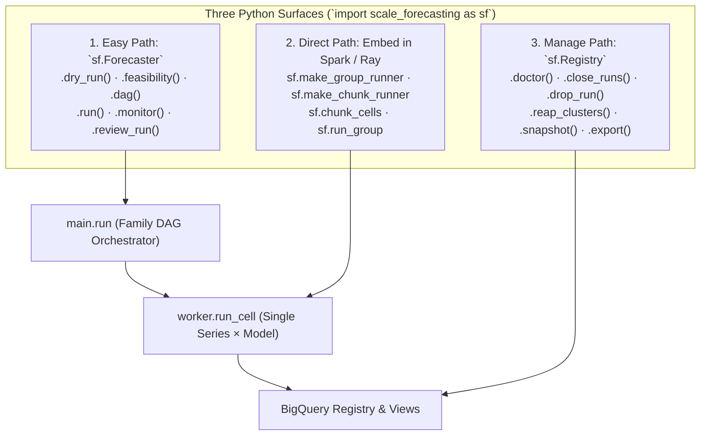

# Using the SDK

There are two ways to *run* `scale_forecasting` from Python, and they share one engine underneath:

1. **The easy path** — the `Forecaster` facade. Point it at a config, call `run()`. It wraps the
   exact same orchestration the CLI and Composer run, so an SDK run is byte-for-byte a CLI run.
2. **The direct path** — drive Spark or Ray yourself and call the model machinery directly, bypassing
   the SDK entirely while reusing the *same* per-cell code. This is for when you already have a
   `SparkSession` or a Ray cluster and want to embed forecasting into your own job.

Both paths run the identical unit of work (`run_cell`), so results are the same whichever door you
come in. A third class, `Registry`, doesn't run anything — it manages what runs leave behind.
Everything below imports from the top-level package:

```python
import scale_forecasting as sf
```

`import scale_forecasting` is near-instant — the heavy model modules (statsmodels, xgboost, …) load
lazily, only when you first touch a name that runs models (`Forecaster`, `run`, `run_cell`, …).
Touching `RunConfig`/`Settings` alone pays no model-import cost.



---

## The easy path: `Forecaster`

```python
import scale_forecasting as sf

# Build from a JSON config file, a dict, or an in-memory RunConfig.
forecaster = sf.Forecaster.from_file("configs/explode_demo.json")

# See what it would do — no GCP calls, no compute launched.
plan = forecaster.dry_run()
print(plan.run_id)  # deterministic config hash — the id the real run lands under
print(plan.fanout)  # series × models = cells (folds happen inside a cell)
print(plan.workload)  # the same counts plus the fit-cost half, when it can be known
print(plan.python_models)  # models routed to Python / AutoML runtimes (spark / ray / vertex / gce / gke / vertex_automl)
print(plan.bq_models)  # models routed to BigQuery-native

# Run it. Python / AutoML families and BigQuery-native run in parallel under one run_id.
result = forecaster.run()
print(result.run_id, result.dataset_ref)
print(result.views)  # the five registry views — query any of them by run_id
```

`Forecaster` construction:

| Constructor | Source |
|-------------|--------|
| `sf.Forecaster(cfg)` | an in-memory `sf.RunConfig` |
| `sf.Forecaster.from_file(path)` | a JSON config file (raises `sf.ConfigError` on a bad file) |
| `sf.Forecaster.from_dict(data)` | an already-parsed dict (raises `sf.ConfigError` on a bad schema) |
| `sf.Forecaster.from_run_id(run_id)` | the config a past run landed under, read back out of its registry header |
| `sf.Forecaster.profile_data(source, *, horizon=14, ...)` | run a Step 0 7-dimension Data Profile & Readiness scan on a DataFrame or BigQuery table and return a human-readable `pd.DataFrame` |
| `sf.Forecaster.build_config(source, *, tier="wide_field", where="auto", ...)` | inspect a DataFrame or BigQuery table and return a glass-box `ConfigBlueprint` (`blueprint.config`, `blueprint.profile_df()`, `blueprint.rationale_df`, `blueprint.duration_estimate`) |
| `sf.Forecaster.auto(source, *, tier="wide_field", autofocus=True, ...)` | compile and execute a single pass or multi-branch `autofocus=True` tournament with cell borrowing, Champion Ratchet, and 7-Question Practitioner Assessment (see [Auto-forecaster & `autofocus`](./auto_forecaster.md)) |

`from_run_id` is for the case where you inherited a broken run and have its id but not its config
file — most often to repair it. It refuses rather than guessing: if the registry has no stored
config for that id, if the stored config no longer validates against this version of the package, or
if the stored config's own digest is not the id you asked for, you get a `sf.ConfigError` naming the
id instead of a `Forecaster` that would plan a repair you did not mean. Note what it does *not*
change: `retry()` still takes no `run_id`. A repair is planned from a config, and an id is a way to
obtain that config, not a second way to plan.

Useful methods and properties:

- `.run_id` — the deterministic run_id for this config (pure hash; no GCP call).
- `.dry_run() -> DryRunResult` — validate + report the planned fan-out and runtime split, offline.
  Carries both `.fanout` (the four counts, kept for compatibility) and `.workload`, which adds the
  cost half: `n_fits`, `full_fit_equivalents`, `train_rows_total`, `fold_histogram`, `n_unscored`.
  Those five are `None`/`{}` here on purpose — how many folds a series achieves depends on how long
  that series is, and `dry_run` does not read the data. Call `sf.estimate_workload(cfg,
  obs_counts=[…])` with measured lengths to fill them in, or use `.feasibility()` below to have them
  measured for you.
- `.feasibility() -> list[str]` — the SDK face of `--dry-run --feasibility`: reads the source
  panel's series lengths from BigQuery and returns the report lines (cost multiplier, fold-coverage
  histogram, suggested `min_train`). The one planning call that touches GCP; if it can't reach the
  panel it returns a single line saying so rather than raising.
- `.dag() -> tuple[DagNode, ...]` — the planned execution DAG, offline: one node per model family
  plus the ensemble, each with its deterministic `job_key`, resolved runtime/hardware, and upstream
  deps (see [Plan the DAG and trace the jobs](#plan-the-dag-and-trace-the-jobs)).
- `.variant_matrix() -> pd.DataFrame` — the resolved model/variant taxonomy matrix, offline: one row
  per expanded `<base_model>@<tag>` entry with `base_model`, `variant_tag`, `family`,
  `scope_capability`, `training_mode`, `cov_profile`, `is_univariate`, `covariates_used`, and
  `model_spec_hash`.
- `.run(*, spark=None) -> RunResult` — execute; pass a `SparkSession` (incl. a Spark Connect
  `DataprocSparkSession`) to run the Spark models in-process instead of as a remote batch.
- `.jobs(run_id=None) -> list[JobTrace]` — the per-family cross-system trace of a run (from
  `v_run_jobs`): where each family actually ran and its platform job id (see below). `[]` if the run
  has no jobs yet.
- `.review() -> RunResult` — a pointer to where a *past* run's results live, computed offline from
  the deterministic run_id. `dataset_ref` is `None` if the GCP identity can't be resolved.

### Threading an explicit GCP identity

By default the run resolves its project/dataset from the `SF_*` environment variables. To pass an
explicit identity instead (e.g. from Terraform outputs), inject `Settings`:

```python
settings = sf.Settings.from_terraform_outputs(tf_outputs)  # or sf.Settings.resolve()
forecaster = sf.Forecaster.from_file("configs/explode_demo.json", settings=settings)
result = forecaster.run()
```

### Plan the DAG and trace the jobs

A run is a DAG of **one job per model family** (`statistical` / `ml` / `deep_learning` / `automl` / `native`), each on
its resolved runtime, plus a downstream ensemble node. Two methods expose that DAG — one offline
(what *will* run) and one live (what *did*), lined up by the same deterministic `job_key`:

```python
forecaster = sf.Forecaster.from_file("configs/all_families_10k.json")

# Offline — the planned DAG, no GCP. One DagNode per family + the ensemble.
for node in forecaster.dag():
    print(node.job_key, node.family, node.runtime, node.hardware, "→ deps:", node.depends_on)

# Live — after (or during) a run, the per-family cross-system trace from v_run_jobs.
for job in forecaster.jobs():  # defaults to this config's run_id
    print(job.family, job.runtime, job.status, job.system_job_id, job.runtime_seconds)
```

- `dag()` returns `DagNode`s (`job_key`, `family`, `runtime`, `models`, `hardware`, `gpu_type`,
  `spark_mode`, `depends_on`) — pure and offline, so you get every job's identity *before* the run.
- `jobs()` returns `JobTrace`s (`family`, `job_key`, `system_job_id`, `runtime`, `status`,
  `attempt`, `hardware`, `gpu_type`, `spark_mode`, `runtime_seconds`), and `jobs_df()` formats the
  same trace directly as a pandas `DataFrame`. `system_job_id` is the platform's own id (a Dataproc
  batch/job id, a Ray `submission_id`, or a BigQuery job id), so you can jump straight to that
  platform's console. Because it reads by `run_id`, it's a reattach path from a fresh process.

### Reviewing, explaining, and plotting results

After a run finishes, `Forecaster` provides zero-SQL pandas DataFrame builders and publication-grade
`matplotlib` visualizers directly from the BigQuery registry:

| Method | Returns | Purpose |
|--------|---------|---------|
| `forecaster.variant_matrix()` | `pd.DataFrame` | Offline resolved `<base_model>@<tag>` taxonomy matrix (`scope_capability`, `training_mode`, `cov_profile`, `covariates_used`, `model_spec_hash`) |
| `forecaster.leaderboard()` | `pd.DataFrame` | Ranked model accuracy from `v_model_leaderboard` or `v_model_leaderboard_comparable` (including `training_mode`, `cov_profile`, `borrowed_from_run_id`, `n_borrowed`) |
| `forecaster.jobs_df()` | `pd.DataFrame` | Per-family execution telemetry (`runtime_seconds`, `status`, `system_job_id`) |
| `forecaster.cohorts_df()` | `pd.DataFrame` | Backtest cohort health (`full_folds`, `partial_folds`, `zero_folds`), `refit_mode`, and staleness gap |
| `forecaster.calibration()` | `dict[str, pd.DataFrame]` | Conformal interval coverage & Winkler Score by horizon (`by_horizon`) and point-forecast arm winner counts (`arm_summary`) |
| `forecaster.calibration_df(by=...)` | `pd.DataFrame` | Single-DataFrame accessor for calibration (`by="horizon"` or `by="arms"`) |
| `forecaster.plot_calibration()` | `matplotlib.figure.Figure` | 2-panel visualization of empirical vs nominal coverage + Winkler Score by step and point-arm winners |
| `forecaster.ensemble_weights_df()` | `pd.DataFrame` | Base-learner blending weights across strategies (`ensemble_mean`, `ensemble_trimmed_mean`, `ensemble_inv_var`, `ensemble_nnls`, `ensemble_ridge`, `ensemble_xgb`) |
| `forecaster.plot_ensemble_weights()` | `matplotlib.figure.Figure` | Horizontal stacked bar chart of base-learner contribution shares per ensemble strategy |
| `forecaster.explain_forecast(ts_id, model)` | `pd.DataFrame` | Decomposes a series forecast into seasonal naive baseline, trend/model residual, and covariate alignment |
| `forecaster.plot_forecast_explanation(ts_id, model)` | `matplotlib.figure.Figure` | Multi-panel decomposition plot (history + fan chart, baseline vs residual split, and future exogenous drivers) |
| `forecaster.attributions_df(ts_id=..., model=...)` | `pd.DataFrame` | Returns **Tier 1 (`fit_diagnostics.feature_attributions`)** and **Tier 2 (`forecast_predictions.explanations`)** feature attributions across `automl` (`vertex_l2l`, `vertex_tide`, `vertex_tft`, `vertex_seq2seq`), `ml` (`xgboost`, `lightgbm`, `catboost`, `random_forest`, `regression_lags`), and `native` (`arima_plus` / `arima_plus@xreg` via `ML.EXPLAIN_FORECAST`) models |
| `forecaster.plot_attributions(ts_id, model)` | `matplotlib.figure.Figure` | 2-panel visualization of Tier 1 overall feature importance and Tier 2 per-horizon-step local attribution over `forecast_date` |
| `forecaster.detect_anomalies_df(run_id=..., model_name=...)` | `pd.DataFrame` | Universal time-series anomaly detection across **all 37 models, 9 ensembles, and past runs** (`ML.DETECT_ANOMALIES` for `arima_plus`, `AI.DETECT_ANOMALIES` for `timesfm`, stored `backtest_oof` conformal intervals via `compute_anomalies` for any `statistical` / `ml` / `deep_learning` / `automl` / `ensemble_*` model or `model_name="all"`, forward `actuals_df` scoring, or model-free `engine="stl"`) |
| `forecaster.detect_change_points_df(run_id=..., model_name=...)` | `pd.DataFrame` | Structural regime break and level-shift detection across raw series (`ML.DETECT_CHANGE_POINTS` with gap-edge artifact filtering) or **any model's / ensemble's backtest residuals** (`model_name="<model>"` or `"all"` via `compute_change_points`) on current or past runs |
| `forecaster.plot_series(ts_id, models=[...])` | `matplotlib.figure.Figure` | Overlay historical actuals, prediction intervals, and multi-model forecast trajectories |
| `forecaster.fva_df()` / `plot_fva()` | `pd.DataFrame` / `Figure` | Forecast Value Added (FVA) waterfall (`fva_vs_baseline_pct`, `covariate_fva_pct` vs. same-scope `@univariate` sibling, `pooling_fva_pct` vs. same-cov `@local_*` sibling) with Harvey–Leybourne–Newbold (1997) modified Diebold–Mariano & Wilcoxon $p$-values |
| `forecaster.horizon_decay_df()` / `plot_horizon_decay()` | `pd.DataFrame` / `Figure` | Step-by-step error decay ($h = 1 \dots H$) and crossover horizon $h^*$ vs. baseline |
| `forecaster.bias_df()` | `pd.DataFrame` | Directional percentage bias, Trigg Tracking Signal ($\text{TS}$), and chronic over/under-forecasting streaks |
| `forecaster.rollup_time(freq="W")` | `pd.DataFrame` | Autocorrelation-aware temporal or $L$-day lead-time aggregation of point and interval forecasts |
| `forecaster.inventory_policy_df(...)` / `plot_inventory_policy(...)` | `pd.DataFrame` / `Axes` | Translates calibrated forecasts, empirical AR(1) residual autocorrelation, and supplier lead-time variability into continuous $(s, S)$ and periodic $(R, S)$ **Reorder Points (`ROP`)**, **Safety Stock (`SS`)**, **Order-Up-To Levels ($S$)**, **Recommended Order Quantities ($Q$)**, and **Expected Holding vs. Stockout Cost** tables |
| `forecaster.simulate_scenarios(scenarios={...})` | `pd.DataFrame` | Counterfactual future covariate shocks (promo/price elasticity) with delta units and revenue impact |
| `forecaster.score_realized(actuals_df)` | `pd.DataFrame` | Joins published predictions against newly arrived actuals and flags live accuracy drift (`drift_flagged`) |
| `forecaster.revision_stability_df([run_1, ...])` | `pd.DataFrame` | Cross-run forecast revision stability (`mar`, `revision_cov`, `whipsaw_flagged`) across overlapping target dates |
| `forecaster.exceptions_df()` | `pd.DataFrame` | Ranked Top-$N$ operational exception triage queue across 5 failure modes (`worse_than_naive`, `chronic_bias`, `realized_drift`, `whipsaw_jump`, `capacity_ceiling_hit`) |
| `forecaster.autofocus_ledger_df()` | `pd.DataFrame` | Pass-by-pass and branch-by-branch tournament ledger for `Forecaster.auto(..., autofocus=True)` runs (`pass_id`, `parent_pass_ids`, `champion_model`, `champion_score`, `fva_vs_univariate_pct`, `fva_vs_foundation_pct`, `covariate_lift_pct`, `reconciliation_lift_pct`, `champion_is_univariate`, `beaten_challengers`, `is_session_champion`) |
| `forecaster.autofocus_diff_df()` | `pd.DataFrame` | Parameter-by-parameter config diffs across `autofocus` branches (`branch_hypothesis`, `action`, `parameter`, `old_value`, `new_value`, `rationale`) |
| `forecaster.baseline_value_df()` | `pd.DataFrame` | Multi-baseline value ladder comparing the session champion against every configured baseline (`naive_seasonal`, `theta`, `arima_plus@univariate`, `chronos_bolt` / `timesfm_torch@v2.5_univariate` / `timesfm@univariate`) plus beaten complex challengers when a univariate model wins |
| `forecaster.compare_models(model_a, model_b)` | `pd.DataFrame` | Head-to-head comparison of any two models (or the session champion against all models) with FVA %, series win rate %, and Diebold–Mariano $p$-values |
| `forecaster.profile_df()` | `pd.DataFrame` | Step 0 7-dimension Data Profile & Readiness table (`scale_and_shape`, `demand_regime`, `seasonality_and_scaling`, `breaks_and_outliers`, `hygiene_and_calendar`, `covariates`, `hierarchy_topology`) |
| `forecaster.practitioner_assessment_df()` / `forecaster.assess()` | `pd.DataFrame` / `str` | Answers the 7 recurring practitioner trust questions (`model_vs_baseline`, `ensemble_vs_single`, `covariates_vs_overfitting`, `global_vs_local`, `hierarchy_reconciliation`, `horizon_stability`, `forecast_trust`) with evidence and verdicts |
| `forecaster.hierarchy_value_df()` | `pd.DataFrame` | Per-level hierarchy reconciliation audit (`Root`, `Intermediate`, `Leaf`) with base vs. reconciled accuracy and reconciliation lift |
| `forecaster.explain_auto_decisions_df()` | `pd.DataFrame` | Unified end-to-end audit table combining Pass 1 compilation rationales (`[PINNED]` user constraints + tier rules) and all subsequent `autofocus` changes |
| `forecaster.preview_next_loop()` / `forecaster.step()` | `LoopContinuation` / `Forecaster` | Preview proposed next-pass mutations and advance one interactive step when running with `step_by_step=True` |
| `forecaster.export_report("report.html")` | `pathlib.Path` | Exports a self-contained, single-file interactive HTML (and optional `.json`) executive report |

Every `Forecaster` visual and tabular helper delegates to a pure, offline function exported at the
top level of `scale_forecasting` (`build_variant_matrix_frame`, `explain_forecast_frame`, `plot_forecast_explanation`,
`build_attributions_frame`, `plot_attributions`, `compute_anomalies`, `compute_change_points`,
`compute_inventory_policy`, `plot_inventory_policy`, `build_calibration_frames`, `plot_calibration`,
`build_ensemble_weights_frame`, `plot_ensemble_weights`, `build_cohorts_frame`), so you can run the
exact same diagnostics on in-memory `CellResult` objects in `00_model_playground.ipynb` before
touching Google Cloud.

---

## The manage path: `Registry`

`Forecaster` produces runs; `Registry` reads and prunes them. It is keyed on the registry your
`SF_*` environment resolves to — no config needed, which is exactly right for "what is in here, and
clean up run X":

```python
from scale_forecasting import Registry

reg = Registry()  # or Forecaster.from_file(...).registry()
runs = reg.runs_df(limit=20)  # zero-SQL DataFrame of recent runs from v_run_summary
print(reg.doctor())  # row counts, runs stuck RUNNING, orphaned artifacts

reg.close_runs()  # PREVIEW — stuck RUNNING headers and what they'd close to
reg.close_runs(yes=True)  # writes header statuses only; deletes nothing

reg.drop_run("abc123")  # PREVIEW — prints the blast radius, deletes nothing
reg.drop_run("abc123", yes=True)  # artifacts, then BQML models, then rows

reg.snapshot("before_migration", expiration_days=7)
reg.export("gs://my-bucket/registry-dump", fmt="JSON")
```

Every method delegates to `registry.ops`, the same code
`python -m scale_forecasting.registry.ops <verb>` runs, so the notebook, the SDK and the CLI can't
diverge. The destructive verbs preview by default and refuse a run that is still in flight (check
with `monitor(probe=True)` first — a `RUNNING` row can also be a dead job — then pass `force=True`).
`close_runs` is the exception, and the one to reach for when a header is *stuck* rather than wrong:
it repairs abandoned `RUNNING` rows from the job rows they already have — checked against the
families the run's config planned, so a family that never submitted is not mistaken for one that
never existed — deletes nothing, and skips any run whose jobs are not yet all terminal. To probe one of those skipped runs you need
`probes.reconcile.probe_run(run_id)` rather than `monitor(probe=True)` — `monitor` lives on
`Forecaster` and wants a config, and a stuck run is usually one you only have an id for. There is deliberately no wipe method: a full teardown is `bq rm -r -f <dataset>`. Full verb
reference: [running_and_reviewing.md §6](./running_and_reviewing.md#6-managing-the-registry).

---

## The direct path: drive Spark or Ray yourself

When you already have your own Spark or Ray job, you can call the model machinery directly and skip
the SDK. The stable surface is:

| Name | What it is |
|------|-----------|
| `run_cell(series, model, cfg, params=None)` | the unit of work — fit + predict one series×model into a `CellResult`; never raises (a failure comes back as `status="error"`) |
| `run_group(pdf, cfg, models=None, params_by_model=None)` | pure: run every cell in one pandas frame; returns `(list[CellResult], status_frame)` |
| `make_group_runner(cfg, settings, ...)` | builds the `applyInPandas` closure: `run_group` + write results, returns the status frame |
| `make_chunk_runner(cfg, settings, ...)` | the Ray twin of `make_group_runner`, for a `@ray.remote` task |
| `chunk_cells(source, cfg, models, n_chunks)` | pure: shard a panel by series into task-sized frames, one per parallel task |

There are two embedding modes:

- **Naive (recommended):** hand `run_group` a chunk of whole series plus `models=[...]`; it loops
  every model per series. This is the simplest shape for your own `applyInPandas` / `@ray.remote`.
- **Explode (advanced):** pre-tag rows with an `_sf_model` column to get cell-level fan-out. A
  tagged frame carries one `(ts_id, model)` cell per group, so `run_group` takes its per-cell
  branch and the `models=` argument is ignored.

`chunk_cells` is the sharder the Ray engine itself uses: it assigns each distinct `ts_id` to one
chunk, so a series' whole history stays together and the panel is split, not replicated. Pass it
the models the *resulting runner* will run, and pass that same list to `make_chunk_runner` — the
frames come back untagged, so the runner's model list is what each chunk actually runs. **Which
series land in which chunk, and whether frames come back tagged, are not part of the contract**
(below one series per chunk it falls back to tagged cell-level frames). What is guaranteed: every
`(series, model)` cell appears exactly once across the chunks, and no series is split across two.

### Spark — your own `applyInPandas`

`make_group_runner` builds the executor function for you: it runs the group and writes the results
(once per bucket, executor-side) so no forecast payload crosses back to the driver.

```python
import scale_forecasting as sf

cfg = sf.load_config("configs/explode_demo.json")
settings = sf.Settings.resolve()

# Read your source into a Spark DataFrame with columns [ts_id, ds, y], add a bucket column, then:
runner = sf.make_group_runner(cfg, settings, models=cfg.models)
status = df.groupBy("bucket").applyInPandas(
    runner, schema="ts_id string, model_type string, status string, fit_seconds double"
)
status.show()  # one row per cell: ts_id, model_type, status, fit_seconds
```

Prefer to control the write yourself? Call the pure core and the writer separately:

```python
from scale_forecasting.registry.cells import write_cells


def my_runner(pdf):
    results, status = sf.run_group(pdf, cfg, models=cfg.models)
    if results:
        write_cells(results, settings=settings)  # append-only + dedupe-on-read; safe per-partition
    return status
```

### Ray — your own `@ray.remote`

```python
import ray
import scale_forecasting as sf

cfg = sf.load_config("configs/ray_cpu_demo.json")
settings = sf.Settings.resolve()

# Shard the panel by series into task-sized chunks, then run one task per chunk.
source_pdf = ...  # a pandas frame with columns [ts_id, ds, y]
chunks = sf.chunk_cells(source_pdf, cfg, cfg.models, n_chunks=64)

# Same model list to both calls: the chunks are untagged, so this is what each task runs.
runner = sf.make_chunk_runner(cfg, settings, cfg.models)
run_remote = ray.remote(runner)
statuses = ray.get([run_remote.remote(chunk) for chunk in chunks])
```

Each task runs the shared `run_group` and appends its results with the same writer the Spark path
uses — appends compose, so per-task writes are safe (results dedupe on read by `run_id`).

---

## Which door should I use?

- **Just run a config** → `Forecaster` (or the CLI, `python -m scale_forecasting.main`).
- **Embed forecasting into a Spark/Ray job you already own** → the direct path.
- **Clean up, inspect or archive what past runs left behind** → `Registry`.

Either way the per-cell logic is identical, so you can prototype with `Forecaster`, then drop down to
the direct path without changing model behavior. See [architecture.md](./architecture.md) for how the
pieces fit and [configuration_reference.md](./configuration_reference.md) for every config knob.
