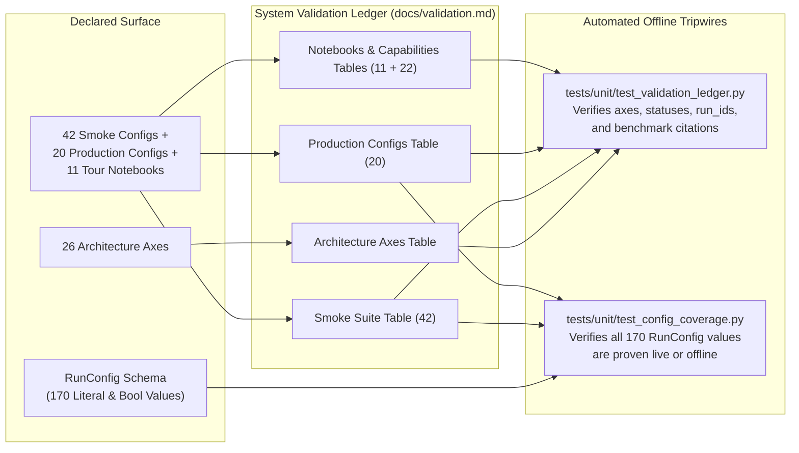

# System validation ledger

**What has been proven on live Google Cloud infrastructure, and on which architecture.**

This ledger is the single source of truth for live system validation across Dataproc Serverless, Dataproc Standard Clusters, Vertex AI Ray, Ray on Google Kubernetes Engine (`gke`), Vertex AI `CustomJob`, Vertex AI AutoML & Tabular Workflows (`vertex_automl`), Compute Engine Single-VM (`gce`), Google Kubernetes Engine Indexed Jobs (`gke`), BigQuery ML / AI.FORECAST, and Cloud Composer. Notice that **System Validation** refers to platform, runtime, and operational validation—for statistical forecast evaluation and backtesting, see [Backtesting and Model Selection](backtesting.md).

## How the Validation Tripwires Work

A live validation result is only meaningful relative to the architecture it ran on. Every entry in this ledger declares the **architecture axes** it depends on and the value each axis held when the run was proven:

1. **Staleness Tripwire (`tests/unit/test_validation_ledger.py`)**: When an architectural axis changes, any ledger entry pinned to the previous value becomes mechanically stale. The offline test suite refuses to allow an entry with a superseded axis value, an unrecorded `run_id`, or a missing config row to claim `CURRENT`. Benchmark citations in [Quota, Throughput, and Scale](quota_and_scale.md) are also cross-checked against this ledger.
2. **Config Surface Coverage Tripwire (`tests/unit/test_config_coverage.py`)**: Joins every reachable `Literal` member and `bool` state on `RunConfig` against the `CURRENT` rows in this ledger and the offline unit test suite. Every configuration value must be explicitly accounted for: **176 declared values — 133 proven live, 41 exercised offline, 0 genuine gaps, 2 not work.**

---

## Architecture Axes

Each axis represents a core architectural contract. Changing an axis value in code automatically invalidates any ledger row that depends on the previous value until that configuration is re-proven on live GCP infrastructure.

| Axis | Current value | Set by | Previous value |
|------|---------------|--------|----------------|
| `ray_deps` | `stock-image+uv-runtime-env` | `822ae25` (2026-08-28) | `custom-container-image` |
| `cluster_deps` | `packed-venv-init-action` | `eae3874` | `job-attached-archive` |
| `serverless_deps` | `container-image` | baseline | — |
| `gpu_cluster_image` | `driver-init-action+image-pinned-2.2.85` | `2026-09-12` | `driver-init-action` on floating `2.2-debian12` |
| `cluster_provisioning` | `concurrent-per-hardware` | `e1010be` (2026-09-12) | `sequential-per-hardware` |
| `native_source_pin` | `unpinned-all-sources` | `9af322a` (2026-08-25) | `unpinned-iceberg-only` |
| `python` | `3.11` | `515ecb0` | `mixed-per-surface` |
| `run_id_inputs` | `authored-config-only-v3` | `2026-09-09` | `authored-config-only-v2` |
| `fleet_sizing` | `derived-overlay-three-way-min` | `2026-09-07` | `derived-overlay` |
| `horizon_features` | `computed-at-future-dates` | `cb7d15f` (2026-08-31) | `first-rows-of-history` |
| `ray_pool_shape` | `autoscaling` | `2026-09-03` | `fixed-size` |
| `ray_slot_memory` | `harvest-only` | `efecb4c` (2026-09-04) | `driver-rss-prepass` |
| `dl_gpu_routing` | `resolved-per-family` | `2026-09-05` | `flat-compute.use_gpu` |
| `backtest_scoring` | `holdout-reserved+embargo-aware+auto-refit` | `11401bf`, `fae9cee`, `834ad6a` (2026-09-10) | `holdout-fold-reserved` |
| `gpu_device_probe` | `trainer-root-device` | `2026-09-09` | `parameter-tensor-after-fit` |
| `serverless_gpu_allocator` | `rapids-pool-released` | `2026-09-09` | `rapids-default-pool` |
| `job_status` | `derived-from-cell-tallies` | `bf12e96` (2026-09-10) | `launch-call-returned` |
| `gpu_batch_churn` | `executor-failure-budget+stall-watchdog` | `2026-09-10` | `unbounded-executor-replacement` |
| `gpu_fault_injection` | `probe-mode-default` | `2026-09-10` | `cuda-visible-devices-emptied` |
| `ray_poll_recovery` | `transient-transport+auth` | `2026-09-10` | `auth-expiry-only` |
| `serverless_cancel` | `operation-cancel` | `2026-09-11` | `batch-delete` |
| `ensemble_weighting` | `per-series-calculated+batch-fit-learned` | `2026-09-11` | `gather-order-dependent` |
| `job_wait` | `operator-dialed-24h+leave-cluster-up` | `2ca68f1` + `5f3c48e` (2026-09-14) | `fixed-2h-client-ceiling` |
| `gpu_slot_fraction` | `measured-on-device` | `29c19dc` (2026-09-16) | `head-node-probe-fallback` |

---

## Smoke Suite (`configs/smokes/`)

The 42 smoke configurations live in [`configs/smokes/`](https://github.com/statmike/scale-forecasting/tree/main/configs/smokes); see [Smoke Testing](smoke_testing.md) for how to execute and verify them. The ledger tripwire enforces a strict 1-to-1 mapping between `configs/smokes/*.json` and the rows below.

| # | Config | Proves | Status | Date | run_id | Axes at proof |
|---|--------|--------|--------|------|--------|---------------|
| 01 | `01_serverless_cpu.json` | Spark on Dataproc Serverless CPU (`statistical` + `ml` families, 100 series). | CURRENT | 2026-10-12 | `smoke-01-serverless-cpu-7a3d4234e0e1` (attempt 10; re-proven for the v1.0.0 hardening round: `bigquery_client` factory on-cluster, `DataConfig` identifier guard, and per-job `provision_seconds` / `execute_seconds`) | `serverless_deps=container-image`, `python=3.11`, `fleet_sizing=derived-overlay-three-way-min`, `run_id_inputs=authored-config-only-v3`, `horizon_features=computed-at-future-dates` |
| 02 | `02_bq_native.json` | BigQuery-native models (`arima_plus` via BQML and `timesfm` via `AI.FORECAST`). | CURRENT | 2026-10-12 | `smoke-02-bq-native-e354a8652712` (attempt 4; re-proven for the v1.0.0 hardening round: `bigquery_engine` through the `bigquery_client` factory, `--probe` → `TRUST_REGISTRY` 200/200) | `native_source_pin=unpinned-all-sources`, `python=3.11`, `run_id_inputs=authored-config-only-v3` |
| 03 | `03_serverless_gpu.json` | Dataproc Serverless GPU (`deep_learning` family on NVIDIA L4). | CURRENT | 2026-09-09 | `smoke-03-serverless-gpu-92763e0f2242` | `serverless_deps=container-image`, `serverless_gpu_allocator=rapids-pool-released`, `gpu_device_probe=trainer-root-device`, `dl_gpu_routing=resolved-per-family`, `python=3.11`, `fleet_sizing=derived-overlay-three-way-min`, `run_id_inputs=authored-config-only-v3`, `horizon_features=computed-at-future-dates` |
| 04 | `04_cluster_cpu.json` | Spark on an ephemeral Dataproc Standard Cluster (CPU), including create-then-delete lifecycle verification. | CURRENT | 2026-09-12 | `smoke-04-cluster-cpu-9196365250ac` | `cluster_deps=packed-venv-init-action`, `python=3.11`, `fleet_sizing=derived-overlay-three-way-min`, `horizon_features=computed-at-future-dates`, `run_id_inputs=authored-config-only-v3` |
| 05 | `05_cluster_reuse.json` | Reusing a standing Dataproc Standard Cluster by name (`sf-smoke-cluster`) without tearing it down after completion. | CURRENT | 2026-09-12 | `smoke-05-cluster-reuse-adbe6bd63644` | `cluster_deps=packed-venv-init-action`, `python=3.11`, `fleet_sizing=derived-overlay-three-way-min`, `horizon_features=computed-at-future-dates`, `run_id_inputs=authored-config-only-v3` |
| 06 | `06_cluster_gpu.json` | Ephemeral Dataproc Standard Cluster with NVIDIA T4 GPUs on pinned image `2.2.85-debian12` and GPU driver initialization. | CURRENT | 2026-09-13 | `smoke-06-cluster-gpu-eea70f834c66` | `cluster_deps=packed-venv-init-action`, `gpu_cluster_image=driver-init-action+image-pinned-2.2.85`, `gpu_device_probe=trainer-root-device`, `dl_gpu_routing=resolved-per-family`, `python=3.11`, `fleet_sizing=derived-overlay-three-way-min`, `horizon_features=computed-at-future-dates`, `run_id_inputs=authored-config-only-v3` |
| 07 | `07_ray_cpu.json` | Vertex AI Ray CPU with two model families sharing one cluster and live poll-recovery fault injection (`SF_RAY_POLL_FAULT=transport,auth`). | CURRENT | 2026-09-22 | `smoke-07-ray-cpu-ed27e03a2083` (attempts 2 and 3) | `ray_poll_recovery=transient-transport+auth`, `ray_pool_shape=autoscaling`, `ray_deps=stock-image+uv-runtime-env`, `ray_slot_memory=harvest-only`, `python=3.11`, `fleet_sizing=derived-overlay-three-way-min`, `run_id_inputs=authored-config-only-v3`, `horizon_features=computed-at-future-dates` |
| 08 | `08_ray_gpu.json` | Vertex AI Ray GPU (`neuralprophet` on NVIDIA T4 workers). | CURRENT | 2026-09-09 | `smoke-08-ray-gpu-497c57c3ad2c` | `ray_pool_shape=autoscaling`, `ray_deps=stock-image+uv-runtime-env`, `ray_slot_memory=harvest-only`, `gpu_device_probe=trainer-root-device`, `dl_gpu_routing=resolved-per-family`, `python=3.11`, `fleet_sizing=derived-overlay-three-way-min`, `run_id_inputs=authored-config-only-v3`, `horizon_features=computed-at-future-dates` |
| 09 | `09_shared_ray.json` | Multiple families (`statistical`, `ml`, `deep_learning`) sharing one Vertex AI Ray cluster with dedicated CPU and GPU worker pools. | CURRENT | 2026-09-12 | `smoke-09-shared-ray-859750fc97a5` | `ray_pool_shape=autoscaling`, `ray_deps=stock-image+uv-runtime-env`, `ray_slot_memory=harvest-only`, `gpu_device_probe=trainer-root-device`, `dl_gpu_routing=resolved-per-family`, `python=3.11`, `fleet_sizing=derived-overlay-three-way-min`, `run_id_inputs=authored-config-only-v3`, `horizon_features=computed-at-future-dates` |
| 10 | `10_mixed_runtimes.json` | Concurrent execution across Dataproc Serverless Spark, Vertex AI Ray GPU, and BigQuery ML under a single `run_id`. | CURRENT | 2026-09-12 | `smoke-10-mixed-runtimes-7aef85d2117b` | `ray_pool_shape=autoscaling`, `ray_deps=stock-image+uv-runtime-env`, `ray_slot_memory=harvest-only`, `serverless_deps=container-image`, `native_source_pin=unpinned-all-sources`, `gpu_device_probe=trainer-root-device`, `dl_gpu_routing=resolved-per-family`, `python=3.11`, `fleet_sizing=derived-overlay-three-way-min`, `horizon_features=computed-at-future-dates`, `run_id_inputs=authored-config-only-v3` |
| 11 | `11_ensemble_barrier.json` | Post-hoc ensembling in `barrier` gather mode across multiple families, producing identical blended forecasts to `microbatch` mode across all 2,800 cells. | CURRENT | 2026-09-11 | `smoke-11-ensemble-barrier-834f770ba38b` (attempt 2) | `ensemble_weighting=per-series-calculated+batch-fit-learned`, `backtest_scoring=holdout-reserved+embargo-aware+auto-refit`, `serverless_deps=container-image`, `native_source_pin=unpinned-all-sources`, `python=3.11`, `fleet_sizing=derived-overlay-three-way-min`, `horizon_features=computed-at-future-dates`, `run_id_inputs=authored-config-only-v3` |
| 12 | `12_ensemble_microbatch.json` | Post-hoc ensembling in `microbatch` gather mode, polling and blending member families incrementally as they complete. | CURRENT | 2026-09-11 | `smoke-12-ensemble-microbatch-9bcd1d294437` (attempt 2) | `ensemble_weighting=per-series-calculated+batch-fit-learned`, `backtest_scoring=holdout-reserved+embargo-aware+auto-refit`, `serverless_deps=container-image`, `native_source_pin=unpinned-all-sources`, `python=3.11`, `fleet_sizing=derived-overlay-three-way-min`, `horizon_features=computed-at-future-dates`, `run_id_inputs=authored-config-only-v3` |
| 13 | `13_native_format.json` | Reading directly from a standard BigQuery native table (`source_series_native`) alongside BigLake Iceberg tables. | CURRENT | 2026-09-11 | `smoke-13-native-format-0995c922faab` | `native_source_pin=unpinned-all-sources`, `serverless_deps=container-image`, `python=3.11`, `fleet_sizing=derived-overlay-three-way-min`, `horizon_features=computed-at-future-dates`, `run_id_inputs=authored-config-only-v3` |
| 14 | `14_full_dag.json` | Flagship multi-family run: four model families (`statistical`, `ml`, `deep_learning` on Serverless L4 GPU, `native`) plus ensembling under one `run_id` (11,200 blended rows). | CURRENT | 2026-09-11 | `smoke-14-full-dag-2cef0feb95da` | `ensemble_weighting=per-series-calculated+batch-fit-learned`, `backtest_scoring=holdout-reserved+embargo-aware+auto-refit`, `serverless_deps=container-image`, `serverless_gpu_allocator=rapids-pool-released`, `gpu_device_probe=trainer-root-device`, `dl_gpu_routing=resolved-per-family`, `native_source_pin=unpinned-all-sources`, `python=3.11`, `fleet_sizing=derived-overlay-three-way-min`, `horizon_features=computed-at-future-dates`, `run_id_inputs=authored-config-only-v3` |
| 15 | `15_airflow_multi_engine.json` | Full multi-engine DAG (`statistical`, `ml`, `deep_learning` on Ray T4 GPU, `native`, `ensemble`, `finalize`) emitted by `airflow_emit` and orchestrated end-to-end by Cloud Composer 3 / Airflow. | CURRENT | 2026-09-20 | `smoke-15-airflow-multi-engine-60d76b813135` | `ray_pool_shape=autoscaling`, `ray_deps=stock-image+uv-runtime-env`, `ray_slot_memory=harvest-only`, `serverless_deps=container-image`, `native_source_pin=unpinned-all-sources`, `gpu_device_probe=trainer-root-device`, `dl_gpu_routing=resolved-per-family`, `ensemble_weighting=per-series-calculated+batch-fit-learned`, `backtest_scoring=holdout-reserved+embargo-aware+auto-refit`, `python=3.11`, `fleet_sizing=derived-overlay-three-way-min`, `horizon_features=computed-at-future-dates`, `run_id_inputs=authored-config-only-v3` |
| 16 | `16_cluster_split_hardware.json` | Concurrent provisioning of two ephemeral Dataproc Standard Clusters in one run (`sf-cluster-<run_id>-cpu` on `2.2.87-debian12` and `sf-cluster-<run_id>-gpu` on `2.2.85-debian12`). | CURRENT | 2026-09-13 | `smoke-16-cluster-split-hardware-8a15339afe9b` | `cluster_provisioning=concurrent-per-hardware`, `cluster_deps=packed-venv-init-action`, `gpu_cluster_image=driver-init-action+image-pinned-2.2.85`, `gpu_device_probe=trainer-root-device`, `dl_gpu_routing=resolved-per-family`, `python=3.11`, `fleet_sizing=derived-overlay-three-way-min`, `horizon_features=computed-at-future-dates`, `run_id_inputs=authored-config-only-v3` |
| 17 | `17_gpu_absent_serverless.json` | **Negative GPU contract arm (Serverless L4):** with the GPU hidden at probe time, every cell fails with `CONFIG_REPAIRABLE` naming the service, and the batch terminates cleanly via the executor failure budget. | CURRENT | 2026-09-10 | `smoke-17-gpu-absent-serverless-ea3341fa9fd5` | `gpu_fault_injection=probe-mode-default`, `gpu_batch_churn=executor-failure-budget+stall-watchdog`, `job_status=derived-from-cell-tallies`, `serverless_deps=container-image`, `serverless_gpu_allocator=rapids-pool-released`, `gpu_device_probe=trainer-root-device`, `dl_gpu_routing=resolved-per-family`, `python=3.11`, `fleet_sizing=derived-overlay-three-way-min`, `run_id_inputs=authored-config-only-v3`, `horizon_features=computed-at-future-dates` |
| 18 | `18_gpu_absent_cluster.json` | **Negative GPU contract arm (Dataproc Cluster T4):** with the GPU hidden at probe time, every cell records `CONFIG_REPAIRABLE` and both `run_jobs` and `run_registry` close `FAILED`. | CURRENT | 2026-09-13 | `smoke-18-gpu-absent-cluster-ef1858b8b83d` | `gpu_fault_injection=probe-mode-default`, `job_status=derived-from-cell-tallies`, `cluster_deps=packed-venv-init-action`, `gpu_cluster_image=driver-init-action+image-pinned-2.2.85`, `gpu_device_probe=trainer-root-device`, `dl_gpu_routing=resolved-per-family`, `python=3.11`, `fleet_sizing=derived-overlay-three-way-min`, `run_id_inputs=authored-config-only-v3`, `horizon_features=computed-at-future-dates` |
| 19 | `19_gpu_absent_ray.json` | **Negative GPU contract arm (Vertex AI Ray T4):** with the GPU hidden at probe time, every cell records `CONFIG_REPAIRABLE` without crashing the Ray worker holding the GPU slot. | CURRENT | 2026-09-10 | `smoke-19-gpu-absent-ray-1c033f10707b` | `gpu_fault_injection=probe-mode-default`, `job_status=derived-from-cell-tallies`, `ray_pool_shape=autoscaling`, `ray_deps=stock-image+uv-runtime-env`, `ray_slot_memory=harvest-only`, `gpu_device_probe=trainer-root-device`, `dl_gpu_routing=resolved-per-family`, `python=3.11`, `fleet_sizing=derived-overlay-three-way-min`, `run_id_inputs=authored-config-only-v3`, `horizon_features=computed-at-future-dates` |
| 20 | `20_gpu_intent_cpu_family.json` | **Hardware override arm:** top-level `use_gpu: true` with `deep_learning` overridden to `hardware: "cpu"` provisions a CPU-only Ray pool and completes on CPU. | CURRENT | 2026-09-10 | `smoke-20-gpu-intent-cpu-family-239ba1e33242` | `dl_gpu_routing=resolved-per-family`, `ray_deps=stock-image+uv-runtime-env`, `ray_pool_shape=autoscaling`, `gpu_device_probe=trainer-root-device`, `python=3.11`, `fleet_sizing=derived-overlay-three-way-min`, `run_id_inputs=authored-config-only-v3`, `horizon_features=computed-at-future-dates` |
| 21 | `21_full_catalogue.json` | **Full catalogue sweep:** all 18 registered models and all 6 ensemble strategies (`mean`, `median`, `trimmed_mean`, `inverse_metric`, `ridge`, `xgb`) in a single run across 50 series, scoring all 15 metrics with zero NULLs (33,600 forecasts, 50,400 OOF rows). | CURRENT | 2026-09-23 | `smoke-21-full-catalogue-98e3cb319f96` | `ensemble_weighting=per-series-calculated+batch-fit-learned`, `backtest_scoring=holdout-reserved+embargo-aware+auto-refit`, `serverless_deps=container-image`, `native_source_pin=unpinned-all-sources`, `python=3.11`, `fleet_sizing=derived-overlay-three-way-min`, `horizon_features=computed-at-future-dates`, `run_id_inputs=authored-config-only-v3` |
| 22 | `22_backtest_sliding_overlap.json` | **Backtest semantics (1/4):** `sliding` refit scheme, `overlap` short-series policy (compressing fold step from 28 to 26 to achieve 6 folds with `backtest_status=reduced`), `control_arm: true` (`yhat_stale` populated), and `decision_metric="rmse"`. | CURRENT | 2026-09-23 | `smoke-22-backtest-sliding-overlap-eca75eb54835` | `backtest_scoring=holdout-reserved+embargo-aware+auto-refit`, `serverless_deps=container-image`, `python=3.11`, `fleet_sizing=derived-overlay-three-way-min`, `job_status=derived-from-cell-tallies`, `run_id_inputs=authored-config-only-v3` |
| 23 | `23_backtest_frozen_shrink.json` | **Backtest semantics (2/4):** `expanding_frozen` refit scheme, `shrink_train` short-series policy against `min_train_floor=1000`, `staleness_gap` calculation, and `decision_metric="mae"`. | CURRENT | 2026-09-23 | `smoke-23-backtest-frozen-shrink-ce2793df03f2` | `backtest_scoring=holdout-reserved+embargo-aware+auto-refit`, `serverless_deps=container-image`, `python=3.11`, `fleet_sizing=derived-overlay-three-way-min`, `job_status=derived-from-cell-tallies`, `run_id_inputs=authored-config-only-v3` |
| 24 | `24_backtest_stale.json` | **Backtest semantics (3/4):** `expanding_stale` refit scheme (`backtest_refit=extrapolate`), default `adapt` short-series policy (5 of 6 folds achieved with diagnostic note), and `decision_metric="smape"`. | CURRENT | 2026-09-23 | `smoke-24-backtest-stale-1c0d92a16531` | `backtest_scoring=holdout-reserved+embargo-aware+auto-refit`, `serverless_deps=container-image`, `python=3.11`, `fleet_sizing=derived-overlay-three-way-min`, `job_status=derived-from-cell-tallies`, `run_id_inputs=authored-config-only-v3` |
| 25 | `25_backtest_skip.json` | **Backtest semantics (4/4):** `skip` short-series policy (`backtest_status=unscored`, `n_folds_achieved=0` on short series while still producing all 560 horizon forecasts per model) and `decision_metric="maape"`. | CURRENT | 2026-09-23 | `smoke-25-backtest-skip-d28444e0a889` | `backtest_scoring=holdout-reserved+embargo-aware+auto-refit`, `serverless_deps=container-image`, `python=3.11`, `fleet_sizing=derived-overlay-three-way-min`, `job_status=derived-from-cell-tallies`, `run_id_inputs=authored-config-only-v3` |
| 26 | `26_hpo_fleetwide.json` | **Hyperparameter optimization (1/2):** Optuna HPO with `granularity="fleetwide"` — tunes each model on a fleet sample and stamps a single winning `best_params` across all 50 series. | CURRENT | 2026-09-26 | `smoke-26-hpo-fleetwide-3df8ee4169b8` | `backtest_scoring=holdout-reserved+embargo-aware+auto-refit`, `serverless_deps=container-image`, `python=3.11`, `fleet_sizing=derived-overlay-three-way-min`, `job_status=derived-from-cell-tallies`, `run_id_inputs=authored-config-only-v3` |
| 27 | `27_hpo_per_series.json` | **Hyperparameter optimization (2/2):** Optuna HPO with `granularity="per_series"` — runs an independent Optuna study inside each `(ts_id, model)` cell, yielding series-specific `best_params`. | CURRENT | 2026-09-26 | `smoke-27-hpo-per-series-343ed2bdf272` | `backtest_scoring=holdout-reserved+embargo-aware+auto-refit`, `serverless_deps=container-image`, `python=3.11`, `fleet_sizing=derived-overlay-three-way-min`, `job_status=derived-from-cell-tallies`, `run_id_inputs=authored-config-only-v3` |
| 28 | `28_features_off.json` | **Feature engineering baseline:** six feature-consuming models (`regression_lags`, `prophet`, `sarimax`, `xgboost`, `ucm`, `lightgbm`) on 50 series with no `features` block, providing the control baseline for smokes 29–31. | CURRENT | 2026-09-26 | `smoke-28-features-off-f9298e722d7a` | `backtest_scoring=holdout-reserved+embargo-aware+auto-refit`, `serverless_deps=container-image`, `python=3.11`, `fleet_sizing=derived-overlay-three-way-min`, `job_status=derived-from-cell-tallies`, `run_id_inputs=authored-config-only-v3` |
| 29 | `29_features_on.json` | **Feature engineering (1/3):** `fourier`, `level_shift`, and `exog_lags` (`{"is_holiday": [1, 7, 28]}`) alongside `exog: ["is_holiday"]` across all 300 cells. | CURRENT | 2026-09-26 | `smoke-29-features-on-e4ad80d90817` | `backtest_scoring=holdout-reserved+embargo-aware+auto-refit`, `serverless_deps=container-image`, `python=3.11`, `fleet_sizing=derived-overlay-three-way-min`, `job_status=derived-from-cell-tallies`, `run_id_inputs=authored-config-only-v3` |
| 30 | `30_features_boxcox.json` | **Feature engineering (2/3):** `transform: "boxcox"` across 50 series — fits and inverts Box-Cox on the 30 strictly positive series (`ok`) and cleanly flags the 20 non-positive series with `CONFIG_REPAIRABLE` (`error`). | CURRENT | 2026-09-26 | `smoke-30-features-boxcox-96c5368ce4ca` | `backtest_scoring=holdout-reserved+embargo-aware+auto-refit`, `serverless_deps=container-image`, `python=3.11`, `fleet_sizing=derived-overlay-three-way-min`, `job_status=derived-from-cell-tallies`, `run_id_inputs=authored-config-only-v3` |
| 31 | `31_features_exog.json` | **Feature engineering (3/3):** `features.exog` (`["is_holiday"]`) projected from the source table, validated, passed to all six models, and extended across the forecast horizon. | CURRENT | 2026-09-26 | `smoke-31-features-exog-8bc96fed0e7a` | `backtest_scoring=holdout-reserved+embargo-aware+auto-refit`, `serverless_deps=container-image`, `python=3.11`, `fleet_sizing=derived-overlay-three-way-min`, `job_status=derived-from-cell-tallies`, `run_id_inputs=authored-config-only-v3` |
| 32 | `32_covariates_three_tier.json` | **Three-tier covariates:** `static_covariates` (`region`, `category`, `store_size`), `future_covariates` (`is_holiday`, `promo_depth`), and lookahead-safe `past_covariates` (`foot_traffic` lagged `[1, 7]`) across 8 statistical & ML models on `source_series_covariates_iceberg` (`decision_metric="rmsse"`). | CURRENT | 2026-09-30 | `smoke-32-covariates-three-tier-77d614b503d1` | `backtest_scoring=holdout-reserved+embargo-aware+auto-refit`, `serverless_deps=container-image`, `python=3.11`, `fleet_sizing=derived-overlay-three-way-min`, `job_status=derived-from-cell-tallies`, `horizon_features=computed-at-future-dates`, `run_id_inputs=authored-config-only-v3` |
| 33 | `33_expanded_stats_ml.json` | **Expanded statistical & ML models:** all 6 new statistical models (`auto_arima`, `auto_ces`, `auto_theta`, `tbats`, `fft`, `kalman`) and 2 new ML models (`random_forest`, `catboost`) across 25 series on `source_series_covariates_native` (`decision_metric="msse"`). | CURRENT | 2026-09-30 | `smoke-33-expanded-stats-ml-dfb077c0de90` | `backtest_scoring=holdout-reserved+embargo-aware+auto-refit`, `serverless_deps=container-image`, `native_source_pin=unpinned-all-sources`, `python=3.11`, `fleet_sizing=derived-overlay-three-way-min`, `job_status=derived-from-cell-tallies`, `horizon_features=computed-at-future-dates`, `run_id_inputs=authored-config-only-v3` |
| 34 | `34_global_hybrid_dl.json` | **Global & hybrid deep learning:** multi-series panel training across all 4 `neuralforecast` global models (`tide`, `tft`, `tsmixer`, `patchtst`) and `neuralprophet` (`training_mode="hybrid"`) with three-tier covariates on Vertex AI Ray (`decision_metric="interval_score"`). | CURRENT | 2026-09-30 | `smoke-34-global-hybrid-dl-83e2e83c34a3` (attempt 3) | `ray_pool_shape=autoscaling`, `ray_deps=stock-image+uv-runtime-env`, `ray_slot_memory=harvest-only`, `dl_gpu_routing=resolved-per-family`, `backtest_scoring=holdout-reserved+embargo-aware+auto-refit`, `python=3.11`, `fleet_sizing=derived-overlay-three-way-min`, `job_status=derived-from-cell-tallies`, `horizon_features=computed-at-future-dates`, `run_id_inputs=authored-config-only-v3` |
| 35 | `35_hierarchy_reconciliation.json` | **Hierarchical forecast reconciliation:** 3-level hierarchy (`__total__` → `region` → `region/category` → 50 bottom series = 57 nodes) reconciled across all 7 FPP3 methods (`bottom_up`, `top_down`, `middle_out`, `ols`, `wls_struct`, `wls_var`, `mint_shrink`) on Dataproc Serverless (`decision_metric="msis"`). | CURRENT | 2026-09-30 | `smoke-35-hierarchy-reconciliation-80a8810304fc` | `backtest_scoring=holdout-reserved+embargo-aware+auto-refit`, `serverless_deps=container-image`, `python=3.11`, `fleet_sizing=derived-overlay-three-way-min`, `job_status=derived-from-cell-tallies`, `horizon_features=computed-at-future-dates`, `run_id_inputs=authored-config-only-v3` |
| 36 | `36_covariate_fallback_multi_runtime.json` | **Multi-runtime covariate fallback + HPO + ensemble:** 3-tier covariates across Spark (`theta`, `sarimax`, `xgboost`, `catboost`), Ray (`tide`, `patchtst` in `global` mode), and BigQuery ML (`arima_plus`, `timesfm`) with `on_unsupported_covariates="fallback"`, `fleetwide` HPO, and `ensemble` (`mean`, `inverse_error`, `nnls`). | CURRENT | 2026-10-01 | `smoke-36-covariate-fallback-multi-runtime-301a6be995a8` (attempt 2) | `ray_pool_shape=autoscaling`, `ray_deps=stock-image+uv-runtime-env`, `ray_slot_memory=harvest-only`, `dl_gpu_routing=resolved-per-family`, `serverless_deps=container-image`, `native_source_pin=unpinned-all-sources`, `ensemble_weighting=per-series-calculated+batch-fit-learned`, `backtest_scoring=holdout-reserved+embargo-aware+auto-refit`, `python=3.11`, `fleet_sizing=derived-overlay-three-way-min`, `job_status=derived-from-cell-tallies`, `horizon_features=computed-at-future-dates`, `run_id_inputs=authored-config-only-v3` |
| 37 | `37_hierarchy_covariates_ensemble.json` | **Hierarchy + covariates + ensemble:** 3-level hierarchical reconciliation (`bottom_up`, `wls_struct`, `mint_shrink`) combined with 3-tier covariates (`static_covariates: ["region", "category"]`), univariate fallback (`theta`), and post-hoc `ensemble` (`mean`, `inverse_error`, `nnls`) scoring finite `mase` and `rmsse` across all bottom and aggregated hierarchy nodes. | CURRENT | 2026-10-01 | `smoke-37-hierarchy-covariates-ensemble-e6be5fed8071` (attempt 2) | `ensemble_weighting=per-series-calculated+batch-fit-learned`, `backtest_scoring=holdout-reserved+embargo-aware+auto-refit`, `serverless_deps=container-image`, `python=3.11`, `fleet_sizing=derived-overlay-three-way-min`, `job_status=derived-from-cell-tallies`, `horizon_features=computed-at-future-dates`, `run_id_inputs=authored-config-only-v3` |
| 38 | `38_vertex_custom_job.json` | **Vertex AI `CustomJob` (`runtime = "vertex"`) — multi-VM worker pools across all families + dedicated per-model NVIDIA L4 GPU VMs:** 2-VM CPU worker pools (`workers=2` on `statistical` for `theta` + `sarimax` and on `ml` for `xgboost` + `lightgbm`) and automatic 3-VM NVIDIA L4 GPU worker pool (`3 x g2-standard-8 + L4`, 1 dedicated GPU VM per model for global/hybrid `tide`, `tsmixer`, `neuralprophet`) with GCS worker-pool barrier synchronization, profile-driven hardware sizing, 3-tier covariates, 3-level hierarchy reconciliation (`bottom_up`, `wls_struct`, `mint_shrink`), and post-hoc `ensemble` (`mean`, `inverse_error`, `nnls`). | CURRENT | 2026-10-12 | `smoke-38-vertex-custom-job-82b620bbd9ba` (attempt 7 on `deep_learning`, 5 on `statistical` / `ml` / `ensemble`; re-proven for the v1.0.0 hardening round — Vertex `CustomJob` `provision_seconds` / `execute_seconds`: `deep_learning` L4 pool 308.7 s / 30.0 s, `ml` 142.5 s / 121.0 s, `statistical` 148.5 s / 302.0 s) | `serverless_deps=container-image`, `dl_gpu_routing=resolved-per-family`, `gpu_device_probe=trainer-root-device`, `ensemble_weighting=per-series-calculated+batch-fit-learned`, `backtest_scoring=holdout-reserved+embargo-aware+auto-refit`, `python=3.11`, `fleet_sizing=derived-overlay-three-way-min`, `job_status=derived-from-cell-tallies`, `horizon_features=computed-at-future-dates`, `run_id_inputs=authored-config-only-v3` |
| 39 | `39_gce_single_vm.json` | **Compute Engine Single-VM (`runtime = "gce"`) — zero-orphan container execution + hardware sizing:** single-VM Container-Optimized OS execution across `statistical` (`theta`, `sarimax`), `ml` (`xgboost`), and `deep_learning` (`tide` in `global` mode) with triple-redundant anti-orphan lifecycle guarantees (`maxRunDuration` + `instanceTerminationAction="DELETE"`, guest `trap cleanup EXIT` GCS status marker + self-delete, and client `finally` teardown leaving `0` orphaned VMs), profile-driven sizing, 3-tier covariates, hierarchy reconciliation (`bottom_up`, `wls_struct`), and post-hoc `ensemble` (`mean`, `inverse_error`, `nnls`). | CURRENT | 2026-10-03 | `smoke-39-gce-single-vm-4aa21163baa6` (attempt 1) | `serverless_deps=container-image`, `dl_gpu_routing=resolved-per-family`, `ensemble_weighting=per-series-calculated+batch-fit-learned`, `backtest_scoring=holdout-reserved+embargo-aware+auto-refit`, `python=3.11`, `fleet_sizing=derived-overlay-three-way-min`, `job_status=derived-from-cell-tallies`, `horizon_features=computed-at-future-dates`, `run_id_inputs=authored-config-only-v3` |
| 40 | `40_gke_indexed_job.json` | **Google Kubernetes Engine (`runtime = "gke"`, `gke_mode = "job"`) — multi-pod Kubernetes Indexed Jobs:** 2-pod distributed series sharding (`workers=2` via `JOB_COMPLETION_INDEX` on `statistical` for `theta` + `sarimax`), single-pod execution on `ml` (`xgboost`) and `deep_learning` (`tide` in `global` mode), in-memory `/dev/shm`, GCS worker-pool barrier synchronization, profile-driven sizing, 3-tier covariates, 3-level hierarchy reconciliation (`bottom_up`, `wls_struct`), and post-hoc `ensemble` (`mean`, `inverse_error`, `nnls`). | CURRENT | 2026-10-06 | `smoke-40-gke-indexed-job-c593ae5b6035` (attempt 2) | `serverless_deps=container-image`, `dl_gpu_routing=resolved-per-family`, `ensemble_weighting=per-series-calculated+batch-fit-learned`, `backtest_scoring=holdout-reserved+embargo-aware+auto-refit`, `python=3.11`, `fleet_sizing=derived-overlay-three-way-min`, `job_status=derived-from-cell-tallies`, `horizon_features=computed-at-future-dates`, `run_id_inputs=authored-config-only-v3` |
| 41 | `41_gke_ray.json` | **Ray on Google Kubernetes Engine (`gke_mode = "ray"` & `ray_mode = "gke"`):** multi-pod ephemeral Ray cluster on GKE (`workers=2`: 1 Ray head pod + 1 Ray worker pod via Kubernetes Headless Service + Deployment on `statistical` for `theta` + `sarimax`), `runtime = "ray"` with `ray_mode = "gke"` on `deep_learning` (`tide` in `global` mode), `runtime = "gke"` with `gke_mode = "job"` on `ml` (`xgboost`), and post-hoc `ensemble` (`mean`, `inverse_error`, `nnls`). | CURRENT | 2026-10-06 | `smoke-41-gke-ray-f9c3cd840845` (attempt 2) | `serverless_deps=container-image`, `dl_gpu_routing=resolved-per-family`, `ensemble_weighting=per-series-calculated+batch-fit-learned`, `backtest_scoring=holdout-reserved+embargo-aware+auto-refit`, `python=3.11`, `fleet_sizing=derived-overlay-three-way-min`, `job_status=derived-from-cell-tallies`, `horizon_features=computed-at-future-dates`, `run_id_inputs=authored-config-only-v3` |
| 42 | `42_vertex_automl_tabular_workflow.json` | **Vertex AI AutoML & Tabular Workflow for Forecasting (`runtime = "vertex_automl"`, `automl_mode = "tabular_workflow"`):** managed global panel forecasting (`vertex_tide`) via Vertex AI Pipelines + `BatchPredictionJob` with Tier 1 & Tier 2 feature attributions (`explanations` JSON), GCS `stage_1_tuning_result_artifact_uri` warm-start & indexing, 3-tier covariates, `ml` (`xgboost` on `vertex` CustomJob with TreeSHAP explanations), `native` (`arima_plus` on BigQuery ML), and post-hoc `ensemble` (`mean`, `inverse_error`, `nnls`). | CURRENT | 2026-10-07 | `smoke-42-vertex-automl-tabular-workflow-d3fea0c6efc5` (attempt 3) | `serverless_deps=container-image`, `native_source_pin=unpinned-all-sources`, `ensemble_weighting=per-series-calculated+batch-fit-learned`, `backtest_scoring=holdout-reserved+embargo-aware+auto-refit`, `python=3.11`, `fleet_sizing=derived-overlay-three-way-min`, `job_status=derived-from-cell-tallies`, `horizon_features=computed-at-future-dates`, `run_id_inputs=authored-config-only-v3` |

---

## Demonstration & Scale Configs (`configs/`)

The 20 production, demonstration, and scale benchmark configurations in [`configs/`](https://github.com/statmike/scale-forecasting/tree/main/configs) back the [Hands-On Workshop](workshop.md) and [Quota, Throughput, and Scale](quota_and_scale.md).

| Config | Proves | Status | Date | run_id | Axes at proof |
|--------|--------|--------|------|--------|---------------|
| `bq_native_demo.json` | BigQuery-native family (`arima_plus`, `timesfm`) with zero cluster provisioning (100 series). | CURRENT | 2026-09-15 | `bq-native-demo-afdc0507e8b5` | `native_source_pin=unpinned-all-sources`, `python=3.11`, `run_id_inputs=authored-config-only-v3` |
| `explode_demo.json` | Spark `explode` fan-out across `statistical` and `ml` families with GCS artifact persistence (10 series). | CURRENT | 2026-09-10 | `explode-demo-088f172ad2f5` | `serverless_deps=container-image`, `python=3.11`, `fleet_sizing=derived-overlay-three-way-min`, `run_id_inputs=authored-config-only-v3`, `horizon_features=computed-at-future-dates` |
| `mixed_demo.json` | Spark and BigQuery-native models under one `run_id`, backtested and ranked on a unified leaderboard (10 series). | CURRENT | 2026-09-10 | `mixed-demo-db2dfb2f675d` | `backtest_scoring=holdout-reserved+embargo-aware+auto-refit`, `serverless_deps=container-image`, `native_source_pin=unpinned-all-sources`, `python=3.11`, `fleet_sizing=derived-overlay-three-way-min`, `run_id_inputs=authored-config-only-v3`, `horizon_features=computed-at-future-dates` |
| `ensemble_demo.json` | Multi-family run with three ensemble strategies (`mean`, `median`, `inverse_metric`) ranked alongside base models (10 series). | CURRENT | 2026-09-12 | `ensemble-demo-b2ff15a4d418` (attempt 2) | `ensemble_weighting=per-series-calculated+batch-fit-learned`, `backtest_scoring=holdout-reserved+embargo-aware+auto-refit`, `serverless_deps=container-image`, `native_source_pin=unpinned-all-sources`, `python=3.11`, `fleet_sizing=derived-overlay-three-way-min`, `run_id_inputs=authored-config-only-v3`, `horizon_features=computed-at-future-dates` |
| `per_family_runtimes_demo.json` | Per-family runtime routing: `deep_learning` on Vertex AI Ray GPU, `statistical` and `ml` on Dataproc Serverless Spark, and `native` on BigQuery (50 series). | CURRENT | 2026-09-10 | `per-family-runtimes-demo-8fe8f224a7e1` | `serverless_deps=container-image`, `ray_deps=stock-image+uv-runtime-env`, `ray_pool_shape=autoscaling`, `native_source_pin=unpinned-all-sources`, `gpu_device_probe=trainer-root-device`, `dl_gpu_routing=resolved-per-family`, `python=3.11`, `fleet_sizing=derived-overlay-three-way-min`, `run_id_inputs=authored-config-only-v3`, `horizon_features=computed-at-future-dates` |
| `per_family_runtimes_cpu_demo.json` | Per-family runtime routing with `deep_learning` on CPU (`hardware: "cpu"`), matching the recommended CPU-first default for short univariate panels (50 series). | NEVER_RUN | — | — | — |
| `ray_cpu_demo.json` | Vertex AI Ray CPU alongside BigQuery-native models with backtesting (6 series). | CURRENT | 2026-09-15 | `ray-cpu-demo-1650659c3c20` | `ray_pool_shape=autoscaling`, `ray_deps=stock-image+uv-runtime-env`, `ray_slot_memory=harvest-only`, `native_source_pin=unpinned-all-sources`, `backtest_scoring=holdout-reserved+embargo-aware+auto-refit`, `python=3.11`, `fleet_sizing=derived-overlay-three-way-min`, `run_id_inputs=authored-config-only-v3`, `horizon_features=computed-at-future-dates` |
| `ray_gpu_demo.json` | Vertex AI Ray GPU (`neuralprophet` on T4) alongside BigQuery-native models, recording `device_verdict=ENGAGED_IDLE` on small univariate series (6 series). | CURRENT | 2026-09-15 | `ray-gpu-demo-fa53d37c8122` | `ray_pool_shape=autoscaling`, `ray_deps=stock-image+uv-runtime-env`, `ray_slot_memory=harvest-only`, `dl_gpu_routing=resolved-per-family`, `gpu_device_probe=trainer-root-device`, `native_source_pin=unpinned-all-sources`, `backtest_scoring=holdout-reserved+embargo-aware+auto-refit`, `python=3.11`, `fleet_sizing=derived-overlay-three-way-min`, `run_id_inputs=authored-config-only-v3`, `horizon_features=computed-at-future-dates` |
| `ray_autoscale_demo.json` | Shipped `ray_autoscale=true` default scaling 1→8 CPU worker nodes on 10,000 series. | CURRENT | 2026-09-10 | `ray-autoscale-demo-9728c900963a` | `ray_pool_shape=autoscaling`, `ray_deps=stock-image+uv-runtime-env`, `python=3.11`, `fleet_sizing=derived-overlay-three-way-min`, `run_id_inputs=authored-config-only-v3`, `horizon_features=computed-at-future-dates`, `ray_slot_memory=harvest-only` |
| `gke_demo.json` | Google Kubernetes Engine Indexed Job (`runtime = "gke"`, `gke_mode = "job"`) alongside BigQuery-native models (`arima_plus`, `timesfm`) with backtesting (6 series). | CURRENT | 2026-10-06 | `gke-demo-4886e298cb99` (attempt 4) | `serverless_deps=container-image`, `native_source_pin=unpinned-all-sources`, `backtest_scoring=holdout-reserved+embargo-aware+auto-refit`, `python=3.11`, `fleet_sizing=derived-overlay-three-way-min`, `run_id_inputs=authored-config-only-v3`, `horizon_features=computed-at-future-dates` |
| `explode_100k.json` | 100,000-series scale benchmark on Dataproc Serverless Spark (`statistical` + `ml`, 400,000 cells). | CURRENT | 2026-09-10 | `explode-100k-ef602ea229b4` | `serverless_deps=container-image`, `python=3.11`, `fleet_sizing=derived-overlay-three-way-min`, `run_id_inputs=authored-config-only-v3`, `horizon_features=computed-at-future-dates` |
| `ray_100k.json` | 100,000-series scale benchmark on Vertex AI Ray CPU (`statistical` + `ml`, 400,000 cells; supersedes earlier baseline harvest run `ray-100k-dcc77a9d1e9b`). | CURRENT | 2026-09-10 | `ray-100k-3fbc82fe3b6d` | `ray_pool_shape=autoscaling`, `ray_deps=stock-image+uv-runtime-env`, `python=3.11`, `fleet_sizing=derived-overlay-three-way-min`, `run_id_inputs=authored-config-only-v3`, `horizon_features=computed-at-future-dates`, `ray_slot_memory=harvest-only`, `ray_poll_recovery=transient-transport+auth` |
| `all_families_10k.json` | Four model families (`statistical`, `ml`, `deep_learning` on 12 T4s, `native`) across 10,000 series on Vertex AI Ray + BigQuery (9.0 NeuralProphet fits/min per T4 at 7 cells/card). | CURRENT | 2026-09-16 | `all-families-10k-a0f6797d69c1` | `gpu_slot_fraction=measured-on-device`, `ray_pool_shape=autoscaling`, `ray_deps=stock-image+uv-runtime-env`, `ray_slot_memory=harvest-only`, `ray_poll_recovery=transient-transport+auth`, `dl_gpu_routing=resolved-per-family`, `gpu_device_probe=trainer-root-device`, `native_source_pin=unpinned-all-sources`, `python=3.11`, `fleet_sizing=derived-overlay-three-way-min`, `run_id_inputs=authored-config-only-v3`, `horizon_features=computed-at-future-dates` |
| `all_families_10k_full.json` | Four families (`statistical`, `ml`, `deep_learning`, `native`) across 10,000 series with 2 backtest folds, holidays, `log1p` transform, and persisted artifacts (70,000 cells, 3,920,000 OOF rows, 50,000 persisted models, 9.1 NeuralProphet fits/min per T4). | CURRENT | 2026-09-16 | `all-families-10k-full-92a6080476d7` | `ray_pool_shape=autoscaling`, `ray_deps=stock-image+uv-runtime-env`, `ray_slot_memory=harvest-only`, `ray_poll_recovery=transient-transport+auth`, `backtest_scoring=holdout-reserved+embargo-aware+auto-refit`, `dl_gpu_routing=resolved-per-family`, `gpu_device_probe=trainer-root-device`, `native_source_pin=unpinned-all-sources`, `python=3.11`, `fleet_sizing=derived-overlay-three-way-min`, `run_id_inputs=authored-config-only-v3`, `horizon_features=computed-at-future-dates` |
| `repair_demo.json` | Repair ladder safety guard: a family interrupted mid-write leaves partial cells (`PARTIAL_WRITE`), which `--retry` classifies and refuses to overwrite (3,000 series). | CURRENT | 2026-09-11 | `repair-demo-55119d4c6f7c` | `serverless_deps=container-image`, `python=3.11`, `fleet_sizing=derived-overlay-three-way-min`, `run_id_inputs=authored-config-only-v3`, `horizon_features=computed-at-future-dates` |
| `repair_retry_demo.json` | Repair ladder surgical retry: a family lost during provisioning (`0` cells landed) is re-submitted under a `<family>_repair` token while a deliberately cancelled sibling family is untouched (300 series). | CURRENT | 2026-09-11 | `repair-retry-demo-59310436a6fd` | `serverless_deps=container-image`, `serverless_cancel=operation-cancel`, `python=3.11`, `fleet_sizing=derived-overlay-three-way-min`, `run_id_inputs=authored-config-only-v3`, `horizon_features=computed-at-future-dates` |
| `neuralprophet_ab_gpu.json` | Accelerator A/B benchmark (Ray GPU arm): 10,000 NeuralProphet series across 12 `n1-standard-8` + T4 nodes on Vertex AI Ray. | CURRENT | 2026-09-10 | `neuralprophet-ab-gpu-e530eea3a755` | `ray_deps=stock-image+uv-runtime-env`, `ray_pool_shape=autoscaling`, `ray_slot_memory=harvest-only`, `dl_gpu_routing=resolved-per-family`, `gpu_device_probe=trainer-root-device`, `backtest_scoring=holdout-reserved+embargo-aware+auto-refit`, `python=3.11`, `fleet_sizing=derived-overlay-three-way-min`, `run_id_inputs=authored-config-only-v3`, `horizon_features=computed-at-future-dates`, `ray_poll_recovery=transient-transport+auth` |
| `neuralprophet_ab_cpu.json` | Accelerator A/B benchmark (Ray CPU arm): identical 10,000 NeuralProphet series across 12 `n1-standard-8` CPU nodes on Vertex AI Ray. | CURRENT | 2026-09-11 | `neuralprophet-ab-cpu-f4bfff3b39e9` | `ray_deps=stock-image+uv-runtime-env`, `ray_pool_shape=autoscaling`, `ray_slot_memory=harvest-only`, `dl_gpu_routing=resolved-per-family`, `gpu_device_probe=trainer-root-device`, `backtest_scoring=holdout-reserved+embargo-aware+auto-refit`, `python=3.11`, `fleet_sizing=derived-overlay-three-way-min`, `run_id_inputs=authored-config-only-v3`, `horizon_features=computed-at-future-dates`, `ray_poll_recovery=transient-transport+auth` |
| `neuralprophet_ab_cluster_gpu.json` | Accelerator A/B benchmark (Dataproc Cluster GPU arm): 3,000 NeuralProphet series across 4 `n1-standard-8` + T4 workers on Dataproc Standard Cluster. | CURRENT | 2026-09-14 | `neuralprophet-ab-cluster-gpu-273d32b553c8` (attempt 2) | `cluster_deps=packed-venv-init-action`, `gpu_cluster_image=driver-init-action+image-pinned-2.2.85`, `gpu_device_probe=trainer-root-device`, `dl_gpu_routing=resolved-per-family`, `backtest_scoring=holdout-reserved+embargo-aware+auto-refit`, `job_status=derived-from-cell-tallies`, `job_wait=operator-dialed-24h+leave-cluster-up`, `python=3.11`, `fleet_sizing=derived-overlay-three-way-min`, `run_id_inputs=authored-config-only-v3`, `horizon_features=computed-at-future-dates` |
| `neuralprophet_ab_cluster_cpu.json` | Accelerator A/B benchmark (Dataproc Cluster CPU arm): identical 3,000 NeuralProphet series across 4 `n1-standard-8` CPU workers on Dataproc Standard Cluster. | CURRENT | 2026-09-15 | `neuralprophet-ab-cluster-cpu-a402414abf5e` (attempt 2) | `cluster_deps=packed-venv-init-action`, `gpu_device_probe=trainer-root-device`, `dl_gpu_routing=resolved-per-family`, `backtest_scoring=holdout-reserved+embargo-aware+auto-refit`, `job_status=derived-from-cell-tallies`, `job_wait=operator-dialed-24h+leave-cluster-up`, `python=3.11`, `fleet_sizing=derived-overlay-three-way-min`, `run_id_inputs=authored-config-only-v3`, `horizon_features=computed-at-future-dates` |

---

## Notebooks (`notebooks/`)

All 12 notebooks in [`notebooks/`](https://github.com/statmike/scale-forecasting/tree/main/notebooks) are verified against their declared architecture axes.

| Notebook | Status | Date | Axes at proof |
|----------|--------|------|---------------|
| `00_model_playground.ipynb` | CURRENT | 2026-10-22 | `python=3.11`, `run_id_inputs=authored-config-only-v3` |
| `01_bigquery_native_sql.ipynb` | CURRENT | 2026-10-14 | `python=3.11`, `native_source_pin=unpinned-all-sources`, `run_id_inputs=authored-config-only-v3` |
| `02_vertex_and_gce_vms.ipynb` | CURRENT | 2026-10-07 | `python=3.11`, `fleet_sizing=derived-overlay-three-way-min`, `run_id_inputs=authored-config-only-v3` |
| `03_spark_serverless_and_connect.ipynb` | CURRENT | 2026-10-04 | `serverless_deps=container-image`, `python=3.11`, `horizon_features=computed-at-future-dates`, `run_id_inputs=authored-config-only-v3` |
| `04_ray_on_vertex_gpu.ipynb` | CURRENT | 2026-10-04 | `ray_deps=stock-image+uv-runtime-env`, `ray_pool_shape=autoscaling`, `python=3.11`, `fleet_sizing=derived-overlay-three-way-min`, `native_source_pin=unpinned-all-sources`, `run_id_inputs=authored-config-only-v3` |
| `05_covariates_and_global_models.ipynb` | CURRENT | 2026-10-20 | `python=3.11`, `fleet_sizing=derived-overlay-three-way-min`, `horizon_features=computed-at-future-dates`, `run_id_inputs=authored-config-only-v3` |
| `06_hierarchical_reconciliation.ipynb` | CURRENT | 2026-10-21 | `python=3.11`, `fleet_sizing=derived-overlay-three-way-min`, `run_id_inputs=authored-config-only-v3` |
| `07_hpo_backtesting_and_ensembles.ipynb` | CURRENT | 2026-10-04 | `python=3.11`, `fleet_sizing=derived-overlay-three-way-min`, `native_source_pin=unpinned-all-sources`, `ensemble_weighting=per-series-calculated+batch-fit-learned`, `run_id_inputs=authored-config-only-v3` |
| `08_multi_engine_master_workflow.ipynb` | CURRENT | 2026-10-22 | `serverless_deps=container-image`, `python=3.11`, `fleet_sizing=derived-overlay-three-way-min`, `native_source_pin=unpinned-all-sources`, `job_status=derived-from-cell-tallies`, `ensemble_weighting=per-series-calculated+batch-fit-learned`, `run_id_inputs=authored-config-only-v3` |
| `09_custom_models_and_metrics.ipynb` | CURRENT | 2026-10-07 | `python=3.11`, `run_id_inputs=authored-config-only-v3` |
| `10_registry_operations_and_scale.ipynb` | CURRENT | 2026-10-07 | `python=3.11`, `job_status=derived-from-cell-tallies`, `run_id_inputs=authored-config-only-v3` |
| `11_auto_forecaster_and_autofocus.ipynb` | CURRENT | 2026-10-19 | `python=3.11`, `run_id_inputs=authored-config-only-v3` |

---

## Operational & Registry Capabilities

| Capability | Status | Evidence |
|------------|--------|----------|
| Workshop Act 1 (100k history, Cloud Shell / VM) | NEVER_RUN | Individual scale configs (`explode_100k.json`, `ray_100k.json`, `all_families_10k.json`, `all_families_10k_full.json`) are all `CURRENT` above, and all CLI/SQL snippets were verified on 2026-09-02; full fresh-deploy interactive session walk remains tracked as `NEVER_RUN`. |
| Workshop Act 2 (pre-rendered notebook tour) | NEVER_RUN | All 11 notebooks are proven `CURRENT` via the headless execution harness; running the workshop pre-renderer script against a brand-new deployment remains `NEVER_RUN`. |
| Workshop Act 3 (live Colab Enterprise tour) | NEVER_RUN | Interactive execution of the 11 notebooks inside a fresh Colab Enterprise `sf-main` runtime session remains `NEVER_RUN`. |
| Run-inspection layer (`review.py`) | CURRENT | Exercised live through `08_multi_engine_master_workflow.ipynb` and `10_registry_operations_and_scale.ipynb` against the deployed BigQuery registry views. |
| Airflow DAG emitter (`airflow_emit`) | CURRENT | Proven live on `smoke-15-airflow-multi-engine-60d76b813135` (2026-09-20): emitted DAG parsed cleanly by Cloud Composer 3 / Airflow 2.10.5 and orchestrated all 7 tasks across Serverless Spark, Vertex AI Ray GPU, and BigQuery to `COMPLETED`. |
| RuntimeProbe read path (P1–P4) | CURRENT | Proven live across Dataproc Serverless, Dataproc Cluster, Vertex AI Ray, and BigQuery (`--probe` returning `TRUST_REGISTRY`, `RUNNING_CONFIRMED`, `STALE_REGISTRY`, and `LOST`). |
| RuntimeProbe cancel (P5) | CURRENT | Proven live (`--cancel --force`) stopping in-flight Dataproc Serverless batches and Vertex AI Ray jobs, recording `job_telemetry.cancel` audit metadata, and preserving sticky `CANCELLED` status on unwind. |
| Custom IAM roles (P6) | CURRENT | Applied live via Terraform (`roles/sfProbeReader` and `roles/sfJobCanceller`) and exercised by live probe and cancel operations. |
| Registry ops (`registry.ops`) | CURRENT | All 6 `@gcp` live integration tests in `tests/integration/test_registry_ops_live.py` pass (`init`, `doctor`, `drop_run` preview & execute, `sweep_orphans`, `snapshot`, `export`); re-run 2026-10-12 after every `ops` BigQuery call moved onto the `bigquery_client` factory, alongside an SDK read-back (`Forecaster.from_run_id` → `leaderboard()` 31 rows, `trace()` 1,040 rows, `monitor()` `COMPLETED`) against `smoke-38-vertex-custom-job-82b620bbd9ba`. |
| Registry ops — `close_runs` (7th verb) | CURRENT | Proven live (`close-runs --yes`) rolling terminal `run_jobs` statuses up to `run_registry` headers and closing header-only abandoned launches as `FAILED`. |
| Shipped baseline profile (`profiling.baseline`) | CURRENT | Baseline cost constants in `src/scale_forecasting/profiling/baseline.py` harvested on 2026-09-03 from live 100,000-series Ray run `ray-100k-dcc77a9d1e9b` via `read_compute_harvest`. |
| Registry ops — job-level settle (`--settle`) | CURRENT | Proven live (`--settle`) reconciling stale `run_jobs` rows from probe verdicts (`STALE_REGISTRY` → `COMPLETED` and `LOST` → `FAILED` / `RUNTIME_LOST`) with full `job_telemetry.settle` audit trails. |
| Run audit principal (P6) | CURRENT | Proven live (`resolve_principal()`) stamping the launching user or service account email onto `run_registry.user_id` (verified on `ray-100k-dcc77a9d1e9b` and `smoke-15-airflow-multi-engine-60d76b813135`). |
| Registry ops — Ray cluster reaper (`reap-clusters`) | CURRENT | Proven live (`reap-clusters --yes` and automatic `sweep_on_launch`) reclaiming orphaned Vertex AI Ray `PersistentResource` clusters while sparing active runs and respecting the 1,800-second grace floor. |
| Repair ladder end to end — a launcher killed mid-provision (`--probe` → `--settle` → `close-runs` → `reap-clusters`) | CURRENT | Proven live against `deadlock-11h-d09a1bf19be9` (2026-09-15): launcher killed during Vertex AI Ray cluster creation walked cleanly via `--probe` (`LOST`), `--settle --force` (`FAILED`/`RUNTIME_LOST`), `close-runs --yes`, and `reap-clusters --yes`. |
| Repair ladder end to end — a launcher killed *after* the submit, row stuck at `AWAITING_CAPACITY` | CURRENT | Proven live against `orphan-11h-28d65b370b23` (2026-09-15): launcher killed after Ray job submission (where the job finished 100/100 cells server-side) walked cleanly via `--probe` (`STALE_REGISTRY`), `--settle --force` (`COMPLETED`), `close-runs --yes`, and `reap-clusters --yes`. |
| Repair ladder end to end — the **Dataproc-cluster** shape of a launcher killed mid-provision | CURRENT | Proven live against `sig4-11h-35c7c0d03d55` (2026-09-19): launcher killed during ephemeral Dataproc cluster creation walked cleanly via deterministic job ID probing (`LOST`), `--settle --force` (`FAILED`/`RUNTIME_LOST`), `close-runs --yes`, and automatic Dataproc idle-TTL cluster deletion. |
| Model variants (`<base_model>@<tag>`), orthogonal `<scope>` $\times$ `<cov_profile>` taxonomy, ablation ladders, and multi-baseline FVA | CURRENT | Proven live on `phase-g5-live-perm-producer-5358a3f6a592` (`gce` + `bigquery`, 18 variants $\times$ 8 series = 144 cells), `phase-g5-live-cross-runtime-c13a4237f8c3` (`spark` $\parallel$ 4-worker `vertex` $\parallel$ `bigquery`, 15 variants $\times$ 8 series = 120 cells, 2026-10-11), and the 4-run full-breadth live verification suite (`live-verify-run1-full-options-1771e7d52481` through `live-verify-run4-borrow-and-diagnostics-c33433cbdb42`, 2026-10-12): verified `<base_model>@univariate`, `ablation_modes`, `ablation_models`, `variant_policy` (`"all"`, `"best_per_base_model"`, `"primary_only"`), HPO parameter-pin preservation (`croston@classic` vs `croston@tsb`, `lightgbm@direct`, `catboost@direct`), and `fva_df()` (`covariate_fva_pct` and `pooling_fva_pct`). |
| Snapshot-verified cross-run cell borrowing (`reuse_prior_runs`) | CURRENT | Proven live on `phase-g5-live-borrow-consumer-18265089bea8` (2026-10-11) and `live-verify-run4-borrow-and-diagnostics-c33433cbdb42` (2026-10-12): verified `--force` bypasses borrowing, and default execution borrowed invariant models across `gce`, `vertex`, and `bigquery` (`statistical` and `native` completed with `runtime_seconds=0.00` via `borrowed:<source_run_id>`), narrowed the `ml` Vertex `CustomJob` exclusively to newly added `catboost@direct` while borrowing 10 prior ML variants from `live-verify-run1-full-options-1771e7d52481`, and blended all 18 borrowed + fresh models across all 7 ensemble strategies. |
| Per-job provisioning vs. execution split (`run_jobs.job_telemetry.$.platform` → `v_run_jobs.provision_seconds` / `execute_seconds`) and the single `bigquery_client` factory on every runtime | CURRENT | Proven live on `smoke-01-serverless-cpu-7a3d4234e0e1` attempt 10 (2026-10-12, Dataproc Serverless: `statistical` provision 66.6 s / execute 316.5 s, `ml` 64.7 s / 317.8 s against launcher walls of 570 s / 527 s, the same split echoed on the header), `smoke-38-vertex-custom-job-82b620bbd9ba` (2026-10-12, Vertex `CustomJob`: the L4 `deep_learning` pool read 308.7 s provisioning against 30.0 s executing — the shape this split exists to make visible — while the `bigquery` ensemble row is NULL as documented), `nb08-master-workflow-1792005806-e997855397a2` (2026-10-14, Dataproc Serverless `statistical` 62.0 s / 846.1 s, Vertex `ml` 720.8 s / 151.0 s, Vertex `deep_learning` 409.6 s / 152.0 s), `track-f-live-gce-telemetry-5a36420d9828` (2026-10-14, GCE Single-VM `statistical` 238.0 s / 95.0 s), and `track-f-live-gce-gke-telemetry-d06d4295170a` (2026-10-14, GKE Indexed Job `ml` 418.0 s / 531.0 s). The first live attempt (attempt 9's predecessor, batch `-ml-a7`) failed on a whole-`[gcp]` probe inside the Serverless worker, which carries only the BigQuery client; the factory now guards on `google.cloud.bigquery` alone (`errors.require_modules`). |
| Full-breadth config-directed output constraints, non-negative hierarchical reconciliation (`mint_nonneg`), and end-to-end decision workbench (`sdk.py`) | CURRENT | Proven live across 4 sequential multi-runtime cloud runs (2026-10-12): (1) `live-verify-run1-full-options-1771e7d52481` (`gce` + `vertex` + `bigquery`, 24 models $\times$ 8 series = 192 cells: `0` bound/ordering/integer violations under `floor=0`, `cap=5000`, `integer_rounding="cumulative_round"`, `target_quantile=0.65`, and `underage_cost=3.0` / `overage_cost=1.0` across all base, `arima_plus`, and 7 `ensemble_*` models); (2) `live-verify-run2-hierarchy-mint-nonneg-4e1872b1cbce` (`spark` Serverless + `vertex` + `bigquery`, 37 models $\times$ 21 hierarchy nodes = 777 cells: exact additive coherence $\le 4.55 \times 10^{-13}$ and `min_yhat = 0.0` under `mint_nonneg`, plus `control_arm=true` `staleness_gap`); (3) `live-verify-run3-gke-ray-gpu-iceberg-38246e716947` (`vertex` 4-GPU T4 pool + Vertex AI `ray` + 2-pod `gke` Indexed Job + `bigquery` on `source_series_covariates_iceberg`, 96 cells: `tide@global_cov_all` vs `tide@local_univariate` vs `neuralprophet@hybrid_univariate` and `variant_policy="primary_only"`); and (4) `live-verify-run4-borrow-and-diagnostics-c33433cbdb42` (verified all 14 `Forecaster` workbench methods live: `from_run_id`, `calibration_df`, `cohorts_df`, global/local `attributions_df`, `explain_forecast`, `fva_df`, `horizon_decay_df`, `bias_report_df`, `rollup_time`, `revision_stability_df`, `exceptions_df`, `simulate_scenarios`, GCS `model_artifact` deserialization, and `export_report`). |
| Open-weight zero-shot foundation model suite (`chronos_bolt`, `chronos2`, `timesfm_torch` across `[models-foundation]`) and `bq_timesfm` alias | CURRENT | Proven live across local `playground.bakeoff` and 11 live cloud runs spanning all 6 cloud execution engines on both CPU (`use_gpu=false`) and NVIDIA T4 GPU (`use_gpu=true`, `gpu_type="T4"`, 2026-10-14): (1) BigQuery `AI.FORECAST` via `"bq_timesfm"` alias (`track-a-live-bq-timesfm-alias-b6ab5d229c1e`, `COMPLETED` in 109.5 s); (2) Compute Engine Single-VM CPU (`track-a-live-gce-cpu-745704d9a6e4`, `564.6 s`) & T4 GPU (`track-a-live-gce-gpu-f73c33518436`, `499.6 s`); (3) Vertex AI `CustomJob` CPU (`track-a-live-vertex-cpu-b8537e961725`, `1183.2 s`) & T4 GPU (`track-a-live-vertex-gpu-059459fb18e0`, `382.9 s`); (4) GKE Indexed Job CPU (`track-a-live-gke-cpu-d4e7b7b5f0cc`, `1028.3 s`) & T4 GPU (`track-a-live-gke-gpu-8bee3451003b`, `952.1 s`); (5) Vertex AI Ray CPU (`track-a-live-ray-cpu-1f289b1f3328`, `1030.1 s`) & T4 GPU (`track-a-live-ray-gpu-c0fce894ae56`, `965.5 s`); and (6) Dataproc Standard Cluster Spark CPU (`track-a-live-spark-cpu-add8c0163b3b`, `808.7 s`) & T4 GPU (`track-a-live-spark-gpu-05f3ce0fb401`, `1046.4 s`). All 10 Python cloud runs produced bit-for-bit identical 6-decimal `mean_wape` scores across CPU and GPU (`ensemble_nnls=0.302764`, `chronos_bolt@tiny=0.302976`, `timesfm_torch=0.304234`, `chronos2@global=0.307375`, `chronos2=0.311239`, `timesfm_torch@v2.5=0.312387`). |
| Operational inventory & replenishment policy translators (`compute_inventory_policy`, `plot_inventory_policy`, `Forecaster.inventory_policy_df`, `BakeOff.inventory_policy_df`, `report.py` Inventory Policy tab, and MCP `include_inventory_policy`) | CURRENT | Proven live against `track-a-live-vertex-gpu-059459fb18e0` in BigQuery (2026-10-14): verified (1) continuous review $(s, S)$ at 95% CSL across `ensemble_nnls` (`s_000000`: `lead_time_demand=1658.47`, `error_autocorr_rho=-0.1786`, `safety_stock=30.12` vs. `naive_iid_safety_stock=35.17`, `reorder_point=1688.60`, `recommended_order_qty=1538.60`, `expected_total_cost=33.95`), `chronos2@global` (`ROP=1677.99`, `SS=41.57`), and `timesfm_torch` (`ROP=1705.81`, `SS=45.00`); (2) periodic review $(R, S)$ at 98% Fill Rate with stochastic lead time ($L=7, \sigma_L=1.5, R=7 \implies P=14$) and `order_multiple=10` (`s_000000`: `protection_demand=3316.95`, `safety_stock=191.86`, `order_up_to_level=3508.81`, `recommended_order_qty=3260.0`, `implied_fill_rate=0.9800`; `s_000001`: `order_up_to_level=52.44 < inventory_position=250.0` $\implies$ `recommended_order_qty=0.0`); (3) Newsvendor critical fractile with per-SKU overrides (`s_000000`: $\alpha^*=0.90$, `order_multiple=25` $\implies$ `recommended_order_qty=1525.0`; `s_000001`: $\alpha^*=0.75$, `on_hand=900` $\implies$ `reorder_triggered=False`); (4) `Forecaster.export_report()` 10-tab interactive HTML/JSON report (`tab-inventory`) and `plot_inventory_policy()`; and (5) live MCP `review_run(include_inventory_policy=True, model_type="ensemble_nnls")` over JSON-RPC 2.0. |
| Cross-version release resilience (`test_cross_version_resilience.py`), `:vX.Y.Z` container dual-tagging (`make image`), launcher $\leftrightarrow$ worker version parity (`verify_version_parity`), and showcase notebook refresh (`01` & `08`) | CURRENT | Proven live on 2026-10-14 (`v1.2.1`): (1) Cloud Build `ca1735d4-5eba-4423-8425-5736cd9eb14a` built and pushed `us-central1-docker.pkg.dev/statmike-scale-forecasting/scale-forecasting/spark-runtime:latest` and `:v1.2.1` + `gs://statmike-scale-forecasting-code/envs/182079b82728766592b2012f0a206544.tar.gz`; (2) `notebooks/01_bigquery_native_sql.ipynb` (`nb01-bq-native-1792004174-754186bc0ccc`, `COMPLETED` in 305.1 s across `arima_plus`, `arima_plus_xreg`, `timesfm` `TimesFM 3.0` multivariate, `timesfm@univariate` `TimesFM 2.5`, Covariate FVA, `ML.EXPLAIN_FORECAST` Two-Tier attributions, anomaly/change-point detection, and $(s, S)$ inventory policy); and (3) `notebooks/08_multi_engine_master_workflow.ipynb` (`nb08-master-workflow-1792005806-e997855397a2`, `COMPLETED` in 1141.9 s across `spark`, `vertex`, and `bigquery` on `spark-runtime:v1.2.1`, stamping `run_registry.job_telemetry.$.version = {"launcher": "1.2.1", "worker": "1.2.1", "match": true}`). |
| Glass-Box Auto-Forecaster (`Forecaster.build_config`, `Forecaster.auto`), Multi-Branch `autofocus` (`autofocus_mode="dag"`), 5 `n_series` Scale Regimes (`micro` to `hyperscale`), 4-Anchor Baseline Value Ladder (`baseline_value_df`), Hierarchical Reconciliation Value (`hierarchy_value_df`), User Scope Pinning, Approximate 7-Runtime Duration Estimator (`predict_run_duration`), 20-Panel Synthetic + 9-Dataset Public Open-Data Benchmark Suites (`benchmarks.py`), Dynamic 6-Runtime Quota Preflight (`quota.py`), and AlphaEvolve on Gemini Enterprise Policy Calibration (`auto_policy.py`) | CURRENT | Proven live and offline across the 5-Wave Live Cloud, Open-Data Benchmark & AlphaEvolve Campaign (2026-10-14 through 2026-10-16): (1) **Wave 1 (`39/39` Live Cloud Runs across All 7 Runtimes + `11,724` Local Benchmark Cells):** Executed `23/23` `n_series` scale-ladder runs (`50` to `100,000` series across `spark`, `ray`, `vertex`, `gce`, `gke`, `bigquery`), `6/6` paired covariate & foundation matrix runs (`chronos2`, `chronos_bolt`, `timesfm_torch`, `tft`, `nhits`, `tide`, `arima_plus_xreg`, `timesfm`), `8/8` hierarchy scale & sparsity ladder runs (`bottom_up`, `top_down`, `ols`, `wls_var`, `mint_shrink`, `mint_nonneg`, `erm`), and `2/2` managed `vertex_automl` runs (`tabular_workflow` and `training_job`); (2) **Wave 2A & Wave 3 AlphaEvolve on Gemini Enterprise (`300` Generations):** Evolved pure-Python decision rules in `src/scale_forecasting/auto_policy.py` via `discoveryengine.googleapis.com/v1alpha` (`alphaEvolveExperiments` with `gemini-3.8-flash` `0.7` + `gemini-4-argon` `0.3` and local `(1+λ)` tournament evolution across `300` generations), lifting composite policy fitness to `71.0734` (`-25.60%` mean 18-DGP regret reduction, `100.0%` rule accuracy across `18/18` panels) with zero runtime LLM dependency; (3) **Wave 2B Multi-Branch `autofocus` Tournament (`60/60` Runs) & Duration Refit (`606` Cloud Jobs / `5.59M` Cells):** Executed `54/54` local 18-DGP $\times$ 3-tier multi-branch tournaments plus `6/6` live cloud tournaments across `bigquery`, `cloud_cpu`, and `cloud_all`, and refitted `src/scale_forecasting/profiling/duration.py` from `606` completed cloud jobs (`5,594,929` evaluated cells); (4) **Wave 3 Unseen Holdout Verification (`8/8` Runs up to `25,000` Series):** Verified out-of-sample on `holdout_00100`, `holdout_02500`, and `holdout_25000` (`100%` monotonic ratchet, `7/7` practitioner assessment questions answered per run), highlighted by `w3-holdout-25000-cloud-cpu` (25,000 series on Serverless Spark: `Pass 1` `w3-holdout-25000-cloud-cpu-8a052f73d5c0` `mase=0.8140` / `wape=0.3737` $\rightarrow$ `Pass 2A` `w3-holdout-25000-cloud-cpu-p2a-93bc2df4e7d5` `mase=0.6803` $\rightarrow$ `Pass 2B` `w3-holdout-25000-cloud-cpu-p2b-b1b58188e3fa` `mase=0.6873` $\rightarrow$ `Pass 3 Synthesis` `w3-holdout-25000-cloud-cpu-p3-synth-bd1d0c224f52` borrowing `200,000` cells and reaching `ensemble_horizon_specialist` `mase=0.4065` / `wape=0.2054`, a **`+50.07%` MASE lift and `+45.04%` WAPE lift** over Pass 1) and `w3-holdout-25000-bigquery-3d8d8bdec11b` (25,000 series on BigQuery ML: `mase=0.5835`, `ensemble_champion` `wape=0.3062`); and (5) **Waves 4 & 5 Dynamic 6-Runtime Quota Preflight, Schema-Backed Column Detection, Vectorized Spark `applyInPandas`, Leave-One-Fold-Out OOF Ensembling, Physical & Sub-Daily Fourier Harmonics (`365.25d` & `24h/12h/168h`), Frequency-Matched Lag Selection, Finite-Sample Conformal Ensemble Intervals & 20-DGP + 9-Dataset Real-World Open-Data Benchmark Suites (2026-10-16):** Expanded synthetic DGP bank to `20` panels (`dgp_19_hourly_diurnal_weekly_load` `+66.90%` FVA; `dgp_20_monthly_regime_drift_damped` `+67.93%` FVA) and verified `9/9` non-negative held-out test MAE lifts over `SNaive` (`+14.92%` mean test lift, `+25.18%` mean OOF FVA) across `m5_walmart` (`+17.15%` local test lift; live BigQuery `r4-m5-walmart-bigquery-p2-ba55284e942a` `wape=0.2573`, `+24.54%` FVA; live Serverless Spark `r4-m5-walmart-cloud-cpu-505cb1271dd3` `wape=0.2669`, `+24.86%` FVA), `favorita_grocery` (`+5.21%` local test lift, `+24.45%` OOF FVA; live BigQuery `r4-favorita-grocery-bigquery-p2-f35b95b9cc3b` `wape=0.0703`, `+35.22%` FVA), `m4_daily` (`+11.21%`), `m4_weekly` (`+46.24%`), `m4_monthly` (`+45.86%`), `monash_tourism_monthly` (`+1.04%`), `monash_hospital` (`+6.64%` test lift, `+23.24%` OOF FVA), `monash_car_parts` (`+0.00%`), and `etth1` (`+0.89%` test lift, `+18.01%` OOF FVA), plus automatic BigQuery batch-load fallback in `write_api.py` when historical partition dates fall outside BigQuery Storage Write API's `[-3650d, +366d]` streaming window. |
| Opt-In AlphaEvolve Runtime Harness (`scale_forecasting.evolve`, `Forecaster.evolve`, `f.evolve()`, `from_runs` / `from_run_ids`, `verify_oof_pool_compatibility`, `python -m scale_forecasting.evolve`, AST Security Sandbox `validate_candidate_ast`, `+1e6` Temporal Lookahead Probe `verify_no_future_leakage`, and 3-Gate Anti-Overfitting Ratchet across `backend="alphaevolve"` on Gemini Enterprise Discovery Engine `v1alpha`, `backend="vertex_gemini"` Backup on Vertex AI Gemini, and `backend="mock"`) | CURRENT | Proven live on Google Cloud (`project_id="statmike-scale-forecasting"`, `region="us-central1"` / `location="global"`, `model_name="gemini-3.8-flash"`, 2026-10-19) and offline across all 4 `# EVOLVE-BLOCK` targets (`"features"`, `"ensemble"`, `"model"`, `"policy"`): (1) **Live Pre-Flight Entitlement Probe (`probe_alphaevolve_access`):** Verified against `https://discoveryengine.googleapis.com/v1alpha/projects/statmike-scale-forecasting/locations/global/alphaEvolveExperiments` (`HTTP 404` on non-Gemini-Enterprise project `statmike-scale-forecasting`, raising the 3-part actionable `ConfigError`); (2) **Primary `backend="alphaevolve"` Protocol (`discoveryengine.googleapis.com/v1alpha` `:acquirePrograms` & `:submitProgramsEvaluations`):** On `target="features"` (`dgp_04_true_vs_decoy_covs`), improved inner CV `WAPE` `0.1019 -> 0.0594` (`fva_pct = +43.67%`, $p_{\text{DM}} < 0.0001$, `worst_decile_fva_pct = +11.49%`) and unseen Lockdown Fold `0.0953 -> 0.0537` (`promoted = True` in `20.55s`); on `target="ensemble"` (`dgp_01_smooth_seasonal`), improved inner CV `WAPE` `0.0503 -> 0.0270` (`fva_pct = +46.37%`, $p_{\text{DM}} < 0.0001$, `worst_decile_fva_pct = +30.68%`) and Lockdown Fold `0.0522 -> 0.0287` (`promoted = True` in `28.96s`); (3) **Live Non-Default Backup `backend="vertex_gemini"` (`aiplatform.googleapis.com`, `gemini-3.8-flash` in `us-central1`):** On `target="features"` (`dgp_04_true_vs_decoy_covs`), improved inner CV `WAPE` `0.1019 -> 0.0585` (`fva_pct = +42.94%`, $p_{\text{DM}} < 0.0001$, `worst_decile_fva_pct = +12.72%`) and Lockdown Fold `0.0953 -> 0.0544` (`promoted = True` in `13.03s`); on `target="ensemble"` (`dgp_01_smooth_seasonal`), improved inner CV `WAPE` `0.0503 -> 0.0223` (`fva_pct = +55.60%`, $p_{\text{DM}} < 0.0001$, `worst_decile_fva_pct = +37.07%`) and Lockdown Fold `0.0522 -> 0.0246` (`promoted = True` in `22.61s`); (4) **Gate 3 Anti-Overfitting Ratchet Guard (`dgp_12_already_optimal_white_noise`):** Candidate that overfit inner CV (`0.0594 -> 0.0161`, `+72.93%` inner FVA) but degraded the unseen Lockdown Fold (`0.0599 -> 0.2500`) was rejected by Gate 3 (`promoted = False` in `6.17s`), ratcheting cleanly back to the `Forecaster.auto()` baseline; and (5) **Live BigQuery Post-Run Single-Run (`f.evolve()`) & Multi-Run Super-Ensembling (`from_run_ids` — Zero Base-Model Refitting across Both `alphaevolve` and `vertex_gemini`):** Verified live against `statmike-scale-forecasting.scale_forecasting` (`10` common series, reigning `#1` model `'holtwinters'`, `predictions_df = 140` conformal-calibrated rows per run): single-run `Forecaster.from_run_id("w1a-spark-srv-n10-e839bf6f74ef").evolve(target="ensemble")` (`models_pooled = 7`: `['ensemble_inverse_error', 'ensemble_mean', 'ensemble_nnls', 'holtwinters', 'lightgbm@univariate', 'naive_seasonal', 'theta']`) achieved `promoted = True` on both `backend="alphaevolve"` (inner CV `0.3268 -> 0.3138`, `fva_pct = +3.97%`, $p_{\text{DM}} = 0.0792$, `worst_decile_fva_pct = -0.0006`, Lockdown Fold `0.3497 -> 0.3445` in `32.98s`) and `backend="vertex_gemini"` (`gemini-3.8-flash`: inner CV `0.3268 -> 0.3134`, `fva_pct = +4.12%`, $p_{\text{DM}} = 0.0676$, `worst_decile_fva_pct = +0.0000`, Lockdown Fold `0.3497 -> 0.3442` in `39.13s`); multi-run super-ensemble pool `Forecaster.evolve(from_run_ids=["w1a-spark-srv-n10-e839bf6f74ef", "w1a-gke-job-n10-75276ed3cc94"], target="ensemble")` (`models_pooled = 10`, deduplicating `['lightgbm@univariate', 'naive_seasonal', 'theta']` and disambiguating `['ensemble_inverse_error@75276ed3', 'ensemble_inverse_error@e839bf6f', 'ensemble_mean@75276ed3', 'ensemble_mean@e839bf6f', 'ensemble_nnls@75276ed3', 'ensemble_nnls@e839bf6f']`) achieved `promoted = True` on both `backend="alphaevolve"` (inner CV `0.3268 -> 0.3138`, `fva_pct = +3.98%`, $p_{\text{DM}} = 0.0790$, `worst_decile_fva_pct = -0.0006`, Lockdown Fold `0.3497 -> 0.3441` in `49.24s`) and `backend="vertex_gemini"` (`gemini-3.8-flash`: inner CV `0.3268 -> 0.3138`, `fva_pct = +3.98%`, $p_{\text{DM}} = 0.0790$, `worst_decile_fva_pct = -0.0006`, Lockdown Fold `0.3497 -> 0.3441` in `49.53s`). |
| Causal & structural econometric guardrails (`@monotone` sign/monotonicity constraints across `regression_lags@monotone`, `ridge_lags@monotone`, `lightgbm@monotone`, `xgboost@monotone`, `catboost@monotone`), moving-holiday lead/lag kernels (`holiday_window`), Double/Debiased ML promotional elasticity & dip attribution (`promo_elasticity_df`, `summarize_promo_elasticity`, `plot_promo_elasticity`), and full-chain gross-margin, hierarchical reconciliation & inventory what-if scenario simulation (`simulate_scenarios(..., unit_cost=..., reconcile=True, include_inventory_impact=True)`, `compare_scenario_margin_curves`, `plot_scenarios`, `report.py` Scenarios & Promo Elasticity tab, and MCP `simulate_scenarios`) | CURRENT | Proven live on Google Cloud (`track-j-live-causal-guardrails-88ed03759f09`, `COMPLETED` in `1380.0s` across GCE Single-VM `statistical` `915.2s`, Vertex AI `CustomJob` `ml` `1253.5s`, and BigQuery `ensemble` `41.4s` on `source_series_covariates_native` with `user_id` `<the launching user email>`, 2026-10-20) and in live-executed notebooks `00_model_playground.ipynb` (Act 8) and `05_covariates_and_global_models.ipynb` (Act 6): (1) **`@monotone` Sign/Monotonicity Constraints (`monotonic_constraints={"price_index": -1, "promo_flag": 1}`) & `holiday_window` (`pre_holiday_days=7`, `post_holiday_days=3`, `kernel="linear"`):** Across `35` base, reconciled (`bottom_up`, `wls_struct`, `mint_nonneg`), and ensemble models $\times$ `21` hierarchy nodes (`735` cells), `regression_lags@monotone_mint_nonneg` ranked `#1` overall (`score=0.284849`, `pooled_wape=0.095632`, `mean_mae=14.0527`, `mean_rmse=18.1835`), outperforming unconstrained `regression_lags_mint_nonneg` (`#4`, `score=0.291652`) and `regression_lags` (`#7`, `score=0.300281`), while `lightgbm@monotone_mint_nonneg` (`#13`, `score=0.305410`, `pooled_wape=0.069513`, `mean_mae=11.5372`) beat unconstrained `lightgbm_mint_nonneg` (`#25`, `score=0.330681`) and `lightgbm` (`#30`, `score=0.350023`); (2) **Double/Debiased ML Promo Elasticity (`f.promo_elasticity_df(run_id="track-j-live-causal-guardrails-88ed03759f09", summary=True)`):** Orthogonalized seasonal/trend confounding (`s_000000`: `mean_causal_promo_lift=15.0970` vs. `mean_naive_ols_lift=32.5478`, `confounding_bias_pct=+115.59%`, `total_net_incremental_units=1600.28`; `s_000002`: `mean_causal_promo_lift=6.2715` vs. `13.3563`, `confounding_bias_pct=+112.97%`, `total_pull_forward_dip=-120.34`, `net_to_gross_lift_ratio=0.8155`; `s_000005`: `confounding_bias_pct=+256.70%`, `total_cannibalization_dip=-1175.74`, `net_to_gross_lift_ratio=-0.0072`); and (3) **Full-Chain Counterfactual Scenario Simulation (`f.simulate_scenarios(..., unit_cost=85.0, reconcile=True, include_inventory_impact=True)` & `compare_scenario_margin_curves`):** Under `price_increase_10pct` (`promo_flag=0.0`, `price_index * 1.10`) at `__total__`, unconstrained `lightgbm` exhibited a perverse positive price response (`delta_units=+301.66`, `+2.12%`, `mean_implied_elasticity=+0.2134`, `delta_reorder_point=+149.39`), whereas `lightgbm@monotone` (`delta_units=-122.36`, `-0.87%`, `mean_implied_elasticity=-0.0854`, `gross_margin_delta=+139478.10`, `delta_reorder_point=-55.52`) and `regression_lags@monotone` (`delta_units=-194.38`, `-1.30%`, `mean_implied_elasticity=-0.1239`, `gross_margin_delta=+146350.77`, `delta_reorder_point=-65.91`) enforced downward-sloping demand (`price_index: -1`), coherent `mint_nonneg` rollups across all 21 hierarchy nodes, and exact inventory $\Delta\text{ROP}$ / $\Delta\text{SS}$ propagation. |
| Multi-temporal (`THieF`) & simultaneous cross-temporal coherent reconciliation across all 3 operational modes (`spatial_only`, `temporal_only`, and joint `cross_temporal` with `spatial_temporal_weight="auto"`, `reconcile_temporal`, `cross_temporal`, `temporal_aggregations`, `cross_temporal_mint`, `temporal_reconcile_df`, and `sample_coherent_paths`), compositional simplex forecasting (`@transform_clr`, `@transform_ilr`, `simplex_sum`, `forecast_simplex_panel`), top-down goal-seek constrained QP allocation with temporal smoothness (`allocate_target`, `smoothness_weight`, `summarize_goal_seek`, `plot_goal_seek`, `GoalSeekInfeasibleError`, `report.py` Goal-Seek tab, and MCP `allocate_forecast_target` / `reconcile_temporal_hierarchy`), `f.assess()` Track J/K reporting, and live `vertex_gemini` evolutionary verification | CURRENT | Proven live on Google Cloud across two end-to-end GCE Single-VM + BigQuery registry runs (`user_id` `<the launching user email>`, 2026-10-21), a live Mode 2 flat-panel temporal + BigQuery ensemble run (`track-k-mode2-temporal-ens-live-cc1c228d5854`), three live `Forecaster.evolve(..., backend="vertex_gemini")` (`gemini-3.8-flash` in `us-central1`) runs, and live-executed notebooks `00_model_playground.ipynb` (Act 10) and `06_hierarchical_reconciliation.ipynb` (Acts 5–6): (1) **3-Mode Simultaneous Cross-Temporal Reconciliation, Coherent Path Simulation & Post-Run Goal-Seek (`track-k-cross-temporal-mint-gce-827eec43125f` & `track-k-mode2-temporal-ens-live-cc1c228d5854`):** `COMPLETED` in `519.9s` (`statistical` GCE `440.0s`, `ml` GCE `373.8s`, `ensemble` BigQuery `54.3s`) on `source_series_covariates_iceberg` (`20` bottom series $\rightarrow$ `37` hierarchy nodes across `region` and `region/category`, `H=28`, `temporal_aggregations=[7, 14, 28]`, `n_folds=2`), persisting `18,648` `forecast_predictions` rows and `37,296` `backtest_oof` rows across `18` model cohorts (`theta`, `holtwinters`, `lightgbm` $\times$ `bottom_up`, `wls_struct`, `mint_shrink`, `cross_temporal_mint` + `ensemble_mean`, `ensemble_inverse_error`, `ensemble_nnls`) with `0` failed cells; `lightgbm_cross_temporal_mint` and `lightgbm_mint_shrink` tied for `#1` on `v_model_leaderboard` (`mean_wape=0.3413`, `mean_mae=20.3412` vs. unreconciled `lightgbm` `mean_wape=0.3674`), all 15 reconciled and ensemble cohorts achieved cross-sectional discrepancy $\le 1.36 \times 10^{-12}$ (vs. $158$–$251$ on unreconciled base models) across both `forecast_predictions` and `backtest_oof`, post-run `Forecaster.from_run_id("track-k-cross-temporal-mint-gce-827eec43125f")` verified all 3 modes (`mode="spatial_only"` with $\alpha=1.0$ and `final_cs_discrepancy=9.09e-13`; `mode="temporal_only"` with $\alpha=0.0$ and `final_temp_discrepancy=3.64e-12`, plus live BigQuery Mode 2 flat-panel ensemble `track-k-mode2-temporal-ens-live-cc1c228d5854` achieving `0.00e+00` temporal discrepancy on `ensemble_median`, `ensemble_mean`, `naive_mean_mint_shrink`, and `naive_seasonal_mint_shrink` with `ensemble_median` / `ensemble_mean` ranking `#1` at `mean_wape=0.5054`; and `mode="cross_temporal"` with `spatial_temporal_weight="auto"` learning $\alpha=0.1790$ from `cs_first_discrepancy=132.15` vs. `temp_first_discrepancy=1764.66` and achieving `final_cs_discrepancy=9.09e-13` and `final_temp_discrepancy=0.00`), `sample_coherent_paths(n_paths=50)` generated `51,800` scenario rows with `max_cs=1.36e-12` and `max_temp=0.00`, and `allocate_target(target_total=65278.9733, locked_nodes=["s_000000"], floor=0.0, prices=25.0, unit_cost=15.0, include_inventory_impact=True)` hit the exact `+15.000000%` grand-total target (`56764.3246 -> 65278.9733`, `delta_units=+8514.6487`, `gross_margin_delta=+85146.49`, `delta_reorder_point=+2128.78`) while holding `s_000000` `LOCKED` (`delta_units=0.000000`) and clamping `s_000016` `AT_FLOOR`; (2) **Compositional Simplex Transforms (`track-k-simplex-compositional-gce-354937e0b724`):** `COMPLETED` in `408.4s` (`statistical` GCE `365.9s`, `ensemble` BigQuery `20.5s`) across `12` series (`H=14`, `simplex_sum=100.0`, `n_folds=2`) with `theta@transform_ilr`, `holtwinters@transform_clr`, `autoets@transform_ilr`, and `ensemble_mean` / `ensemble_inverse_error` / `ensemble_nnls` (`1,008` `forecast_predictions` rows, `2,016` `backtest_oof` rows, `0` failed cells), verifying strict positivity ($0 < \hat{y}_{i, t} < 100.0$) and exact cross-series simplex closure ($\max_t \|\sum_{i=1}^{12} \hat{y}_{i, t} - 100.0\| \le 4.26 \times 10^{-14}$) across every horizon date and backtest fold in BigQuery; and (3) **Live `Forecaster.evolve(..., backend="vertex_gemini")` on Compositional Simplex & Hierarchical/Causal Panels (`gemini-3.8-flash`, `us-central1`):** On the 4-brand compositional simplex panel (`simplex_sum=100.0`, `target="ensemble"`), improved inner CV `WAPE` `0.4207 -> 0.3379` (`fva_pct=+19.68%`) and Lockdown Fold `0.6771 -> 0.6138` (`promoted=True` in `225.78s`, preserving simplex closure `1.42e-14` and `min_share=9.0057`); on the hierarchical causal panel (`levels=[["region"]]`, `target="ensemble"`), improved inner CV `WAPE` `0.0528 -> 0.0131` (`fva_pct=+75.22%`) and Lockdown Fold `0.0487 -> 0.0151` (`promoted=True` in `164.20s`, preserving cross-sectional coherence `0.00e+00`), while `target="features"` (`inner_cv=0.1760` vs. `baseline=0.1491`, `fva_pct=-18.05%`) cleanly triggered the Gate 1/3 anti-overfitting ratchet (`promoted=False` in `110.94s`). |
| Cold-start & NPI analog donor transfer (`features.cold_start_transfer`, `cold_start_min_obs`, `cold_start_method`, `cold_start_transfer_df`, `dgp_11_cold_start_mixed`), online Adaptive Conformal Inference (`output.calibration_method` `"aci"` or `"aci_normalized"`, `aci_gamma`, `aci_df`, `dgp_20_monthly_regime_drift_damped`), joint cross-series & cross-horizon copula trajectory simulation & portfolio VaR/CVaR tail risk (`sample_trajectories`, `tail_risk_df`, `evaluate_trajectory_paths`), multi-SKU portfolio-constrained inventory optimizer (`optimize_inventory_df`), and prescriptive price & promotional calendar optimizer (`optimize_scenario`, `report.py` Risk & Prescriptive Decisioning tab, and MCP `include_aci` / `include_tail_risk` / `optimize_inventory_params` / `optimize_scenario_params`) | CURRENT | Proven live on Google Cloud across `track-l-live-gce-bq-prescriptive-c76b6285e9e8` and `nb08-master-workflow-1792704406-9a68c0de33d3` (`user_id` `<the launching user email>`, 2026-10-22), live `Forecaster.evolve(..., llm_backend="vertex_gemini")` (`gemini-3.8-flash` in `us-central1`), and live-executed notebooks `00_model_playground.ipynb` (Act 8) and `08_multi_engine_master_workflow.ipynb` (Act 5): (1) **Live Multi-Engine GCE Single-VM + BigQuery Prescriptive & Risk Run (`track-l-live-gce-bq-prescriptive-c76b6285e9e8`):** `COMPLETED` across GCE Single-VM `statistical` (`435.7s`, provision `321.0s` / execute `56.0s`), GCE Single-VM `ml` (`447.2s`, provision `348.0s` / execute `28.0s`), BigQuery `native` (`75.8s`), and BigQuery `ensemble` (`21.4s`) on `source_series_covariates_iceberg` (`12` series, `H=14`, `n_folds=2`, `cold_start_transfer=True`, `calibration_method="aci_normalized"`, `aci_gamma=0.05`, `monotonic_constraints={"price_index": -1, "promo_flag": 1}`), persisting `1` `run_registry` row (`status="COMPLETED"`), `4` `run_jobs` rows (`all COMPLETED`), `72` `forecast_metadata` rows (`0` failed cells), `1,008` `forecast_predictions` rows, `2,016` `backtest_oof` rows, and `6` `v_model_leaderboard` rows (`holtwinters` `#1` `mean_wape=0.4059`, `ensemble_inverse_error` `#2` `mean_wape=0.4319`, `arima_plus` `#3` `mean_wape=0.4446`, `ensemble_nnls` `#4` `mean_wape=0.4454`, `lightgbm@monotone` `#5` `mean_wape=0.4794`, `theta` `#6` `mean_wape=0.4827`); (2) **Post-Run Online ACI, Copula Tail Risk, Portfolio Inventory & Prescriptive Scenario Optimization on Live Registry Artifacts:** Verified `f.aci_df()` (`2,016` rows across 34 columns with `rolling_coverage_aci` vs. `rolling_coverage_split` and `drift_detected`), `f.sample_trajectories(n_paths=150, copula_type="auto")` (`151,200` scenario rows), `f.tail_risk_df()` (`72` rows across 27 columns including `var_90`, `cvar_90`, `var_95`, `cvar_95`, `var_99`, `cvar_99`, `crps`, `energy_score`, `variogram_score`, and `risk_verdict`), `f.optimize_inventory_df(max_budget=35000.0, target_portfolio_fill_rate=0.95, uncertainty_source="copula")` (`72` rows across 47 columns with `binding_constraint="budget+fill_rate"`), and `f.optimize_scenario(objective="risk_adjusted_profit", price_col="price_index", promo_col="promo_flag", price_bounds=(-0.10, 0.10), max_promo_days=4, min_cooldown_days=2, unit_cost=55.0, risk_aversion_lambda=0.25)` (`12` SKU summary rows across 25 columns, lifting risk-adjusted profit from `1,040,163.34` to `1,199,127.07`, `+15.28%`, with `cvar_profit=1,160,962.38`); and (3) **Live Multi-Engine Master Workflow (`nb08-master-workflow-1792704406-9a68c0de33d3`):** `COMPLETED` across Dataproc Serverless `spark`, Vertex AI `CustomJob` (`ml` and `deep_learning`), and BigQuery (`native` and `ensemble`) with all Track L post-run prescriptive and risk methods verified end-to-end in `notebooks/08_multi_engine_master_workflow.ipynb` Act 5. |

---

## Known validation gaps

Items tracked as open or intentionally scoped in the validation matrix above:

- **`per_family_runtimes_cpu_demo.json` (`NEVER_RUN`)**: Identical to `per_family_runtimes_demo.json` (`CURRENT`) except that `deep_learning` sets `hardware: "cpu"` (which is already proven live in `smoke-20-gpu-intent-cpu-family-239ba1e33242` and the 10,000-series `neuralprophet-ab-cpu-f4bfff3b39e9` benchmark).
- **End-to-end Workshop Walkthrough (`Workshop Act 1–3`, `NEVER_RUN`)**: Every underlying scale config, SQL query, CLI command, and notebook in the workshop is individually `CURRENT`; only an unassisted start-to-finish walkthrough on a newly created GCP project is left marked `NEVER_RUN`.
- **Ray Smoke Suite Autoscaling Pin**: The four fast Ray smoke configs (`07`–`10`) set `ray_autoscale: false` for deterministic 2-node smoke timing, while the shipped `ray_autoscale: true` default is proven at 10,000-series scale by `ray_autoscale_demo.json`, `all_families_10k.json`, and `ray_100k.json`.
- **GPU Device Utilization Verdict Surface**: `device_audit` records `job_telemetry.device_use.verdict` (`ENGAGED_IDLE` when a GPU is allocated on small univariate series that use negligible VRAM) without failing the job; operators can inspect this verdict in `run_jobs.job_telemetry` and consult [Quota, Throughput, and Scale](quota_and_scale.md) for CPU vs. GPU sizing guidance.
