# Visual system walkthrough — progressive architecture

This visual atlas unpacks **`scale-forecasting`** from the **10,000-foot system map (`Level 0`)** down through **5 enterprise personas** and **8 progressive zoom levels**, using a single **6-color semantic key** that maps every box to source modules, guides, notebooks, and tests.

## Level 0 — The 10,000-foot system map

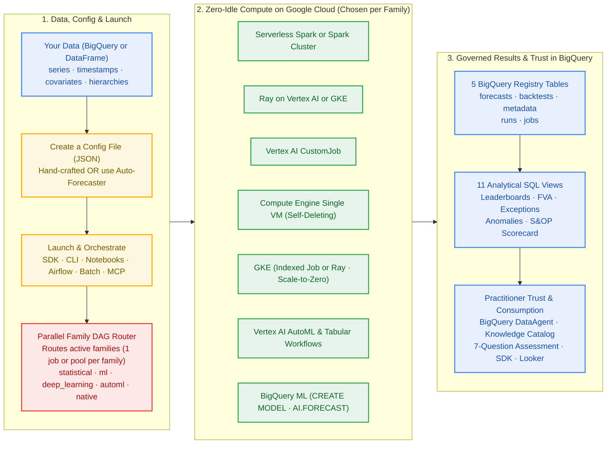

### Visual 6-color key (shared across every diagram)

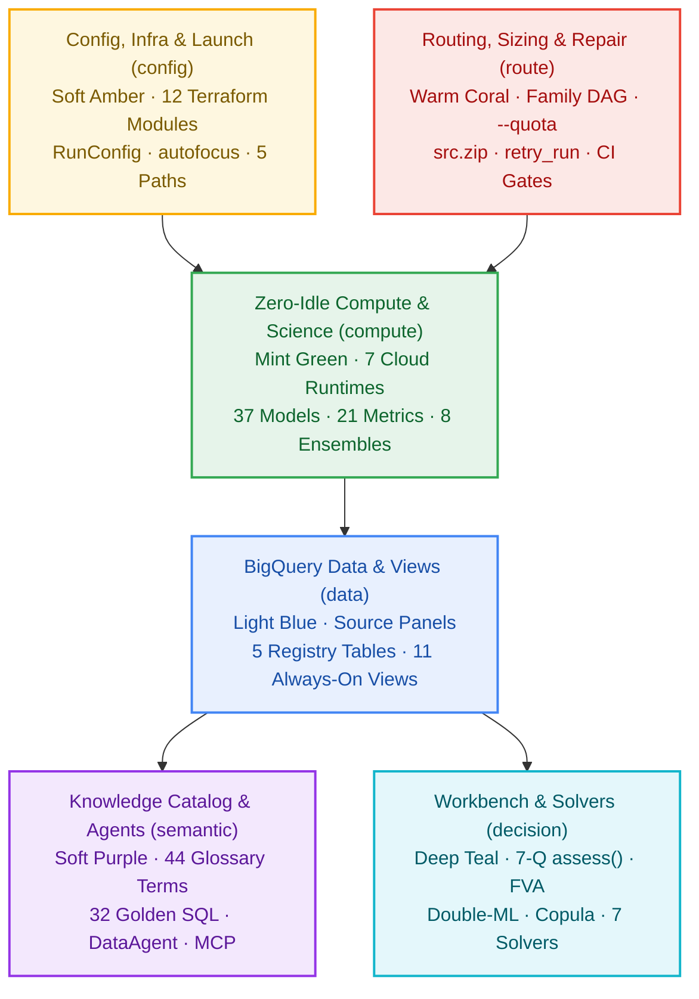

**Jump to zoom level:** [Persona Map](#persona-map--5-enterprise-personas--entry-surfaces) · [Level 1: Cloud Infra & `src.zip`](#level-1--stage-0-two-stage-cloud-deployment-100k-seeding--zero-rebuild-code-delivery) · [Level 2: `RunConfig`, Auto & Evolve](#level-2--stage-1a-authoring-auto-compiling-ablating--evolving-a-runconfig) · [Level 3: 5 Execution Paths](#level-3--stage-1b-the-5-execution-paths-preflight--durationcost-predictor) · [Level 4: 7 Cloud Runtimes](#level-4--stage-2a-parallel-per-family-routing-sizing-gpu-audit--7-cloud-runtimes) · [Level 5: Models, Covariates, CV & Metrics (`5A`–`5E`)](#level-5--stage-2b-forecasting-science-inside-the-worker-5a5e) · [Level 6: Registry & Knowledge Catalog](#level-6--stage-3a-self-documenting-registry-schema-11-always-on-views--knowledge-catalog) · [Level 7: Workbench & Solvers](#level-7--stage-3b-the-forecaster-workbench--6-pillars--prescriptive-solvers) · [Level 8: Agents, Repair & CI](#level-8--stage-3c-ai-agent-ecosystem-5-chat-surfaces-day-2-repair--3-tier-verification) · [Appendix: Index & Auto-Synced Inventory](#appendix--zoom-index--auto-synced-repository-inventory)

---

## Persona Map — 5 enterprise personas & entry surfaces

Different practitioners enter `scale-forecasting` at different layers while sharing the **exact same `RunConfig`, `run_id`, and BigQuery registry**:

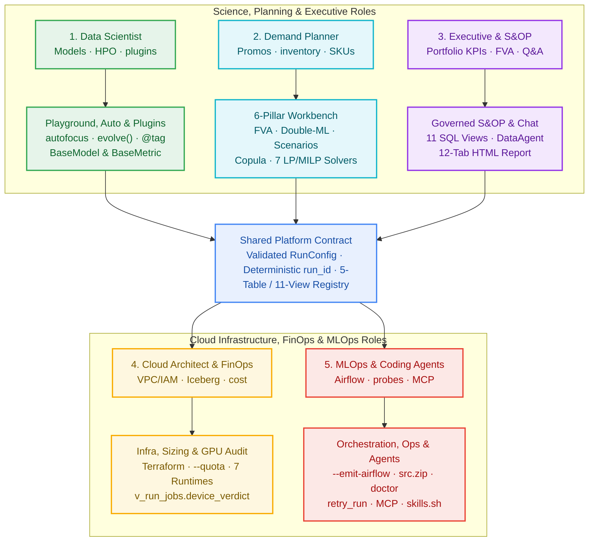

| Persona | Key Entrypoints (SDK / CLI / SQL) | Recommended Notebooks | Zoom Levels to Read First |
| :--- | :--- | :--- | :--- |
| **1. Data Scientist & Quant Forecaster** | `playground.bakeoff()`, `Forecaster.auto(..., autofocus=True)`, `Forecaster.evolve()`, `variant_matrix()`, `@register` plugins | [`00`](./notebooks/00_model_playground.ipynb), [`05`](./notebooks/05_covariates_and_global_models.ipynb), [`07`](./notebooks/07_hpo_backtesting_and_ensembles.ipynb), [`09`](./notebooks/09_custom_models_and_metrics.ipynb), [`11`](./notebooks/11_auto_forecaster_and_autofocus.ipynb) | [Level 2](#level-2--stage-1a-authoring-auto-compiling-ablating--evolving-a-runconfig), [Level 5](#level-5--stage-2b-forecasting-science-inside-the-worker-5a5e), [Level 7](#level-7--stage-3b-the-forecaster-workbench--6-pillars--prescriptive-solvers) |
| **2. Demand Planner & Merchandiser** | `exceptions_df()`, `promo_elasticity_df()`, `simulate_scenarios()`, `recommend_substitutes_df()`, `emerging_trends_df()`, `optimize_inventory_df()`, `optimize_clearance_df()`, `optimize_assortment_df()` | [`05`](./notebooks/05_covariates_and_global_models.ipynb), [`06`](./notebooks/06_hierarchical_reconciliation.ipynb), [`08`](./notebooks/08_multi_engine_master_workflow.ipynb), [`12`](./notebooks/12_conversational_analytics_and_knowledge_catalog.ipynb) | [Level 6](#level-6--stage-3a-self-documenting-registry-schema-11-always-on-views--knowledge-catalog), [Level 7](#level-7--stage-3b-the-forecaster-workbench--6-pillars--prescriptive-solvers) |
| **3. Executive & S&OP Leader** | `v_executive_sop_summary`, `Registry.ask()` / BigQuery Studio *Agents* tab, `f.assess()`, `allocate_target()`, `export_report("briefing.html")` | [`11`](./notebooks/11_auto_forecaster_and_autofocus.ipynb), [`12`](./notebooks/12_conversational_analytics_and_knowledge_catalog.ipynb), [workshop.md](./workshop.md) | [Level 0](#level-0--the-10000-foot-system-map), [Level 6](#level-6--stage-3a-self-documenting-registry-schema-11-always-on-views--knowledge-catalog), [Level 7](#level-7--stage-3b-the-forecaster-workbench--6-pillars--prescriptive-solvers) |
| **4. Cloud Architect & FinOps Lead** | `terraform/bootstrap` & `terraform/main`, `--quota`, `predict_run_duration()`, `v_run_summary`, `v_run_jobs.device_verdict` | [`01`](./notebooks/01_bigquery_native_sql.ipynb), [`02`](./notebooks/02_vertex_and_gce_vms.ipynb), [`03`](./notebooks/03_spark_serverless_and_connect.ipynb), [`04`](./notebooks/04_ray_on_vertex_gpu.ipynb) | [Level 1](#level-1--stage-0-two-stage-cloud-deployment-100k-seeding--zero-rebuild-code-delivery), [Level 4](#level-4--stage-2a-parallel-per-family-routing-sizing-gpu-audit--7-cloud-runtimes) |
| **5. MLOps Engineer & AI Coding Agent** | `--emit-airflow`, `--stage-only`, `Registry.doctor()`, `Forecaster.retry()`, `python -m scale_forecasting.mcp`, `SKILL.md` | [`08`](./notebooks/08_multi_engine_master_workflow.ipynb), [`10`](./notebooks/10_registry_operations_and_scale.ipynb), [`12`](./notebooks/12_conversational_analytics_and_knowledge_catalog.ipynb) | [Level 1](#level-1--stage-0-two-stage-cloud-deployment-100k-seeding--zero-rebuild-code-delivery), [Level 3](#level-3--stage-1b-the-5-execution-paths-preflight--durationcost-predictor), [Level 8](#level-8--stage-3c-ai-agent-ecosystem-5-chat-surfaces-day-2-repair--3-tier-verification) |

---

## Level 1 — Stage 0: Two-Stage Cloud Deployment, 100k Seeding & Zero-Rebuild Code Delivery

Before the first cloud forecast runs, `scale-forecasting` separates **immutable dependency substrates** from **instant-iteration Python source code**:

1. **Pure-Core Packaging (`13` Extras in `pyproject.toml`):** Base `pip install scale-forecasting` installs **zero Google Cloud SDKs**; `[gcp]` is the single home of every Google client, composed cleanly into `spark`, `ray`, `submit`, and the 6 `models-*` extras.
2. **Two-Stage Terraform (`terraform/bootstrap` + `12` Modules in `terraform/main`):** Provisions remote state, APIs, private VPC/PSC-I networking, least-privilege service accounts, GCS buckets, BigQuery + BigLake Apache Iceberg tables, Artifact Registry container + packed worker `venv`, Colab Enterprise `sf-main` runtime template, budget alerts, and an automated **100,000-series seed batch** (`seed_spark.py` across 5 archetypes).
3. **Zero-Rebuild Code Delivery (`code_delivery.py`):** `src/scale_forecasting/` is **never baked into the Docker image** (`test_code_delivery.py`). Submitters zip `src/` and upload it per run, so local edits or new 1-file model plugins execute on the very next cloud job in seconds without rebuilding containers.

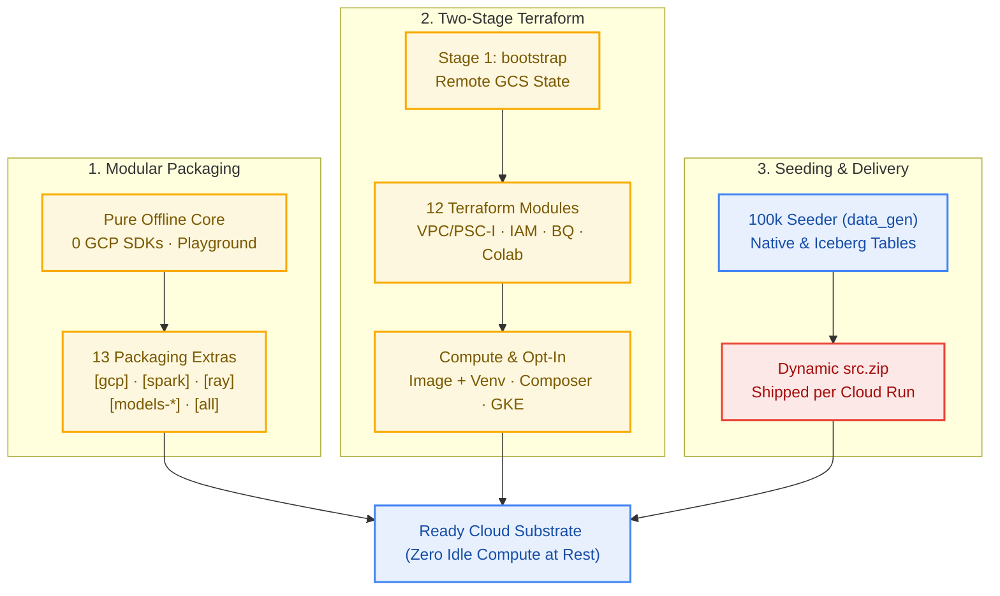

| Diagram Block | Source Modules | Guides & Notebooks | Tests & Smokes |
| :--- | :--- | :--- | :--- |
| **Pure Core & 13 Packaging Extras** | [`pyproject.toml`](https://github.com/statmike/scale-forecasting/blob/main/pyproject.toml), [`errors.py`](https://github.com/statmike/scale-forecasting/blob/main/src/scale_forecasting/errors.py), [`settings.py`](https://github.com/statmike/scale-forecasting/blob/main/src/scale_forecasting/settings.py) | [runtime_dependencies.md](./runtime_dependencies.md), [version_matrix.md](./version_matrix.md), [notebook_runtimes.md](./notebook_runtimes.md) | [`test_packaging_extras.py`](https://github.com/statmike/scale-forecasting/blob/main/tests/unit/test_packaging_extras.py), [`test_core_install.py`](https://github.com/statmike/scale-forecasting/blob/main/tests/unit/test_core_install.py), [`test_launch_point_lean.py`](https://github.com/statmike/scale-forecasting/blob/main/tests/unit/test_launch_point_lean.py) |
| **Two-Stage Terraform (12 Modules)** | [`terraform/bootstrap/`](https://github.com/statmike/scale-forecasting/tree/main/terraform/bootstrap), [`terraform/main/modules/`](https://github.com/statmike/scale-forecasting/tree/main/terraform/main/modules), [`docker/Dockerfile`](https://github.com/statmike/scale-forecasting/blob/main/docker/Dockerfile) | [deploying_on_gcp.md](./deploying_on_gcp.md), [cost_estimates.md](./cost_estimates.md), [why_google_cloud.md](./why_google_cloud.md) | [`13_native_format.json`](https://github.com/statmike/scale-forecasting/blob/main/configs/smokes/13_native_format.json), [`explode_100k.json`](https://github.com/statmike/scale-forecasting/blob/main/configs/explode_100k.json), [`ray_100k.json`](https://github.com/statmike/scale-forecasting/blob/main/configs/ray_100k.json) |
| **100k Deterministic Data Generator** | [`data_gen/generator.py`](https://github.com/statmike/scale-forecasting/blob/main/src/scale_forecasting/data_gen/generator.py), [`data_gen/seed_spark.py`](https://github.com/statmike/scale-forecasting/blob/main/src/scale_forecasting/data_gen/seed_spark.py) | [api/data_gen.md](./api/data_gen.md), [reading_source_data.md](./reading_source_data.md) | [`test_generator.py`](https://github.com/statmike/scale-forecasting/blob/main/tests/unit/test_generator.py), [`test_seed_transform.py`](https://github.com/statmike/scale-forecasting/blob/main/tests/unit/test_seed_transform.py) |
| **Zero-Rebuild `src.zip` Delivery** | [`code_delivery.py`](https://github.com/statmike/scale-forecasting/blob/main/src/scale_forecasting/code_delivery.py), [`cluster_deps.py`](https://github.com/statmike/scale-forecasting/blob/main/src/scale_forecasting/cluster_deps.py) | [editing_code_without_rebuilding.md](./editing_code_without_rebuilding.md), [Notebook 09](./notebooks/09_custom_models_and_metrics.ipynb) | [`test_code_delivery.py`](https://github.com/statmike/scale-forecasting/blob/main/tests/unit/test_code_delivery.py) |

---

## Level 2 — Stage 1A: Authoring, Auto-Compiling, Ablating & Evolving a `RunConfig`

Zooming into **`Create a Config File (JSON)`**: whether hand-authored across the **12 root `RunConfig` fields**, compiled automatically by the **Glass-Box Auto-Forecaster** (`Forecaster.build_config()` / `Forecaster.auto()` — calibrated offline with AlphaEvolve across `20` synthetic DGPs and `9` public benchmarks, running with **0 runtime LLM calls**), or mutated via opt-in **`Forecaster.evolve()`**, every path produces the **exact same validated `RunConfig`**, expands `<base_model>@<tag>` ablation variants (`variant_matrix()`), and hashes to a **deterministic `<slug>-<12hex>` `run_id`**.

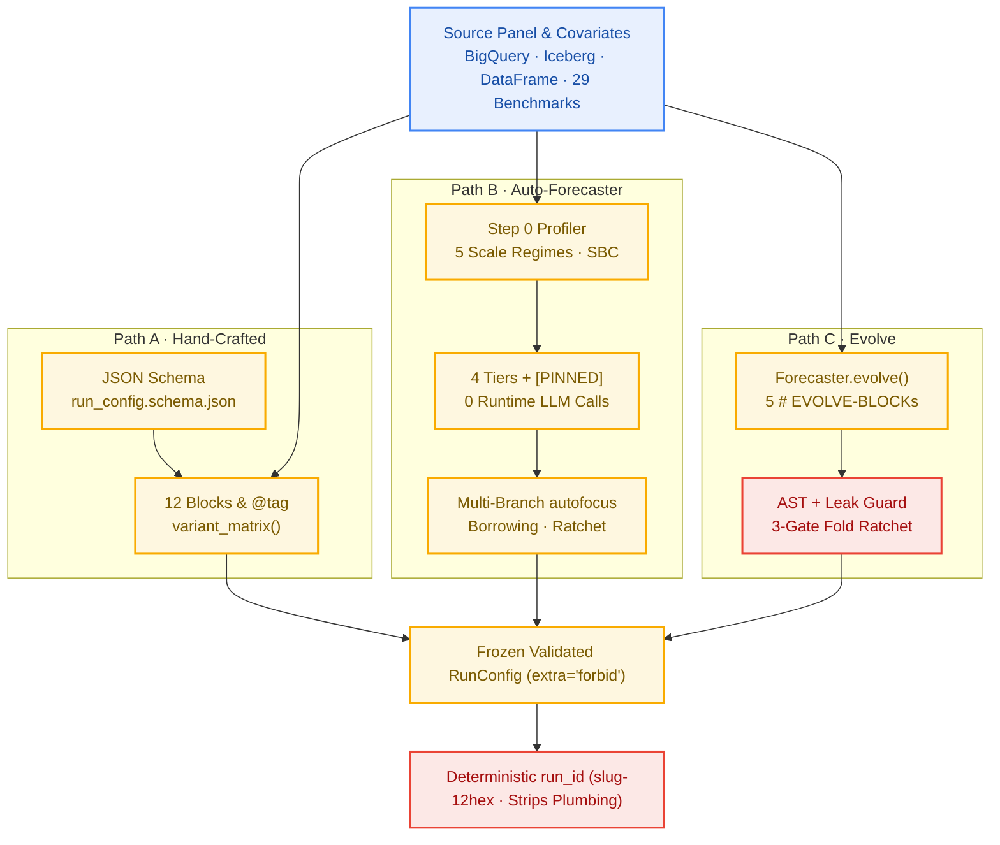

| Diagram Block | Source Modules | Guides & Notebooks | Tests & Smokes |
| :--- | :--- | :--- | :--- |
| **12-Block `RunConfig`, Schema & `@tag` Ablations** | [`config.py`](https://github.com/statmike/scale-forecasting/blob/main/src/scale_forecasting/config.py), [`agent_surfaces.py`](https://github.com/statmike/scale-forecasting/blob/main/src/scale_forecasting/agent_surfaces.py) | [configuration_reference.md](./configuration_reference.md), [forecaster_workbench.md](./forecaster_workbench.md) | [`test_config.py`](https://github.com/statmike/scale-forecasting/blob/main/tests/unit/test_config.py), [`test_config_coverage.py`](https://github.com/statmike/scale-forecasting/blob/main/tests/unit/test_config_coverage.py), [`test_phase_g5_variants_and_borrowing.py`](https://github.com/statmike/scale-forecasting/blob/main/tests/unit/test_phase_g5_variants_and_borrowing.py) |
| **Auto-Forecaster, `autofocus` & 29 Benchmarks** | [`auto.py`](https://github.com/statmike/scale-forecasting/blob/main/src/scale_forecasting/auto.py), [`auto_policy.py`](https://github.com/statmike/scale-forecasting/blob/main/src/scale_forecasting/auto_policy.py), [`benchmarks.py`](https://github.com/statmike/scale-forecasting/blob/main/src/scale_forecasting/benchmarks.py) | [auto_forecaster.md](./auto_forecaster.md), [auto_forecaster_benchmarks.md](./auto_forecaster_benchmarks.md), [auto_forecaster_cloud_scale.md](./auto_forecaster_cloud_scale.md), [Notebook 11](./notebooks/11_auto_forecaster_and_autofocus.ipynb) | [`test_auto_forecaster.py`](https://github.com/statmike/scale-forecasting/blob/main/tests/unit/test_auto_forecaster.py) |
| **Opt-In Evolutionary Harness (`evolve`)** | [`evolve/`](https://github.com/statmike/scale-forecasting/tree/main/src/scale_forecasting/evolve) | [alphaevolve_runner.md](./alphaevolve_runner.md), [api/evolve.md](./api/evolve.md), [Notebook 11](./notebooks/11_auto_forecaster_and_autofocus.ipynb) | [`test_evolve.py`](https://github.com/statmike/scale-forecasting/blob/main/tests/unit/test_evolve.py) |
| **Deterministic `run_id` & Cell Borrowing** | [`registry/ids.py`](https://github.com/statmike/scale-forecasting/blob/main/src/scale_forecasting/registry/ids.py), [`registry/harvest.py`](https://github.com/statmike/scale-forecasting/blob/main/src/scale_forecasting/registry/harvest.py) | [architecture.md](./architecture.md), [faq.md](./faq.md) | [`test_ids.py`](https://github.com/statmike/scale-forecasting/blob/main/tests/unit/test_ids.py), [`test_prebreak_snapshots.py`](https://github.com/statmike/scale-forecasting/blob/main/tests/unit/test_prebreak_snapshots.py) |

---

## Level 3 — Stage 1B: The 5 Execution Paths, Preflight & Duration/Cost Predictor

Zooming into **`Launch & Orchestrate`**: one `RunConfig` executes identically across **5 launch paths** with zero code forks — backed by offline wall-clock/cost estimation (`predict_run_duration`), read-only cloud `--feasibility` and `--quota` checks, and staged native CLI emission (`--stage-only`).

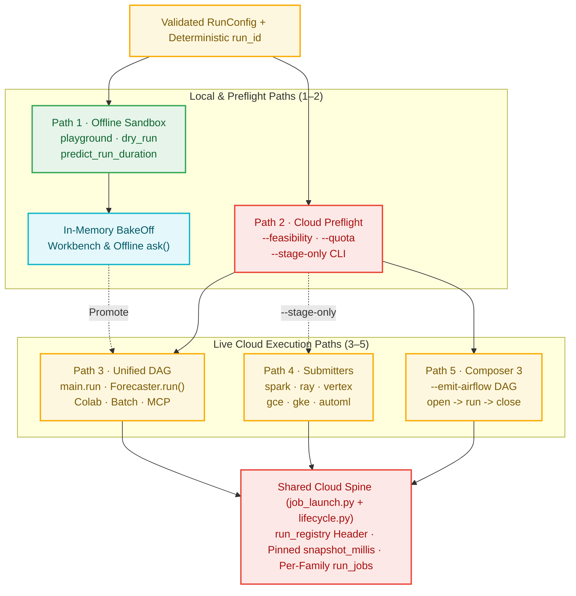

| Diagram Block | Source Modules | Guides & Notebooks | Tests & Smokes |
| :--- | :--- | :--- | :--- |
| **Path 1 — Pure-Offline Sandbox & Duration Predictor** | [`playground.py`](https://github.com/statmike/scale-forecasting/blob/main/src/scale_forecasting/playground.py), [`launch_plan.py`](https://github.com/statmike/scale-forecasting/blob/main/src/scale_forecasting/launch_plan.py), [`profiling/duration.py`](https://github.com/statmike/scale-forecasting/blob/main/src/scale_forecasting/profiling/duration.py) | [getting_started.md](./getting_started.md), [cost_estimates.md](./cost_estimates.md), [Notebook 00](./notebooks/00_model_playground.ipynb) | [`test_playground.py`](https://github.com/statmike/scale-forecasting/blob/main/tests/unit/test_playground.py), [`test_core_install.py`](https://github.com/statmike/scale-forecasting/blob/main/tests/unit/test_core_install.py), [`test_launch_plan.py`](https://github.com/statmike/scale-forecasting/blob/main/tests/unit/test_launch_plan.py) |
| **Path 2 — Feasibility, Quota & `--stage-only`** | [`validation.py`](https://github.com/statmike/scale-forecasting/blob/main/src/scale_forecasting/validation.py), [`quota.py`](https://github.com/statmike/scale-forecasting/blob/main/src/scale_forecasting/quota.py), [`staging.py`](https://github.com/statmike/scale-forecasting/blob/main/src/scale_forecasting/staging.py), [`commands.py`](https://github.com/statmike/scale-forecasting/blob/main/src/scale_forecasting/commands.py) | [quota_and_scale.md](./quota_and_scale.md), [running_and_reviewing.md](./running_and_reviewing.md), [Notebook 10](./notebooks/10_registry_operations_and_scale.ipynb) | [`test_validation.py`](https://github.com/statmike/scale-forecasting/blob/main/tests/unit/test_validation.py), [`test_quota.py`](https://github.com/statmike/scale-forecasting/blob/main/tests/unit/test_quota.py), [`test_commands.py`](https://github.com/statmike/scale-forecasting/blob/main/tests/unit/test_commands.py) |
| **Path 3 — Unified Orchestrator, `run_live()` & MCP** | [`main.py`](https://github.com/statmike/scale-forecasting/blob/main/src/scale_forecasting/main.py), [`sdk.py`](https://github.com/statmike/scale-forecasting/blob/main/src/scale_forecasting/sdk.py), [`mcp.py`](https://github.com/statmike/scale-forecasting/blob/main/src/scale_forecasting/mcp.py), [`job_launch.py`](https://github.com/statmike/scale-forecasting/blob/main/src/scale_forecasting/job_launch.py) | [using_the_sdk.md](./using_the_sdk.md), [Notebook 08](./notebooks/08_multi_engine_master_workflow.ipynb) | [`test_main.py`](https://github.com/statmike/scale-forecasting/blob/main/tests/unit/test_main.py), [`test_job_launch.py`](https://github.com/statmike/scale-forecasting/blob/main/tests/unit/test_job_launch.py), [`14_full_dag.json`](https://github.com/statmike/scale-forecasting/blob/main/configs/smokes/14_full_dag.json) |
| **Path 4 — Direct Per-Family Submitters** | [`submitters.py`](https://github.com/statmike/scale-forecasting/blob/main/src/scale_forecasting/submitters.py), [`submit.py`](https://github.com/statmike/scale-forecasting/blob/main/src/scale_forecasting/submit.py), [`ray_submit.py`](https://github.com/statmike/scale-forecasting/blob/main/src/scale_forecasting/ray_submit.py), [`vertex_submit.py`](https://github.com/statmike/scale-forecasting/blob/main/src/scale_forecasting/vertex_submit.py), [`gce_submit.py`](https://github.com/statmike/scale-forecasting/blob/main/src/scale_forecasting/gce_submit.py), [`gke_submit.py`](https://github.com/statmike/scale-forecasting/blob/main/src/scale_forecasting/gke_submit.py), [`automl_submit.py`](https://github.com/statmike/scale-forecasting/blob/main/src/scale_forecasting/automl_submit.py) | [runtimes_reference.md](./runtimes_reference.md) | [`test_submitters.py`](https://github.com/statmike/scale-forecasting/blob/main/tests/unit/test_submitters.py), [`test_submit.py`](https://github.com/statmike/scale-forecasting/blob/main/tests/unit/test_submit.py), [`test_ray_submit.py`](https://github.com/statmike/scale-forecasting/blob/main/tests/unit/test_ray_submit.py), [`test_gke_submit.py`](https://github.com/statmike/scale-forecasting/blob/main/tests/unit/test_gke_submit.py) |
| **Path 5 — Cloud Composer 3 / Airflow DAG** | [`airflow_emit.py`](https://github.com/statmike/scale-forecasting/blob/main/src/scale_forecasting/airflow_emit.py), [`airflow_tasks.py`](https://github.com/statmike/scale-forecasting/blob/main/src/scale_forecasting/airflow_tasks.py) | [deploying_on_gcp.md](./deploying_on_gcp.md), [operations.md](./operations.md), [Notebook 10](./notebooks/10_registry_operations_and_scale.ipynb) | [`test_airflow_emit.py`](https://github.com/statmike/scale-forecasting/blob/main/tests/unit/test_airflow_emit.py), [`test_airflow_dagbag.py`](https://github.com/statmike/scale-forecasting/blob/main/tests/unit/test_airflow_dagbag.py), [`15_airflow_multi_engine.json`](https://github.com/statmike/scale-forecasting/blob/main/configs/smokes/15_airflow_multi_engine.json) |

---

## Level 4 — Stage 2A: Parallel Per-Family Routing, Sizing, GPU Audit & 7 Cloud Runtimes

Zooming into **`Parallel Family DAG Router -> 2. Zero-Idle Compute on Google Cloud`**: `dag.plan_dag` fans active families out concurrently (`statistical`, `ml`, `deep_learning`, `automl`, `native`) so fast CPU batches tear down immediately without idling behind GPU trainers. `resources/` sizes pools across `CPU`, `T4`, `L4`, `A100`, and `A100_80GB`; `capacity.py` + `compute_fallback.py` walk regions on stockouts; workers read `snapshot_millis`-pinned Arrow slices directly via Storage Read API `row_restriction` (`order_chunks_lpt`); and `device_audit.py` stamps `device_verdict` (`ENGAGED_UTILISED` vs. unused GPU warning) onto `run_jobs`.

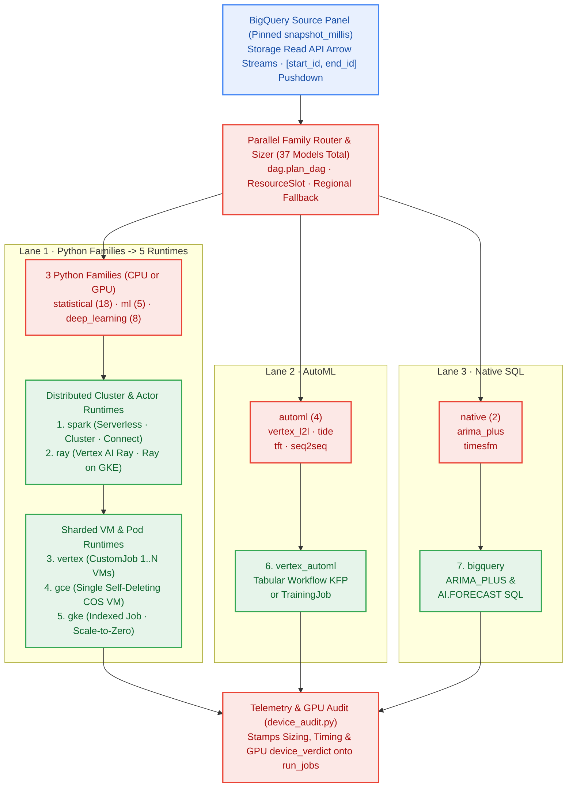

| Diagram Block | Source Modules | Guides & Notebooks | Tests & Smokes |
| :--- | :--- | :--- | :--- |
| **Family DAG, Sizing, Fallback & GPU Audit** | [`dag.py`](https://github.com/statmike/scale-forecasting/blob/main/src/scale_forecasting/dag.py), [`router.py`](https://github.com/statmike/scale-forecasting/blob/main/src/scale_forecasting/router.py), [`shared_clusters.py`](https://github.com/statmike/scale-forecasting/blob/main/src/scale_forecasting/shared_clusters.py), [`capacity.py`](https://github.com/statmike/scale-forecasting/blob/main/src/scale_forecasting/capacity.py), [`compute_fallback.py`](https://github.com/statmike/scale-forecasting/blob/main/src/scale_forecasting/compute_fallback.py), [`device_audit.py`](https://github.com/statmike/scale-forecasting/blob/main/src/scale_forecasting/device_audit.py), [`resources/`](https://github.com/statmike/scale-forecasting/tree/main/src/scale_forecasting/resources) | [choosing_a_runtime.md](./choosing_a_runtime.md), [quota_and_scale.md](./quota_and_scale.md), [cost_estimates.md](./cost_estimates.md) | [`test_dag.py`](https://github.com/statmike/scale-forecasting/blob/main/tests/unit/test_dag.py), [`test_resources.py`](https://github.com/statmike/scale-forecasting/blob/main/tests/unit/test_resources.py), [`test_capacity.py`](https://github.com/statmike/scale-forecasting/blob/main/tests/unit/test_capacity.py), [`test_compute_fallback.py`](https://github.com/statmike/scale-forecasting/blob/main/tests/unit/test_compute_fallback.py), [`test_device_audit.py`](https://github.com/statmike/scale-forecasting/blob/main/tests/unit/test_device_audit.py), [`10_mixed_runtimes.json`](https://github.com/statmike/scale-forecasting/blob/main/configs/smokes/10_mixed_runtimes.json) |
| **`spark` & `ray` Distributed Engines** | [`engines/spark_explode.py`](https://github.com/statmike/scale-forecasting/blob/main/src/scale_forecasting/engines/spark_explode.py), [`engines/spark_io.py`](https://github.com/statmike/scale-forecasting/blob/main/src/scale_forecasting/engines/spark_io.py), [`engines/ray_engine.py`](https://github.com/statmike/scale-forecasting/blob/main/src/scale_forecasting/engines/ray_engine.py), [`engines/ray_io.py`](https://github.com/statmike/scale-forecasting/blob/main/src/scale_forecasting/engines/ray_io.py) | [runtimes_reference.md](./runtimes_reference.md), [Notebook 03](./notebooks/03_spark_serverless_and_connect.ipynb), [Notebook 04](./notebooks/04_ray_on_vertex_gpu.ipynb) | [`test_spark_engines.py`](https://github.com/statmike/scale-forecasting/blob/main/tests/unit/test_spark_engines.py), [`test_ray_engine.py`](https://github.com/statmike/scale-forecasting/blob/main/tests/unit/test_ray_engine.py), [`01_serverless_cpu.json`](https://github.com/statmike/scale-forecasting/blob/main/configs/smokes/01_serverless_cpu.json), [`08_ray_gpu.json`](https://github.com/statmike/scale-forecasting/blob/main/configs/smokes/08_ray_gpu.json) |
| **`vertex`, `gce` & `gke` Worker-Shard Engines** | [`engines/vertex_engine.py`](https://github.com/statmike/scale-forecasting/blob/main/src/scale_forecasting/engines/vertex_engine.py), [`vertex_submit.py`](https://github.com/statmike/scale-forecasting/blob/main/src/scale_forecasting/vertex_submit.py), [`gce_submit.py`](https://github.com/statmike/scale-forecasting/blob/main/src/scale_forecasting/gce_submit.py), [`gke_submit.py`](https://github.com/statmike/scale-forecasting/blob/main/src/scale_forecasting/gke_submit.py) | [reading_source_data.md](./reading_source_data.md), [Notebook 02](./notebooks/02_vertex_and_gce_vms.ipynb) | [`test_vertex_runtime.py`](https://github.com/statmike/scale-forecasting/blob/main/tests/unit/test_vertex_runtime.py), [`38_vertex_custom_job.json`](https://github.com/statmike/scale-forecasting/blob/main/configs/smokes/38_vertex_custom_job.json), [`39_gce_single_vm.json`](https://github.com/statmike/scale-forecasting/blob/main/configs/smokes/39_gce_single_vm.json), [`40_gke_indexed_job.json`](https://github.com/statmike/scale-forecasting/blob/main/configs/smokes/40_gke_indexed_job.json) |
| **`vertex_automl` & `bigquery` SQL Engines** | [`engines/automl_engine.py`](https://github.com/statmike/scale-forecasting/blob/main/src/scale_forecasting/engines/automl_engine.py), [`engines/bigquery_engine.py`](https://github.com/statmike/scale-forecasting/blob/main/src/scale_forecasting/engines/bigquery_engine.py), [`engines/bigquery_sql.py`](https://github.com/statmike/scale-forecasting/blob/main/src/scale_forecasting/engines/bigquery_sql.py) | [models_reference.md](./models_reference.md), [Notebook 01](./notebooks/01_bigquery_native_sql.ipynb) | [`test_automl_engine.py`](https://github.com/statmike/scale-forecasting/blob/main/tests/unit/test_automl_engine.py), [`test_bigquery_engine.py`](https://github.com/statmike/scale-forecasting/blob/main/tests/unit/test_bigquery_engine.py), [`02_bq_native.json`](https://github.com/statmike/scale-forecasting/blob/main/configs/smokes/02_bq_native.json), [`42_vertex_automl_tabular_workflow.json`](https://github.com/statmike/scale-forecasting/blob/main/configs/smokes/42_vertex_automl_tabular_workflow.json) |

---

## Level 5 — Stage 2B: Forecasting Science Inside the Worker (`5A`–`5E`)

Zooming inside an executing task: **the unit of work is byte-identical across laptop, Spark, Ray, Vertex, GCE, and GKE**. The vertical spine below shows the end-to-end execution order inside every run, and sub-diagrams **`5A`–`5E`** unpack our entire forecasting methodology:

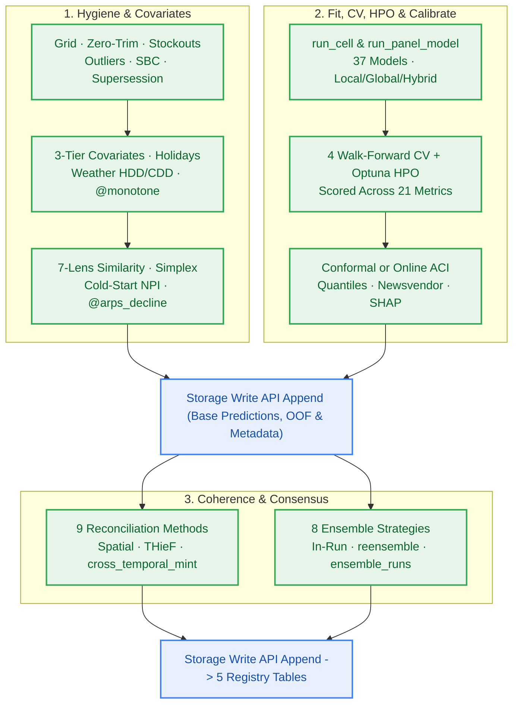

### 5A. All 37 models, 5 model families & the 31 `<model>@<tag>` variant modifiers

Every model inherits from [`BaseModel`](https://github.com/statmike/scale-forecasting/blob/main/src/scale_forecasting/models/base_model.py), declares its covariate flags (`supports_future_covariates`, `supports_past_covariates`, `supports_static_covariates`), training modes (`local`, `global`, `hybrid`), GPU affinity (`gpu_useful`), fast origin updates (`recondition`), and 2-tier explainability (`feature_attributions` + horizon-step `explain`), and composes orthogonally with **31 `@tag` modifiers**:

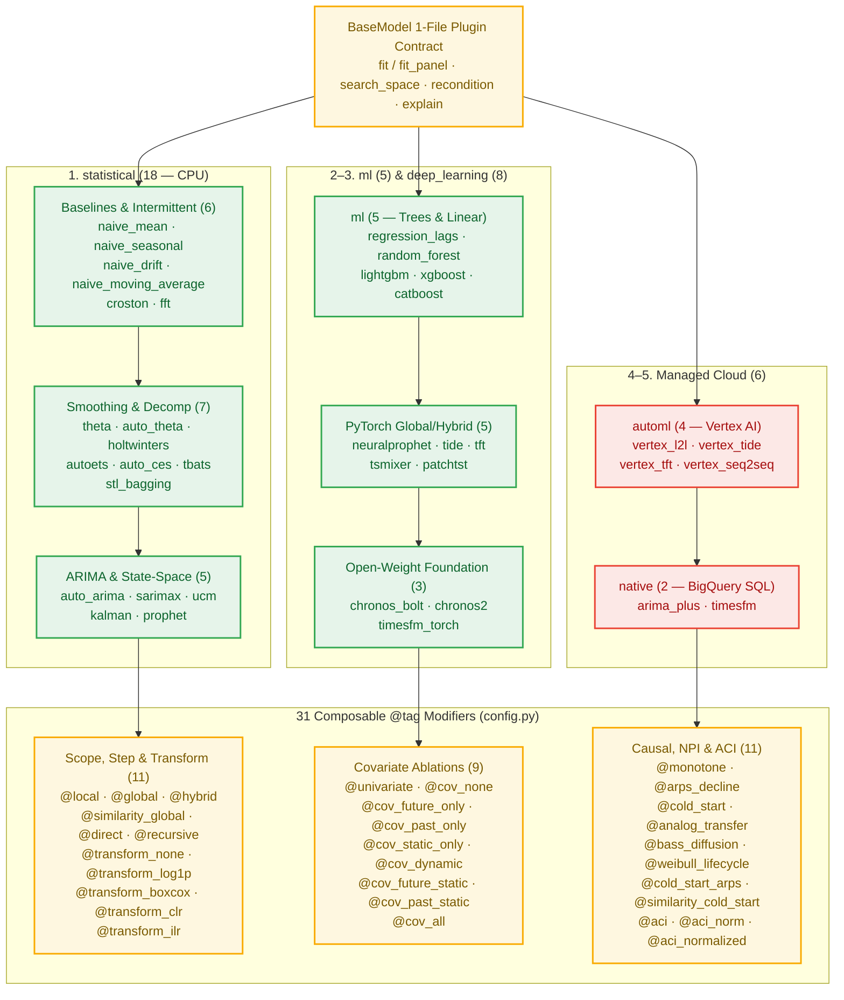

### 5B. Three-tier covariates across the temporal cutoff (`T_cutoff`) & domain feature hygiene

Exogenous drivers are partitioned strictly by **what is observable after `T_cutoff`**, while pre-fit hygiene and target transforms fit strictly inside `ds <= T_cutoff` on every backtest fold:

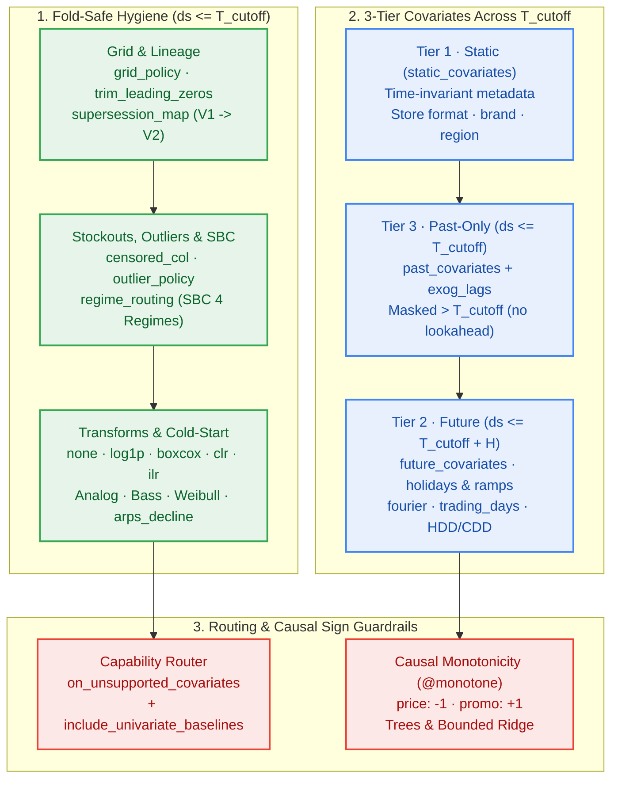

### 5C. Rolling-origin backtesting (`4` schemes), Optuna HPO & uncertainty calibration

Backtesting scores models out-of-sample across `n_folds` walk-forward cutoffs while a **separate full-history fit** produces the shipped production forecast:

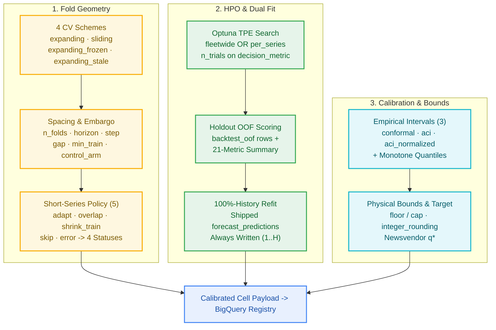

### 5D. All 21 evaluation metrics & how `backtest.decision_metric` steers execution

Every model family and ensemble strategy is scored through the same pure-Python `metrics.compute_metrics` contract across **16 point metrics** and **5 interval metrics**:

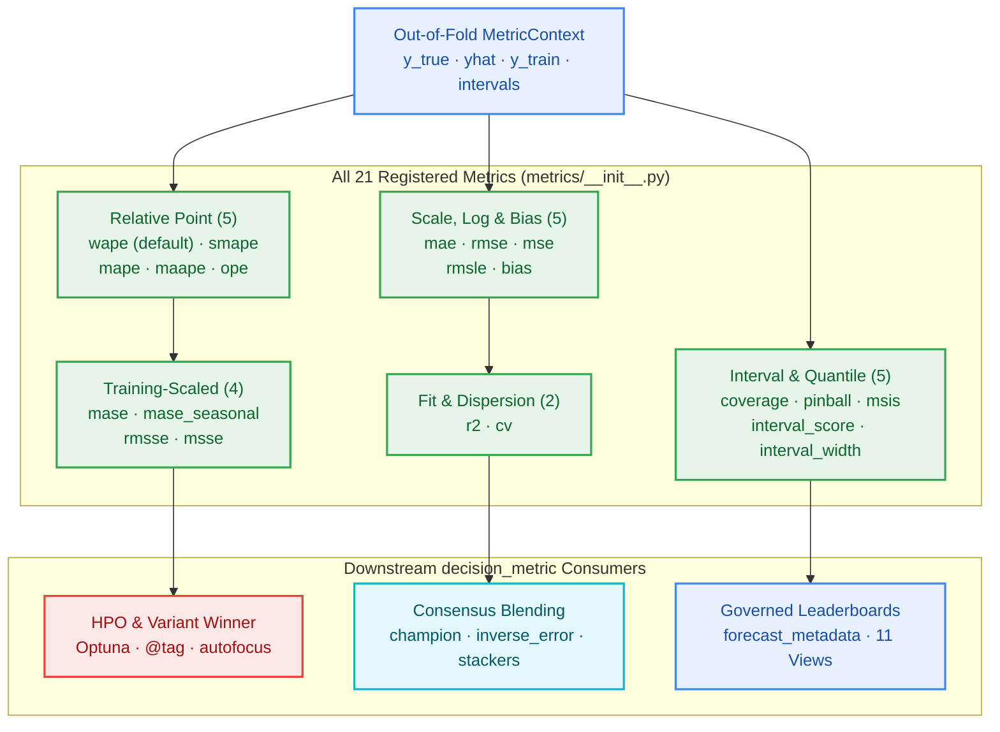

### 5E. Hierarchy construction, 3-mode reconciliation (`9` methods) & 3-scope ensembling (`8` strategies)

Post-worker consensus guarantees **additive coherence across trees and calendars** (`verify_coherence < 1e-6`) and **leak-free multi-model blending** across three operational scopes:

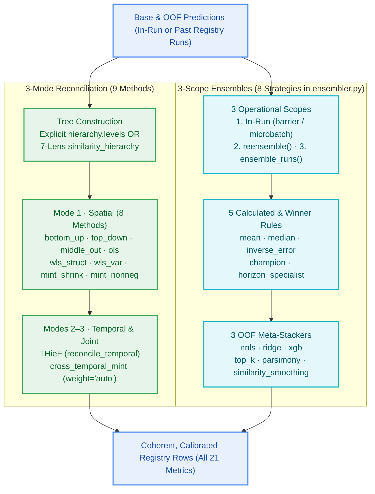

| Diagram Block | Source Modules | First-Visual Reference Guides & Notebooks | Tests & Smokes |
| :--- | :--- | :--- | :--- |
| **`5A` — 37 Models, 5 Families & 31 `@tag` Modifiers** | [`models/`](https://github.com/statmike/scale-forecasting/tree/main/src/scale_forecasting/models), [`models/base_model.py`](https://github.com/statmike/scale-forecasting/blob/main/src/scale_forecasting/models/base_model.py), [`config.py`](https://github.com/statmike/scale-forecasting/blob/main/src/scale_forecasting/config.py) | [models_reference.md](./models_reference.md), [adding_a_model.md](./adding_a_model.md), [Notebook 00](./notebooks/00_model_playground.ipynb), [Notebook 09](./notebooks/09_custom_models_and_metrics.ipynb) | [`test_models_contract.py`](https://github.com/statmike/scale-forecasting/blob/main/tests/unit/test_models_contract.py), [`test_worker_model_matrix.py`](https://github.com/statmike/scale-forecasting/blob/main/tests/unit/test_worker_model_matrix.py), [`test_phase_g5_variants_and_borrowing.py`](https://github.com/statmike/scale-forecasting/blob/main/tests/unit/test_phase_g5_variants_and_borrowing.py), [`21_full_catalogue.json`](https://github.com/statmike/scale-forecasting/blob/main/configs/smokes/21_full_catalogue.json) |
| **`5B` — 3-Tier Covariates (`T_cutoff`) & Domain Hygiene** | [`features.py`](https://github.com/statmike/scale-forecasting/blob/main/src/scale_forecasting/features.py), [`seasonality.py`](https://github.com/statmike/scale-forecasting/blob/main/src/scale_forecasting/seasonality.py), [`holiday_window.py`](https://github.com/statmike/scale-forecasting/blob/main/src/scale_forecasting/holiday_window.py), [`similarity.py`](https://github.com/statmike/scale-forecasting/blob/main/src/scale_forecasting/similarity.py), [`simplex.py`](https://github.com/statmike/scale-forecasting/blob/main/src/scale_forecasting/simplex.py), [`cold_start.py`](https://github.com/statmike/scale-forecasting/blob/main/src/scale_forecasting/cold_start.py), [`monotonicity.py`](https://github.com/statmike/scale-forecasting/blob/main/src/scale_forecasting/monotonicity.py) | [features_and_covariates.md](./features_and_covariates.md), [api/similarity.md](./api/similarity.md), [Notebook 05](./notebooks/05_covariates_and_global_models.ipynb) | [`test_features.py`](https://github.com/statmike/scale-forecasting/blob/main/tests/unit/test_features.py), [`test_phase_g2_hygiene_and_quantiles.py`](https://github.com/statmike/scale-forecasting/blob/main/tests/unit/test_phase_g2_hygiene_and_quantiles.py), [`test_similarity.py`](https://github.com/statmike/scale-forecasting/blob/main/tests/unit/test_similarity.py), [`test_track_p2_cross_industry.py`](https://github.com/statmike/scale-forecasting/blob/main/tests/unit/test_track_p2_cross_industry.py), [`32_covariates_three_tier.json`](https://github.com/statmike/scale-forecasting/blob/main/configs/smokes/32_covariates_three_tier.json) |
| **`5C` — 4-Scheme Backtesting, Optuna HPO & Calibration** | [`worker.py`](https://github.com/statmike/scale-forecasting/blob/main/src/scale_forecasting/worker.py), [`backtest.py`](https://github.com/statmike/scale-forecasting/blob/main/src/scale_forecasting/backtest.py), [`hpo.py`](https://github.com/statmike/scale-forecasting/blob/main/src/scale_forecasting/hpo.py), [`calibration.py`](https://github.com/statmike/scale-forecasting/blob/main/src/scale_forecasting/calibration.py), [`aci.py`](https://github.com/statmike/scale-forecasting/blob/main/src/scale_forecasting/aci.py), [`registry/cells.py`](https://github.com/statmike/scale-forecasting/blob/main/src/scale_forecasting/registry/cells.py) | [backtesting.md](./backtesting.md), [writing_results.md](./writing_results.md), [Notebook 07](./notebooks/07_hpo_backtesting_and_ensembles.ipynb) | [`test_backtest.py`](https://github.com/statmike/scale-forecasting/blob/main/tests/unit/test_backtest.py), [`test_hpo.py`](https://github.com/statmike/scale-forecasting/blob/main/tests/unit/test_hpo.py), [`test_calibration.py`](https://github.com/statmike/scale-forecasting/blob/main/tests/unit/test_calibration.py), [`test_aci.py`](https://github.com/statmike/scale-forecasting/blob/main/tests/unit/test_aci.py), [`22_backtest_sliding_overlap.json`](https://github.com/statmike/scale-forecasting/blob/main/configs/smokes/22_backtest_sliding_overlap.json), [`26_hpo_fleetwide.json`](https://github.com/statmike/scale-forecasting/blob/main/configs/smokes/26_hpo_fleetwide.json) |
| **`5D` — 21 Evaluation Metrics & `decision_metric`** | [`metrics/`](https://github.com/statmike/scale-forecasting/tree/main/src/scale_forecasting/metrics), [`metrics/base_metric.py`](https://github.com/statmike/scale-forecasting/blob/main/src/scale_forecasting/metrics/base_metric.py) | [metrics_reference.md](./metrics_reference.md), [adding_a_metric.md](./adding_a_metric.md), [Notebook 09](./notebooks/09_custom_models_and_metrics.ipynb) | [`test_metrics_contract.py`](https://github.com/statmike/scale-forecasting/blob/main/tests/unit/test_metrics_contract.py), [`test_registry_column_parity.py`](https://github.com/statmike/scale-forecasting/blob/main/tests/unit/test_registry_column_parity.py) |
| **`5E` — 3-Mode Reconciliation (`9`) & 3-Scope Ensembles (`8`)** | [`reconciliation.py`](https://github.com/statmike/scale-forecasting/blob/main/src/scale_forecasting/reconciliation.py), [`temporal_reconciliation.py`](https://github.com/statmike/scale-forecasting/blob/main/src/scale_forecasting/temporal_reconciliation.py), [`ensembler.py`](https://github.com/statmike/scale-forecasting/blob/main/src/scale_forecasting/ensembler.py), [`ensemble_run.py`](https://github.com/statmike/scale-forecasting/blob/main/src/scale_forecasting/ensemble_run.py) | [hierarchical_forecasting.md](./hierarchical_forecasting.md), [models_reference.md](./models_reference.md#ensemble-blending--stacking-strategies), [api/temporal_reconciliation.md](./api/temporal_reconciliation.md), [Notebook 06](./notebooks/06_hierarchical_reconciliation.ipynb), [Notebook 07](./notebooks/07_hpo_backtesting_and_ensembles.ipynb) | [`test_reconciliation.py`](https://github.com/statmike/scale-forecasting/blob/main/tests/unit/test_reconciliation.py), [`test_temporal_reconciliation.py`](https://github.com/statmike/scale-forecasting/blob/main/tests/unit/test_temporal_reconciliation.py), [`test_ensembler.py`](https://github.com/statmike/scale-forecasting/blob/main/tests/unit/test_ensembler.py), [`test_ensemble_run.py`](https://github.com/statmike/scale-forecasting/blob/main/tests/unit/test_ensemble_run.py), [`11_ensemble_barrier.json`](https://github.com/statmike/scale-forecasting/blob/main/configs/smokes/11_ensemble_barrier.json), [`12_ensemble_microbatch.json`](https://github.com/statmike/scale-forecasting/blob/main/configs/smokes/12_ensemble_microbatch.json), [`35_hierarchy_reconciliation.json`](https://github.com/statmike/scale-forecasting/blob/main/configs/smokes/35_hierarchy_reconciliation.json), [`37_hierarchy_covariates_ensemble.json`](https://github.com/statmike/scale-forecasting/blob/main/configs/smokes/37_hierarchy_covariates_ensemble.json) |

---

## Level 6 — Stage 3A: Self-Documenting Registry Schema, 11 Always-On Views & Knowledge Catalog

Zooming into **`5 BigQuery Registry Tables -> 11 Analytical SQL Views -> Knowledge Catalog & DataAgent`**.

> [!IMPORTANT]
> **Architectural Boundary: Always-On Core Registry vs. Opt-In Conversational Layer**
>
> - **Always Created on Every Deployment & Run (Blue `data` — `0` Extra APIs, `\$0` View Storage):** All **5 native registry tables**, all **11 analytical SQL views** (`5` core operational/leaderboard views + `6` server-side diagnostic & executive S&OP views), and all inline BigQuery table, view, and column `OPTIONS(description='...')` are created and updated automatically by [`tables.ensure_tables()`](https://github.com/statmike/scale-forecasting/blob/main/src/scale_forecasting/registry/tables.py) $\rightarrow$ [`tables.ensure_views()`](https://github.com/statmike/scale-forecasting/blob/main/src/scale_forecasting/registry/tables.py) on **every forecast run**, **Terraform deploy**, and **`Registry().init()`** (which also backfills missing descriptions onto older registries via `sync_existing_descriptions`). SQL analysts, Looker dashboards, and SDK users get all 11 views automatically — **even if Conversational Analytics is never enabled**.
> - **Opt-In Governance & Conversational Layer (Purple `semantic` — `scale_forecasting.bq_agent`):** Only when you call `Registry().ensure_bq_agent()`, pass `--ensure-agent`, or set `"output": {"ensure_bq_agent": true}` does the platform provision the external **Knowledge Catalog** Business Glossary, **Knowledge Catalog** `DataProfile` scans, Golden SQL examples, and the stateful BigQuery Conversational Analytics `DataAgent` (`sf-registry-<dataset>`).

### 6A. Relational schema & join keys across source panels, 5 registry tables & 11 views

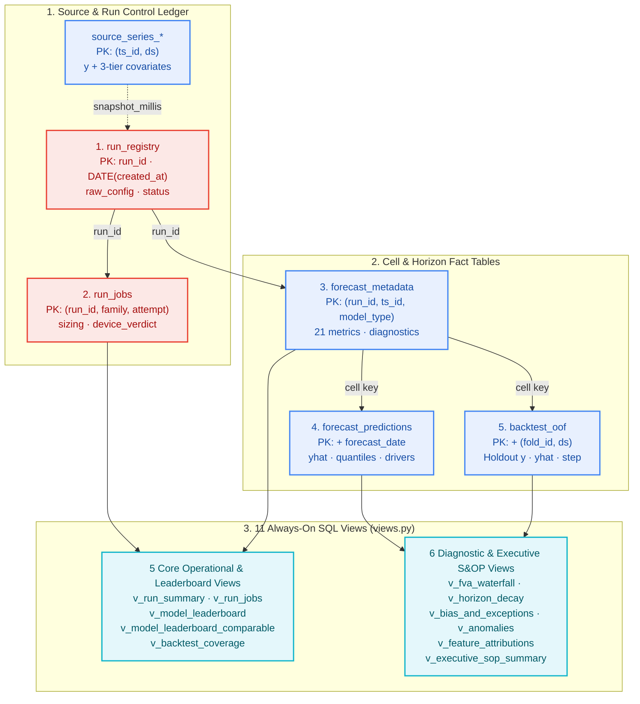

### 6B. Always-on BigQuery semantic foundation vs. opt-in Knowledge Catalog & `DataAgent`

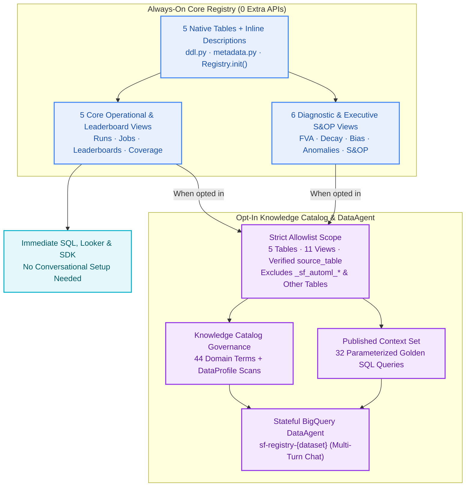

| Diagram Block | Source Modules | Guides & Notebooks | Tests & Smokes |
| :--- | :--- | :--- | :--- |
| **5 Registry Tables & Self-Documenting Metadata** | [`registry/ddl.py`](https://github.com/statmike/scale-forecasting/blob/main/src/scale_forecasting/registry/ddl.py), [`registry/metadata.py`](https://github.com/statmike/scale-forecasting/blob/main/src/scale_forecasting/registry/metadata.py), [`registry/tables.py`](https://github.com/statmike/scale-forecasting/blob/main/src/scale_forecasting/registry/tables.py) | [output_schemas.md](./output_schemas.md), [api/registry_ops.md](./api/registry_ops.md) | [`test_ddl.py`](https://github.com/statmike/scale-forecasting/blob/main/tests/unit/test_ddl.py), [`test_bq_agent.py`](https://github.com/statmike/scale-forecasting/blob/main/tests/unit/test_bq_agent.py), [`ddl_deployment.sql`](https://github.com/statmike/scale-forecasting/blob/main/tests/unit/snapshots/ddl_deployment.sql) |
| **11 Always-On Analytical SQL Views** | [`registry/views.py`](https://github.com/statmike/scale-forecasting/blob/main/src/scale_forecasting/registry/views.py), [`registry/reads.py`](https://github.com/statmike/scale-forecasting/blob/main/src/scale_forecasting/registry/reads.py) | [output_schemas.md](./output_schemas.md), [api/registry_views.md](./api/registry_views.md), [Notebook 10](./notebooks/10_registry_operations_and_scale.ipynb) | [`test_views.py`](https://github.com/statmike/scale-forecasting/blob/main/tests/unit/test_views.py), [`views.sql`](https://github.com/statmike/scale-forecasting/blob/main/tests/unit/snapshots/views.sql) |
| **Strict Allowlist Scope, Knowledge Catalog Glossary & Scans** | [`bq_agent/context.py`](https://github.com/statmike/scale-forecasting/blob/main/src/scale_forecasting/bq_agent/context.py), [`bq_agent/glossary.py`](https://github.com/statmike/scale-forecasting/blob/main/src/scale_forecasting/bq_agent/glossary.py), [`bq_agent/scans.py`](https://github.com/statmike/scale-forecasting/blob/main/src/scale_forecasting/bq_agent/scans.py) | [agent_and_mcp_guide.md](./agent_and_mcp_guide.md), [Notebook 12](./notebooks/12_conversational_analytics_and_knowledge_catalog.ipynb) | [`test_bq_agent.py`](https://github.com/statmike/scale-forecasting/blob/main/tests/unit/test_bq_agent.py), [`test_bq_agent_live.py`](https://github.com/statmike/scale-forecasting/blob/main/tests/integration/test_bq_agent_live.py) |
| **32 Golden SQL Queries & Stateful `DataAgent`** | [`bq_agent/golden_queries.py`](https://github.com/statmike/scale-forecasting/blob/main/src/scale_forecasting/bq_agent/golden_queries.py), [`bq_agent/client.py`](https://github.com/statmike/scale-forecasting/blob/main/src/scale_forecasting/bq_agent/client.py), [`bq_agent/rest.py`](https://github.com/statmike/scale-forecasting/blob/main/src/scale_forecasting/bq_agent/rest.py) | [running_and_reviewing.md](./running_and_reviewing.md), [api/bq_agent.md](./api/bq_agent.md) | [`test_bq_agent.py`](https://github.com/statmike/scale-forecasting/blob/main/tests/unit/test_bq_agent.py), [`test_bq_agent_live.py`](https://github.com/statmike/scale-forecasting/blob/main/tests/integration/test_bq_agent_live.py) |

---

## Level 7 — Stage 3B: The Forecaster Workbench — 6 Pillars & Prescriptive Solvers

Zooming into **`Forecaster Workbench`** ([`workbench.py`](https://github.com/statmike/scale-forecasting/blob/main/src/scale_forecasting/workbench.py)): **every diagnostic, causal decomposition, similarity search, copula simulator, and LP/MILP optimizer runs identically on both live cloud `Forecaster` objects and zero-GCP `playground.bakeoff()` results**, turning forecasts into auditable commercial and supply-chain decisions:

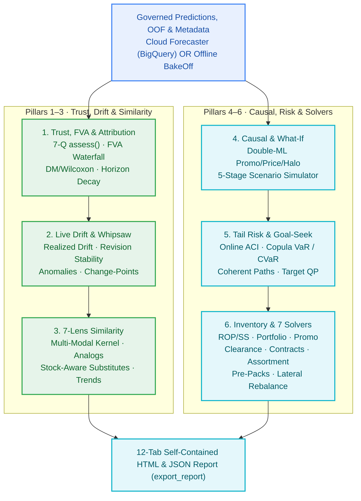

| Workbench Pillar & Key Methods | Source Modules | Guides & Notebooks | Tests & Smokes |
| :--- | :--- | :--- | :--- |
| **1. Trust, FVA Waterfall & Tests** (`practitioner_assessment_df`, `fva_df`, `fva_cascade_df`, `horizon_decay_df`, `attributions_df`) | [`workbench.py`](https://github.com/statmike/scale-forecasting/blob/main/src/scale_forecasting/workbench.py), [`diagnostics.py`](https://github.com/statmike/scale-forecasting/blob/main/src/scale_forecasting/diagnostics.py), [`review.py`](https://github.com/statmike/scale-forecasting/blob/main/src/scale_forecasting/review.py) | [forecaster_workbench.md](./forecaster_workbench.md), [auto_forecaster.md](./auto_forecaster.md), [Notebook 11](./notebooks/11_auto_forecaster_and_autofocus.ipynb) | [`test_phase_g1_workbench.py`](https://github.com/statmike/scale-forecasting/blob/main/tests/unit/test_phase_g1_workbench.py), [`test_phase_g3_diagnostics_and_scenarios.py`](https://github.com/statmike/scale-forecasting/blob/main/tests/unit/test_phase_g3_diagnostics_and_scenarios.py), [`test_review.py`](https://github.com/statmike/scale-forecasting/blob/main/tests/unit/test_review.py) |
| **2. Realized Drift, Whipsaw & HTML Report** (`score_realized`, `revision_stability_df`, `detect_change_points_df`, `export_report`) | [`diagnostics.py`](https://github.com/statmike/scale-forecasting/blob/main/src/scale_forecasting/diagnostics.py), [`report.py`](https://github.com/statmike/scale-forecasting/blob/main/src/scale_forecasting/report.py) | [forecaster_workbench.md](./forecaster_workbench.md), [Notebook 01](./notebooks/01_bigquery_native_sql.ipynb), [Notebook 08](./notebooks/08_multi_engine_master_workflow.ipynb) | [`test_phase_g4_lifecycle_and_report.py`](https://github.com/statmike/scale-forecasting/blob/main/tests/unit/test_phase_g4_lifecycle_and_report.py) |
| **3. 7-Lens Similarity, Substitutes & Trends** (`similarity_df`, `recommend_substitutes_df`, `detect_emerging_trends_df`) | [`similarity.py`](https://github.com/statmike/scale-forecasting/blob/main/src/scale_forecasting/similarity.py) | [forecaster_workbench.md](./forecaster_workbench.md), [api/similarity.md](./api/similarity.md), [Notebook 00](./notebooks/00_model_playground.ipynb), [Notebook 05](./notebooks/05_covariates_and_global_models.ipynb) | [`test_similarity.py`](https://github.com/statmike/scale-forecasting/blob/main/tests/unit/test_similarity.py), [`test_track_p_e2e.py`](https://github.com/statmike/scale-forecasting/blob/main/tests/unit/test_track_p_e2e.py), [`test_track_p2_cross_industry.py`](https://github.com/statmike/scale-forecasting/blob/main/tests/unit/test_track_p2_cross_industry.py) |
| **4. Double-ML Promo Elasticity & What-If** (`promo_elasticity_df`, `simulate_scenarios`) | [`elasticity.py`](https://github.com/statmike/scale-forecasting/blob/main/src/scale_forecasting/elasticity.py), [`scenarios.py`](https://github.com/statmike/scale-forecasting/blob/main/src/scale_forecasting/scenarios.py), [`monotonicity.py`](https://github.com/statmike/scale-forecasting/blob/main/src/scale_forecasting/monotonicity.py) | [forecaster_workbench.md](./forecaster_workbench.md), [api/elasticity.md](./api/elasticity.md), [Notebook 05](./notebooks/05_covariates_and_global_models.ipynb) | [`test_elasticity.py`](https://github.com/statmike/scale-forecasting/blob/main/tests/unit/test_elasticity.py), [`test_scenarios.py`](https://github.com/statmike/scale-forecasting/blob/main/tests/unit/test_scenarios.py), [`test_track_j_e2e.py`](https://github.com/statmike/scale-forecasting/blob/main/tests/unit/test_track_j_e2e.py) |
| **5. Online ACI, Copula `VaR`/`CVaR` & Goal-Seek** (`aci_df`, `sample_trajectories`, `tail_risk_df`, `allocate_target`) | [`aci.py`](https://github.com/statmike/scale-forecasting/blob/main/src/scale_forecasting/aci.py), [`copula.py`](https://github.com/statmike/scale-forecasting/blob/main/src/scale_forecasting/copula.py), [`goal_seek.py`](https://github.com/statmike/scale-forecasting/blob/main/src/scale_forecasting/goal_seek.py) | [forecaster_workbench.md](./forecaster_workbench.md), [api/copula.md](./api/copula.md), [api/goal_seek.md](./api/goal_seek.md), [Notebook 06](./notebooks/06_hierarchical_reconciliation.ipynb), [Notebook 08](./notebooks/08_multi_engine_master_workflow.ipynb) | [`test_aci.py`](https://github.com/statmike/scale-forecasting/blob/main/tests/unit/test_aci.py), [`test_copula.py`](https://github.com/statmike/scale-forecasting/blob/main/tests/unit/test_copula.py), [`test_goal_seek.py`](https://github.com/statmike/scale-forecasting/blob/main/tests/unit/test_goal_seek.py), [`test_track_k_e2e.py`](https://github.com/statmike/scale-forecasting/blob/main/tests/unit/test_track_k_e2e.py) |
| **6. `ROP`/`SS` + 7 LP & MILP Solvers** (`inventory_policy_df`, `optimize_inventory_df`, `optimize_scenario`, `optimize_clearance_df`, `optimize_contract_volume_df`, `optimize_assortment_df`, `optimize_prepacks_df`, `optimize_rebalancing_df`) | [`inventory_optimizer.py`](https://github.com/statmike/scale-forecasting/blob/main/src/scale_forecasting/inventory_optimizer.py), [`scenario_optimizer.py`](https://github.com/statmike/scale-forecasting/blob/main/src/scale_forecasting/scenario_optimizer.py), [`clearance_optimizer.py`](https://github.com/statmike/scale-forecasting/blob/main/src/scale_forecasting/clearance_optimizer.py) | [forecaster_workbench.md](./forecaster_workbench.md), [api/inventory_optimizer.md](./api/inventory_optimizer.md), [api/scenario_optimizer.md](./api/scenario_optimizer.md), [api/clearance_optimizer.md](./api/clearance_optimizer.md), [Notebook 06](./notebooks/06_hierarchical_reconciliation.ipynb), [Notebook 08](./notebooks/08_multi_engine_master_workflow.ipynb) | [`test_inventory_policy.py`](https://github.com/statmike/scale-forecasting/blob/main/tests/unit/test_inventory_policy.py), [`test_inventory_optimizer.py`](https://github.com/statmike/scale-forecasting/blob/main/tests/unit/test_inventory_optimizer.py), [`test_scenario_optimizer.py`](https://github.com/statmike/scale-forecasting/blob/main/tests/unit/test_scenario_optimizer.py), [`test_clearance_optimizer.py`](https://github.com/statmike/scale-forecasting/blob/main/tests/unit/test_clearance_optimizer.py), [`test_track_l_e2e.py`](https://github.com/statmike/scale-forecasting/blob/main/tests/unit/test_track_l_e2e.py) |

---

## Level 8 — Stage 3C: AI Agent Ecosystem, 5 Chat Surfaces, Day-2 Repair & 3-Tier Verification

Zooming into **AI Agent Integration, Day-2 Operations, and Repository Drift Guards**:

1. **5 Repository AI Agent Surfaces + 5 Conversational `DataAgent` Surfaces:** Connects IDE/CLI coding agents (**Google Antigravity `agy`**, **Claude Code**, **Cursor**, **VS Code Copilot**, **Windsurf**) via `SKILL.md` (`npx skills add statmike/scale-forecasting`), the pure-Python `stdio` **MCP server (`7` resources, `14` tools)**, `run_config.schema.json`, and `llms.txt` / `llms-full.txt` — while exposing the BigQuery `DataAgent` across **5 chat surfaces** (BigQuery Studio UI, check-and-run SDK/Notebooks `probe_bq_agent` + `ask()`, CLI `--ask`, MCP `ask_forecast_registry`, and `output.ensure_bq_agent = true`).
2. **Day-2 Lifecycle & Surgical Repair:** Live cloud probes (`probes/`) reconcile mid-flight batch/cluster/pod states, while `retry_run` re-fits **only failed or missing `(ts_id, model)` cells** without recomputing healthy ones.
3. **3-Tier Test & Automated Drift-Lock Gate:** Pre-commit/pre-push hooks (`make hooks`), 12-case pathological torture & SQL-injection suites, live `@gcp`/`@spark`/`@ray` + 13-notebook headless Colab acceptance, and the 42-smoke live infrastructure harness keep code, schemas, and docs permanently aligned.

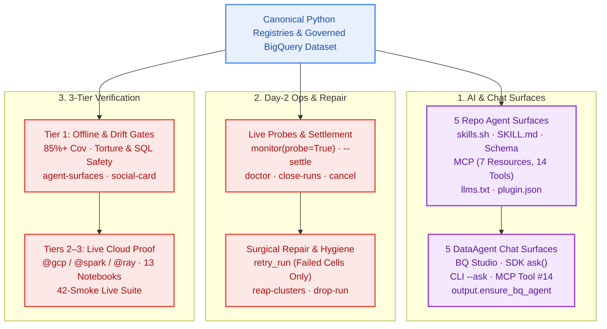

| Diagram Block | Source Modules | Guides & Notebooks | Tests & Smokes |
| :--- | :--- | :--- | :--- |
| **5 Repository AI Agent Surfaces & MCP** | [`agent_surfaces.py`](https://github.com/statmike/scale-forecasting/blob/main/src/scale_forecasting/agent_surfaces.py), [`mcp.py`](https://github.com/statmike/scale-forecasting/blob/main/src/scale_forecasting/mcp.py) (`scale_forecasting.mcp`), [`skills/scale-forecasting/SKILL.md`](https://github.com/statmike/scale-forecasting/blob/main/skills/scale-forecasting/SKILL.md), [`plugin.json`](https://github.com/statmike/scale-forecasting/blob/main/plugin.json) | [agent_and_mcp_guide.md](./agent_and_mcp_guide.md), [api/agent_surfaces.md](./api/agent_surfaces.md), [api/mcp.md](./api/mcp.md) | [`test_agent_surfaces.py`](https://github.com/statmike/scale-forecasting/blob/main/tests/unit/test_agent_surfaces.py), [`test_mcp_server.py`](https://github.com/statmike/scale-forecasting/blob/main/tests/unit/test_mcp_server.py) |
| **5 Conversational Analytics Surfaces** | [`bq_agent/probe.py`](https://github.com/statmike/scale-forecasting/blob/main/src/scale_forecasting/bq_agent/probe.py), [`bq_agent/client.py`](https://github.com/statmike/scale-forecasting/blob/main/src/scale_forecasting/bq_agent/client.py), [`bq_agent/offline.py`](https://github.com/statmike/scale-forecasting/blob/main/src/scale_forecasting/bq_agent/offline.py), [`bq_agent/__main__.py`](https://github.com/statmike/scale-forecasting/blob/main/src/scale_forecasting/bq_agent/__main__.py) | [running_and_reviewing.md](./running_and_reviewing.md), [Notebook 10](./notebooks/10_registry_operations_and_scale.ipynb), [Notebook 12](./notebooks/12_conversational_analytics_and_knowledge_catalog.ipynb) | [`test_bq_agent.py`](https://github.com/statmike/scale-forecasting/blob/main/tests/unit/test_bq_agent.py), [`test_bq_agent_live.py`](https://github.com/statmike/scale-forecasting/blob/main/tests/integration/test_bq_agent_live.py) |
| **Live Probes, Surgical `retry_run` & Hygiene** | [`probes/`](https://github.com/statmike/scale-forecasting/tree/main/src/scale_forecasting/probes), [`retry_run.py`](https://github.com/statmike/scale-forecasting/blob/main/src/scale_forecasting/retry_run.py), [`retry_policy.py`](https://github.com/statmike/scale-forecasting/blob/main/src/scale_forecasting/retry_policy.py), [`registry/ops.py`](https://github.com/statmike/scale-forecasting/blob/main/src/scale_forecasting/registry/ops.py), [`ray_reaper.py`](https://github.com/statmike/scale-forecasting/blob/main/src/scale_forecasting/ray_reaper.py) | [operations.md](./operations.md), [troubleshooting.md](./troubleshooting.md), [Notebook 10](./notebooks/10_registry_operations_and_scale.ipynb) | [`test_probes.py`](https://github.com/statmike/scale-forecasting/blob/main/tests/unit/test_probes.py), [`test_retry_run.py`](https://github.com/statmike/scale-forecasting/blob/main/tests/unit/test_retry_run.py), [`test_registry_ops.py`](https://github.com/statmike/scale-forecasting/blob/main/tests/unit/test_registry_ops.py), [`repair_retry_demo.json`](https://github.com/statmike/scale-forecasting/blob/main/configs/repair_retry_demo.json) |
| **3-Tier Test Suite & Drift Tripwires** | [`notebook_acceptance.py`](https://github.com/statmike/scale-forecasting/blob/main/src/scale_forecasting/notebook_acceptance.py), [`smoke_run.py`](https://github.com/statmike/scale-forecasting/blob/main/src/scale_forecasting/smoke_run.py), [`tests/smokes/smoke_harness.py`](https://github.com/statmike/scale-forecasting/blob/main/tests/smokes/smoke_harness.py) | [validation.md](./validation.md), [smoke_testing.md](./smoke_testing.md) | [`test_docs_integrity.py`](https://github.com/statmike/scale-forecasting/blob/main/tests/unit/test_docs_integrity.py), [`test_validation_ledger.py`](https://github.com/statmike/scale-forecasting/blob/main/tests/unit/test_validation_ledger.py), [`test_pathological_torture_suite.py`](https://github.com/statmike/scale-forecasting/blob/main/tests/unit/test_pathological_torture_suite.py), [`test_sql_injection_safety.py`](https://github.com/statmike/scale-forecasting/blob/main/tests/unit/test_sql_injection_safety.py) |

---

## Appendix — Zoom index & auto-synced repository inventory

### Progressive zoom index

| System Stage | Section | What Is Unpacked |
| :--- | :--- | :--- |
| **Role Routing** | [**Persona Map — 5 Enterprise Personas & Entry Surfaces**](#persona-map--5-enterprise-personas--entry-surfaces) | Which SDK methods, CLI commands, SQL views, notebooks (`00`–`12`), and zoom levels serve each team role. |
| **0. Foundation** | [**Level 1 — Stage 0: Two-Stage Cloud Deployment, 100k Seeding & Zero-Rebuild Code Delivery**](#level-1--stage-0-two-stage-cloud-deployment-100k-seeding--zero-rebuild-code-delivery) | `terraform/bootstrap` + `12` `terraform/main` modules, `13` packaging extras, 100k deterministic `data_gen`, and dynamic `src.zip` shipping. |
| **1. Data, Config & Launch** | [**Level 2 — Stage 1A: Authoring, Auto-Compiling, Ablating & Evolving a `RunConfig`**](#level-2--stage-1a-authoring-auto-compiling-ablating--evolving-a-runconfig) | `12` root `RunConfig` blocks, `@tag` ablation ladders, Glass-Box Auto-Forecaster (`autofocus` + `29` benchmarks), `Forecaster.evolve()`, and `run_id`. |
| **1. Data, Config & Launch** | [**Level 3 — Stage 1B: The 5 Execution Paths, Preflight & Duration/Cost Predictor**](#level-3--stage-1b-the-5-execution-paths-preflight--durationcost-predictor) | Pure-offline sandbox, `--feasibility` / `--quota` / `predict_run_duration`, `--stage-only`, `main.run`, direct submitters, and Cloud Composer 3. |
| **2. Zero-Idle Compute** | [**Level 4 — Stage 2A: Parallel Per-Family Routing, Sizing, GPU Audit & 7 Cloud Runtimes**](#level-4--stage-2a-parallel-per-family-routing-sizing-gpu-audit--7-cloud-runtimes) | Parallel `FamilyJob` fan-out, `ResourceSlot`/`UnitShape` sizing, regional fallback, Arrow `row_restriction` pushdown, 7 runtimes, and `device_verdict`. |
| **2. Zero-Idle Compute** | [**Level 5 — Stage 2B: Forecasting Science Inside the Worker (`5A`–`5E`)**](#level-5--stage-2b-forecasting-science-inside-the-worker-5a5e) | `5A` all `37` models & `31` `@tag` modifiers · `5B` 3-tier covariates across `T_cutoff` & domain hygiene · `5C` 4-scheme backtesting, Optuna HPO & calibration · `5D` all `21` metrics · `5E` 3-mode coherence (`9` methods) & 3-scope ensembles (`8` strategies). |
| **3. Governed Results** | [**Level 6 — Stage 3A: Self-Documenting Registry Schema, 11 Always-On Views & Knowledge Catalog**](#level-6--stage-3a-self-documenting-registry-schema-11-always-on-views--knowledge-catalog) | Primary/join keys across 5 tables & **11 always-created views** vs. the **opt-in** Knowledge Catalog glossary, `DataProfile` scans, and `DataAgent`. |
| **3. Governed Results** | [**Level 7 — Stage 3B: The Forecaster Workbench — 6 Pillars & Prescriptive Solvers**](#level-7--stage-3b-the-forecaster-workbench--6-pillars--prescriptive-solvers) | FVA/DM tests, live drift & whipsaw, 7-lens similarity merchandising, Double-ML & 5-stage What-If, Copula `VaR`/`CVaR`, Goal-Seek QP, and **7 LP/MILP solvers**. |
| **3. Governed Results** | [**Level 8 — Stage 3C: AI Agent Ecosystem, 5 Chat Surfaces, Day-2 Repair & 3-Tier Verification**](#level-8--stage-3c-ai-agent-ecosystem-5-chat-surfaces-day-2-repair--3-tier-verification) | 5 repository AI surfaces (`SKILL.md`, MCP, JSON Schema, `llms.txt`), 5 `DataAgent` chat surfaces, surgical `retry_run`, and the 3-tier test gate. |

### Auto-synced repository inventory

> [!NOTE]
> The table below (and all dynamic counts inside the Mermaid diagrams on this page) is regenerated automatically from live Python reflection via `make agent-surfaces` (`python -m scale_forecasting.agent_surfaces --write`), and `Level 0` is synced from `README.md` via `make social-card`.

<!-- BEGIN AUTO-SYNCED VISUAL INVENTORY -->
| System Surface | Live Code Count & Breakdown | Canonical Source of Truth |
| :--- | :--- | :--- |
| **Forecasting Models** | **37 models** across **5 families** (`18` `statistical`, `5` `ml`, `8` `deep_learning`, `4` `automl`, `2` `native`) + **31 `@tag` modifiers** | [`models/__init__.py`](https://github.com/statmike/scale-forecasting/blob/main/src/scale_forecasting/models/__init__.py), [`config.py`](https://github.com/statmike/scale-forecasting/blob/main/src/scale_forecasting/config.py) |
| **Evaluation Metrics** | **21 metrics** (`16` point accuracy + `5` prediction interval) | [`metrics/__init__.py`](https://github.com/statmike/scale-forecasting/blob/main/src/scale_forecasting/metrics/__init__.py) |
| **Cloud Runtimes & GPUs** | **7 runtimes** (`spark`, `ray`, `vertex`, `gce`, `gke`, `vertex_automl`, `bigquery`) · **4 GPU types** (`T4`, `L4`, `A100`, `A100_80GB`) | [`config.py`](https://github.com/statmike/scale-forecasting/blob/main/src/scale_forecasting/config.py), [`resources/catalog.py`](https://github.com/statmike/scale-forecasting/blob/main/src/scale_forecasting/resources/catalog.py) |
| **Config, Auto-Compiler & Benchmarks** | **12 root `RunConfig` fields** · **4 exposure tiers** · **5 scale regimes** · **20 synthetic DGPs + 9 public benchmarks** | [`auto.py`](https://github.com/statmike/scale-forecasting/blob/main/src/scale_forecasting/auto.py), [`auto_policy.py`](https://github.com/statmike/scale-forecasting/blob/main/src/scale_forecasting/auto_policy.py), [`benchmarks.py`](https://github.com/statmike/scale-forecasting/blob/main/src/scale_forecasting/benchmarks.py) |
| **Similarity, Ensembles & Coherence** | **7 similarity lenses** · **8 ensemble strategies** · **9 reconciliation methods** (3-mode `THieF` & `cross_temporal_mint` + `clr`/`ilr` simplex) | [`similarity.py`](https://github.com/statmike/scale-forecasting/blob/main/src/scale_forecasting/similarity.py), [`ensembler.py`](https://github.com/statmike/scale-forecasting/blob/main/src/scale_forecasting/ensembler.py), [`temporal_reconciliation.py`](https://github.com/statmike/scale-forecasting/blob/main/src/scale_forecasting/temporal_reconciliation.py) |
| **Always-On BigQuery Registry & Views** | **5 native registry tables** · **11 always-created SQL views** (`5` core + `6` diagnostic/S&OP) · `20` object & `326` column descriptions | [`registry/ddl.py`](https://github.com/statmike/scale-forecasting/blob/main/src/scale_forecasting/registry/ddl.py), [`registry/views.py`](https://github.com/statmike/scale-forecasting/blob/main/src/scale_forecasting/registry/views.py), [`registry/metadata.py`](https://github.com/statmike/scale-forecasting/blob/main/src/scale_forecasting/registry/metadata.py) |
| **Opt-In Knowledge Catalog & `DataAgent`** | **44 Business Glossary terms** · `DataProfile` scans · **32 Golden SQL queries** · **5 chat surfaces** | [`bq_agent/`](https://github.com/statmike/scale-forecasting/tree/main/src/scale_forecasting/bq_agent) |
| **Forecaster Workbench & Solvers** | **6 Workbench pillars** · **7-Question `assess()`** · **Single-SKU `ROP`/`SS` + 7 SciPy/HiGHS LP & MILP optimizers** · **12-tab HTML/JSON report** | [`workbench.py`](https://github.com/statmike/scale-forecasting/blob/main/src/scale_forecasting/workbench.py), [`inventory_optimizer.py`](https://github.com/statmike/scale-forecasting/blob/main/src/scale_forecasting/inventory_optimizer.py), [`clearance_optimizer.py`](https://github.com/statmike/scale-forecasting/blob/main/src/scale_forecasting/clearance_optimizer.py) |
| **AI Agent & MCP Ecosystem** | **6 generated agent files** · **1 portable `SKILL.md`** · **MCP server (`7` resources, `14` tools)** across 5 IDE/CLI clients | [`agent_surfaces.py`](https://github.com/statmike/scale-forecasting/blob/main/src/scale_forecasting/agent_surfaces.py), [`mcp.py`](https://github.com/statmike/scale-forecasting/blob/main/src/scale_forecasting/mcp.py) |
| **Infrastructure, Notebooks & Validation** | **12 Terraform modules** · **13 packaging extras** · **13 notebooks** · **42 smoke + 20 demo configs** | [`terraform/`](https://github.com/statmike/scale-forecasting/tree/main/terraform), [`notebooks/`](https://github.com/statmike/scale-forecasting/tree/main/notebooks), [`configs/`](https://github.com/statmike/scale-forecasting/tree/main/configs) |
<!-- END AUTO-SYNCED VISUAL INVENTORY -->

---

## Where to go next

- **Run your first forecast in 5 minutes:** [Getting started](./getting_started.md) or [`notebooks/00_model_playground.ipynb`](./notebooks/00_model_playground.ipynb).
- **Read the function-by-function call spine:** [Software architecture (`architecture.md`)](./architecture.md).
- **Dive into all 6 Workbench pillars & 7 LP/MILP solvers:** [Forecaster workbench (`forecaster_workbench.md`)](./forecaster_workbench.md).
- **Explore the 11 SQL views & Knowledge Catalog:** [Output schemas (`output_schemas.md`)](./output_schemas.md), [AI agents & MCP (`agent_and_mcp_guide.md`)](./agent_and_mcp_guide.md), and [`notebooks/12_conversational_analytics_and_knowledge_catalog.ipynb`](./notebooks/12_conversational_analytics_and_knowledge_catalog.ipynb).
- **Audit live cloud proofs across all 7 runtimes:** [System validation ledger (`validation.md`)](./validation.md).
