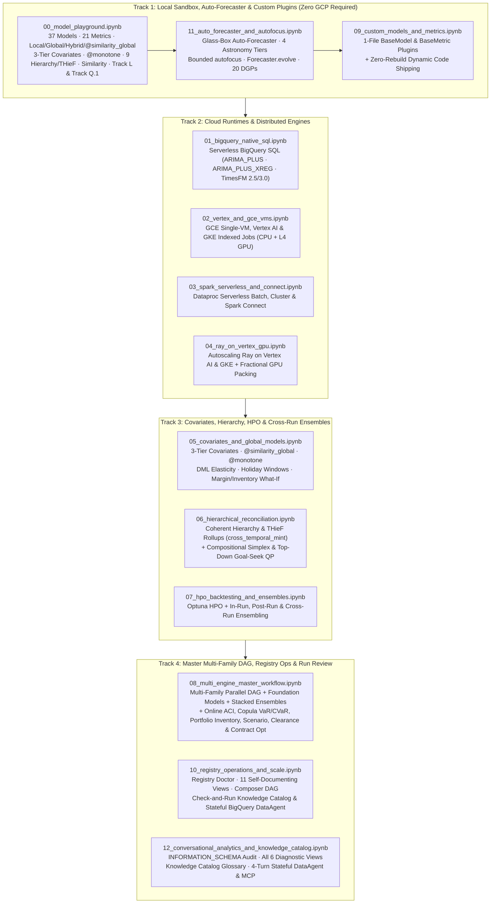

# Interactive Notebooks (`notebooks/`)

<p align="center">
  <b>A Complete Interactive Curriculum for Enterprise Scale Forecasting on Google Cloud</b><br>
  <i>From local zero-GCP prototyping across all 37 models and 21 metrics to distributed execution across BigQuery ML, GCE, Vertex AI, GKE (Indexed Jobs & Ray on GKE), Vertex AI AutoML Tabular Workflows, Spark, and Ray — plus 3-tier covariates, time-series similarity & digital-twin analog search (@similarity_global, @similarity_cold_start, similarity_hierarchy), causal & econometric guardrails (@monotone, DML promo elasticity, moving-holiday windows, full-chain margin/inventory scenarios), two-tier explainability, 8-method FPP3 reconciliation, cross-run ensembling, custom 1-file plugins, and 100,000-series operations.</i>
</p>



---

## Thirteen Focused & Combination Workflow Notebooks

Every cloud workflow notebook (`01`–`08`) is a **complete, self-contained 5-act (or 6-act) journey**:
1. **Setup & Architecture Context:** Bootstrap, `Settings.resolve()`, and visual Mermaid architecture map.
2. **Configure & Explain Plan:** Author `RunConfig` and inspect the pre-flight execution table via `forecaster.explain()`.
3. **Launch & Monitor Live:** Execute asynchronously with live in-place progress bars and infrastructure probes via `forecaster.run_live()`.
4. **Retrieve & Review Results:** Inspect `forecaster.leaderboard_df()`, `plot_leaderboard()`, `plot_metric_distribution()`, `forecaster.plot_forecasts()`, `forecaster.cohorts_df()`, `forecaster.jobs_df()`, `forecaster.attributions_df()`, `forecaster.plot_attributions()`, and `forecaster.trace()`.
5. **Deep Dive / Follow-Up Action:** Inspect 4-panel forecast decomposition (`forecaster.plot_forecast_explanation()`), two-tier feature attributions (`forecaster.attributions_df()`, `forecaster.plot_attributions()`), empirical interval calibration by horizon step (`forecaster.plot_calibration()`), learned ensemble stacking weights (`forecaster.plot_ensemble_weights()`), post-run `reensemble()`, cross-run `ensemble_runs()`, direct Spark/Ray engine embedding (`run_group`, `chunk_cells`), causal & econometric guardrails (`@monotone`, `promo_elasticity_df()`, `holiday_window`, and full-chain `simulate_scenarios()`), cross-temporal `THieF` reconciliation (`temporal_reconcile_df()`, `cross_temporal_mint`), compositional simplex (`@transform_clr`, `@transform_ilr`), top-down Goal-Seek QP (`allocate_target()`, `plot_goal_seek()`), Track L cold-start transfer (`cold_start_transfer_df()`), online ACI (`aci_df()`), copula tail risk (`sample_trajectories()`, `tail_risk_df()`), portfolio inventory optimization (`optimize_inventory_df()`), prescriptive price/promo optimization (`optimize_scenario()`), Track Q.1 lifecycle markdown & perishable clearance MILP (`optimize_clearance_df()`, `plot_clearance_schedule()`) and vendor contract volume / Take-or-Pay optimization (`optimize_contract_volume_df()`), or Track P multi-modal time-series similarity (`similarity_df()`, `find_similar_series_df()`, `cluster_by_similarity_df()`, `recommend_substitutes_df()`, `detect_emerging_trends_df()`, `plot_similarity_map()`, `@similarity_global`, `@similarity_cold_start`, and `similarity_hierarchy=True`).

### Track 1: Foundations, Local Prototyping & Extensibility (Zero GCP Setup)
| Notebook | Target Environment | What You Will Learn |
| :--- | :--- | :--- |
| [`00_model_playground.ipynb`](./00_model_playground.ipynb) | Local Python (Offline) | Explore the full 37-model (5-family) and 21-metric catalogs (`model_catalog()`, `metric_catalog()`), generate synthetic panels (`sample_data()`), run 3-fold rolling-origin backtesting and conformal interval calibration (`run_model()`, `bakeoff()`), decompose forecasts into trend, regime level shift, seasonality, and exogenous covariate attribution (`explain_forecast_frame()`, `plot_forecast_explanation()`), inspect Two-Tier Feature Attributions (`build_attributions_frame()`, `plot_attributions()`), compare `local` vs. `global` vs. `hybrid` vs. `@similarity_global` training modes, run all 9 hierarchical & cross-temporal reconciliation methods, and evaluate the Forecaster Workbench (`fva_df()`, `horizon_decay_df()`, `bias_report_df()`, `rollup_df()`, `inventory_policy_df()`, `@monotone` sign/monotonicity constraints, Double/Debiased ML `promo_elasticity_df()` & `plot_promo_elasticity()`, moving-holiday `holiday_window` kernels, full-chain `simulate_scenarios(..., unit_cost=..., reconcile=True, include_inventory_impact=True)` with `compare_scenario_margin_curves()` & `plot_scenarios()`, `THieF` `temporal_reconcile_df()`, `@transform_clr`/`@transform_ilr` `forecast_simplex_panel()`, constrained `allocate_target()` + `plot_goal_seek()`, **Act 8 Track L**: `cold_start_transfer_df()`, online `aci_df()`, joint copula `sample_trajectories()` & `tail_risk_df()`, portfolio `optimize_inventory_df()`, and prescriptive `optimize_scenario()`, **Act 11 (Act 9 Track P)**: 7-lens & multi-modal `similarity_df()` (`text_cols`, `attribute_cols`, `hierarchy_cols`, `within_hierarchy_level`) across `"hybrid"`, `"physics_attractor"`, `"spectral_phase"`, `"elastic_dtw"`, `"minirocket"`, `"structural_signature"`, and `"foundation_latent"`, `find_similar_series_df(mode="launch_prefix")` analog matching, `cluster_by_similarity_df()`, `recommend_substitutes_df()`, `detect_emerging_trends_df()`, `plot_similarity_map()`, and `@similarity_global` / `@similarity_cold_start`, **Act 12 (Track Q / R)**: lifecycle markdown & perishable clearance MILP (`optimize_clearance_df()`, `plot_clearance_schedule()`), vendor contract volume (`optimize_contract_volume_df()`), assortment delisting (`optimize_assortment()`), integer pre-packs (`optimize_prepacks()`), and lateral store rebalancing (`optimize_rebalancing()`), and **Act 13 (Track D.1)**: offline Executive S&OP scorecard (`sop_summary_df()`) and deterministic `.ask()` router (`mode="offline"`) paired with canonical BigQuery Golden SQL) with zero cloud credentials. |
| [`09_custom_models_and_metrics.ipynb`](./09_custom_models_and_metrics.ipynb) | Local Python (Offline) | Author a custom 1-file `BaseModel` subclass (`@register`) and custom `BaseMetric` subclass, test them immediately in `run_model()` and `bakeoff()`, and inspect automatic BigQuery schema migration (`render_migrations`) and zero-rebuild `src.zip` shipping. |
| [`11_auto_forecaster_and_autofocus.ipynb`](./11_auto_forecaster_and_autofocus.ipynb) | Local Python (Offline) | Explore the **20-panel Synthetic DGP Benchmark Bank** (`list_benchmarks()`, `load_benchmark()`), compile transparent Glass-Box configurations across the **4 observational astronomy exposure tiers** (`first_light`, `wide_field`, `deep_sky`, `deep_field`) and **5 `n_series` scale regimes** (`micro` to `hyperscale`) via `Forecaster.build_config()`, predict wall-clock duration and cloud cost across all **7 runtimes** (`predict_run_duration()`), execute autonomous closed-loop `Forecaster.auto(..., autofocus=True)` with zero-waste cell borrowing (`autofocus_ledger_df()`, `baseline_value_df()`, `hierarchy_value_df()`, `plot_autofocus_progression()`), step through human-in-the-loop `step_by_step=True` (`preview_next_loop()`, `step()`), verify the white-noise stopping gate on `dgp_12_already_optimal_white_noise`, and run **post-run & multi-run evolutionary super-ensembling (`f.evolve()`, `Forecaster.evolve(from_runs=[...])`) + `+1e6` future-leakage verification (`verify_no_future_leakage`)**. |

---

### Track 2: Cloud Runtimes & Distributed Engines
| Notebook | Target Environment | What You Will Learn |
| :--- | :--- | :--- |
| [`01_bigquery_native_sql.ipynb`](./01_bigquery_native_sql.ipynb) | Serverless BigQuery ML | Execute `arima_plus` (`ARIMA_PLUS`), `arima_plus_xreg` (`ARIMA_PLUS_XREG` + `ML.EXPLAIN_FORECAST` Two-Tier attributions), and Google Research `timesfm@univariate` (`TimesFM 2.5`) vs. `timesfm` (`TimesFM 3.0` multivariate covariates via `AI.FORECAST`) directly inside BigQuery SQL with zero cluster provisioning, blend them into stacked ensembles, evaluate Covariate FVA (`fva_df()`), detect anomalies and structural change points (`detect_anomalies_df()`, `detect_change_points_df()`), and compute $(s, S)$ inventory replenishment policies (`inventory_policy_df()`, `plot_inventory_policy()`). |
| [`02_vertex_and_gce_vms.ipynb`](./02_vertex_and_gce_vms.ipynb) | GCE Single-VM, Vertex AI CustomJob & GKE Indexed Jobs | Compare all three direct container runtimes powered by `vertex_engine.py`: ephemeral GCE Single-VM (`runtime="gce"`, triple-redundant auto-delete), multi-worker Vertex AI CustomJob (`runtime="vertex"`), and Google Kubernetes Engine Indexed Jobs (`runtime="gke", gke_mode="job"`, per-model GPU pod auto-expansion and independent node scale-down), plus inspect Two-Tier Feature Attributions (`attributions_df()`, `plot_attributions()`). |
| [`03_spark_serverless_and_connect.ipynb`](./03_spark_serverless_and_connect.ipynb) | Dataproc Spark (`serverless` / `cluster` / `connect`) | Run the distributed Arrow-backed `groupBy(bucket).applyInPandas` fan-out on Dataproc Serverless in parallel with BigQuery SQL, compare with Dataproc Standard Clusters and interactive Spark Connect (`DataprocSparkSession`), and embed the pure Spark UDF directly via `spark_io.run_group()`. |
| [`04_ray_on_vertex_gpu.ipynb`](./04_ray_on_vertex_gpu.ipynb) | Ray on Vertex AI & Ray on GKE (CPU & GPU) | Provision ephemeral autoscaling Ray clusters on Vertex AI (`ray_mode="vertex"`) or GKE (`ray_mode="gke"` / `runtime="gke", gke_mode="ray"`), pack PyTorch deep learning tasks fractionally onto GPUs (`gpu_fraction=0.25`), compare `local`, `global`, and `hybrid` neural network regimes, and embed Ray task chunking directly via `ray_io.chunk_cells()`. |

---

### Track 3: Advanced Modeling — Covariates, Hierarchy, HPO & Cross-Run Ensembles
| Notebook | Target Environment | What You Will Learn |
| :--- | :--- | :--- |
| [`05_covariates_and_global_models.ipynb`](./05_covariates_and_global_models.ipynb) | Vertex AI / Spark + Exog Table | Configure all 3 exogenous covariate tiers (`static_covariates`, `future_covariates`, lag-shifted `past_covariates`) on `source_series_covariates_native`, train global cross-series deep learning (`tide`, `tsmixer`) and ML models (`lightgbm`, `xgboost`), visualize both structural exogenous covariate attribution (`plot_forecast_explanation`) and Two-Tier TreeSHAP feature attributions (`attributions_df`, `plot_attributions`), enforce **Causal & Structural Econometric Guardrails (Act 6)** across `@monotone` sign/monotonicity constraints (`regression_lags@monotone`, `ridge_lags@monotone`, `lightgbm@monotone`, `xgboost@monotone`, `catboost@monotone`), Double/Debiased ML price/promo elasticity (`promo_elasticity_df()`, `plot_promo_elasticity()`), moving-holiday lead/lag windows (`holiday_window`), and full-chain gross-margin, hierarchical reconciliation (`reconcile=True`), and inventory (`include_inventory_impact=True`) what-if scenario simulation (`simulate_scenarios()`, `summarize_scenarios()`, `compare_scenario_margin_curves()`, `plot_scenarios()`), and run **Cluster-Pooled `@similarity_global`, Multi-Modal Retail Similarity, Substitute Recommendation, Emerging Trend Sensing & Similarity-Synthesized Hierarchy Reconciliation (Act 7)** (`similarity_df()`, `cluster_by_similarity_df()`, `find_similar_series_df()` with `text_cols` / `attribute_cols` / `hierarchy_cols`, `recommend_substitutes_df()`, `detect_emerging_trends_df()`, `plot_similarity_map()`, `tide@similarity_global`, `lightgbm@similarity_global`, `@similarity_cold_start`, and `hierarchy.similarity_hierarchy=True` + `mint_shrink`). |
| [`06_hierarchical_reconciliation.ipynb`](./06_hierarchical_reconciliation.ipynb) | Vertex AI / GCE / Spark + Hierarchy | Configure multi-level business hierarchies (`region` $\rightarrow$ `category` $\rightarrow$ `ts_id`), reconcile forecasts across `bottom_up`, `wls_struct`, `mint_shrink`, and simultaneous `cross_temporal_mint` (`THieF` temporal hierarchy reconciliation via `forecaster.temporal_reconcile_df()`, `verify_temporal_coherence()`, `verify_cross_temporal_coherence()`), forecast compositional market-share panels with `@transform_clr` and `@transform_ilr` (`forecast_simplex_panel()`, `verify_simplex_coherence()`), disaggregate executive top-down targets via constrained Minimum-Trace QP (`forecaster.allocate_target()` with `locked_nodes`, bounds, `price_col`, `unit_cost`, `include_inventory_impact=True`, and `forecaster.plot_goal_seek()`), and solve **Track Q.2 / R.2** simplex size-curve integer pre-pack allocation (`forecaster.optimize_prepacks()`), assortment delisting transference (`forecaster.optimize_assortment()`), and lateral store-to-store rebalancing (`forecaster.optimize_rebalancing()`). |
| [`07_hpo_backtesting_and_ensembles.ipynb`](./07_hpo_backtesting_and_ensembles.ipynb) | BigQuery + Vertex AI | Tune hyperparameters with Optuna (`hpo.enabled=True`, `forecaster.best_params_df()`), inspect backtest cohort health (`cohorts_df()`), run **in-run ensembling**, add new stacked strategies in seconds with **post-run re-ensembling** (`forecaster.reensemble()`), combine base models across two separate runs using **cross-run ensembling** (`forecaster.ensemble_runs()`, plus how to extend to evolutionary super-ensembling via `Forecaster.evolve(from_run_ids=[...])`), and plot learned base-model weights (`plot_ensemble_weights()`). |

---

### Track 4: Master Multi-Family Workflow, Registry Operations & Run Review
| Notebook | Target Environment | What You Will Learn |
| :--- | :--- | :--- |
| [`08_multi_engine_master_workflow.ipynb`](./08_multi_engine_master_workflow.ipynb) | Spark $\parallel$ Vertex / GKE / AutoML $\parallel$ BigQuery | Dispatch active model families (`statistical`, `ml`, `deep_learning` including `[models-foundation]` `chronos_bolt`, and `native`) concurrently across their optimal runtimes from a single `RunConfig` (**zero-idle per-family compute** — including a 5-family execution plan preview with `automl` on `vertex_automl`), join them in a stacked ensemble, and run the complete diagnostic, explainability, anomaly/change-point, online ACI (`aci_df`), copula VaR/CVaR tail risk (`sample_trajectories`, `tail_risk_df`), portfolio inventory (`optimize_inventory_df`, `plot_inventory_frontier`), prescriptive price/promo (`optimize_scenario`, `plot_optimal_scenario`), and **Act 6 Track Q / R** lifecycle markdown clearance (`optimize_clearance_df`, `plot_clearance_schedule`), vendor contract volume (`optimize_contract_volume_df`), assortment delisting transference (`optimize_assortment_df`), simplex size-curve integer pre-packs (`optimize_prepacks_df`), and lateral store-to-store rebalancing (`optimize_rebalancing_df`) workbench (`leaderboard_df`, `fva_df`, `cohorts_df`, `jobs_df`, `attributions_df`, `plot_attributions`, `plot_calibration`, `plot_ensemble_weights`, `plot_forecasts`, `plot_forecast_explanation`, `plot_trace`, `detect_anomalies_df`, `detect_change_points_df`, `inventory_policy_df`, `plot_inventory_policy`). |
| [`10_registry_operations_and_scale.ipynb`](./10_registry_operations_and_scale.ipynb) | BigQuery Registry, Ops & Check-and-Run Agent | Zero-SQL registry health audit (`reg.doctor()`, `reg.runs_df()`, `reg.sop_summary_df()`), historical run reattachment (`Forecaster.from_run_id()`, `attributions_df()`), pre-flight fold feasibility (`feasibility()`), preview-safe Day-2 verbs (`retry`, `settle`, `cancel`), **all 5 production launch pathways** (including live execution of the Cloud Composer 3 `airflow_tasks` DAG sequence against a GCS-staged config), cross-platform review of completed runs (the 100,000-series benchmark `run_id`s are recorded in [Quota & Scale](../quota_and_scale.md)), and **Act 6**: safe **check-and-run** readiness probing (`reg.probe_bq_agent()`) with **Knowledge Catalog** Business Glossary (`44` terms) provisioning (`reg.ensure_bq_agent()`) and multi-turn stateful Q&A (`reg.ask(..., conversation_id=...)`). |
| [`12_conversational_analytics_and_knowledge_catalog.ipynb`](./12_conversational_analytics_and_knowledge_catalog.ipynb) | BigQuery Views, Knowledge Catalog & Stateful `DataAgent` | Dedicated deep dive into `Track D.1`: non-raising readiness probing (`reg.probe_bq_agent()`, fallback `setup_hint`), `INFORMATION_SCHEMA` audit proving `100%` table/view/column description coverage across all `16` canonical registry objects, pure-SQL inspection of `v_executive_sop_summary`, `v_fva_waterfall`, and `v_horizon_decay`, strict `BQAgentScope` discovery (`0` staging leaks), **44-term Knowledge Catalog Business Glossary** & **32 Golden SQL queries** (`reg.ensure_bq_agent()`), **4-turn stateful conversation** (`conversation_id`), historical `run_id` pinning (`Forecaster.from_run_id().ask()`), cross-run rollups (`run_id="all"`), `output.ensure_bq_agent = True` auto-refresh, offline `.ask()` parity, and live MCP `ask_forecast_registry` (`mode="probe"` & `"auto"`). |

---

## How to Run the Notebooks

### Option 1: 1-Click in Google Cloud Colab Enterprise (Recommended)

When you deploy the platform via Terraform (`create_colab_runtimes = true`, enabled by default), the **`sf-main`** Python 3.11 runtime template is pre-configured with all required environment variables (`SF_PROJECT_ID`, `SF_DATASET_ID`, `SF_CONNECTION`, `SF_WAREHOUSE_URI`, `SF_CODE_BUCKET`, `SF_CONTAINER_IMAGE`, `SF_COMPUTE_SA`, `SF_SUBNETWORK_URI`).

1. Open any notebook and click the **Run in Colab Enterprise** badge at the top.
2. Select the **`sf-main`** runtime template.
3. Click **Run all** — the environment bootstrap cell automatically sets up the locked dependencies from `uv.lock` and executes smoothly.

---

### Option 2: Local Jupyter / VS Code

1. Install the pinned environment and register the Jupyter kernel:
   ```bash
   uv sync --all-extras
   uv run python -m ipykernel install --user --name scale-forecasting
   ```
2. Export your deployment's environment variables (not required for `00_model_playground.ipynb`, `09_custom_models_and_metrics.ipynb`, or `11_auto_forecaster_and_autofocus.ipynb`):
   ```bash
   eval "$(cd terraform/main && terraform output -raw sf_env_exports)"
   ```
3. Open any notebook in your local IDE and select the `scale-forecasting` kernel.

---

## Automated Verification

All thirteen notebooks are verified end-to-end using the headless acceptance test runner:

```bash
uv run python -m scale_forecasting.notebook_acceptance --tier all
```

For technical details on all 7 cloud compute runtimes and 4-tier scaling, see [`docs/runtimes_reference.md`](../runtimes_reference.md). For Colab Enterprise runtime templates and interpreter configurations, see [`docs/notebook_runtimes.md`](../notebook_runtimes.md).
