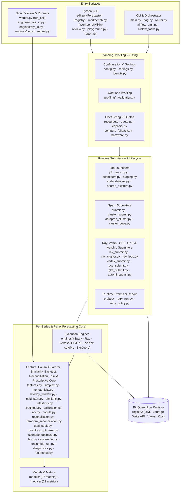

# `scale_forecasting` Package (`src/scale_forecasting/`)

`scale_forecasting` is structured around **one capability per file** and a strict separation between **pure planning/math** and **cloud I/O**. Every execution surface — local Python, Dataproc Spark (Serverless and GCE Clusters), Ray on Vertex AI, Vertex AI `CustomJob`, Compute Engine (`gce`), Google Kubernetes Engine (`gke`), and Cloud Composer (Airflow) — imports this exact package and runs the same per-series unit of work ([`worker.run_cell`](./worker.py)).

The package root ([`__init__.py`](./__init__.py)) uses a PEP 562 lazy `__getattr__` loader so importing `scale_forecasting` never pulls in heavy optional dependencies (`pyspark`, `ray`, `torch`, `neuralprophet`) until the specific module or model is requested.

---

## Subpackages

Each subpackage has its own `README.md` with architecture diagrams and module guides:

| Subpackage | Purpose |
| :--- | :--- |
| **[`models/`](./models/README.md)** | The 37 forecasting models (`statistical`, `ml`, `deep_learning`, `automl`, `native`), the `BaseModel` contract (local, global, and hybrid scopes + two-tier explainability), recursive lag design matrix (`_lag_forecaster.py`), Nixtla `neuralforecast` adapter (`_neuralforecast_base.py`), open-weight foundation adapter (`_foundation_base.py`), Vertex AI AutoML adapter (`_vertex_automl_base.py`), and model registry. |
| **[`metrics/`](./metrics/README.md)** | The 21 evaluation metrics (16 point metrics + 5 prediction-interval metrics), `BaseMetric` contract, and `METRIC_NAMES` schema driver. |
| **[`engines/`](./engines/README.md)** | Distributed, single-VM, and managed AutoML engines for Dataproc Spark (`spark_explode.py`, `spark_io.py`), Ray on Vertex AI & GKE (`ray_engine.py`, `ray_io.py`), Vertex AI `CustomJob`, Compute Engine & GKE Indexed Jobs (`vertex_engine.py`), Vertex AI AutoML Tabular Workflows (`automl_engine.py`), and BigQuery SQL (`bigquery_engine.py`, `bigquery_sql.py`). |
| **[`registry/`](./registry/README.md)** | BigQuery table DDL (`ddl.py`), deterministic `run_id` hashing (`ids.py`), Storage Write API streaming (`write_api.py`), SQL views (`views.py`), and operator maintenance verbs (`ops.py`). |
| **[`probes/`](./probes/README.md)** | Live runtime-to-registry reconciliation (`reconcile.py`), platform status readers (`runtimes.py`), safe job cancellation (`cancel.py`), and abandoned-row settling (`settle.py`). |
| **[`resources/`](./resources/README.md)** | Translates measured per-cell resource profiles and regional quotas into concrete executor/worker sizing for Dataproc Serverless, Dataproc Clusters, Ray pools, Vertex `CustomJob`, GCE, GKE, and Vertex AI AutoML. |
| **[`profiling/`](./profiling/README.md)** | Empirical per-cell CPU, memory, and wall-time measurement (`measure.py`), representative series sampling (`sampling.py`), baseline fallbacks (`baseline.py`), and cost-weighted bucketing (`cost.py`). |
| **[`data_gen/`](./data_gen/README.md)** | Synthetic multi-archetype time-series panel generator (`generator.py`) and distributed Spark seeding job (`seed_spark.py`). |
| **[`evolve/`](./evolve/README.md)** | Opt-in AlphaEvolve runtime harness (`Forecaster.evolve` / `python -m scale_forecasting.evolve`) with dual cloud backends (`backend="alphaevolve"` on Gemini Enterprise Discovery Engine `v1alpha` and `backend="vertex_gemini"` backup on standard Vertex AI Gemini + `"mock"` offline), 5 `# EVOLVE-BLOCK` targets (`"features"`, `"ensemble"`, `"model"`, `"policy"`, `"similarity_kernel"`), AST security sandbox (`sandbox.py`), `+1e6` temporal lookahead probe, and 3-Gate Anti-Overfitting Ratchet (`evaluator.py`, `runner.py`). |

---

## Top-Level Modules by Role

### 1. User & Orchestration Entrypoints
- **[`sdk.py`](./sdk.py) & [`workbench.py`](./workbench.py):** The Python SDK (`Forecaster` in `sdk.py` for planning, running, monitoring, probing, cancelling, settling, retrying runs, compiling Glass-Box auto-configs (`build_config`), running closed-loop `autofocus` sessions (`auto`), and running opt-in runtime `# EVOLVE-BLOCK` code evolution (`evolve`), mixed with `WorkbenchMixin` / `PlaygroundWorkbenchMixin` in `workbench.py` for post-run diagnostics, decomposing promo/price elasticity (`promo_elasticity_df`), synthesizing cold-start/NPI transfers (`cold_start_transfer_df`, `plot_cold_start_transfer`), computing time-series similarity & analog clusters (`similarity_df`, `similarity_matrix_df`, `similarity_clusters_df`, `similarity_embeddings_df`, `find_similar_series_df`, `plot_similarity_map`), tracking online ACI intervals (`aci_df`, `plot_aci`), simulating joint copula trajectories & VaR/CVaR tail risk (`sample_trajectories`, `tail_risk_df`, `plot_trajectories`), running full-chain margin/inventory scenarios (`simulate_scenarios`), solving prescriptive price/promo calendars (`optimize_scenario`, `plot_optimal_scenario`), solving lifecycle markdown, perishable expiry, warehouse space reclamation, vendor contract volume, & assortment rationalization MILPs (`optimize_clearance_df`, `plot_clearance_schedule`, `optimize_contract_volume_df`, `optimize_assortment_df`), optimizing multi-SKU portfolio inventory, simplex size-curve integer pre-packs, and lateral store-to-store rebalancing (`optimize_inventory_df`, `plot_inventory_frontier`, `optimize_prepacks_df`, `optimize_rebalancing_df`), reconciling temporal hierarchies (`temporal_reconcile_df`), solving top-down Goal-Seek target allocations (`allocate_target`, `plot_goal_seek`), and exporting executive reports; `Registry` for dataset maintenance).
- **[`auto.py`](./auto.py) & [`auto_policy.py`](./auto_policy.py):** Glass-Box Auto-Forecaster (`build_config`, `auto_forecast`, `inspect_panel_for_auto`), Observational Astronomy Exposure Tiers (`first_light`, `wide_field`, `deep_sky`, `deep_field`), 5 `n_series` scale regimes (`micro` to `hyperscale`), 4-anchor baseline ladder (`select_default_baselines`), scale-aware hierarchy reconciliation (`select_hierarchy_reconciliation_methods`), Step 0 price/promo `@monotone`, `holiday_window`, compositional simplex (`is_compositional_simplex`), cold-start (`n_cold_start_series`), and similarity cluster (`optimal_similarity_clusters`, `similarity_silhouette_score`, `has_similarity_clusters`) detection, evolutionary decision policy (`select_tier_models_and_features`, `propose_autofocus_pass`, `propose_autofocus_dag_branches` including `@similarity_global`, `@similarity_cold_start`, and `similarity_hierarchy`), and bounded closed-loop `Plan -> Execute -> Observe -> Review -> Re-Plan` (`autofocus=True`) controller.
- **[`benchmarks.py`](./benchmarks.py):** Deterministic 20-panel Synthetic Data-Generating Process (DGP) Benchmark Suite (`load_benchmark`, `list_benchmarks`, `benchmark_catalog`, `python -m scale_forecasting.benchmarks`) + 9-Dataset Public Open-Data Benchmark Suite (`fetch_public_benchmark`, `list_public_benchmarks`, `public_benchmark_catalog` for M5, Favorita, M4, Monash, and ETT) with known ground-truth signals, true vs. decoy covariates, all-decoy univariate regimes, multi-level hierarchies, hourly multi-seasonality, cold-start launches (`cold_start_short_history`), macro volatility shifts (`regime_shift_volatility_drift`), and oracle future actuals.
- **[`main.py`](./main.py):** Primary CLI and orchestration entrypoint (`python -m scale_forecasting.main --config ...` and `--auto` / `--init-config`).
- **[`review.py`](./review.py):** Live run progress monitoring (`monitor_run`), post-run evaluation (`review_run`), two-tier feature attribution analytics (`build_attributions_frame`, `plot_attributions`), and matplotlib visualization helpers.
- **[`diagnostics.py`](./diagnostics.py), [`elasticity.py`](./elasticity.py), [`goal_seek.py`](./goal_seek.py), [`inventory_optimizer.py`](./inventory_optimizer.py), [`scenario_optimizer.py`](./scenario_optimizer.py), [`clearance_optimizer.py`](./clearance_optimizer.py), [`scenarios.py`](./scenarios.py) & [`report.py`](./report.py):** Econometric Forecast Value Added (`compute_fva`) with Harvey–Leybourne–Newbold (1997) modified Diebold–Mariano & Wilcoxon significance tests, Robinson/Chernozhukov Double/Debiased ML promo & price elasticity decomposition (`compute_promo_elasticity_decomposition` / `promo_elasticity_df`, `summarize_promo_elasticity`, `plot_promo_elasticity`), lead-time horizon decay (`compute_horizon_decay`), Trigg tracking-signal bias audits (`compute_bias_report`), AR(1)-aware temporal/lead-time rollups (`rollup_time`), operational inventory & replenishment policy translators (`compute_inventory_policy`, `plot_inventory_policy`), multi-SKU portfolio-constrained inventory replenishment, simplex size-curve integer pre-pack allocation & lateral store-to-store rebalancing (`optimize_inventory_portfolio`, `plot_inventory_frontier`, `estimate_simplex_size_curves`, `optimize_prepacks`, `optimize_prepacks_df`, `optimize_rebalancing`, `optimize_rebalancing_df`), prescriptive price & promotional calendar optimization (`optimize_scenario`, `plot_optimal_scenario`), lifecycle markdown & perishable expiry MILP, warehouse/shelf space reclamation, vendor contract volume / Take-or-Pay & assortment delisting transference optimization (`optimize_clearance`, `optimize_clearance_df`, `optimize_contract_volume`, `optimize_contract_volume_df`, `optimize_assortment`, `optimize_assortment_df`, `plot_clearance_schedule`), realized accuracy & drift scoring (`compute_realized_accuracy`), cross-run revision stability (`compute_revision_stability`), Top-$N$ exception triage (`compute_exceptions_queue`), top-down Goal-Seek QP target allocation (`allocate_forecast_target`, `summarize_goal_seek`, `plot_goal_seek`), 5-stage full-chain counterfactual scenario simulation (`simulate_scenarios`), and self-contained interactive HTML/JSON reports (`export_report`, `python -m scale_forecasting.report`).
- **[`playground.py`](./playground.py):** Offline single-series and panel bake-off sandbox (`python -m scale_forecasting.playground`) for testing models, backtests, diagnostics, promo elasticity, cold-start transfer, time-series similarity & analog search, online ACI, copula tail risk, portfolio inventory optimization, simplex pre-pack allocation, lateral store rebalancing, prescriptive scenario optimization, lifecycle clearance, contract volume & assortment delisting optimization, temporal reconciliation, Goal-Seek target allocation, scenarios, and HTML reports without cloud infrastructure.
- **[`agent_surfaces.py`](./agent_surfaces.py) & [`mcp.py`](./mcp.py):** Single-source generator/drift-checker for JSON Schema, `llms.txt`, `llms-full.txt`, and `skills/scale-forecasting/references/*.md`, local environment readiness probe (`probe_environment`), and built-in `stdio` Model Context Protocol server (`python -m scale_forecasting.mcp`, 13 tools).
- **[`airflow_emit.py`](./airflow_emit.py) & [`airflow_tasks.py`](./airflow_tasks.py):** Renders any `RunConfig` into a standalone Cloud Composer / Airflow Python DAG (`dag_<run_id>.py`) and provides the task callables it executes.

### 2. Core Forecasting & Evaluation Pipeline
- **[`worker.py`](./worker.py):** Defines `run_cell(series, model_name, cfg) -> CellResult` — the single per-series unit of work shared across local, Spark, Ray, Vertex `CustomJob`, GCE, and GKE execution, plus `run_panel_model` for cross-series global/hybrid/`@similarity_global` models.
- **[`features.py`](./features.py), [`simplex.py`](./simplex.py), [`cold_start.py`](./cold_start.py) & [`similarity.py`](./similarity.py):** Builds historical and future exogenous design matrices (target transforms `log1p`/`boxcox` plus Aitchison compositional `clr`/`ilr` log-ratio transforms with multiplicative zero replacement and Helmert contrast matrices, country holidays, moving-holiday lead/lag windows, Fourier terms, binary-segmentation level shifts, `static_covariates`, `future_covariates`, `past_covariates`, `exog`, `exog_lags`, composable `@<tag>` model variant resolution, cold-start / NPI analog donor transfer `cold_start_transfer_df`, `match_cold_start_donors`, `fit_bass_diffusion`, `fit_weibull_lifecycle`, and 7-lens time-series similarity, Takens phase-space / Kuramoto spectral embeddings, spectral clustering, lead-lag discovery, and launch-prefix kinematic matching `compute_similarity_matrix`, `cluster_by_similarity_df`, `find_similar_series_df`, `match_cold_start_launch_prefix_df`, `plot_similarity_map`).
- **[`monotonicity.py`](./monotonicity.py):** Economic sign constraint inference (`infer_monotonic_constraints`), config/variant merging (`resolve_monotonic_constraints`), feature-aligned constraint vector construction (`build_monotonic_constraint_vector`), and `scipy.optimize.lsq_linear` bounded Ridge regression (`fit_sign_constrained_ridge`) for `@monotone` model variants (`lightgbm`, `xgboost`, `catboost`, `regression_lags` / `ridge_lags`).
- **[`holiday_window.py`](./holiday_window.py):** Multi-day moving-holiday lead/lag window configuration (`HolidayWindowConfig`) and deterministic pre-holiday build-up (`pre_holiday_window`, `days_to_next_holiday`) and post-holiday slump (`post_holiday_window`, `days_since_prev_holiday`, `holiday_offset_days`) ramp generators (`build_holiday_window_features`).
- **[`backtest.py`](./backtest.py):** Rolling-origin cross-validation (`expanding`, `sliding`, `expanding_frozen`, `expanding_stale`), short-series policies, fold geometry resolution, and metric panel scoring.
- **[`calibration.py`](./calibration.py), [`aci.py`](./aci.py) & [`copula.py`](./copula.py):** Out-of-fold conformal prediction-interval calibration, online Adaptive Conformal Inference (`compute_aci_trajectory`, `compute_aci_df`, `calibrate_intervals_aci`, `plot_aci`) with horizon-delay buffering and EWMA volatility normalization (`aci_normalized`), joint cross-series & cross-horizon Gaussian and Student-$t$ copula trajectory simulation (`sample_trajectories`, `plot_trajectories`), and portfolio VaR / CVaR tail-risk analytics (`compute_tail_risk`).
- **[`reconciliation.py`](./reconciliation.py) & [`temporal_reconciliation.py`](./temporal_reconciliation.py):** Hyndman FPP3 cross-sectional hierarchical and grouped forecast reconciliation (`bottom_up`, `top_down`, `middle_out`, `ols`, `wls_struct`, `wls_var`, `mint_shrink`, `mint_nonneg`), Athanasopoulos et al. (2017) Temporal Hierarchies (`THieF` via `reconcile_temporal_forecasts` and `reconcile_series_temporal`), and Kourentzes & Athanasopoulos (2019) Simultaneous Cross-Temporal Reconciliation (`cross_temporal_mint`).
- **[`hpo.py`](./hpo.py):** Optuna hyperparameter optimization (`fleetwide` sampled pre-pass or `per_series` in-worker studies).
- **[`ensembler.py`](./ensembler.py) & [`ensemble_run.py`](./ensemble_run.py):** Pure mathematical blending (`mean`, `median`, `inverse_error`, `nnls`, `ridge`, `xgb`) and the registry-backed ensemble job runner (including cross-run ensembling).
- **[`seasonality.py`](./seasonality.py):** Maps pandas frequency codes (`D`, `W`, `MS`, `h`, etc.) to seasonal periods and Fourier harmonic counts.

### 3. DAG Planning, Sizing & Hardware Preflight
- **[`config.py`](./config.py):** Pydantic models defining `RunConfig` and all nested configuration blocks.
- **[`settings.py`](./settings.py) & [`identity.py`](./identity.py):** Resolves deployment settings from `SF_*` environment variables and parses `<slug>-<12hex>` run and job identifiers.
- **[`dag.py`](./dag.py) & [`router.py`](./router.py):** Splits a config's models into per-family `FamilyJobNode`s, wires shared-cluster brackets and ensemble dependencies, and routes in-process execution.
- **[`launch_plan.py`](./launch_plan.py) & [`commands.py`](./commands.py):** Builds dry-run plans, stages configs to GCS, records `STAGED`/`EMITTED` registry rows, and emits copy-pasteable `gcloud` / `python` launch commands.
- **[`validation.py`](./validation.py):** Panel inspection (`inspect_source_panel`), workload estimation (`estimate_workload`), and preflight feasibility reporting (`check_feasibility`).
- **[`hardware.py`](./hardware.py) & [`device_audit.py`](./device_audit.py):** GPU usefulness classification, hardware preflight validation, and runtime CUDA device verification.
- **[`quota.py`](./quota.py), [`capacity.py`](./capacity.py) & [`compute_fallback.py`](./compute_fallback.py):** Live regional CPU/GPU quota inspection, capacity-exhausted backoff/clamping, and multi-region/machine-type fallback chains.

### 4. Cloud Submission, Code Delivery & Cluster Lifecycle
- **[`code_delivery.py`](./code_delivery.py) & [`staging.py`](./staging.py):** Packages `src/scale_forecasting` into a deterministic zip for Spark/Vertex/GCE/GKE and builds the locked `uv` `runtime_env` for Ray.
- **[`job_launch.py`](./job_launch.py), [`job_wait.py`](./job_wait.py), [`job_outcome.py`](./job_outcome.py) & [`submitters.py`](./submitters.py):** Dispatches family jobs in parallel threads, handles platform attempt-counter walks, polls job completion, and rolls family outcomes up into the run status.
- **[`submit.py`](./submit.py), [`batch_infra.py`](./batch_infra.py) & [`batch_telemetry.py`](./batch_telemetry.py):** Dataproc Serverless batch submission and telemetry extraction.
- **[`dataproc_cluster.py`](./dataproc_cluster.py), [`cluster_submit.py`](./cluster_submit.py), [`cluster_deps.py`](./cluster_deps.py) & [`cluster_telemetry.py`](./cluster_telemetry.py):** Ephemeral and named Dataproc GCE cluster creation, packed-venv init action wiring, PySpark job submission, and teardown.
- **[`ray_cluster.py`](./ray_cluster.py), [`ray_submit.py`](./ray_submit.py), [`ray_jobs.py`](./ray_jobs.py), [`ray_infra.py`](./ray_infra.py), [`ray_telemetry.py`](./ray_telemetry.py) & [`ray_reaper.py`](./ray_reaper.py):** Ray on Vertex AI cluster lifecycle, autoscaling pool configuration, bearer-token-resilient job polling, and leaked-cluster reaping (`reap-clusters` / `sweep_on_launch`).
- **[`vertex_submit.py`](./vertex_submit.py), [`gce_submit.py`](./gce_submit.py), [`gke_submit.py`](./gke_submit.py) & [`automl_submit.py`](./automl_submit.py):** Serverless Vertex AI `CustomJob` (`runtime="vertex"`), direct Compute Engine Single-VM (`runtime="gce"`), Google Kubernetes Engine (`runtime="gke"`, `gke_mode="job" | "ray"`, `ray_mode="gke"`), and Vertex AI AutoML Tabular Workflow (`runtime="vertex_automl"`) submission, worker-pool sizing, regional/zonal capacity fallback, and zero-orphan lifecycle management.
- **[`shared_clusters.py`](./shared_clusters.py):** Reference-counted cluster sharing when multiple model families co-locate on one ephemeral Dataproc or Ray cluster.
- **[`retry_run.py`](./retry_run.py) & [`retry_policy.py`](./retry_policy.py):** Cell-level and family-level surgical repair (`--retry` / `Forecaster.retry()`), targeting only failed or missing `(series_id, model)` pairs.
- **[`spark_entry.py`](./spark_entry.py), [`ray_entry.py`](./ray_entry.py), [`vertex_entry.py`](./vertex_entry.py), [`_entry.py`](./_entry.py) & [`_infra_args.py`](./_infra_args.py):** Remote driver/worker entrypoints executed inside Dataproc, Ray, Vertex AI `CustomJob`, GCE, and GKE jobs.
- **[`smoke_run.py`](./smoke_run.py) & [`notebook_acceptance.py`](./notebook_acceptance.py):** Post-deploy Terraform smoke runner and headless Colab Enterprise notebook execution harness.
- **[`errors.py`](./errors.py):** Typed exception hierarchy under one base so callers can `except ScaleForecastError`: `ConfigError`, `DataError` (pre-flight contract violations, raised before compute fans out), `ModelError` (captured into the `CellResult` inside workers, raised only in direct use), `RegistryError`, `EngineError`, `JobIdTaken` (an `EngineError` for a job id the platform already holds), and `MissingExtraError` (also an `ImportError`, so a bare `except ImportError` still catches it). The extras seam lives here too: `EXTRA_MODULES` maps each cloud-facing extra (`gcp`, `notebook`, `spark`, `ray`, `submit`, `models-automl`) to the import names that prove it is installed, `is_importable()` probes one module without importing it, and `require_extra(extra, purpose=...)` raises `MissingExtraError` with the exact `pip install "scale-forecasting[<extra>]"` / `uv sync --extra <extra>` line — called once at every entry point that needs the extra (`main.run`, the submitters, `registry.ops`, plotting) so a core-only install fails with guidance instead of a `ModuleNotFoundError` from deep inside a client library. Also the package's logging seam: `get_logger()` (named loggers that attach nothing and propagate — the package logger carries one `NullHandler`, so Airflow, a notebook, or any host routes the records with its own configuration) and `configure_cli_logging()` (the root handler every `python -m scale_forecasting.<module>` entry point installs unless the host already has one; `SF_LOG_LEVEL` sets the level).
- **[`py.typed`](./py.typed):** PEP 561 marker shipped in the wheel. It tells downstream type-checkers that the package's annotations are authoritative, which is why `mypy src/scale_forecasting` is a CI gate (zero errors) and not a suggestion: every public signature is a promise someone else's checker will hold us to.
