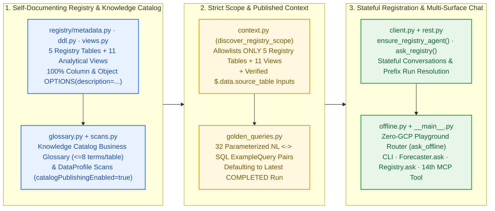

# `src/scale_forecasting/bq_agent/` — Knowledge Catalog & Stateful BigQuery Conversational Analytics Agent

This isolated subpackage turns any `scale-forecasting` BigQuery Registry dataset (`5` registry tables + `11` analytical SQL views + auto-discovered `source_table`s) into a **Knowledge-Catalog-governed, stateful conversational forecasting workbench** powered by Google Cloud's Conversational Analytics API (`geminidataanalytics.googleapis.com/v1`) and **Knowledge Catalog** (`dataplex.googleapis.com/v1`).

---

## Architecture & Single-Responsibility Module Map

---

## File Responsibilities

| File | Responsibility |
| :--- | :--- |
| [`__init__.py`](./__init__.py) | Public subpackage exports (`ensure_registry_agent`, `ask_registry`, `BQAgentRegistration`, `BQAgentResponse`, `BQAgentScope`, `GLOSSARY_TERMS`, `build_golden_queries`). |
| [`context.py`](./context.py) | Strict allowlisted BigQuery scope discovery (`discover_registry_scope` — never sweeps unrelated tables in the dataset), `SchemaRelationship` join graph, domain `systemInstruction` (default-to-latest-run & `snapshot_millis` rules), and `build_published_context`. |
| [`golden_queries.py`](./golden_queries.py) | 32 verified natural-language $\leftrightarrow$ BigQuery Standard SQL `ExampleQuery` templates parameterized to `{project_id}.{dataset_id}` across all 11 analytical views, forward quantile fans, attributions, and realized accuracy. |
| [`glossary.py`](./glossary.py) | 44 canonical forecasting domain terms (`WAPE`, `MASE`, `sMAPE`, `FVA`, `Tracking Signal`, `SBC Regime`, `Staleness Gap`, `Champion Ensemble`, `Conformal Quantiles`, `Reconciled Model`, `Device Verdict`, `Snapshot Millis`, `Comparable Leaderboard`, and more) formatted for `Context.glossaryTerms` and synced to **Knowledge Catalog** (`glossaries`, `terms`, and `@dataplex/entryLinks` capped at $\le 8$ per table). |
| [`scans.py`](./scans.py) | **Knowledge Catalog** `DataScan` (`DATA_PROFILE` & optional `DATA_DOCUMENTATION` with `catalogPublishingEnabled=True`) provisioner and on-demand trigger over scoped physical/Iceberg tables. |
| [`probe.py`](./probe.py) | Non-raising pre-flight readiness probe (`probe_bq_agent_access`, `BQAgentProbeResult`, `Registry.probe_bq_agent()`, `python -m scale_forecasting.bq_agent --probe`) for safe "check-and-run" notebooks and pipelines. |
| [`rest.py`](./rest.py) | Lightweight `AuthorizedSession` JSON HTTP & Long-Running Operation (LRO) helper (`x-goog-user-project` quota billing, zero extra gRPC client dependencies beyond `[gcp]`). |
| [`client.py`](./client.py) | `ensure_registry_agent`, `get_registry_agent`, `delete_registry_agent`, smart `resolve_registry_run_id` (`"latest"`, `"all"`, exact ID, or prefix match), stateful multi-turn `ask_registry`, `BQAgentRegistration`, and `BQAgentResponse` (`.answer`, `.sql`, `.df`, `.chart_spec`, `.conversation_id`). |
| [`offline.py`](./offline.py) | Zero-GCP natural-language router (`ask_offline`, `match_golden_query`) over in-memory `Forecaster` / `PlaygroundRun` / `BakeOff` DataFrames paired with canonical Golden SQL templates. |
| [`__main__.py`](./__main__.py) | CLI entrypoint (`python -m scale_forecasting.bq_agent --ensure-agent --ask "..." --list-golden-queries`). |
