# Opt-In AlphaEvolve & Vertex AI Gemini Evolutionary Harness (`src/scale_forecasting/evolve/`)

While `Forecaster.auto()` (`auto.py` and `auto_policy.py`) ships with **pre-calibrated, zero-license pure-Python evolutionary policies** that execute offline in milliseconds, the `evolve` subpackage provides an **opt-in runtime evolutionary harness** (`Forecaster.evolve()` and `python -m scale_forecasting.evolve`) for organizations that want to synthesize custom causal covariates, out-of-fold ensemble blending rules, custom `BaseModel` plugins, or dataset-specific policy thresholds on their own time-series panels.

Every evolutionary run builds directly on either `Forecaster.auto()` (reusing its `PanelAutoProfile` and cached model bank) **or** any existing manual run / pool of prior runs (`f.evolve()`, `Forecaster.evolve(from_runs=[...])`, or `Forecaster.evolve(from_run_ids=[...])` with **zero base-model re-fitting**), and is governed by an AST security sandbox, a $+10^6$ temporal lookahead perturbation probe, and a **3-Gate Anti-Overfitting Ratchet** that must beat the reigning `#1` single model or built-in `ensemble_*` strategy.

```mermaid
flowchart LR
    input["Time-Series Panel or<br/>Prior Run Pool (from_runs / from_run_ids)"]

    subgraph baseline["1. Baseline &amp; Pool Alignment (evaluator.py)"]
        auto["Forecaster.auto() or verify_oof_pool_compatibility()<br/>Reigning #1 Model / Ensemble Baseline<br/>+ Inner CV vs. Lockdown OOF Split"]
    end

    subgraph transport["2. Dual-Backend Evolution Transport (client.py)"]
        ae["backend='alphaevolve' (Default)<br/>Discovery Engine AlphaEvolve REST API<br/>(:acquirePrograms / :submitProgramsEvaluations)<br/>Requires Gemini Enterprise License"]
        vg["backend='vertex_gemini' (Backup)<br/>Standard Vertex AI Gemini (gemini-3.8-flash)<br/>+ In-Memory IslandPopulationBuffer"]
        mk["backend='mock' (Offline CI/Test)<br/>Deterministic Zero-Network Replay"]
    end

    subgraph sandbox["3. Pre-Gate Security &amp; Causality (sandbox.py)"]
        ast["validate_candidate_ast()<br/>Whitelisted Scientific Imports Only"]
        leak["verify_no_future_leakage()<br/>y[T-H:] += 1e6 Perturbation Probe"]
    end

    subgraph ratchet["4. 3-Gate Anti-Overfitting Ratchet (evaluator.py &amp; runner.py)"]
        g1["Gate 1: Inner Walk-Forward CV Lift<br/>(inner_cv_score &lt; baseline_score)"]
        g2["Gate 2: Diebold-Mariano &amp; Tail Guard<br/>(dm_pvalue &lt;= alpha &amp; worst_decile &gt;= -0.02)"]
        g3["Gate 3: Held-Out Lockdown Fold<br/>(lockdown_candidate &lt; lockdown_baseline)"]
    end

    out["EvolveResult<br/>Promoted Champion Code + predictions_df<br/>or Ratcheted Baseline + Airflow DAG"]

    input --> baseline --> transport --> sandbox --> g1 --> g2 --> g3 --> out
```

---

## Modules in This Subpackage

| File | Role |
| :--- | :--- |
| [`__init__.py`](./__init__.py) | Public subpackage surface re-exporting `EvolveConfig`, `EvolveResult`, `run_evolution`, `verify_oof_pool_compatibility`, client classes, target seeds, and sandbox validators. |
| [`client.py`](./client.py) | Dual-backend evolution transport (`AlphaEvolveClient` for `discoveryengine.googleapis.com/v1alpha` with `probe_alphaevolve_access` raising `ConfigError` when Gemini Enterprise entitlement is absent, `VertexGeminiEvolutionClient` with `IslandPopulationBuffer` on standard Vertex AI `aiplatform.googleapis.com`, and `MockEvolutionClient` for offline tests). |
| [`targets.py`](./targets.py) | Defines `EVOLVE_TARGETS` (`"features"`, `"ensemble"`, `"model"`, `"policy"`), `TargetSpec`, `AutoPolicyWeights`, `extract_evolve_block`, `inject_evolve_block`, `build_mutation_prompt`, and the 4 reference `# EVOLVE-BLOCK` seed implementations (`synthesize_evolved_features`, `compute_evolved_weights` supporting global and per-series adaptive weights, `EvolvedForecaster`, `evolve_policy_weights`). |
| [`sandbox.py`](./sandbox.py) | Static AST security validator (`validate_candidate_ast`), temporal future-leakage perturbation probe (`verify_no_future_leakage`), and bounded wall-clock sandbox executor (`execute_in_sandbox`). |
| [`evaluator.py`](./evaluator.py) | Temporal panel splitter (`split_inner_and_lockdown_panel`), cross-run OOF compatibility verifier and model disambiguator (`verify_oof_pool_compatibility`), and `EvolutionEvaluator` implementing Gate 1 (Inner CV lift over the reigning `#1` model or built-in `ensemble_*`), Gate 2 (Diebold–Mariano significance & worst-decile FVA guard), Gate 3 (Held-Out Lockdown Fold verification), and forward forecast materialization (`materialize_ensemble_predictions`). |
| [`runner.py`](./runner.py) | End-to-end orchestrator (`EvolveConfig`, `EvolveResult` with `predictions_df` and `pool_diagnostics`, `run_evolution`) and Cloud Composer 3 / Airflow DAG generator (`EvolveResult.emit_airflow_dag`). |
| [`__main__.py`](./__main__.py) | CLI entry point (`python -m scale_forecasting.evolve`) supporting `--target`, `--backend`, `--from-run-ids`, `--dataset-id`, `--max-evaluations`, `--dry-run`, `--export-path`, and `--emit-dag`. |
